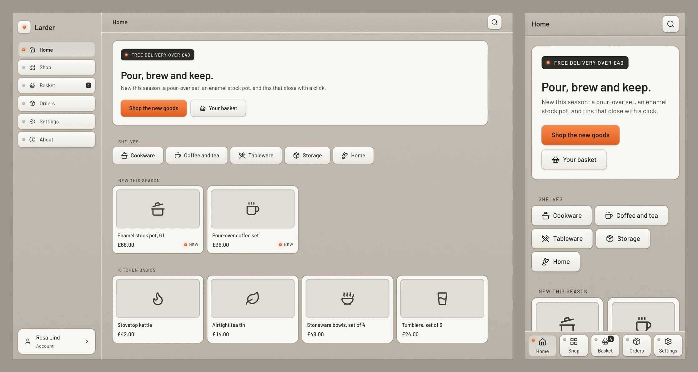

# appliance_ui

Appliance is a Flutter widget library with moulded keys, indicator lamps and recessed displays. It includes forms, navigation, dialogs, pickers and interactive charts in light and dark themes.



**[Live gallery](https://wenkaifan0720.github.io/flutter_design_systems/appliance/)** · [Docs](https://wenkaifan0720.github.io/flutter_design_systems/docs/looks/appliance/) · [API reference](https://pub.dev/documentation/appliance_ui/latest/) · [All the looks](https://wenkaifan0720.github.io/flutter_design_systems/)

## Getting started

Add the packages for the Material example below.

```sh
flutter pub add appliance_ui material_ui
```

Load the bundled Barlow font before calling `runApp`. Place `ApplianceHost` in the application builder so pages and overlays share the same theme. The host also works with `CupertinoApp` and `WidgetsApp`.

```dart
import 'package:appliance_ui/appliance_ui.dart';
import 'package:material_ui/material_ui.dart';

Future<void> main() async {
  WidgetsFlutterBinding.ensureInitialized();
  await applianceLoadFonts();
  runApp(
    MaterialApp(
      theme: ThemeData(
        pageTransitionsTheme: const PageTransitionsTheme(builders: appliancePageTransitions),
      ),
      builder: (context, child) => ApplianceHost(child: child!),
      home: ApplianceScreen(
        topBar: const ApplianceAppBar(title: 'Basket'),
        body: Center(child: ApplianceButton.filled('Checkout', onPressed: () {})),
      ),
    ),
  );
}
```

Under `CupertinoApp` (from `cupertino_ui`) or Flutter's own `WidgetsApp`, the host goes in the same place:

```dart
CupertinoApp(
  builder: (context, child) => ApplianceHost(child: child!),
  home: const HomePage(),
);
```

```dart
WidgetsApp(
  color: const Color(0xFF1F7A5C),
  pageRouteBuilder: <T>(settings, builder) => PageRouteBuilder<T>(
    settings: settings,
    pageBuilder: (context, _, _) => builder(context),
  ),
  builder: (context, child) => ApplianceHost(child: child!),
  home: const HomePage(),
);
```

## Navigation

`ApplianceScaffold` shows a bottom bar below 600 logical pixels, a navigation rail from 600 pixels, and a side panel from 1024 pixels. Pass the current destination in `selectedIndex` and update it in `onSelected`. The bottom bar can use a second row when destination names need more space.


## Everyday parts

Controls take a value and an `onChanged`, and buttons an `onPressed`; leave the callback null to disable one.

```dart
ApplianceTextField(label: 'Postcode', hint: 'e.g. EH3 9DR', controller: postcode);

ApplianceSwitch(
  value: notify,
  onChanged: (value) => setState(() => notify = value),
  semanticLabel: 'Order updates',
);

ApplianceSegmentedButton<String>(
  segments: const [
    ApplianceSegment(value: 'grid', label: 'Grid'),
    ApplianceSegment(value: 'list', label: 'List'),
  ],
  value: view,
  onChanged: (value) => setState(() => view = value),
);

ApplianceListGroup(
  header: 'Account',
  children: [ApplianceListTile(title: 'Name', trailingText: 'Rosa Lind', onTap: () {})],
);

final remove = await showApplianceDialog<bool>(
  context: context,
  builder: (context) => const ApplianceDialog(title: 'Remove this item?'),
);

showApplianceToast(context, 'Added to basket', actionLabel: 'Undo', onAction: () {});

ApplianceBarChart(
  semanticLabel: 'Items by room',
  labels: const ['Kitchen', 'Hall'],
  series: const [ApplianceChartSeries('Items', [14, 6])],
);
```

## Theming

`ApplianceHost` follows the platform brightness. For a custom palette, wrap the app in an `ApplianceTheme` and pass the result of `ApplianceThemeData.from` to its `data` property.

```dart
final theme = ApplianceThemeData.from(
  brightness: Brightness.light,
  finish: const Color(0xFFDDE7E1),
  signal: const Color(0xFF1F7A5C),
);
```

Use `theme.copyWith(texture: false)` for smooth housing. High-contrast mode also removes the grain. Set component defaults on the theme or pass an `ApplianceStyle` to an individual control.

## Accessibility and right to left

Every part follows the app’s text direction: under a right-to-left `Directionality` the navigation, list rows, sliders, steppers and arrows mirror, and the example shop’s settings can switch the direction. Tab moves between controls, arrow keys move between tabs and rail destinations, and Escape dismisses open menus and dialogs. Slider thumbs support keyboard input and screen readers. For values with units, pass `valueText` to `ApplianceSlider` or `semanticFormatterCallback` to `ApplianceRangeSlider`.

## Platforms and localization

Appliance supports Android, iOS, macOS, Windows, Linux and the web. Its menus, dialogs, charts and keyboard navigation use [ui_core](https://pub.dev/packages/ui_core). Register `DesignLocalizations.delegate` with your app’s localization delegates to translate the built-in control labels. Your app supplies its own destination names, button labels and messages.

## Requirements

Flutter 3.47.0 or later (Dart 3.13), on Android, iOS, web, macOS, Windows and Linux.

## License

The package uses the MIT license. Barlow uses the SIL Open Font License 1.1. See THIRD_PARTY_NOTICES for the font and icon licenses.
