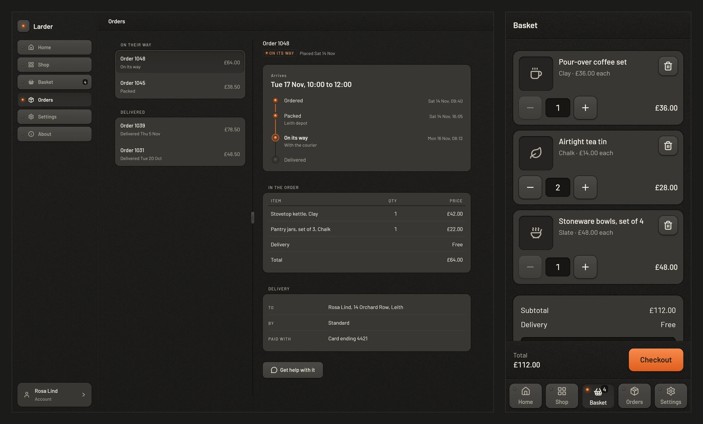

# appliance_ui

Appliance is a Flutter widget library with moulded keys, indicator lamps and recessed displays. It includes forms, navigation, dialogs, pickers and interactive charts in light and dark themes.


**[Docs and demo](https://wenkaifan0720.github.io/flutter_design_systems/docs/looks/appliance/)** · [Try it in Stint](https://wenkaifan0720.github.io/flutter_design_systems/docs/stint/?look=appliance) · [API reference](https://pub.dev/documentation/appliance_ui/latest/) · [All the looks](https://wenkaifan0720.github.io/flutter_design_systems/docs/)

## Getting started

```yaml
dependencies:
  appliance_ui: ^0.6.0
```

The smallest app: `ApplianceHost` in the app's `builder` gives everything under it Appliance's theme, by day and by night as the platform is.

```dart
import 'package:flutter/widgets.dart';
import 'package:appliance_ui/appliance_ui.dart';

void main() => runApp(
  WidgetsApp(
    color: const Color(0xFFEE6A26),
    builder: (context, _) => ApplianceHost(
      child: Center(child: ApplianceButton.filled('Start', onPressed: () {})),
    ),
  ),
);
```

A fuller app on Material (`flutter pub add appliance_ui material_ui`) loads the bundled Barlow font before calling `runApp`, so the first frame is set in it, and places `ApplianceHost` in the application builder so pages and overlays share the same theme. The host also works with `CupertinoApp` and `WidgetsApp`.

```dart
import 'package:appliance_ui/appliance_ui.dart';
import 'package:material_ui/material_ui.dart';

Future<void> main() async {
  WidgetsFlutterBinding.ensureInitialized();
  await applianceLoadFonts();
  runApp(
    MaterialApp(
      theme: ThemeData(
        pageTransitionsTheme: const PageTransitionsTheme(builders: appliancePageTransitions),
      ),
      builder: (context, child) => ApplianceHost(child: child!),
      home: ApplianceScreen(
        topBar: const ApplianceAppBar(title: 'Basket'),
        body: Center(child: ApplianceButton.filled('Checkout', onPressed: () {})),
      ),
    ),
  );
}
```

A `CupertinoApp` (from `cupertino_ui`) or a bare `WidgetsApp` takes the same `builder:`, as the smallest app above shows.

## Navigation

`ApplianceScaffold` shows a bottom bar below 600 logical pixels, a navigation rail from 600 pixels, and a side panel from 1024 pixels. Pass the current destination in `selectedIndex` and update it in `onSelected`. The bottom bar can use a second row when destination names need more space.



## Everyday parts

Controls take a value and an `onChanged`, and buttons an `onPressed`; leave the callback null to disable one. Appliance draws [Lucide](https://lucide.dev) icons: `LucideIcons` comes with `package:appliance_ui/appliance_ui.dart`, with no import of its own.

```dart
import 'package:appliance_ui/appliance_ui.dart';
import 'package:material_ui/material_ui.dart';

class AccountPage extends StatefulWidget {
  const AccountPage({super.key});

  @override
  State<AccountPage> createState() => _AccountPageState();
}

class _AccountPageState extends State<AccountPage> {
  final _postcode = TextEditingController();
  bool _notify = true;
  String _view = 'grid';

  @override
  void dispose() {
    _postcode.dispose();
    super.dispose();
  }

  Future<void> _remove(BuildContext context) async {
    final remove = await showApplianceDialog<bool>(
      context: context,
      builder: (context) => const ApplianceDialog(title: 'Remove this item?'),
    );
    if (remove != true || !context.mounted) return;
    showApplianceToast(context, 'Removed from basket', actionLabel: 'Undo', onAction: () {});
  }

  @override
  Widget build(BuildContext context) => ApplianceScreen(
    topBar: const ApplianceAppBar(title: 'Account'),
    body: Column(
      crossAxisAlignment: CrossAxisAlignment.stretch,
      spacing: 16,
      children: [
        ApplianceTextField(labelText: 'Postcode', hintText: 'e.g. EH3 9DR', controller: _postcode),
        ApplianceSwitch(
          value: _notify,
          onChanged: (value) => setState(() => _notify = value),
          semanticLabel: 'Order updates',
        ),
        ApplianceSegmentedButton<String>(
          segments: const [
            ApplianceSegment(value: 'grid', label: 'Grid'),
            ApplianceSegment(value: 'list', label: 'List'),
          ],
          value: _view,
          onChanged: (value) => setState(() => _view = value),
        ),
        ApplianceListGroup(
          header: 'Account',
          children: [ApplianceListTile(title: 'Name', trailingText: 'Rosa Lind', onTap: () {})],
        ),
        const SizedBox(
          height: 200,
          child: ApplianceBarChart(
            semanticLabel: 'Items by room',
            labels: ['Kitchen', 'Hall'],
            series: [ApplianceChartSeries('Items', [14, 6])],
          ),
        ),
        ApplianceButton('Remove an item', onPressed: () => _remove(context)),
      ],
    ),
  );
}
```

## Forms

`ApplianceForm` is the form: `ApplianceTextFormField`s in it validate, and so does any other control (a select, a date, a radio group) inside ui_core's `RawFormField`, as Flutter's `FormField` takes any control. `ApplianceForm.submit(context)` checks every field, shows each error under its field and moves focus to the first, or saves each field and calls `onSubmit`. In a column, every field takes the column's width.

```dart
import 'package:appliance_ui/appliance_ui.dart';
import 'package:material_ui/material_ui.dart';

class DeliveryPage extends StatefulWidget {
  const DeliveryPage({super.key});

  @override
  State<DeliveryPage> createState() => _DeliveryPageState();
}

class _DeliveryPageState extends State<DeliveryPage> {
  final _dayFocus = FocusNode();
  String _name = '';
  DateTime? _day;

  @override
  void dispose() {
    _dayFocus.dispose();
    super.dispose();
  }

  @override
  Widget build(BuildContext context) => ApplianceForm(
    // Called once every field is fine, after each field's onSaved.
    onSubmit: () => Navigator.of(context).pop((_name, _day)),
    child: ApplianceScreen(
      topBar: ApplianceAppBar(title: 'Delivery', leading: ApplianceAppBar.autoLeading(context)),
      body: Column(
        crossAxisAlignment: CrossAxisAlignment.stretch,
        spacing: 16,
        children: [
          ApplianceTextFormField(
            labelText: 'Name',
            validator: (value) => (value ?? '').trim().isEmpty ? 'Enter a name' : null,
            onSaved: (value) => _name = value!.trim(),
          ),
          // Any other control takes part through ui_core's RawFormField: its
          // error on the control, its focus node on both, so a failed submit
          // can focus it.
          RawFormField<DateTime>(
            focusNode: _dayFocus,
            validator: (value) => value == null ? 'Pick a delivery day' : null,
            onSaved: (value) => _day = value,
            builder: (field) => ApplianceDatePicker(
              labelText: 'Delivery day',
              value: field.value,
              errorText: field.errorText,
              focusNode: _dayFocus,
              firstDate: DateTime.now(),
              lastDate: DateTime.now().add(const Duration(days: 30)),
              onChanged: field.didChange,
            ),
          ),
        ],
      ),
      // Under the form, so submit finds it.
      footer: Builder(
        builder: (context) => ApplianceButton.filled('Save', onPressed: () => ApplianceForm.submit(context)),
      ),
    ),
  );
}
```

A date field with no value shows its hint; one with a day shows it with the year ("Nov 9, 2026" in English), as `ApplianceFormat.date(context, day)` writes it for a page that shows the same day. A field in error lights its edge in the danger colour, focused or not, and its message reads as an error to a screen reader.

## Lists, pages and dialogs

`ApplianceListTile` is one key: a tag or words at its end are part of the row's name, and a control at its end (a switch, a ⋯ key) stays a key of its own, to a press and to a screen reader. `ApplianceScreen` holds its body, its top bar and its footer to one measure (`maxWidth`, 1200 by default), so on a wide window the bar's title and the footer's keys line up with the content under them.

`showApplianceDialog` completes with the answer the dialog pops with. Pass `isAlert: true` for a question that wants an answer: a screen reader hears an alert, and a tap on the scrim leaves it standing while Escape still answers.

```dart
final sure = await showApplianceDialog<bool>(
  context: context,
  isAlert: true,
  builder: (context) => ApplianceDialog(
    title: 'Delete this list?',
    content: const Text('Its items go with it. This cannot be undone.'),
    actions: [
      ApplianceButton('Keep', onPressed: () => Navigator.of(context).pop(false)),
      ApplianceButton.filled('Delete', isDestructiveAction: true, onPressed: () => Navigator.of(context).pop(true)),
    ],
  ),
);
```

## Theming

`ApplianceHost` follows the platform brightness. Appliance comes in six finishes, each by day and by night: `ApplianceThemeData.palettes`, each a `RawNamedPalette` with an `id` to store, a `label` to show and the swatches to draw it by. Hand the chosen one to the host; `ApplianceThemeData.preset(id, brightness)` builds a stored id's theme again.

```dart
import 'package:appliance_ui/appliance_ui.dart';
import 'package:material_ui/material_ui.dart';

class PalettePicker extends StatelessWidget {
  const PalettePicker({super.key, required this.palette, required this.onChanged});

  final RawNamedPalette palette;
  final ValueChanged<RawNamedPalette> onChanged;

  @override
  Widget build(BuildContext context) => ApplianceField(
    labelText: 'Finish',
    mergeSemantics: false,
    child: ApplianceRadioGroup<RawNamedPalette>(
      options: ApplianceThemeData.palettes,
      value: palette,
      labelOf: (p) => p.label,
      // Each palette's colours right beside its name.
      secondaryOf: _Swatches.new,
      onChanged: onChanged,
    ),
  );
}

// A palette's colours in the brightness on screen.
class _Swatches extends StatelessWidget {
  const _Swatches(this.palette);

  final RawNamedPalette palette;

  @override
  Widget build(BuildContext context) {
    final theme = ApplianceTheme.of(context);
    return Row(
      mainAxisSize: MainAxisSize.min,
      children: [
        for (final color in palette.swatchesFor(theme.brightness))
          Container(
            width: 14,
            height: 14,
            margin: const EdgeInsetsDirectional.only(start: 4),
            decoration: BoxDecoration(
              color: color,
              shape: BoxShape.circle,
              border: Border.all(color: theme.colors.hairline),
            ),
          ),
      ],
    );
  }
}
```

```dart
MaterialApp(
  // The stored choice, found again by its id.
  builder: (context, child) => ApplianceHost(
    palette: ApplianceThemeData.palettes.firstWhere((p) => p.id == 'mint'),
    child: child!,
  ),
);
```

For a brand's own colours, pass the result of `ApplianceThemeData.from`: the plastic is moulded toward `finish` at the look's own tones, and `signal` is the main key, the lamps and the focus, its words a tone that reads on the housing and on every faceplate and key.

```dart
final theme = ApplianceThemeData.from(
  brightness: Brightness.light,
  finish: const Color(0xFFDDE7E1),
  signal: const Color(0xFF1F7A5C),
);
```

Use `theme.copyWith(texture: false)` for smooth housing. High-contrast mode also removes the grain. Set component defaults on the theme or pass an `ApplianceStyle` to an individual control.

## Accessibility and right to left

Every part follows the app’s text direction: under a right-to-left `Directionality` the navigation, list rows, sliders, steppers and arrows mirror, and the gallery's settings can switch the direction. Tab moves between controls, arrow keys move between tabs and rail destinations, and Escape dismisses open menus and dialogs. Slider thumbs support keyboard input and screen readers. For values with units, pass `semanticFormatterCallback` to `ApplianceSlider` or `ApplianceRangeSlider`. Controls stand at ui_core's touch floor, 40 by 40, or an app's `RawTapTargetScope`. Below 600 wide the date pickers open their month in a sheet, as Material's open full width on a phone.

## Platforms and localization

Appliance supports Android, iOS, macOS, Windows, Linux and the web. Its menus, dialogs, charts and keyboard navigation use [ui_core](https://pub.dev/packages/ui_core). Register `RawWidgetsLocalizations.delegate` with your app’s localization delegates to translate the built-in control labels. Your app supplies its own destination names, button labels and messages.

## Example

`example/lib/main.dart` is one app to copy: the host by day, by night or as the platform is, the frame with three places, a list with a pushed page, a form that checks itself and takes a date, a dialog answered and settings with the six finishes. `example/lib/gallery.dart` (`flutter run -t lib/gallery.dart`) sets every part on its page, in each finish, by day and by night, and Larder, a fuller shop.

## Requirements

Flutter 3.47.0 or later (Dart 3.13), on Android, iOS, web, macOS, Windows and Linux.

## License

The package uses the MIT license. Barlow uses the SIL Open Font License 1.1. See THIRD_PARTY_NOTICES for the font and icon licenses.
