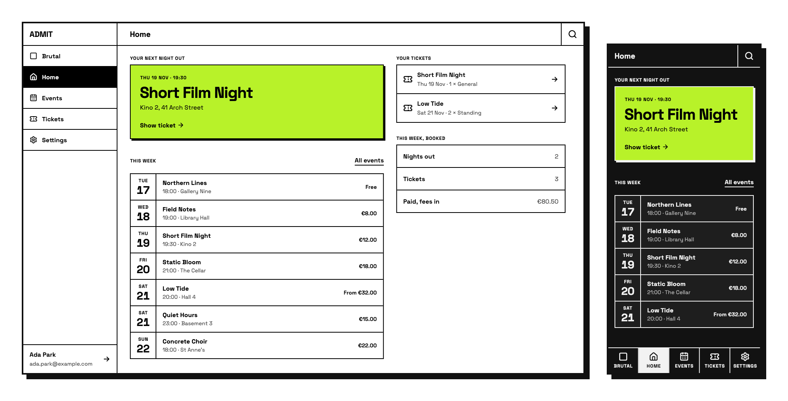

# brutal_ui

A neo-brutalist Flutter design system with square controls, a 4-pixel grid, 2-pixel borders and hard shadows. It includes adaptive navigation, accessible forms, data displays and light and dark themes.



**[Live gallery](https://wenkaifan0720.github.io/flutter_design_systems/brutal/)** · [API reference](https://pub.dev/documentation/brutal_ui/latest/) · [All the looks](https://wenkaifan0720.github.io/flutter_design_systems/)

The gallery includes Admit, a ticketing demo. Try checkout with the saved demo card and any three-digit security code. Bookings, cancellations and account edits last for the current gallery session.

## Install

```sh
flutter pub add brutal_ui material_ui
```

`material_ui` is the material library Brutal is built on; an app takes its `MaterialApp` from it, as Flutter 3.50
deprecates `package:flutter/material.dart` for it.

## Use

Place `BrutalTheme` in the app’s `builder` so routes and overlays inherit the theme. It supports `MaterialApp`, `CupertinoApp` and `WidgetsApp`. Use `brutalPageTransitions` in the Material theme to apply the same transition to pushed routes.

```dart
import 'package:brutal_ui/brutal_ui.dart';
import 'package:material_ui/material_ui.dart';

Future<void> main() async {
  WidgetsFlutterBinding.ensureInitialized();
  await brutalLoadFonts();
  runApp(
    MaterialApp(
      theme: ThemeData(
        pageTransitionsTheme: const PageTransitionsTheme(builders: brutalPageTransitions),
      ),
      builder: (context, child) => BrutalTheme(
        data: BrutalThemeData.light(),
        child: BrutalToaster(child: child!),
      ),
      home: const Center(child: Text('Low Tide, doors at 19:00.')),
    ),
  );
}
```

`brutalLoadFonts()` loads the face before the first frame, so the web never shows a fallback.

For a multi-page app, use `BrutalHost` in the app builder, `BrutalAppShell` for top-level destinations, and `BrutalScreen` for a page’s content, app bar and optional footer.

```dart
BrutalAppShell(
  tabs: const [BrutalTab(LucideIcons.house, 'Home'), BrutalTab(LucideIcons.ticket, 'Tickets')],
  selectedIndex: index,
  onSelected: (i) => setState(() => index = i),
  child: BrutalScreen(
    topBar: const BrutalAppBar(title: 'Tonight'),
    footer: BrutalButton.filled('Buy tickets', onPressed: buy),
    body: const Text('Low Tide, doors at 19:00.'),
  ),
);
```

## Navigation and accessibility

Pushed pages slide 24 logical pixels from the trailing edge and support the native iOS swipe-back gesture. Switching between top-level destinations replaces the page in place. Android system back dismisses the innermost open overlay before leaving the page.

- Tab moves between controls. A tab bar or navigation menu is a single tab stop, with arrow keys to move between destinations. F6 switches focus between navigation and content.
- Tooltips open on focus or hover and close with Escape. Dialogs keep focus inside and restore it to their opener when dismissed. Bottom sheets support drag-to-dismiss.
- Add `DesignLocalizations.delegate` to the app’s localization delegates for shared control labels. A `LocalizationsDelegate<BrutalLocalizations>` can override package-specific text, including table row counts.
- Controls follow platform density. The theme respects the system’s reduced-motion setting.

Date pickers scroll within the space available around their field. Step progress stacks its cells when the names need more room. Line, bar and area charts scale their axes with the reader’s text settings and include the full data series in their screen-reader descriptions.

## Controls

Buttons take `onPressed`, rows take `onTap`, and controlled inputs take `value` and `onChanged`. A null callback disables the control. The selected state uses the theme’s ink fill. Focus uses an additional square outline. Radio buttons are circular so they remain distinct from checkboxes.

## Make it yours

Set the theme’s palette, border width, shadow offset and typography. Supply a component style on `BrutalThemeData` for defaults across your app or use the component’s `style` for a local override.

```dart
// The brand: your signal colour (its words picked black or white at 4.5:1),
// a heavier rule (2 to 4 px) and a deeper shadow (2 to 8 px).
final theme = BrutalThemeData.from(signal: const Color(0xFF2F5BFF)).copyWith(
  borderWidth: 3,
  shadowOffset: 6,
  // Every primary button.
  filledButtonStyle: const BrutalStyle(
    padding: WidgetStatePropertyAll(EdgeInsets.symmetric(horizontal: 28)),
    minimumSize: WidgetStatePropertyAll(Size(0, 56)),
  ),
);

// One button.
BrutalButton.filled(
  'Buy tickets',
  onPressed: buy,
  style: const BrutalStyle(fill: WidgetStatePropertyAll(Color(0xFFFFD23F))),
);
```

Every part takes `style:` and reads its slot in the theme (`BrutalThemeData.chipStyle`, `.dialogStyle` and so on);
each part's documentation says which of the style's fields it reads. `typeface:` sets the face for every part and the
Material theme under them; give the family's cap height so words sit centred in their cells.

A pointer over a part changes nothing but the cursor: hover is a desktop's wash, not Brutal's. The hovered state still
reaches every style, and a value left null falls through to the next layer, so a hover takes one line:

```dart
BrutalStyle(
  fill: WidgetStateProperty.resolveWith(
    (states) => states.contains(WidgetState.hovered) ? const Color(0xFFFFF4C2) : null,
  ),
);
```

In an open list the pointer and the keyboard are one place. A menu (`BrutalMenu`, a menu bar's, a split button's), a
select's list and the combobox's and tag input's options light one row with a square line inside it: the pointer's
move takes the keyboard to its row, and the keys move on from there. A menu opened by a click lights no row until the
pointer moves onto one or a key is pressed (the first Down lights the first row); one opened by Enter, Space or Down
lights its first row. A list opened by a touch lights a row once a mouse or trackpad moves onto one, though the
platform shows no keyboard focus after a touch.

## Licence

The package uses the BSD 3-Clause License. Space Grotesk uses the SIL Open Font License 1.1. Lucide and Feather icons are covered by the notices in `THIRD_PARTY_NOTICES/`.
