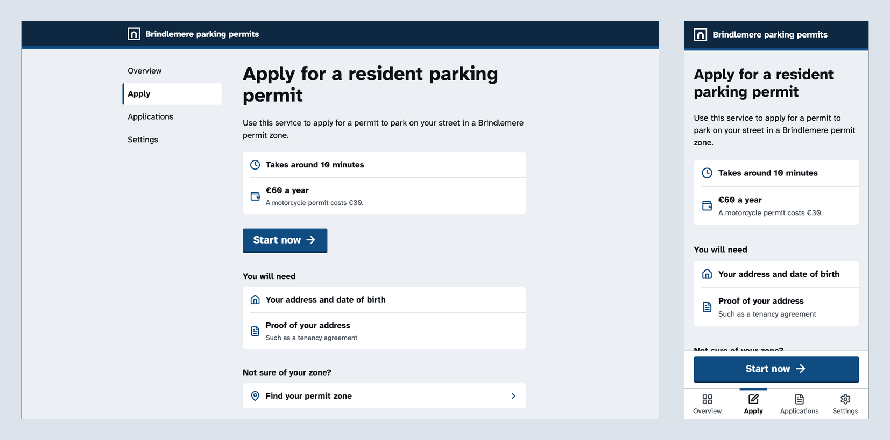

# civic_ui

A Flutter design system for public services: one thing per page, large type, a heavy yellow focus, errors said in
words, answers checked before they are sent.



**[Live gallery](https://wenkaifan0720.github.io/flutter_design_systems/civic/)** ·
[API reference](https://pub.dev/documentation/civic_ui/latest/) ·
[All the looks](https://wenkaifan0720.github.io/flutter_design_systems/)

## Install

```sh
flutter pub add civic_ui material_ui
```

`material_ui` is Flutter's Material as a package, as it is from Flutter 3.50; the quick start's app is a
`MaterialApp`. Civic has no app widget of its own: an app on `WidgetsApp` or `CupertinoApp` needs only `civic_ui` (see
[Set up the theme](#set-up-the-theme)).

## Quick start

Load Civic's faces before the first frame, put `CivicTheme` in your app's `builder:`, and ask the page's one question:

```dart
import 'package:civic_ui/civic_ui.dart';
import 'package:material_ui/material_ui.dart';

Future<void> main() async {
  WidgetsFlutterBinding.ensureInitialized();
  await civicLoadFonts(); // the first frame is set in Civic's faces
  runApp(const App());
}

class App extends StatelessWidget {
  const App({super.key});

  @override
  Widget build(BuildContext context) => MaterialApp(
    theme: ThemeData(
      pageTransitionsTheme: const PageTransitionsTheme(builders: civicPageTransitions),
    ),
    builder: (context, child) => CivicTheme(
      data: MediaQuery.platformBrightnessOf(context) == Brightness.dark
          ? CivicThemeData.dark()
          : CivicThemeData.light(),
      child: CivicToaster(child: child!),
    ),
    home: const VehiclePage(),
  );
}

class VehiclePage extends StatefulWidget {
  const VehiclePage({super.key});

  @override
  State<VehiclePage> createState() => _VehiclePageState();
}

class _VehiclePageState extends State<VehiclePage> {
  String? _vehicle;

  @override
  Widget build(BuildContext context) => CivicScaffold(
    topBar: const CivicTopBar(title: 'Parking permits'),
    body: CivicPageBody(
      backLink: CivicBackLink(onPressed: () => Navigator.of(context).maybePop()),
      caption: 'Step 1 of 3',
      children: [
        CivicRadioGroup<String>(
          labelText: 'What kind of vehicle is the permit for?',
          isPageHeading: true,
          groupValue: _vehicle,
          onChanged: (value) => setState(() => _vehicle = value),
          children: const [
            CivicRadio(value: 'car', labelText: 'Car or van'),
            CivicRadio(
              value: 'motorcycle',
              labelText: 'Motorcycle',
              helperText: 'Includes mopeds and scooters.',
            ),
          ],
        ),
        const SizedBox(height: 40),
        CivicButton(onPressed: () {}, child: const Text('Continue')),
      ],
    ),
  );
}
```

## Components

Civic includes question pages, forms, navigation, sortable tables and an answers summary for public services.
Atkinson Hyperlegible Next is the default typeface. Blue identifies actions, red marks errors, and a yellow
focus indicator shows which control will respond to the keyboard.

On a phone, the primary destinations appear at the bottom. Their labels follow the system text size and can
wrap into another row. From 600 logical pixels wide, the destinations move to a rail. From 1024, the service
can use a sidebar next to the page title.

- Use a question as the page heading and put hints beside the inputs they describe.
- Give the primary button a label that describes its action, such as “Check your answers.”
- Use the answers summary before submission. Each Change link can announce which answer it edits.

## Set up the theme

`CivicTheme` is the whole install. Put it in your app's `builder:`, under a `MaterialApp`, a `CupertinoApp` or a
`WidgetsApp`; Civic has no app widget of its own. Put `CivicToaster` under it to show toasts. On a `MaterialApp`, put
`civicPageTransitions` in its theme too, so every page it pushes changes as Civic's do (nothing travels) on every
platform. On iOS the map keeps the swipe back from the screen's leading edge round Civic's page change, as
`CivicPageRoute` does; an app that builds a map of its own wraps its iOS entry the same way:

```dart
const Map<TargetPlatform, PageTransitionsBuilder> transitions = {
  TargetPlatform.android: CivicPageTransitions(),
  // iOS's swipe back from the screen's edge, round Civic's page change.
  TargetPlatform.iOS: DesignSwipeBackPageTransitionsBuilder(CivicPageTransitions()),
  TargetPlatform.macOS: CivicPageTransitions(),
  // ...
};
```

`designSwipeBack(map)` does the same to a map built at run time.

## Make it yours

Civic keeps what makes it trustworthy: the yellow focus over a thick ink bar, the fields' 2 pt ink edges, large type, and tap
targets of 48 for a finger and 24 for a pointer. Inside that, your service's colours, face and spacing are yours.

Your brand. Each colour is held to 7:1 against the page, darkened by day and lightened by night, its hue kept
(#0A7D4F becomes about #086640 by day and #0FB673 by night):

```dart
CivicTheme(
  data: CivicThemeData.from(
    brightness: Brightness.light,
    action: const Color(0xFF0A7D4F),
    fontFamily: 'Inter', // reaches every part and Flutter's own widgets
  ),
  child: child,
)
```

Every primary button, through its slot in the theme (each part has one, and each kind of button its own):

```dart
CivicThemeData.light().copyWith(
  primaryButtonStyle: const CivicStyle(
    padding: WidgetStatePropertyAll(EdgeInsets.symmetric(horizontal: 40)),
  ),
)
```

One button, through its `style:`, which wins over the theme:

```dart
CivicButton.secondary(
  style: CivicStyle(fill: WidgetStatePropertyAll(context.civicTheme.surface)),
  onPressed: () {},
  child: const Text('Save and come back later'),
)
```

A part's documentation says which slots it reads. Your own part can wear the look with `CivicFace` (a button's face
on its solid edge) and `CivicWell` (a field's box), which bring the focus with them.

## Accessibility

Every part works at 200% text, right to left, with a screen reader and with the keyboard alone. Errors are said in
words twice: in a summary at the top of the page, which takes the focus and links to each field, and at the field,
which stands on the error rule. Targets are 48 points for a finger and 24 for a
pointer at the least. Under Reduce Motion, on any platform that asks for it (iOS's setting included), a colour or
opacity change is a short fade and a dialog is up within 150 ms; Civic's moves are critically damped, so nothing
bounces.

## Languages and right to left

Civic's parts take their own words (Back, Close) from ui_core's localizations, in 30 languages. The words of your
service (Continue, There is a problem, Step 1 of 3, Change) are yours to give, in your reader's language.

A page in Arabic reads right to left in Noto Sans Arabic, and the example service says its counts in the form each
number takes.

## Keyboard navigation

Use the arrow keys to select a tab. In an application shell, F6 moves focus between navigation and page content.
Type in a combobox to filter the options, then press Enter to choose one. A dialog keeps focus inside while open
and restores it on dismissal. Civic uses [ui_core](https://pub.dev/packages/ui_core) for these interactions.

## Licences

Civic's code is MIT. Its faces are under the SIL Open Font License 1.1: Atkinson Hyperlegible Next and Mono (Braille
Institute of America) and Noto Sans Arabic (the Noto Project Authors); see `THIRD_PARTY_NOTICES/`. Its glyphs are
Lucide's (ISC). The patterns of public-service design it follows are widely shared; no code, tokens or assets of any
design system were taken.
