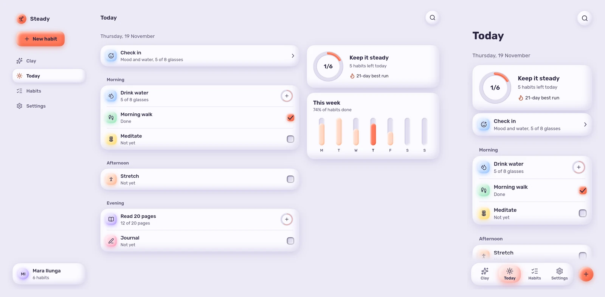

# clay_ui

Clay is a claymorphic Flutter component library: soft, inflated controls of matte clay that float a little above a
pale ground, lit from the top and shaded below, with one coral accent and six pastels. It includes forms, navigation,
lists, dialogs, sheets and toasts, with matching light and dark themes.



**[Live gallery](https://wenkaifan0720.github.io/flutter_design_systems/clay/)** · [API reference](https://pub.dev/documentation/clay_ui/latest/) · [All the looks](https://wenkaifan0720.github.io/flutter_design_systems/)

## Install

```sh
flutter pub add clay_ui material_ui
```

The example uses `MaterialApp` from `material_ui`.

## Quick start

Load the bundled font before `runApp`. Wrap the navigator in `ClayTheme` using your app's `builder` so routes and
overlays share the same colours and typography. Add `ClayToaster` to show toasts.

```dart
import 'package:clay_ui/clay_ui.dart';
import 'package:material_ui/material_ui.dart';

Future<void> main() async {
  WidgetsFlutterBinding.ensureInitialized();
  await clayLoadFonts();
  runApp(
    MaterialApp(
      theme: ThemeData(
        pageTransitionsTheme: const PageTransitionsTheme(
          builders: clayPageTransitions,
        ),
      ),
      builder: (context, child) => ClayTheme(
        data: ClayThemeData.clay(MediaQuery.platformBrightnessOf(context)),
        child: ClayToaster(child: child!),
      ),
      home: const TodayPage(),
    ),
  );
}

class TodayPage extends StatelessWidget {
  const TodayPage({super.key});

  @override
  Widget build(BuildContext context) => ClayScaffold(
    body: Center(
      child: ClayButton.filled('Add habit', onPressed: () {}),
    ),
  );
}
```

`clayPageTransitions` supplies page transitions on each platform, including the iOS swipe-back gesture. You can also
install the theme with the builder of a `CupertinoApp` or `WidgetsApp`.

## Components

- **Forms** include text fields, selects, checkboxes, radios and radio groups, switches, segmented buttons and chips.
- **Navigation** includes a top bar, tabs, a floating dock, a rail and a sidebar. `ClayScaffold` picks one for the
  window width.
- **Display** includes slabs of rows, cards, badges, progress bars and rings.
- **Overlays** include dialogs, sheets and toasts.

The example app, Steady, uses these widgets to track habits, log a day and set reminders.

## Customize the theme

Use `ClayThemeData.clay(Brightness.dark)` for the night palette. Use `ClayThemeData.from(accent: color)` for a brand
colour: the factory picks the accent's readable words and keeps its text and focus colours at AA contrast. Every part
takes a `style:` over its part theme in `ClayThemeData`, and `ClaySurface` with `ClayFace` draws your own parts in the
same clay.

## Performance

Clay's soft shading is drawn from small masks blurred once and cached, then painted as nine-slices: scrolling and
pressing never blur anything anew.

## Platforms

Clay supports Android, iOS, web, macOS, Windows and Linux.

## Accessibility

Text meets WCAG AA contrast on every surface by day and by night. Keyboard focus brings a 2 px rim of the focus colour
up inside a part's own edge. Tab reaches each control; the arrow keys move within tabs and open lists. A radio group,
a segmented button and a one-choice toggle group are one Tab stop, on the choice, whose arrows choose as they move, as
Flutter's `RadioGroup` does. A screen reader hears each checkbox, radio and switch as one, with its state, and never as
a button. Dialogs, sheets, tabs and toasts respect reduced motion.

## Right to left and languages

Controls follow the ambient `Directionality`, and the light falls from the top-leading corner in either direction.
Add `DesignLocalizations.delegate` to your app for localized control labels. Use `clayPlural` for phrases that depend
on a count.

## Licence

The package uses the BSD 3-Clause License. Rubik uses the SIL Open Font License 1.1. Lucide icons use the ISC and MIT
licenses. Full notices are in `THIRD_PARTY_NOTICES/`.
