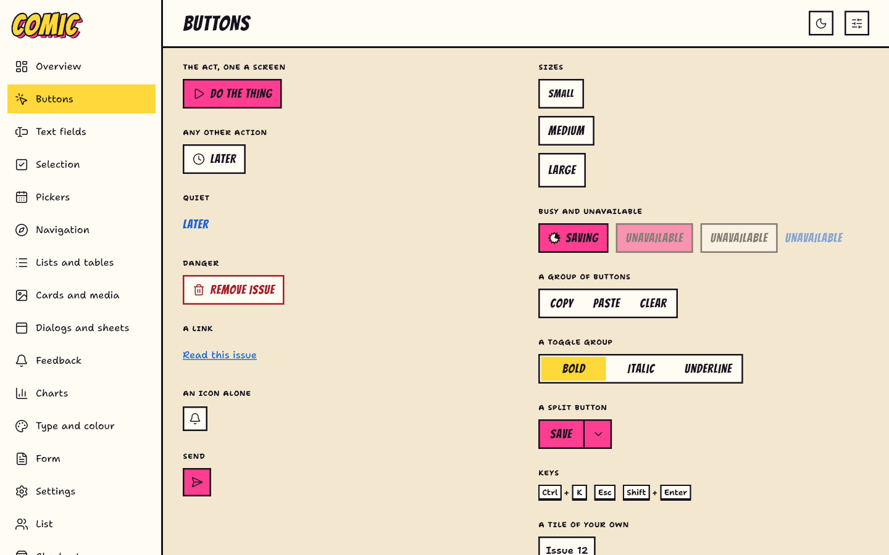
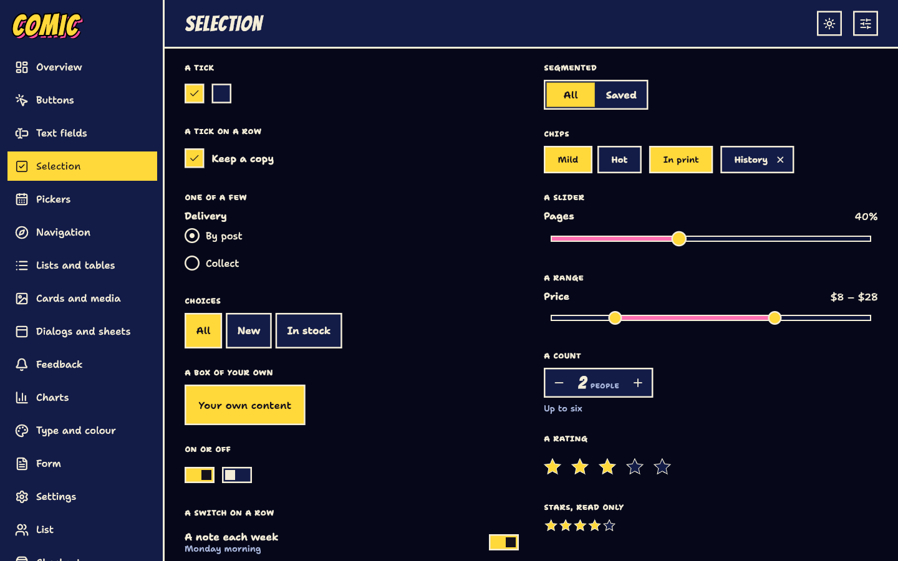
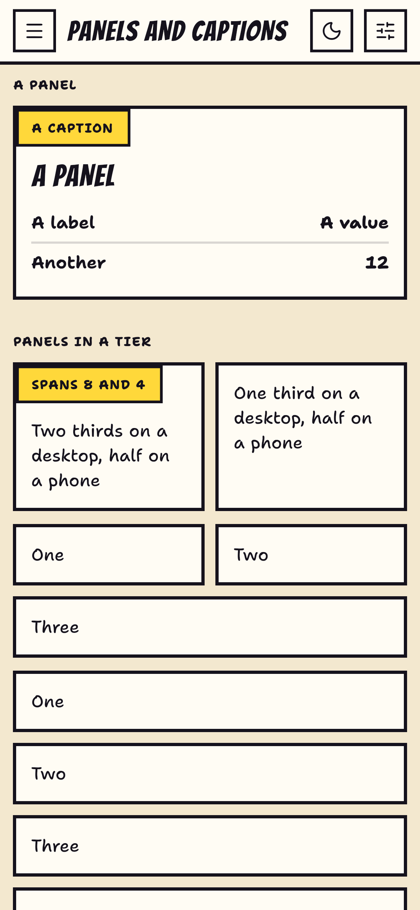
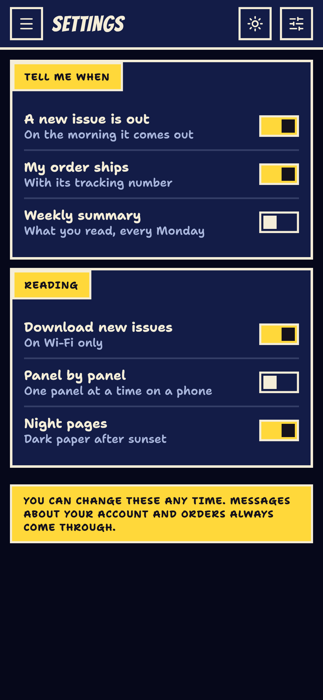
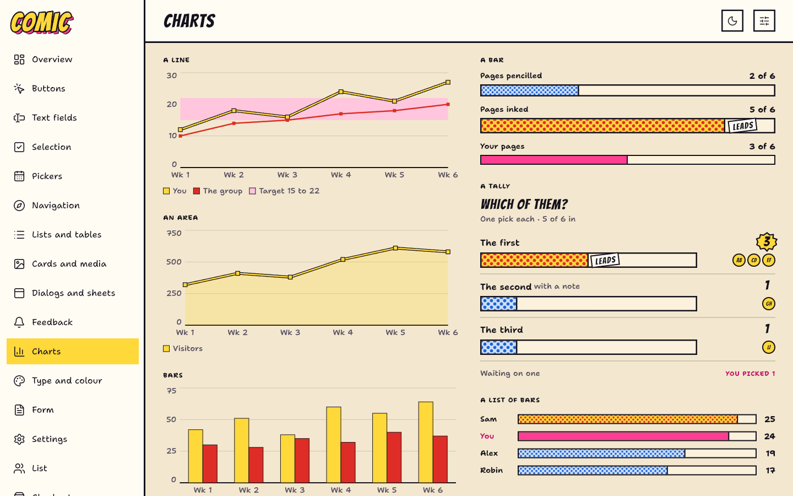

# comic_ui

Comic is a design system for Flutter that draws an app as a page of a printed comic: flat process inks on paper,
heavy inked panels set in tiers, narration captions, speech balloons with tails, Ben-Day dots for tone and one starburst
a screen. Its everyday parts (buttons, fields, selects, lists, dialogs, navigation) are ordinary, accessible controls
in that print, and every change of state moves the way a comic does: a quick cut, a small pop. Five print editions
come in a day and a night issue each.



## Install

```yaml
dependencies:
  comic_ui: ^0.1.0
```

Comic bundles its two typefaces, Bangers for lettering and Shantell Sans for text. Load them before the first frame:

```dart
Future<void> main() async {
  WidgetsFlutterBinding.ensureInitialized();
  await comicLoadFonts();
  runApp(const App());
}
```

## Set up the theme

`ComicTheme` holds a `ComicThemeData` for everything under it. Install it in your app's `builder`, under whichever app
widget you use; your navigator, routes and localizations stay yours.

With `MaterialApp`:

```dart
import 'package:flutter/material.dart';
import 'package:comic_ui/comic_ui.dart';

class App extends StatelessWidget {
  const App({super.key});

  @override
  Widget build(BuildContext context) => MaterialApp(
    builder: (context, child) => ComicTheme(
      data: ComicThemeData.offset(MediaQuery.platformBrightnessOf(context)),
      child: child!,
    ),
    home: const HomePage(),
  );
}
```

With `CupertinoApp`:

```dart
import 'package:flutter/cupertino.dart';
import 'package:comic_ui/comic_ui.dart';

class App extends StatelessWidget {
  const App({super.key});

  @override
  Widget build(BuildContext context) => CupertinoApp(
    builder: (context, child) => ComicTheme(
      data: ComicThemeData.pulp(MediaQuery.platformBrightnessOf(context)),
      child: child!,
    ),
    home: const HomePage(),
  );
}
```

With `WidgetsApp`, for an app with no Material or Cupertino at all:

```dart
import 'package:flutter/widgets.dart';
import 'package:comic_ui/comic_ui.dart';

class App extends StatelessWidget {
  const App({super.key});

  @override
  Widget build(BuildContext context) => WidgetsApp(
    color: const Color(0xff111111),
    builder: (context, _) => ComicTheme(
      data: ComicThemeData.sunday(MediaQuery.platformBrightnessOf(context)),
      child: const HomePage(),
    ),
  );
}
```

A page is a `ComicScaffold`: its top bar, then the page's column on newsprint.

```dart
class HomePage extends StatelessWidget {
  const HomePage({super.key});

  @override
  Widget build(BuildContext context) => ComicScaffold(
    topBar: const ComicAppBar(title: 'This issue'),
    body: ComicSections(
      children: [
        ComicCard(
          title: 'A new story',
          children: [
            const Text('Twelve pages to explore.'),
            ComicButton.filled('Read', onPressed: () {}),
          ],
        ),
      ],
    ),
  );
}
```

## Everyday parts

A button comes in three emphases, as Cupertino names them: `ComicButton.filled` for the screen's one primary action,
`ComicButton` (a square outline in caps) for any other, `ComicButton.text` for quiet words. `isDestructiveAction`
draws any of them in the danger tone.

```dart
Row(
  children: [
    ComicButton.filled('New plan', icon: ComicGlyphs.plus, onPressed: create),
    ComicButton('Share', onPressed: share),
    ComicButton.text('Later', onPressed: close),
    ComicButton('Delete issue', isDestructiveAction: true, onPressed: remove),
  ],
)
```

A text field takes a label, a hint and an error, and reports what is typed:

```dart
ComicTextField(
  label: 'Your name',
  hint: 'As it should be lettered',
  error: name.isEmpty ? 'Tell us who you are' : null,
  onChanged: (text) => setState(() => name = text),
)
```

A select opens its options in a raised menu; the current one carries a check:

```dart
ComicSelect<String>(
  label: 'Format',
  value: format,
  options: const [
    ComicSelectOption('print', 'Print'),
    ComicSelectOption('digital', 'Digital'),
  ],
  onChanged: (value) => setState(() => format = value),
)
```

A list is a section of ruled rows; a row presses, and a switch row turns a setting on and off:

```dart
ComicListSection(
  label: 'Reading',
  children: [
    ComicListTile(title: 'Issue 12', subtitle: 'Twelve pages', onPressed: open),
    ComicSwitchRow(
      label: 'Reminders',
      note: 'The evening before',
      value: reminders,
      onChanged: (value) => setState(() => reminders = value),
    ),
  ],
)
```

A dialog cuts in as a panel on its print. Escape and the back gesture close it, and focus returns where it was:

```dart
showComicDialog<void>(
  context,
  builder: (context) => ComicDialog(
    title: 'Remove this issue?',
    message: 'It leaves your shelf on every device.',
    actions: [
      ComicButton.text('Keep it', onPressed: () => Navigator.pop(context)),
      ComicButton.filled('Remove', isDestructiveAction: true, onPressed: remove),
    ],
  ),
);
```

Navigation is a tab bar at a phone's foot and the masthead's links on a desktop:

```dart
ComicNavigationBar(
  destinations: const [
    ComicNavItem(label: 'Home', short: 'Home', icon: ComicGlyphs.house),
    ComicNavItem(label: 'Alerts', short: 'Alerts', icon: ComicGlyphs.notifications),
    ComicNavItem(label: 'Profile', short: 'Me', icon: ComicGlyphs.person),
  ],
  selectedIndex: tab,
  onDestinationSelected: (index) => setState(() => tab = index),
)
```

A press uses `onPressed`, a control `value` and `onChanged`, and a null callback disables it. Every part with one
focus target takes an optional `focusNode` and `autofocus`; a field takes an optional `controller` and owns one only
when you give none. `ComicDialog`, `ComicBottomSheet`, `ComicMenu`, `ComicTooltip` and `ComicSnackBar` each have a
`showComic...` function.

In 0.1.0 a part's words are a `String` (`label`, `title`) and its icon an `IconData` (`icon`), where Flutter's own
widgets take a `Widget`. A later release adds a `Widget` slot beside each one, with the `String` or `IconData` made
optional, so code written now keeps working.

## Pictures

| | |
| --- | --- |
|  |  |
|  |  |
|  | |

## Editions and colours

Each edition takes `Brightness.dark` for its night issue; `ComicThemeData.preset(id, brightness)` picks one by name.

| Factory | Edition |
| --- | --- |
| `ComicThemeData.offset()` | Process yellow, pink and blue on warm newsprint, a Sunday comic |
| `ComicThemeData.reprint()` | Teal and orange |
| `ComicThemeData.newsstand()` | Green |
| `ComicThemeData.pulp()` | An aged and earthy page |
| `ComicThemeData.sunday()` | A softer page |

Your own colours make a whole edition: Comic derives the readable words, contours, status inks and chart series.

```dart
final branded = ComicThemeData.from(
  primary: const Color(0xff802651),
  caption: const Color(0xffeed36a),
  shade: const Color(0xff276c99),
  background: const Color(0xfff7eadb),
  brightness: Brightness.dark,
);
```

Every part also takes a `style:` (a `ComicStyle` of `WidgetStateProperty` slots: fill, foreground, edge, overlay,
side, shape, padding, minimumSize, textStyle, iconSize), resolved above its component theme in
`ComicThemeData.copyWith`. `AnimatedComicTheme` moves a subtree from one theme to another.

## How Comic is built

Comic keeps seven laws, and every part follows them:

1. Everything is printed on paper in flat process inks. Tone and shade are Ben-Day dots; nothing is blurred, graded
   or see-through.
2. Things are panels: a heavy inked contour, set in tiers with gutters between them. Panels never overlap each other.
   What labels or switches is square; only speech is round.
3. Only the page's top layer breaks a panel's border: balloons, captions, the one burst, and the cast (heads in a crowd
   overlap as figures in a panel do). The order is page, panel, caption or balloon, burst.
4. There is no light source. A raised thing stands on a hard offset print of ink, down and to the end; a pressed thing
   sinks onto it. There are no soft shadows.
5. Speech is a balloon with a tail to whoever says it, narration a caption box, and noise lettered as a sound effect.
   There is one starburst a screen.
6. Motion is drawn: a quick cut, a short pop, motion lines. A part's change of state (pressed, chosen, focused,
   disabled, day to night) moves from where it is to where it is going, and turns from where it is if a new change
   comes mid-way. With reduced motion on, you see the still panel.
7. Night is the night issue: black gutters and cream contours, decided, not inverted.

## Accessibility and languages

- **Screen readers and keyboards.** Every control reports its role, label, value and state (checked, selected,
  expanded, disabled) and leaves its decorative print out. Tab moves in reading order; Enter and Space press, arrows
  move within groups, Escape closes what is raised, and the keyboard's focus is ringed. The gallery's tests hold every
  page to Flutter's tap-target, labelled-target and text-contrast guidelines, by day and by night.
- **Large text.** Parts follow the system's text scaling: words wrap or end with an ellipsis on purpose, controls grow
  taller, and dialogs and sheets scroll. Every gallery page is tested at text scale 2.0.
- **Right to left.** Layouts mirror under a right-to-left `Directionality`: arrows and chevrons turn, fills and
  sliders run from the start side, swipes and carousels follow the reading direction. Parameters say start and end.
- **Other scripts.** Bangers and Shantell Sans cover Latin scripts. Arabic, Hebrew, Chinese, Japanese, Hindi, Thai and
  other scripts fall back to the platform's fonts (on the web, to the Noto fonts the engine fetches; a build made
  with `--no-web-resources-cdn` must bundle its own).
- **Built-in words.** The words parts show or speak by themselves come in two sets, both English when nothing is
  registered. The words every look shares (Close, Cancel, Clear, Back, Previous month, Loading, No results, ...) are
  ui_core's `DesignLocalizations`, under `MaterialLocalizations`' names: translate them by extending
  `DefaultDesignLocalizations` and adding its delegate to your app's `localizationsDelegates`. Comic's own words (a
  stepper's More and Less, the text-editing menu, a file drop's prompts, a rating's "3 of 5", ...) are
  `ComicLocalizations`: a subclass and its delegate replace them. Every part that says something also takes your
  words for it directly.
- **Dates and numbers.** Month and weekday names come from `intl` in your app's locale once you call
  `initializeDateFormatting()`; otherwise they are English. Time pickers follow the platform's 24-hour setting.
  The week starts on Monday unless you pass `firstWeekday`, and counts and money are printed as you pass them; Comic
  does not format numbers by locale.
- **Motion.** With the platform's reduced motion on, every state change switches at once.

## Copying a component

To change a part beyond its style, copy its file from `lib/src/comic/`, rename its public classes, and import the parts
library in place of its sibling imports:

```dart
import 'package:comic_ui/comic_parts.dart';
```

It exports the tokens, painters and layout helpers the parts are built from. The rest of your app stays on
`comic_ui.dart`.

## Example

The example app opens every page of the gallery through Comic's own navigation: Overview, Buttons, Text fields,
Selection, Pickers, Navigation, Lists and tables, Cards and media, Dialogs and sheets, Feedback, Charts, Type and
colour, a form, settings, a list and a checkout, then Comic's own panels, balloons, print and cover. The moon or sun in
its app bar switches day and night, and Customize changes the edition, the colours, the reading direction and
the text scaling on every page.

## Licence

BSD-3-Clause. Bangers and Shantell Sans are under the SIL Open Font License 1.1; Lucide icons under ISC, with Feather
contributions under MIT. See LICENSE.
