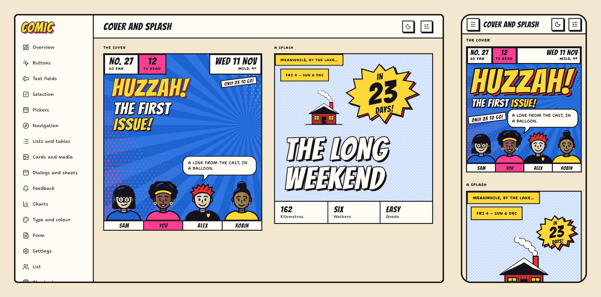
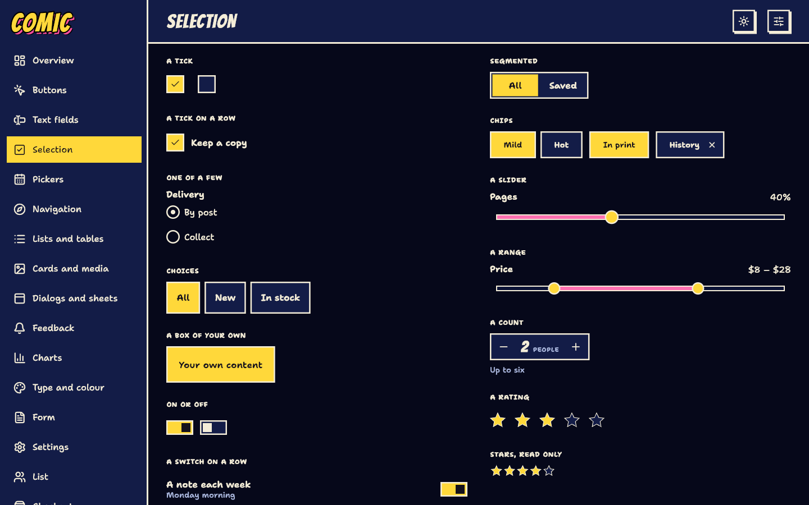
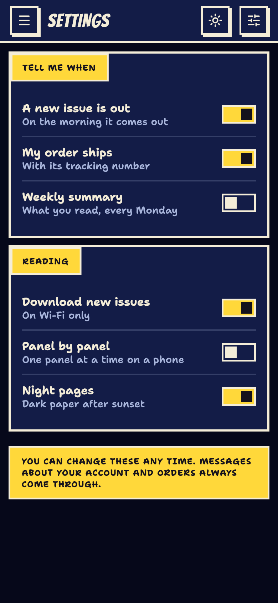

# comic_ui

Comic is a Flutter component library for apps styled as printed comics. It includes form controls, navigation,
charts, speech balloons and illustrated panels. Five colour presets support light and dark mode.



**[Live gallery](https://wenkaifan0720.github.io/flutter_design_systems/comic/)** ·
[API reference](https://pub.dev/documentation/comic_ui/latest/) ·
[All the looks](https://wenkaifan0720.github.io/flutter_design_systems/)

## Install

```sh
flutter pub add comic_ui material_ui
```

`material_ui` is Flutter's Material as a package, as it is from Flutter 3.50; the quick start's app is a
`MaterialApp`. An app on `WidgetsApp` or `CupertinoApp` needs only `comic_ui` (see [Set up the theme](#set-up-the-theme)).

## Quick start

Comic bundles its two typefaces, Bangers for lettering and Shantell Sans for text. Load them before the first frame,
then put `ComicTheme` under your app:

```dart
import 'package:material_ui/material_ui.dart';
import 'package:comic_ui/comic_ui.dart';

Future<void> main() async {
  WidgetsFlutterBinding.ensureInitialized();
  await comicLoadFonts();
  runApp(
    MaterialApp(
      builder: (context, child) => ComicTheme(
        data: ComicThemeData.offset(MediaQuery.platformBrightnessOf(context)),
        child: child!,
      ),
      home: ComicScaffold(
        topBar: const ComicAppBar(title: 'The plan'),
        body: Center(
          child: ComicButton.filled('New plan', onPressed: () {}),
        ),
      ),
    ),
  );
}
```

## Set up the theme

`ComicTheme` holds a `ComicThemeData` for everything under it. Install it in your app's `builder`, under whichever app
widget you use; your navigator, routes and localizations stay yours.

With `MaterialApp`:

```dart
import 'package:material_ui/material_ui.dart';
import 'package:comic_ui/comic_ui.dart';

class App extends StatelessWidget {
  const App({super.key});

  @override
  Widget build(BuildContext context) => MaterialApp(
    builder: (context, child) => ComicTheme(
      data: ComicThemeData.offset(MediaQuery.platformBrightnessOf(context)),
      child: child!,
    ),
    home: const HomePage(),
  );
}
```

A page changes as a comic's panel does: a cut, the next page whole in its first frame. comic_ui stands on
material_ui, and `ComicTheme` gives material_ui's `Theme` the cut, so a `MaterialPageRoute` your app pushes on
material_ui's `MaterialApp` cuts already. On Flutter's own `MaterialApp` (`package:flutter/material.dart`, deprecated
from Flutter 3.50) a `MaterialPageRoute` reads Flutter's `Theme`, which Comic doesn't reach, and flies in unless that
theme carries `comicPageTransitions`: `theme: ThemeData(pageTransitionsTheme: const PageTransitionsTheme(builders:
comicPageTransitions))`. The one map fits both Materials' `PageTransitionsTheme`. On iOS a page still pops with a swipe
from the screen's leading edge, the page following the finger: the map wraps the cut there in ui_core's
`DesignSwipeBackPageTransitionsBuilder`. A map of your own built on `ComicPageTransitionsBuilder` keeps the swipe the
same way, or with `designSwipeBack(map)`.

With `CupertinoApp`:

```dart
import 'package:flutter/cupertino.dart';
import 'package:comic_ui/comic_ui.dart';

class App extends StatelessWidget {
  const App({super.key});

  @override
  Widget build(BuildContext context) => CupertinoApp(
    builder: (context, child) => ComicTheme(
      data: ComicThemeData.pulp(MediaQuery.platformBrightnessOf(context)),
      child: child!,
    ),
    home: const HomePage(),
  );
}
```

With `WidgetsApp`, for an app with no Material or Cupertino at all:

```dart
import 'package:flutter/widgets.dart';
import 'package:comic_ui/comic_ui.dart';

class App extends StatelessWidget {
  const App({super.key});

  @override
  Widget build(BuildContext context) => WidgetsApp(
    color: const Color(0xff111111),
    builder: (context, _) => ComicTheme(
      data: ComicThemeData.sunday(MediaQuery.platformBrightnessOf(context)),
      child: const HomePage(),
    ),
  );
}
```

A page is a `ComicScaffold`: its top bar, then the page's column on newsprint.

```dart
class HomePage extends StatelessWidget {
  const HomePage({super.key});

  @override
  Widget build(BuildContext context) => ComicScaffold(
    topBar: const ComicAppBar(title: 'This issue'),
    body: ComicSections(
      children: [
        ComicCard(
          title: 'A new story',
          children: [
            const Text('Twelve pages to explore.'),
            ComicButton.filled('Read', onPressed: () {}),
          ],
        ),
      ],
    ),
  );
}
```

## Everyday parts

A button comes in three emphases, as Cupertino names them: `ComicButton.filled` for the screen's one primary action,
`ComicButton` (a square outline in caps) for any other, `ComicButton.text` for quiet words. `isDestructiveAction`
draws any of them in the danger tone.

```dart
Row(
  children: [
    ComicButton.filled('New plan', icon: ComicGlyphs.plus, onPressed: create),
    ComicButton('Share', onPressed: share),
    ComicButton.text('Later', onPressed: close),
    ComicButton('Delete issue', isDestructiveAction: true, onPressed: remove),
  ],
)
```

A text field takes a label, a hint and an error, and reports what is typed:

```dart
ComicTextField(
  label: 'Your name',
  hint: 'As it should be lettered',
  error: name.isEmpty ? 'Tell us who you are' : null,
  onChanged: (text) => setState(() => name = text),
)
```

A select opens its options in a raised menu; the current one carries a check:

```dart
ComicSelect<String>(
  label: 'Format',
  value: format,
  options: const [
    ComicSelectOption('print', 'Print'),
    ComicSelectOption('digital', 'Digital'),
  ],
  onChanged: (value) => setState(() => format = value),
)
```

A list is a section of ruled rows; a row presses, and a switch row turns a setting on and off:

```dart
ComicListSection(
  label: 'Reading',
  children: [
    ComicListTile(title: 'Issue 12', subtitle: 'Twelve pages', onPressed: open),
    ComicSwitchRow(
      label: 'Reminders',
      note: 'The evening before',
      value: reminders,
      onChanged: (value) => setState(() => reminders = value),
    ),
  ],
)
```

A dialog pops in as a panel on its print, with a short bounce (a cut under Reduce Motion). Escape and the back
gesture close it, and focus returns where it was:

```dart
showComicDialog<void>(
  context,
  builder: (context) => ComicDialog(
    title: 'Remove this issue?',
    message: 'It leaves your shelf on every device.',
    actions: [
      ComicButton.text('Keep it', onPressed: () => Navigator.pop(context)),
      ComicButton.filled('Remove', isDestructiveAction: true, onPressed: remove),
    ],
  ),
);
```

Navigation is a tab bar at a phone's foot and the masthead's links on a desktop:

```dart
ComicNavigationBar(
  destinations: const [
    ComicNavItem(label: 'Home', short: 'Home', icon: ComicGlyphs.house),
    ComicNavItem(label: 'Alerts', short: 'Alerts', icon: ComicGlyphs.notifications),
    ComicNavItem(label: 'Profile', short: 'Me', icon: ComicGlyphs.person),
  ],
  selectedIndex: tab,
  onDestinationSelected: (index) => setState(() => tab = index),
)
```

A press uses `onPressed`, a control `value` and `onChanged`, and a null callback disables it. Every part with one
focus target takes an optional `focusNode` and `autofocus`; a field takes an optional `controller` and owns one only
when you give none. `ComicDialog`, `ComicBottomSheet`, `ComicMenu`, `ComicTooltip` and `ComicSnackBar` each have a
`showComic...` function.

A part's words are a `String` (`label`, `title`) and its icon an `IconData` (`icon`), where Flutter's own widgets
take a `Widget`.

## Pictures

| | |
| --- | --- |
|  |  |
|  |  |
|  | |

## Editions and colours

Each edition takes `Brightness.dark` for its night issue; `ComicThemeData.preset(id, brightness)` picks one by name.

| Factory | Edition |
| --- | --- |
| `ComicThemeData.offset()` | Process yellow, pink and blue on warm newsprint, a Sunday comic |
| `ComicThemeData.reprint()` | Teal and orange |
| `ComicThemeData.newsstand()` | Green |
| `ComicThemeData.pulp()` | An aged and earthy page |
| `ComicThemeData.sunday()` | A softer page |

Your own colours make a whole edition: Comic derives the readable words, contours, status inks and chart series.

```dart
final branded = ComicThemeData.from(
  primary: const Color(0xff802651),
  caption: const Color(0xffeed36a),
  shade: const Color(0xff276c99),
  background: const Color(0xfff7eadb),
  brightness: Brightness.dark,
);
```

Buttons, fields, choice controls, panels, overlays and avatars accept `ComicStyle`. Each property can depend on
`WidgetState`. A widget's style takes precedence over its component theme in `ComicThemeData`. Supply opaque
colours for fills and overlays. Use `AnimatedComicTheme` to animate a theme change.

To change the default square control corners, pass `shapes: ComicShapes.rounded(12)` to
`ComicThemeData.copyWith`. Nested controls follow their container's corners. Use `ComicTypeface`, `ComicDensity`
and `ComicStrokes` to change type, spacing or outline weight.

Comic uses a plain tint for hover and press, an ink outline for keyboard focus and a solid fill for disabled
controls. Halftone patterns are reserved for illustrations. Speech balloons, narration captions and display
lettering keep a clear background behind the words.

## Accessibility and languages

- **Screen readers and keyboards.** Every control reports its role, label, value and state (checked, selected,
  expanded, disabled) and leaves its decorative print out. Tab moves in reading order; Enter and Space press, arrows
  move within groups, Escape closes what is raised, and the keyboard's focus is ringed. The gallery's tests hold every
  page to Flutter's tap-target, labelled-target and text-contrast guidelines, by day and by night.
- **Large text.** Parts follow the system's text scaling: words wrap or end with an ellipsis on purpose, controls grow
  taller, and dialogs and sheets scroll. Every gallery page is tested at text scale 2.0.
- **Right to left.** Layouts mirror under a right-to-left `Directionality`: arrows and chevrons turn, fills and
  sliders run from the start side, swipes and carousels follow the reading direction. Parameters say start and end.
- **Other scripts.** Bangers and Shantell Sans cover Latin scripts. Arabic, Hebrew, Chinese, Japanese, Hindi, Thai and
  other scripts fall back to the platform's fonts (on the web, to the Noto fonts the engine fetches; a build made
  with `--no-web-resources-cdn` must bundle its own).
- **Control labels.** Extend `DefaultDesignLocalizations` for shared labels such as Close, Cancel and Loading.
  Extend `ComicLocalizations` for Comic-specific labels such as file prompts and ratings. Register your delegates in
  `localizationsDelegates`. Both libraries default to English.
- **Dates and numbers.** Call `initializeDateFormatting()` for localized month and weekday names. Use
  `firstWeekday` to change the Monday start. Time pickers follow the platform's 24-hour setting. Pass
  locale-formatted strings for counts and currency.
- **Motion.** With the platform's reduced motion on, every state change switches at once.

## Copying a component

To customise a component beyond its style, copy its Dart source into your app, rename the widget and import
the shared helpers.

```dart
import 'package:comic_ui/comic_parts.dart';
```

Use `comic_ui.dart` elsewhere in your app. The parts library supports copied components and can change between releases.

## Example

The gallery includes individual controls and complete form, settings, list and checkout screens. Use the app bar
to switch light and dark mode. Open Customize to change the edition, colours, reading direction and text size.

## Licence

BSD-3-Clause. Bangers and Shantell Sans are under the SIL Open Font License 1.1; Lucide icons under ISC, with Feather
contributions under MIT. See LICENSE.
