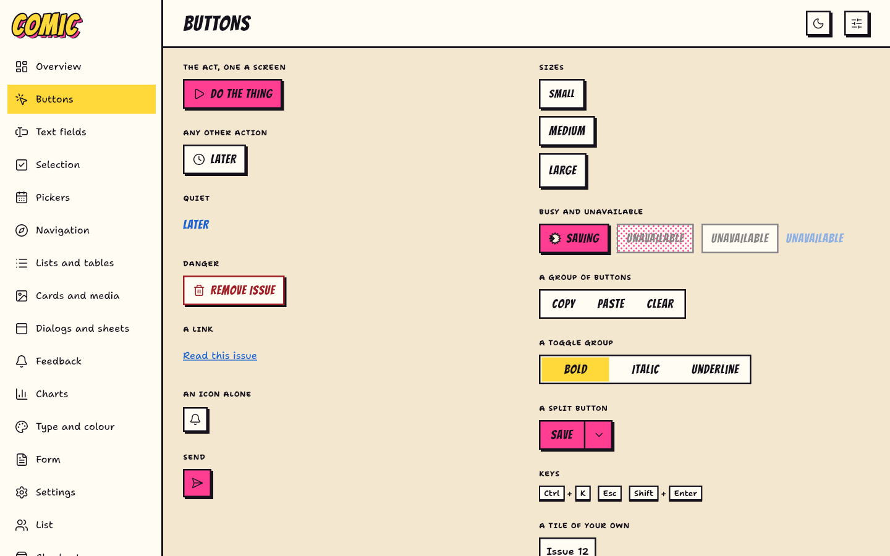
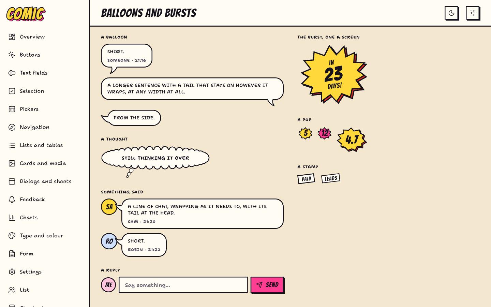
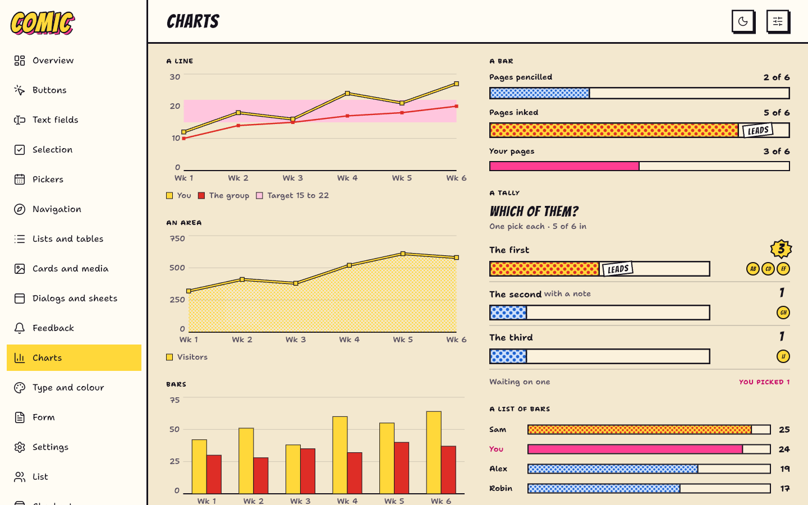

# comic_ui

Comic is a Flutter component library for apps styled as printed comics. It includes form controls, navigation,
charts, speech balloons and illustrated panels. Six palettes, each designed for light and dark.


**[Docs and demo](https://wenkaifan0720.github.io/flutter_design_systems/docs/looks/comic/)** · [Try it in Stint](https://wenkaifan0720.github.io/flutter_design_systems/docs/stint/?look=comic) · [API reference](https://pub.dev/documentation/comic_ui/latest/) · [All the looks](https://wenkaifan0720.github.io/flutter_design_systems/docs/)

## Install

```sh
flutter pub add comic_ui material_ui
```

A whole app: Comic's faces loaded, `ComicHost` over the app, one page and one button.

```dart
import 'package:material_ui/material_ui.dart';
import 'package:comic_ui/comic_ui.dart';

Future<void> main() async {
  WidgetsFlutterBinding.ensureInitialized();
  await comicLoadFonts();
  runApp(MaterialApp(
    builder: (context, child) => ComicHost(child: child!),
    home: ComicScaffold(body: Center(child: ComicButton.filled('Read on', onPressed: () {}))),
  ));
}
```

`material_ui` is Flutter's Material as a package, as it is from Flutter 3.50; import it, not
`package:flutter/material.dart`. `comic_ui.dart` exports none of Flutter's libraries, so a file imports
`material_ui` (or `package:flutter/widgets.dart`) beside it. An app on `CupertinoApp` adds `cupertino_ui`; one on
`WidgetsApp` needs only `comic_ui`. Comic bundles its two typefaces, Bangers for lettering and Shantell Sans for text:
`comicLoadFonts` loads them before the first frame.

## Mount ComicHost

`ComicHost` is the one mount an app needs, in its app's `builder`, above the navigator: Comic's theme by day and by
night, the palette, the page's ground, the text defaults and the app's toaster. Its `brightness` is light, dark, or
null for the platform's setting; its `palette` is one of `ComicThemeData.palettes`. A new appearance or palette
blends: every colour of the page lerps to it. Raise a toast or a snack bar with `showComicToast(context, ...)` or
`showComicSnackBar(context, ...)` from any context under it, a place's page or the root: it stands in the host's
toaster, in the theme it was raised in, stays in sight when the app's place changes, and stands above the shell's tab
bar, a page's footer and the keyboard. Dialogs and sheets need no mount of their own: each rises on the navigator's
overlay. Your navigator, routes and localizations stay yours.

```dart
class HomePage extends StatelessWidget {
  const HomePage({super.key});

  @override
  Widget build(BuildContext context) => ComicScaffold(
    topBar: const ComicAppBar(title: 'This issue'),
    body: ComicButton.filled('Read', onPressed: () {}),
  );
}

class App extends StatefulWidget {
  const App({super.key});

  @override
  State<App> createState() => _AppState();
}

class _AppState extends State<App> {
  // Null follows the platform's light or dark setting.
  Brightness? brightness;
  RawNamedPalette palette = ComicThemeData.palettes.first;

  @override
  Widget build(BuildContext context) => MaterialApp(
    builder: (context, child) => ComicHost(
      brightness: brightness,
      palette: palette,
      child: child!,
    ),
    home: const HomePage(),
  );
}
```

A page changes as a motion comic turns to its next panel: a wipe, the next page drawn whole at full ink and revealed
from the reading start behind a hard ink rule in 160 ms (a cut under Reduce Motion); nothing slides, fades or zooms.
comic_ui stands on material_ui, and `ComicHost` (its `ComicTheme`) gives material_ui's `Theme` the wipe, so a
`MaterialPageRoute` your app pushes on material_ui's `MaterialApp` wipes already. On Flutter's own `MaterialApp` (`package:flutter/material.dart`, deprecated
from Flutter 3.50) a `MaterialPageRoute` reads Flutter's `Theme`, which Comic doesn't reach, and flies in unless that
theme carries `comicPageTransitions`: `theme: ThemeData(pageTransitionsTheme: const PageTransitionsTheme(builders:
comicPageTransitions))`. The one map fits both Materials' `PageTransitionsTheme`. On iOS a page still pops with a swipe
from the screen's leading edge, the wipe following the finger: the map wraps the wipe there in ui_core's
`SwipeBackPageTransitionsBuilder`. A map of your own built on `ComicPageTransitionsBuilder` keeps the swipe the
same way, or with `rawSwipeBack(map)`.

With `CupertinoApp`, or with `WidgetsApp` for an app with no Material or Cupertino at all:

```dart
import 'package:cupertino_ui/cupertino_ui.dart';

CupertinoApp(
  builder: (context, child) => ComicHost(child: child!),
  home: const HomePage(),
);
```

```dart
WidgetsApp(
  color: const Color(0xff111111),
  builder: (context, _) => const ComicHost(child: HomePage()),
);
```

`ComicTheme` alone restyles a part of the tree:
`ComicTheme(data: ComicThemeData.preset('pulp', Brightness.dark), child: ...)`.

## Build an app

The example, `example/lib/main.dart`, is this app in one file to copy: a shelf of books in three places.

**A list and its page.** A page is a `ComicScaffold`: its top bar, then its column on newsprint. A list is a section
of ruled rows; a row pushes its page with Flutter's own route, and the pushed page's bar has its way back (Escape and
the back gesture pop it too). A row's `trailing` status is read with its name and lit with it, a `ComicTag` or a widget
of your own that shows one; a control there keeps its own press. On a desktop the column reads: 880 wide at most, on
the masthead's start, and the page's title, its actions and its footer end where it ends. A form reads better
narrower (`ComicScaffold(maxWidth: 640)`), and a board of panels side by side takes the whole frame
(`maxWidth: double.infinity`).

```dart
class BookPage extends StatelessWidget {
  const BookPage({super.key, required this.title});

  final String title;

  @override
  Widget build(BuildContext context) => ComicScaffold(
    topBar: ComicAppBar(title: title),
    body: const ComicPanel(caption: 'Susanna Clarke', child: Text('Started 2 Oct 2026.')),
  );
}

class BooksPage extends StatelessWidget {
  const BooksPage({super.key});

  @override
  Widget build(BuildContext context) => ComicScaffold(
    topBar: const ComicAppBar(title: 'Books'),
    body: ComicListSection(
      children: [
        for (final (index, title) in ['Piranesi', 'Stoner'].indexed)
          ComicListTile(
            isFirst: index == 0,
            title: title,
            trailing: const ComicTag('To read'),
            onPressed: () => Navigator.of(context).push(
              MaterialPageRoute<void>(builder: (context) => BookPage(title: title)),
            ),
          ),
      ],
    ),
  );
}
```

**A dialog: pop it with the answer.** A dialog pops in as a panel on its print, with a short bounce (a cut under
Reduce Motion). Its buttons pop the route with the answer, which `showComicDialog` returns; Escape, the barrier and the
back gesture return null. Focus goes back where it was. A toast says what happened.

```dart
Future<void> confirmRemove(BuildContext context, String title) async {
  final remove = await showComicDialog<bool>(
    context,
    builder: (context) => ComicDialog(
      title: 'Remove $title?',
      message: 'It leaves your shelf. You can add it again.',
      actions: [
        ComicButton('Keep', onPressed: () => Navigator.of(context).pop(false)),
        ComicButton.filled(
          'Remove',
          isDestructiveAction: true,
          onPressed: () => Navigator.of(context).pop(true),
        ),
      ],
    ),
  );
  if (remove == true && context.mounted) showComicToast(context, 'Removed $title');
}
```

**A form.** `RawForm` (ui_core's, exported with comic_ui) checks every field's `validator` on submit: each error
shows under its field, the first wrong field takes the focus and a screen reader hears how many need attention; after
that the errors follow the typing. A `ComicDateField` raises the calendar.

```dart
class AddBookPage extends StatefulWidget {
  const AddBookPage({super.key});

  @override
  State<AddBookPage> createState() => _AddBookPageState();
}

class _AddBookPageState extends State<AddBookPage> {
  final form = GlobalKey<RawFormState>();
  DateTime? started;

  @override
  Widget build(BuildContext context) => ComicScaffold(
    topBar: const ComicAppBar(title: 'Add a book'),
    body: RawForm(
      key: form,
      onSubmit: () => showComicToast(context, 'Added'),
      child: ComicColumn(
        gap: ComicSpace.wide,
        children: [
          ComicTextField(
            labelText: 'Title',
            validator: (value) => (value ?? '').trim().isEmpty ? 'Enter the title' : null,
          ),
          ComicDateField(
            labelText: 'Started',
            hintText: 'Not yet',
            value: started,
            onChanged: (day) => setState(() => started = day),
          ),
          Align(
            alignment: AlignmentDirectional.centerStart,
            child: ComicButton.filled('Save', onPressed: () => form.currentState!.submit()),
          ),
        ],
      ),
    ),
  );
}
```

A select opens its options in a raised menu, the current one with a check:

```dart
ComicSelect<String>(
  labelText: 'Format',
  value: 'print',
  options: const [
    ComicSelectOption('print', 'Print'),
    ComicSelectOption('digital', 'Digital'),
  ],
  onChanged: (value) {},
);
```

**Settings: the palette picker.** `ComicThemeData.palettes` are the six print runs as ui_core's `RawNamedPalette`: an
`id` to store, a `label` to show, and `swatchesFor(brightness)`, its colours by day or by night. A `ComicRadio`'s
`leading` shows the swatches between its mark and its name. Give the chosen one to `ComicHost(palette: ...)`.

```dart
class SettingsPage extends StatelessWidget {
  const SettingsPage({super.key, this.palette, this.onPalette});

  final RawNamedPalette? palette;
  final ValueChanged<RawNamedPalette>? onPalette;

  @override
  Widget build(BuildContext context) => ComicScaffold(
    topBar: const ComicAppBar(title: 'Settings'),
    body: ComicRadioGroup<RawNamedPalette>(
      labelText: 'Palette',
      options: [
        for (final option in ComicThemeData.palettes)
          ComicRadio(
            option,
            option.label,
            leading: Swatches(option.swatchesFor(ComicTheme.of(context).brightness)),
          ),
      ],
      groupValue: palette,
      onChanged: onPalette,
    ),
  );
}

/// A palette's colours side by side in one square, ruled in the words' ink.
class Swatches extends StatelessWidget {
  const Swatches(this.colors, {super.key});

  final List<Color> colors;

  @override
  Widget build(BuildContext context) => SizedBox.square(
    dimension: 24,
    child: DecoratedBox(
      position: DecorationPosition.foreground,
      decoration: BoxDecoration(
        border: Border.all(color: ComicTheme.of(context).colors.text, width: 2),
      ),
      child: Row(
        crossAxisAlignment: CrossAxisAlignment.stretch,
        // Colours have no reading direction: the stripes stand in one order in every language.
        textDirection: TextDirection.ltr,
        children: [for (final color in colors) Expanded(child: ColoredBox(color: color))],
      ),
    ),
  );
}
```

**The places: `ComicAppShell`.** On a phone the places are the tab bar at the foot; from 600 wide a rail of glyphs down
the start; from 1024 wide the masthead's links, with the app's `brand` at its start. `.branches` keeps a stack for each
place: a pushed page keeps the rail or the masthead while the tab bar steps away, and back pops it. A screen reader hears
the places as tabs.

```dart
class Shelf extends StatefulWidget {
  const Shelf({super.key});

  @override
  State<Shelf> createState() => _ShelfState();
}

class _ShelfState extends State<Shelf> {
  int place = 0;

  @override
  Widget build(BuildContext context) => ComicAppShell.branches(
    brand: 'Shelf',
    destinations: const [
      ComicNavItem(label: 'Books', short: 'Books', icon: ComicGlyphs.book),
      ComicNavItem(label: 'Add a book', short: 'Add', icon: ComicGlyphs.add),
      ComicNavItem(label: 'Settings', short: 'Settings', icon: ComicGlyphs.settings),
    ],
    selectedIndex: place,
    onDestinationSelected: (index) => setState(() => place = index),
    branches: [
      (context) => const BooksPage(),
      (context) => const AddBookPage(),
      (context) => const SettingsPage(),
    ],
  );
}
```

## Building blocks

| For | Comic's |
| --- | --- |
| The app's mount | `ComicHost`; `ComicTheme` for a part of the tree |
| Places | `ComicAppShell`, `ComicNavigationBar`, `ComicNavigationRail`, `ComicNavigationDrawer`, `ComicTabBar` |
| A page | `ComicScaffold`, `ComicAppBar`, `ComicBackButton` |
| Buttons | `ComicButton` (`.filled`, `.text`), `ComicIconButton`, `ComicSplitButton`, `ComicButtonGroup` |
| Text entry | `ComicTextField`, `ComicTextArea`, `ComicPasswordField`, `ComicSearchField`, `ComicNumberField`, `ComicInputOtp` |
| Choices | `ComicSelect`, `ComicCheckbox`, `ComicCheckRow`, `ComicRadioGroup`, `ComicSwitch`, `ComicSwitchRow`, `ComicSegmentedButton`, `ComicChip` |
| Amounts | `ComicSlider`, `ComicRangeSlider`, `ComicRating` |
| Dates and times | `ComicDateField`, `ComicCalendar`, `showComicDatePicker`, `showComicDateRangePicker`, `showComicTimePicker` |
| A form | `RawForm`, `ComicFormField` |
| Lists and tables | `ComicListSection`, `ComicListTile`, `ComicTable`, `ComicDescriptionList`, `ComicSwipeActions` |
| Surfaces | `ComicPanel`, `ComicCard`, `ComicSections`, `ComicDivider` |
| Raised | `showComicDialog` with `ComicDialog`, `showComicBottomSheet`, `showComicActionSheet`, `showComicMenu`, `ComicPopover`, `ComicTooltip`, `ComicHoverCard`, `showComicCommand` |
| Feedback | `showComicToast`, `showComicSnackBar`, `ComicBanner`, `ComicLinearProgressIndicator`, `ComicCircularProgressIndicator`, `ComicSkeleton`, `ComicEmptyState`, `ComicErrorState` |
| Status | `ComicTag`, `ComicBadge`, `ComicMeter` |
| People | `ComicPerson`, `ComicAvatar`, `ComicAvatarGroup` |
| Steps and pages | `ComicStepProgress`, `ComicPagination`, `ComicBreadcrumb`, `ComicPageDots`, `ComicCarouselView` |
| Charts | `ComicLineChart`, `ComicBarChart`, `ComicAreaChart`, `ComicPieChart`, `ComicSparkline` |
| The comic's own | `ComicBalloon`, `ComicThought`, `ComicCaption`, `ComicBurst`, `ComicStamp`, `ComicSfx` |
| Layout | `ComicColumn`, `ComicRow`, `ComicTier`, `ComicFitRow`, `ComicBeside`, `ComicGridOf` |
| Glyphs | `ComicGlyphs` |

A button comes in three emphases, as Cupertino names them: `ComicButton.filled` for the screen's one primary action,
`ComicButton` (a square outline in caps) for any other, `ComicButton.text` for quiet words. `isDestructiveAction`
draws any of them in the danger tone.

A press uses `onPressed`, a control `value` and `onChanged`, and a null callback disables it. Every part with one
focus target takes an optional `focusNode` and `autofocus`; a field takes an optional `controller` and owns one only
when you give none. A part's `label` is the words it draws; `semanticLabel` is a name only a screen reader hears. Its
words are a `String` (`label`, `title`) and its icon an `IconData` (`icon`), where Flutter's own widgets take a
`Widget`.

`ComicGlyphs` names the icons Comic's parts draw, Lucide's, so an app has them with no other package; for the rest of
Lucide, add `lucide_icons_flutter` and pass its `LucideIcons` where a part takes an `IconData`.

Comic letters titles, buttons and tabs in capitals (the parts set Bangers in caps; write the words in plain case), so a
widget test finds them as drawn, `find.text('READ ON')`, or with a finder that ignores case.

## Pictures

| | |
| --- | --- |
|  |  |
|  |  |
|  | |

## Palettes and colours

Six palettes (print runs), each designed for the day and for its night issue (`Brightness.dark`). `ComicThemeData.palettes` lists them for a picker and `ComicHost(palette: ...)` takes one; `ComicThemeData.preset(id, brightness)` and the factories below give one's theme.

| Factory | Palette |
| --- | --- |
| `ComicThemeData.offset()` | Process yellow, pink and blue on warm newsprint, a Sunday comic |
| `ComicThemeData.reprint()` | Teal and orange on seafoam stock, apricot captions |
| `ComicThemeData.newsstand()` | Hot red, cyan and green, white panels on a cool grey rack |
| `ComicThemeData.pulp()` | An aged and earthy page |
| `ComicThemeData.sunday()` | Lilac, mint and butter on a soft blue page |
| `ComicThemeData.cosmic()` | An electric-violet act, a cyan group and acid-lime captions; deep space by night |

Your own colours make a whole edition: Comic derives the readable words, contours, status inks and chart series,
each read on every ground it is painted on. Name the act alone (`ComicThemeData.from(primary: brand)`) and Comic
takes its process yellow for the captions and a group ink that stands apart from your act; by night the grounds take
the group's hue, as its own editions' do, and a dark `background` keeps its hue on light stock by day.

```dart
final branded = ComicThemeData.from(
  primary: const Color(0xff802651),
  caption: const Color(0xffeed36a),
  shade: const Color(0xff276c99),
  background: const Color(0xfff7eadb),
  brightness: Brightness.dark,
);
```

Buttons, fields, choice controls, panels, overlays and avatars accept `ComicStyle`. Each property can depend on
`WidgetState`. A widget's style takes precedence over its component theme in `ComicThemeData`. Supply opaque
colours for fills and overlays. Use `AnimatedComicTheme` to animate a theme change.

Comic is square unless an app rounds it. `shapeScheme` sets the corners, the ink's weight and the print's depth,
each held to Comic's band (a value past one stands at its end, and a debug build says so once). Start from
`comicShapeScheme`, Comic's own: a bare `RawShapeScheme()` brings ui_core's rounded corners.

```dart
final rounder = ComicThemeData(
  shapeScheme: comicShapeScheme.copyWith(
    corners: comicShapeScheme.corners.copyWith(small: 6, medium: 10, large: 14),
    stroke: 3,
  ),
);
```

| Value | Comic's | Band | What it moves |
|---|---|---|---|
| `extraSmall` | 0 | 0 to 8 | Chips, tags, badges, switches, segmented choices, tracks |
| `small` | 0 | 0 to 8 | Buttons and fields |
| `medium` | 0 | 0 to 12 | Cards, menus, snack bars, tooltips |
| `large` | 0 | 0 to 16 | Dialogs and sheets (rounder reads as a balloon, kept for speech) |
| `extraLarge` | 0 | fixed | Not drawn: no panel is larger than a dialog |
| full | a stadium | fixed | A radio, an avatar, a balloon's tail |
| style | round | round only | A bevel, a notch or a stair is another look's |
| `stroke` | 2.5 | 2 to 4 | Every rim, rule and the focus ring, in proportion |
| `depth` | 1 | 0.5 to 1.5 | A control's print (3 at 1), a raised panel's plate (4), the focus lift (2) |
| a part's `corners` | its own | none to large, per corner | One part's corners through its style; full and extra large stand at large |

One part takes corners of its own through its style's `corners`: a step of the scale at each corner, any of none to
large, start and end mirrored right to left. On a rounder scheme, a card rounded at two opposite corners:

```dart
final issue = ComicCard(
  title: 'No. 12',
  style: const ComicStyle(
    corners: WidgetStatePropertyAll(
      RawCorners(
        topStart: RawCorner.large,
        topEnd: RawCorner.none,
        bottomStart: RawCorner.none,
        bottomEnd: RawCorner.large,
      ),
    ),
  ),
  children: const [Text('The lake, at last')],
);
```

A style's `shape` takes any outline as given, outside the bands (`ComicButton('Join', style: ComicStyle(shape: ...))`).
Use `ComicTypeface` and `ComicDensity` to change type or spacing.

Comic uses a plain tint for hover and press, a pop for keyboard focus (the part lifts up and toward the start off a
hard ink print of its outline) and a solid fill for disabled controls. Halftone patterns are reserved for illustrations. Speech balloons, narration captions and display
lettering keep a clear background behind the words.

## Accessibility and languages

- **Screen readers and keyboards.** Every control reports its role, label, value and state (checked, selected,
  expanded, disabled) and leaves its decorative print out. Tab moves in reading order; Enter and Space press, arrows
  move within groups, Escape closes what is raised, and the part the keyboard is on pops off its print. The gallery's tests hold every
  page to Flutter's tap-target, labelled-target and text-contrast guidelines, by day and by night.
- **Tap targets.** Every control takes at least 40 by 40, for a finger and a pointer alike (ui_core's floor); a
  `RawTapTargetScope` above the theme sets an app's own. In a run of chips or links the targets reach into the room
  between the faces, so a run keeps its spacing.
- **Large text.** Parts follow the system's text scaling: words wrap or end with an ellipsis on purpose, controls grow
  taller, and dialogs and sheets scroll. Every gallery page is tested at text scale 2.0.
- **Right to left.** Layouts mirror under a right-to-left `Directionality`: arrows and chevrons turn, fills and
  sliders run from the start side, swipes and carousels follow the reading direction. Parameters say start and end.
- **Other scripts.** Bangers and Shantell Sans cover Latin scripts. Arabic, Hebrew, Chinese, Japanese, Hindi, Thai and
  other scripts fall back to the platform's fonts (on the web, to the Noto fonts the engine fetches; a build made
  with `--no-web-resources-cdn` must bundle its own).
- **Control labels.** Register `RawWidgetsLocalizations.delegate` and `ComicLocalizations.delegate` in
  `localizationsDelegates`. Both support every locale. ui_core says the shared labels (Close, Cancel, Loading, a
  time's hour and minute) in its 30 languages; Comic says its own labels (file prompts, ratings) in English, with the
  words ui_core shares in the app's language. Extend `ComicLocalizations` to say Comic's labels in another language,
  and `DefaultRawWidgetsLocalizations` to change the shared ones.
- **Dates and numbers.** Call `initializeDateFormatting()` for localized month and weekday names. Use
  `firstWeekday` to change the Monday start. Time pickers follow the platform's 24-hour setting. Pass
  locale-formatted strings for counts and currency.
- **Motion.** With the platform's reduced motion on, every state change switches at once.

## Copying a component

To customise a component beyond its style, copy its Dart source into your app, rename the widget and import
the shared helpers.

```dart
import 'package:comic_ui/comic_parts.dart';
```

Use `comic_ui.dart` elsewhere in your app. The parts library supports copied components and can change between releases.

## Example

`example/lib/main.dart` is Shelf, the app [Build an app](#build-an-app) walks through. `flutter run -t lib/gallery.dart`
opens the gallery: every part live on plain pages, light and dark from the app bar, and Customize for the palette, your
own colours, the strokes, the density, the reading direction and the text size.

## Requirements

Flutter 3.47.0 or later (Dart 3.13), on Android, iOS, web, macOS, Windows and Linux. comic_ui 0.8 stands on ui_core 0.8.

## Licence

BSD-3-Clause. Bangers and Shantell Sans are under the SIL Open Font License 1.1; Lucide icons under ISC, with Feather
contributions under MIT. See LICENSE.
