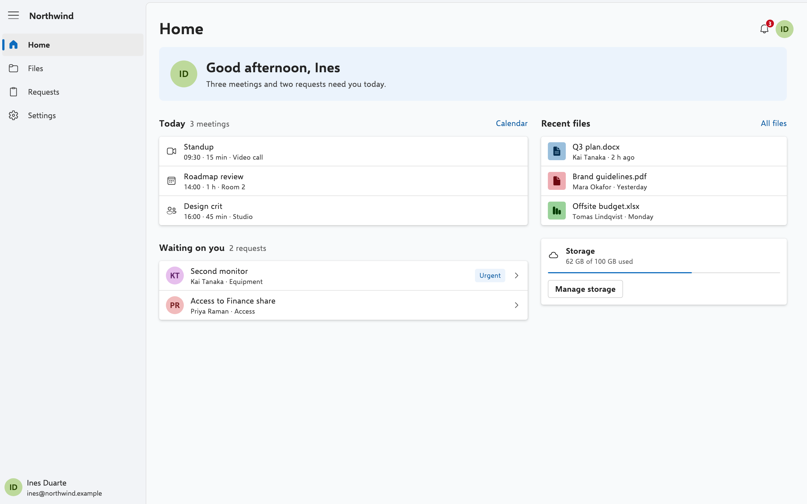
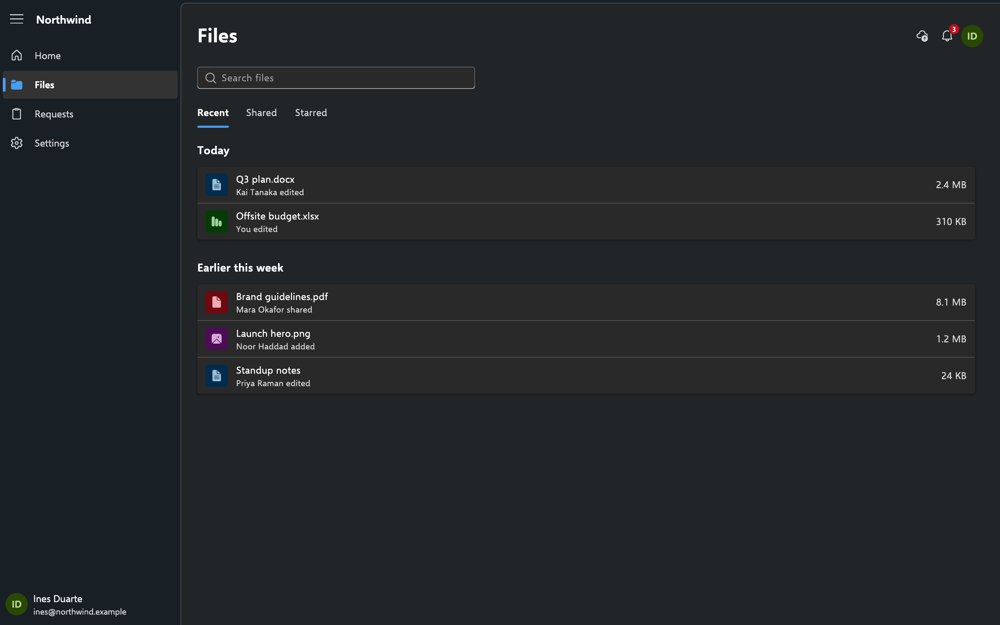
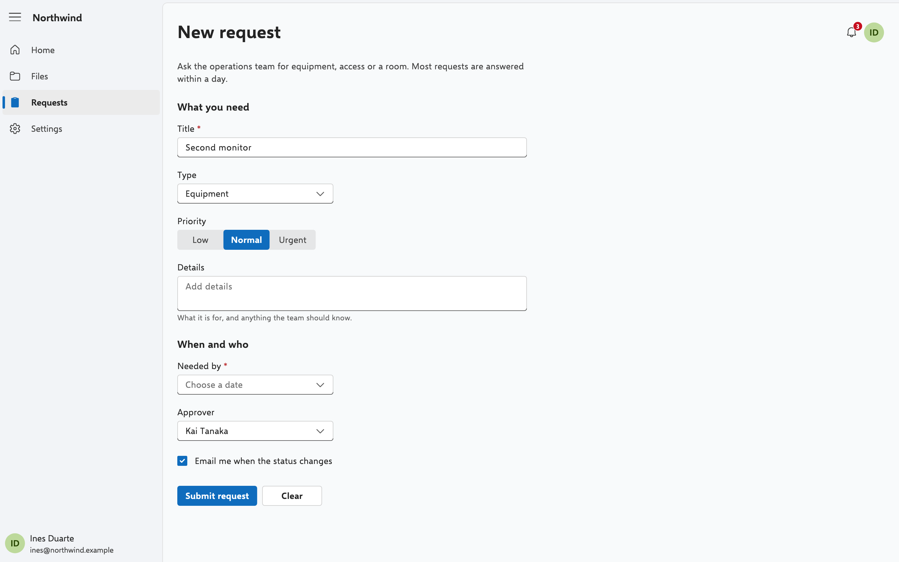
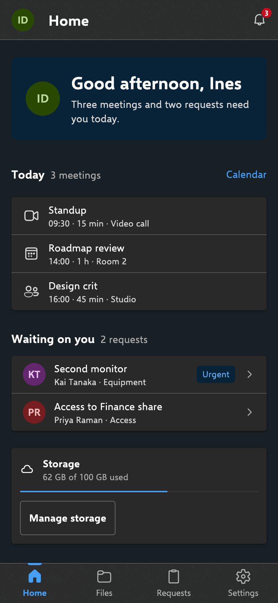
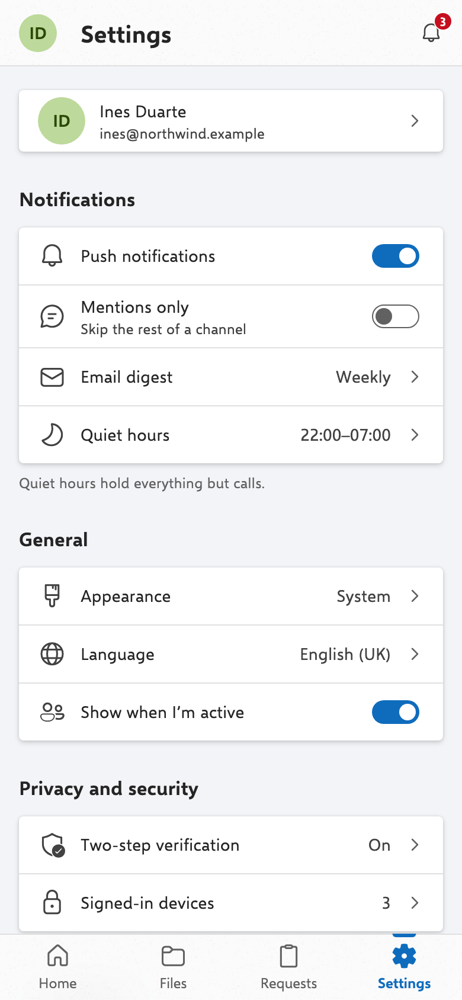
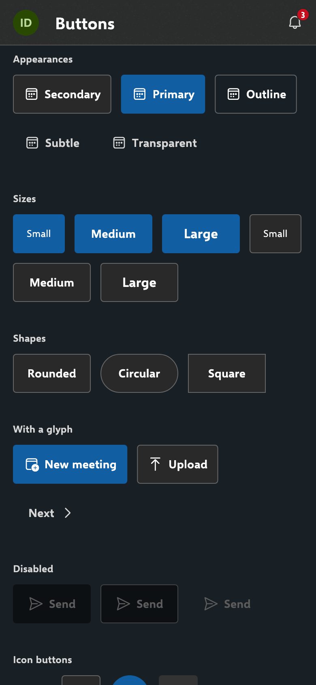

# fluent2_design_ui

An independent Flutter implementation of Fluent 2, not affiliated with or endorsed by Microsoft.

Fluent 2 for Flutter, drawn from Fluent's own published tokens (`@fluentui/tokens` 1.0.0-alpha.24) and the measures in
its React components' styles: calm neutral layers on a faintly brand-tinted ground, acrylic for what floats, dense but
legible rows, forms, toolbars and commands, 4 px corners, subtle strokes, and one brand colour carried as a
sixteen-shade ramp. Every token in the spec is a field of the same name here, and every component reads the token its
Fluent counterpart reads. Seven brand presets, each in light and dark, and accessible controls throughout: focus rings,
screen-reader names, 44 and 48 px touch targets, Reduce Motion.

| | |
|---|---|
|  |  |
|  |  |
|  |  |

## Install

```yaml
dependencies:
  fluent2_design_ui: ^0.1.0
```

Load the bundled faces before `runApp`, so the first frame is set in them:

```dart
Future<void> main() async {
  WidgetsFlutterBinding.ensureInitialized();
  await fluent2LoadFonts();
  runApp(const App());
}
```

## Set up the theme

`Fluent2Theme` is the whole install. Put it in your app's `builder:`, under whichever app widget you use; there is no
app widget of the package's own.

Under a `MaterialApp`:

```dart
import 'package:flutter/material.dart';
import 'package:fluent2_design_ui/fluent2_design_ui.dart';

class App extends StatelessWidget {
  const App({super.key});

  @override
  Widget build(BuildContext context) => MaterialApp(
    builder: (context, child) => Fluent2Theme(
      data: Fluent2ThemeData.lapis(),
      darkData: Fluent2ThemeData.lapis(Brightness.dark),
      child: child!,
    ),
    home: const InboxPage(),
  );
}
```

Under a `CupertinoApp`:

```dart
CupertinoApp(
  builder: (context, child) => Fluent2Theme(
    data: Fluent2ThemeData.iris(MediaQuery.platformBrightnessOf(context)),
    child: child!,
  ),
  home: const InboxPage(),
);
```

Under a bare `WidgetsApp`:

```dart
WidgetsApp(
  color: const Color(0xFF0F6CBD),
  builder: (context, child) => Fluent2Theme(
    data: Fluent2ThemeData.juniper(),
    child: child!,
  ),
  home: const InboxPage(),
);
```

`Fluent2Theme.of(context)` (or `context.fluent2Theme`) returns the theme in scope. Fluent 2 stands on Flutter's widgets
layer and on Material's text field and routes underneath, but nothing of Material shows: no ink, and the field's caret,
selection and handles are Fluent's. No Material or Cupertino type appears in the package's API.

## Everyday parts

A page with a top bar:

```dart
Fluent2Scaffold(
  topBar: const Fluent2AppBar(title: 'Inbox'),
  body: Column(crossAxisAlignment: CrossAxisAlignment.stretch, children: sections),
);
```

Buttons, in Fluent's appearances:

```dart
Fluent2Button(
  'Send',
  appearance: Fluent2ButtonAppearance.primary,
  icon: Fluent2Icons.send,
  onPressed: send,
);
Fluent2Button('Cancel', onPressed: () => Navigator.pop(context));
```

A text field, with a validation message under it:

```dart
Fluent2TextField(
  label: 'Email',
  hint: 'name@example.com',
  onChanged: (value) => setState(() => email = value),
  validationMessage: email.contains('@') ? null : 'Enter an email address',
);
```

A select, Fluent's Dropdown:

```dart
Fluent2Select<String>(
  label: 'Priority',
  options: const [
    Fluent2Option('low', 'Low'),
    Fluent2Option('normal', 'Normal'),
    Fluent2Option('high', 'High'),
  ],
  value: priority,
  onChanged: (value) => setState(() => priority = value),
);
```

A list of items on a card:

```dart
Fluent2ListGroup(
  title: 'Recent files',
  children: [
    Fluent2ListItem(icon: Fluent2Icons.document, title: 'Q3 plan.docx', subtitle: 'Edited 2h ago', onTap: open),
    Fluent2ListItem(icon: Fluent2Icons.folder, title: 'Designs', chevron: true, onTap: browse),
  ],
);
```

A dialog:

```dart
final delete = await showFluent2Dialog<bool>(
  context,
  builder: (context) => Fluent2Dialog(
    title: 'Delete Q3 plan.docx?',
    message: 'It moves to the recycle bin for 30 days.',
    actions: [
      Fluent2Button('Cancel', onPressed: () => Navigator.pop(context, false)),
      Fluent2Button(
        'Delete',
        appearance: Fluent2ButtonAppearance.primary,
        onPressed: () => Navigator.pop(context, true),
      ),
    ],
  ),
);
```

Navigation: a phone's tab bar, and a tab list inside a page:

```dart
Fluent2NavigationBar(
  items: const [
    Fluent2NavItem(Fluent2Icons.home, 'Home'),
    Fluent2NavItem(Fluent2Icons.folder, 'Files'),
    Fluent2NavItem(Fluent2Icons.settings, 'Settings'),
  ],
  selectedIndex: tab,
  onDestinationSelected: (index) => setState(() => tab = index),
);

Fluent2TabList(
  tabs: const ['Activity', 'Files', 'Members'],
  selectedIndex: section,
  onChanged: (index) => setState(() => section = index),
);
```

The names are Fluent's where Fluent names the part (`Fluent2Spinner`, `Fluent2ProgressBar`, `Fluent2MessageBar`,
`Fluent2Toast`, `Fluent2TabList`, `Fluent2SpinButton`, `Fluent2DataGrid`), and the words are Flutter's: a press is
`onPressed`, a control is `value` with `onChanged`, removal is `onDeleted`, and `enabled: false` puts a part out of
use.

## The theme

A `Fluent2ThemeData` holds Fluent's alias tokens by their spec names (`colors.neutralBackground1`,
`colors.brandForeground1`), the shared palette (`sharedColors`), the brand ramp (`brandVariants`), the type ramp
(`body1`, `subtitle2`, `title3`, ...), the acrylic recipe and the shadows. Restyle part of the tree with a nested
`Fluent2Theme`, and animate between themes with `AnimatedFluent2Theme`.

Component themes (`primaryButtonTheme`, `secondaryButtonTheme`, `outlineButtonTheme`, `subtleButtonTheme`,
`transparentButtonTheme`, `iconButtonTheme`, `checkboxTheme`, `radioTheme`, `switchTheme`, `textFieldTheme`,
`tagTheme`, `sliderTheme`, `segmentedButtonTheme`, `tabListTheme`, `cardTheme`, `listItemTheme`, `dialogTheme`,
`bottomSheetTheme`, `menuTheme`, `toastTheme`, `tooltipTheme`, `badgeTheme`, `avatarTheme`) are `Fluent2Style`s; a
null slot resolves to Fluent's own.

```dart
final theme = Fluent2ThemeData.juniper(Brightness.dark);
Fluent2Theme(
  data: theme.copyWith(
    checkboxTheme: Fluent2Style(
      edge: WidgetStateProperty.resolveWith(
        (states) => states.contains(WidgetState.selected) ? null : theme.colors.neutralForeground1,
      ),
    ),
  ),
  child: const SettingsPage(),
);
```

## How Fluent 2 is built

The laws every part here follows. A part Fluent never drew (a timeline, a pull to refresh) is built from these, so
when you add one of your own, build it the same way.

1. **Flat planes in layers.** The app's ground, then content on cards and lists, then what comes and goes (menus,
   popovers, dialogs, sheets). Each layer is a solid or acrylic neutral plane, met by a 1 px hairline, with 4 px corners
   on controls, 8 on cards and 12 or more on large surfaces.
2. **Planes stack; they never pass through each other.** The higher a plane, the larger its shadow: 2 at rest, 4 to 8
   lifted, 16 for menus and a row being dragged, 28 to 64 for dialogs. Things overlap only where one is worn on another:
   a badge or presence dot on an avatar, the faces of a stacked avatar group each ringed in the surface's colour.
3. **Light from above.** A soft key shadow under each plane and an ambient one round it. No inner shadows, no bevels,
   no gradients on controls.
4. **Neutrals carry the page.** The brand marks the one primary act, what is selected, focus and links. Status colours
   mark status only, always with a glyph.
5. **States step one shade at a time.** Hover and press darken (or, in dark, lighten) the fill a step each. A glyph fills
   in under the pointer and while chosen. Focus is the two-tone ring.
6. **Motion is short and has a job.** Things take 100 to 300 ms and enter from where they come from (a drawer from its
   edge, a menu from its anchor), easing out, and they leave faster. Every change of state (hover, press, focus, chosen,
   disabled, error, day to night) eases the whole face from where it stands to where it is going, over Fluent's 100 ms
   easy-ease, and a change mid-way turns without a jump: `Fluent2Eased` is how, for a part of your own. Nothing
   bounces or overshoots; Reduce Motion cuts.
7. **Never:** two primary acts in one view, decoration with no job, a dashed stroke, a control drawn as a raised bump
   or a key cap.

## Make it yours

- **Your own colour**: `Fluent2ThemeData.from(brand: violet, brightness: Brightness.dark)` builds a sixteen-shade ramp
  with your colour at its key step and maps Fluent's brand tokens onto it, moving each token along the ramp until words
  read 4.5:1 and edges 3:1 on every ground they stand on. From Fluent's own blue it gives the `lapis` preset's brand.
- **Density**: `copyWith(density: Fluent2Density.compact)` takes 8 off each control's height and 4 off its padding
  (`comfortable` takes 4 off its height); the 44 and 48 px touch targets stay. A theme is `standard` unless set, on every platform:
  Fluent's measures are its desktop measures, and touch grows targets, not faces.
  `Fluent2Density.adaptivePlatformDensity` is compact on macOS, Windows and Linux, for an app that wants it.
- **Your own face**: `copyWith(typeface: const Fluent2Typeface.app(family: 'Inter'))` sets Fluent's type ramp in a
  family from your app's assets.
- **One component**: the buttons, the check box, radio, switch, tags, the segmented button, cards and list items take
  `style:`, a `Fluent2Style` with the slots of Material's `ButtonStyle`: `fill`, `foreground`, `edge`, `overlay`,
  `side`, `shape`, `padding`, `minimumSize`, `textStyle` and `iconSize`, each a `WidgetStateProperty`. A value comes
  from the widget's `style`, then its component theme, then Fluent's own; each part's docs say which slots it reads.

```dart
Fluent2Button(
  'Send',
  appearance: Fluent2ButtonAppearance.primary,
  onPressed: send,
  style: Fluent2Style(
    shape: WidgetStateProperty.all(const StadiumBorder()),
  ),
);
```

What stays Fluent's whatever you set: the corner and stroke tokens, the two-tone focus ring (a dark and a light
stroke, so it shows on any fill), the acrylic, the shadows' elevations, the touch targets and the motion, which Reduce
Motion turns to cuts.

## Presets

Seven brand ramps, each with a designed light and dark: Fluent's own light and dark for `lapis` (Fluent's web blue,
#0F6CBD) and `iris` (#5B5FC7); the other five are ramps Fluent's theme designer makes from one of Fluent's shared
colours, with its dark mapping.

| Preset | Key colour | Character |
|---|---|---|
| `lapis` | #0F6CBD | the familiar web blue, the default |
| `iris` | #5B5FC7 | indigo |
| `juniper` | #038387 | teal |
| `clover` | #107C10 | green |
| `pumpkin` | #CA5010 | warm orange |
| `berry` | #C239B3 | vivid magenta |
| `flint` | #394146 | graphite, no accent |

Every word on every ground holds 4.5:1 and every control's edge 3:1, in all fourteen themes; where a generated ramp
missed, the word token moves the fewest steps along its own ramp, never a floor loosened.

## Fonts and glyphs

The text face is Selawik, the open, metric-compatible stand-in for Fluent's system face, in its regular, semibold and
bold files. The glyphs are a subset of Fluent UI System Icons (`Fluent2Icons.add`, `.addFilled`, `.chevronDown16`),
drawn at their design sizes, the directional ones mirrored right to left.

## Accessibility and languages

- **Screen readers.** Every control says its role, its name, its value and its state (checked, selected, expanded,
  disabled); decoration is left out. Focus moves in reading order, Fluent's two-tone ring shows where it is, and every
  control works from the keyboard. Every interactive part takes an optional `focusNode` and `autofocus`.
- **Targets and contrast.** Controls stand in 44 px targets on iOS and 48 px on Android. Words hold 4.5:1 and control
  edges 3:1 in all fourteen themes. The package's tests check Flutter's four accessibility guidelines on every gallery
  page, by day and by night.
- **Large text.** Parts follow the reader's text size up to twice the default (`Fluent2Host.maxTextScale`, the 200%
  WCAG asks for): rows and controls grow taller, and long words wrap or end in an ellipsis.
- **Right to left.** Under a right-to-left `Directionality` every part mirrors: rows, a field's glyphs, tabs,
  segments, sliders, progress and swipe actions run from the reading start, and the glyphs that point flip. Parameters
  say start and end and take the directional geometry types. The gallery has a direction switch.
- **Motion.** Reduce Motion (`MediaQuery.disableAnimations`) turns every change of state into a cut.
- **Other scripts.** Selawik draws the Latin alphabet. Arabic, Hebrew, Chinese, Japanese, Hindi, Thai and other
  scripts fall back to the platform's fonts (on the web, to the Noto fonts Flutter fetches).
- **Words the parts say.** No part writes a word in English by itself. The words every look shares (Cancel, OK,
  Close, Back, Search, Clear, Today, Next month, Loading, No results, "Slide 2 of 5") come from ui_core's
  `DesignLocalizations`, under `MaterialLocalizations`' names; the words only Fluent 2 says (Try again, Send, Choose a
  date, "Page 3 of 10") come from `Fluent2Localizations`. English ships for both, with nothing to set up. For another
  language, extend `DefaultDesignLocalizations` (from `package:ui_core`) and `Fluent2LocalizationsEn`, override the
  words you translate, and add a delegate for each to `localizationsDelegates`.
- **Known limits.** `Fluent2Format` writes dates, times, counts and sizes in fixed US English shapes and does not follow
  the locale; so do the date picker's month names and dates. The week strip starts on Monday unless told otherwise.
  The time picker follows the platform's 24-hour setting. Locale-aware formats are planned.

## Example

`example/` is the gallery: every component on its page, in every preset, light and dark, with a sample app's screens.

## Feedback

This is 0.1.0, the first release: issues and suggestions are welcome on the repository.

## Licences

The package is BSD-3-Clause. It is drawn from Fluent's tokens and component styles under the MIT License:

> @fluentui/tokens, @fluentui/react-components. Copyright (c) Microsoft Corporation. All rights reserved. MIT License.
> Permission is hereby granted, free of charge, to any person obtaining a copy of this software and associated
> documentation files (the "Software"), to deal in the Software without restriction, including without limitation the
> rights to use, copy, modify, merge, publish, distribute, sublicense, and/or sell copies of the Software, and to
> permit persons to whom the Software is furnished to do so, subject to the following conditions: The above copyright
> notice and this permission notice shall be included in all copies or substantial portions of the Software. THE
> SOFTWARE IS PROVIDED "AS IS", WITHOUT WARRANTY OF ANY KIND, EXPRESS OR IMPLIED, INCLUDING BUT NOT LIMITED TO THE
> WARRANTIES OF MERCHANTABILITY, FITNESS FOR A PARTICULAR PURPOSE AND NONINFRINGEMENT. IN NO EVENT SHALL THE AUTHORS OR
> COPYRIGHT HOLDERS BE LIABLE FOR ANY CLAIM, DAMAGES OR OTHER LIABILITY, WHETHER IN AN ACTION OF CONTRACT, TORT OR
> OTHERWISE, ARISING FROM, OUT OF OR IN CONNECTION WITH THE SOFTWARE OR THE USE OR OTHER DEALINGS IN THE SOFTWARE.

It bundles Selawik under the SIL Open Font License 1.1 and a subset of Fluent UI System Icons under the MIT License.
The full texts are in `LICENSE` and `THIRD_PARTY_NOTICES/`. Fluent and the names of Microsoft products are trademarks of
Microsoft Corporation; this package uses the name only to say which design system it implements.
