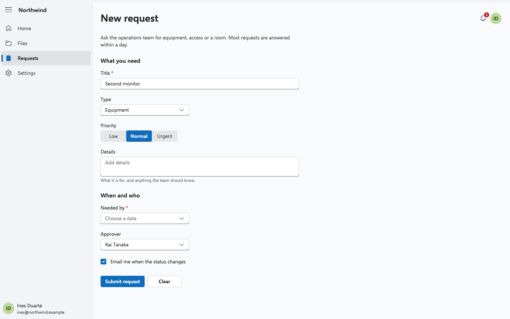
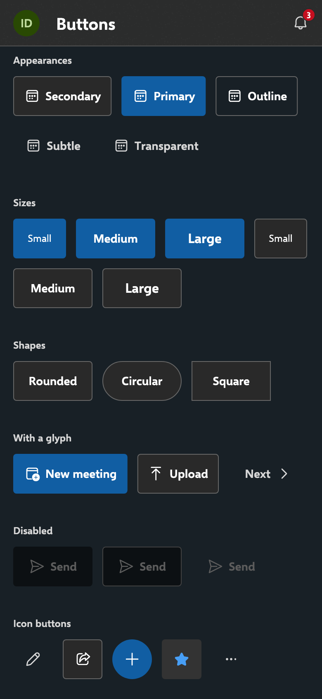

# fluent2_design_ui

Fluent 2 widgets and themes for Flutter: an app shell, forms, lists, menus, data grids, charts and dialogs, with acrylic surfaces and Fluent's icons. Six palettes, each with a light and a dark appearance. This is an independent implementation of Microsoft's Fluent 2 design system.


**[Docs and demo](https://wenkaifan0720.github.io/flutter_design_systems/docs/looks/fluent2/)** · [Try it in Stint](https://wenkaifan0720.github.io/flutter_design_systems/docs/stint/?look=fluent2) · [API reference](https://pub.dev/documentation/fluent2_design_ui/latest/) · [All the looks](https://wenkaifan0720.github.io/flutter_design_systems/docs/)

## Install

```sh
flutter pub add fluent2_design_ui material_ui
```

Every snippet on this page compiles after that line. Each file imports the look and the Material it is built on:

- `package:fluent2_design_ui/fluent2_design_ui.dart` holds every part, `Fluent2Host` and `Fluent2Icons` included, and ui_core's `Raw*` parts.
- `package:material_ui/material_ui.dart` brings `MaterialApp` and Flutter's widgets, which `fluent2_design_ui.dart` doesn't export. Import it rather than `package:flutter/material.dart`, which Flutter deprecates after 3.47.

A first app:

```dart
import 'package:fluent2_design_ui/fluent2_design_ui.dart';
import 'package:material_ui/material_ui.dart';

void main() => runApp(
  MaterialApp(
    builder: (context, child) => Fluent2Host(child: child!),
    home: const Fluent2Scaffold(
      topBar: Fluent2AppBar(title: 'Books'),
      body: Fluent2ListItem(title: 'Middlemarch', subtitle: 'George Eliot'),
    ),
  ),
);
```

## Mount the host

`Fluent2Host`, in the app's `builder`, is the one mount: it builds the palette's light and dark themes, follows the platform's appearance unless you pin one, eases a change of palette or appearance, holds the toasts, sets Fluent's tap targets and caps the text scale at 200%. Load the bundled Selawik faces and Fluent's icons before `runApp` so the first frame is drawn in them.

```dart
import 'package:fluent2_design_ui/fluent2_design_ui.dart';
import 'package:material_ui/material_ui.dart';

Future<void> main() async {
  WidgetsFlutterBinding.ensureInitialized();
  await fluent2LoadFonts(); // the bundled faces and icons, before the first frame
  runApp(const App());
}

class App extends StatelessWidget {
  const App({super.key});

  @override
  Widget build(BuildContext context) => MaterialApp(
    title: 'Shelf',
    // Fluent's push and pop for the pages the app pushes.
    theme: ThemeData(pageTransitionsTheme: const PageTransitionsTheme(builders: fluent2PageTransitions)),
    // brightness: null follows the platform; Brightness.light or Brightness.dark pins it.
    // palette: one of the six, lapis by default.
    builder: (context, child) => Fluent2Host(
      palette: Fluent2ThemeData.palettes.first,
      brightness: null,
      child: child!,
    ),
    home: const Fluent2Scaffold(
      topBar: Fluent2AppBar(title: 'Books'),
      body: Fluent2EmptyState(icon: Fluent2Icons.book, title: 'Nothing here yet'),
    ),
  );
}
```

A `CupertinoApp` (from `cupertino_ui`) or a bare `WidgetsApp` takes the same `builder:`. `Fluent2Host(light:, dark:)` takes themes of your own instead of a palette. To theme one subtree, wrap it in `Fluent2Theme(data: …)`; `AnimatedFluent2Theme` eases between two. Read the theme with `context.fluent2Theme`.

## Build an app

The example app, `example/lib/main.dart`, is all of this in one file: a reading list with three places, a list with a pushed page, a form, a dialog and settings. Copy it and grow it.

### The shell

`Fluent2AppShell` is the app's frame: its places in a tab bar along a phone's foot, in the navigation pane's rail from 640 wide and in the pane from 1024. With `branches`, each place keeps its own stack of pages: a page pushed in a place keeps the rail or the pane beside it while a phone's tab bar steps away, and back pops it. Toasts keep clear of the tab bar. A `Fluent2ShellAction` is the app's one act: a floating button over a phone's first page, the rail's head, the pane's button.

```dart
import 'package:fluent2_design_ui/fluent2_design_ui.dart';
import 'package:material_ui/material_ui.dart';

class Home extends StatefulWidget {
  const Home({super.key});

  @override
  State<Home> createState() => _HomeState();
}

class _HomeState extends State<Home> {
  int _place = 0;

  @override
  Widget build(BuildContext context) => Fluent2AppShell.branches(
    header: Text('Shelf', style: context.fluent2Theme.subtitle2),
    destinations: const [
      Fluent2NavItem(Fluent2Icons.book, 'Books'),
      Fluent2NavItem(Fluent2Icons.bookmark, 'Reading'),
      Fluent2NavItem(Fluent2Icons.settings, 'Settings'),
    ],
    selectedIndex: _place,
    onDestinationSelected: (index) => setState(() => _place = index),
    action: Fluent2ShellAction(
      icon: Fluent2Icons.add,
      label: 'Add a book',
      onPressed: (context) {},
    ),
    branches: [
      (context) => const Fluent2Scaffold(topBar: Fluent2AppBar(title: 'Books'), body: SizedBox()),
      (context) => const Fluent2Scaffold(topBar: Fluent2AppBar(title: 'Reading'), body: SizedBox()),
      (context) => const Fluent2Scaffold(topBar: Fluent2AppBar(title: 'Settings'), body: SizedBox()),
    ],
  );
}
```

### A list, and its page

A page is a `Fluent2Scaffold`: its bar, its body and a footer for its acts. A row pushes its record's page in the same place; the pushed page's bar names where back goes (`backLabel`). A row's status is a `Fluent2LabelBadge`, read as part of the row's name.

```dart
import 'package:fluent2_design_ui/fluent2_design_ui.dart';
import 'package:material_ui/material_ui.dart';

class Book {
  const Book(this.title, this.author, {this.reading = false});

  final String title;
  final String author;
  final bool reading;
}

class BooksPage extends StatelessWidget {
  const BooksPage({super.key, required this.books});

  final List<Book> books;

  @override
  Widget build(BuildContext context) => Fluent2Scaffold(
    topBar: const Fluent2AppBar(title: 'Books'),
    body: Fluent2ListGroup(
      children: [
        for (final book in books)
          Fluent2ListItem(
            title: book.title,
            subtitle: book.author,
            trailing: book.reading
                ? const Fluent2LabelBadge(
                    label: 'Reading',
                    appearance: Fluent2BadgeAppearance.tint,
                  )
                : null,
            chevron: true,
            onTap: () => Navigator.of(context).push(
              MaterialPageRoute<void>(builder: (context) => BookPage(book: book)),
            ),
          ),
      ],
    ),
  );
}

class BookPage extends StatelessWidget {
  const BookPage({super.key, required this.book});

  final Book book;

  @override
  Widget build(BuildContext context) => Fluent2Scaffold(
    topBar: Fluent2AppBar(title: book.title, backLabel: 'Books'),
    body: Fluent2DescriptionList(
      properties: [
        Fluent2DescriptionItem('Author', book.author, icon: Fluent2Icons.person),
        Fluent2DescriptionItem('Status', book.reading ? 'Reading' : 'Want to read', icon: Fluent2Icons.circle),
      ],
    ),
    footer: Row(
      mainAxisAlignment: MainAxisAlignment.end,
      children: [
        Fluent2Button('Start reading', appearance: Fluent2ButtonAppearance.primary, onPressed: () {}),
      ],
    ),
  );
}
```

### Forms

`Fluent2Form` is the form: `Fluent2TextFormField`s in it validate, and `Fluent2Form.submit(context)` checks every field, shows each error under its field and moves focus to the first, or saves each field and calls `onSubmit`. A `Fluent2FormSection` is the form's column on a 560 measure, its fields 16 apart; in a form a select, a combobox and a date field take the column's width, as a text field does. Wrap a control that brings no label of its own in a `Fluent2FormField`.

```dart
import 'package:fluent2_design_ui/fluent2_design_ui.dart';
import 'package:material_ui/material_ui.dart';

class NewBookPage extends StatefulWidget {
  const NewBookPage({super.key});

  @override
  State<NewBookPage> createState() => _NewBookPageState();
}

class _NewBookPageState extends State<NewBookPage> {
  String _title = '';
  String _shelf = 'wanted';
  DateTime? _started;
  bool _favourite = false;

  @override
  Widget build(BuildContext context) => Fluent2Form(
    // Called once every field is fine, after each field's onSaved.
    onSubmit: () => Navigator.of(context).pop(_title),
    child: Fluent2Scaffold(
      topBar: const Fluent2AppBar(title: 'New book', backLabel: 'Books'),
      body: Fluent2FormSection(
        children: [
          Fluent2TextFormField(
            labelText: 'Title',
            required: true,
            validator: (value) => (value ?? '').trim().isEmpty ? 'Enter the title' : null,
            onSaved: (value) => _title = value!.trim(),
          ),
          Fluent2FormField(
            labelText: 'Shelf',
            child: Fluent2Select<String>(
              value: _shelf,
              options: const [
                Fluent2Option('wanted', 'Want to read'),
                Fluent2Option('reading', 'Reading'),
              ],
              onChanged: (value) => setState(() => _shelf = value),
            ),
          ),
          Fluent2FormField(
            labelText: 'Started',
            child: Fluent2DatePicker(
              value: _started,
              hintText: 'Not yet',
              onChanged: (value) => setState(() => _started = value),
            ),
          ),
          Fluent2Switch(
            label: 'Favourite',
            value: _favourite,
            onChanged: (value) => setState(() => _favourite = value),
          ),
        ],
      ),
      footer: Row(
        mainAxisAlignment: MainAxisAlignment.end,
        children: [
          // Under the form, so submit finds it.
          Builder(
            builder: (context) => Fluent2Button(
              'Save',
              appearance: Fluent2ButtonAppearance.primary,
              onPressed: () => Fluent2Form.submit(context),
            ),
          ),
        ],
      ),
    ),
  );
}
```

A date field with no value shows its hint; one with a day shows a medium date with its year ("Nov 9, 2026"), as `Fluent2Format.date(day, year: true)` writes it. A field in error draws Fluent's danger stroke and its message under it, read as the field's hint.

### Dialogs and toasts

`showFluent2Dialog` raises a dialog over the whole app and completes with what the dialog pops with, null when dismissed. A destructive act is a `Fluent2Button` with `danger: true`, in Fluent's danger colour.

```dart
import 'package:fluent2_design_ui/fluent2_design_ui.dart';
import 'package:material_ui/material_ui.dart';

Future<void> deleteBook(BuildContext context, String title) async {
  final sure = await showFluent2Dialog<bool>(
    context,
    builder: (context) => Fluent2Dialog(
      title: 'Delete "$title"?',
      message: 'It leaves your shelf. This cannot be undone.',
      actions: [
        Fluent2Button('Keep', onPressed: () => Navigator.of(context).pop(false)),
        Fluent2Button(
          'Delete',
          appearance: Fluent2ButtonAppearance.primary,
          danger: true,
          onPressed: () => Navigator.of(context).pop(true),
        ),
      ],
    ),
  );
  if (sure != true || !context.mounted) return;
  showFluent2Toast(context, 'Deleted "$title"', actionLabel: 'Undo', onAction: () {});
}
```

### The palette picker

`Fluent2ThemeData.palettes` are the six palettes, each a `RawNamedPalette`: an `id` to store, a `label` to show, and the swatches to draw it by. Hand the chosen one to the host.

```dart
import 'package:fluent2_design_ui/fluent2_design_ui.dart';
import 'package:material_ui/material_ui.dart';

class PalettePicker extends StatelessWidget {
  const PalettePicker({super.key, required this.palette, required this.onChanged});

  final RawNamedPalette palette;
  final ValueChanged<RawNamedPalette> onChanged;

  @override
  Widget build(BuildContext context) => Fluent2RadioGroup<RawNamedPalette>(
    label: 'Palette',
    value: palette,
    onChanged: onChanged,
    options: [
      for (final p in Fluent2ThemeData.palettes)
        Fluent2Radio(p, p.label, secondary: _Swatches(p)),
    ],
  );
}

// Each palette's colours in the brightness on screen, beside its name.
class _Swatches extends StatelessWidget {
  const _Swatches(this.palette);

  final RawNamedPalette palette;

  @override
  Widget build(BuildContext context) {
    final theme = context.fluent2Theme;
    return Row(
      mainAxisSize: MainAxisSize.min,
      children: [
        for (final color in palette.swatchesFor(theme.brightness))
          Container(
            width: 14,
            height: 14,
            margin: const EdgeInsetsDirectional.only(start: 4),
            decoration: BoxDecoration(
              color: color,
              shape: BoxShape.circle,
              border: Border.all(color: theme.colors.neutralStroke1),
            ),
          ),
      ],
    );
  }
}
```

`Fluent2ThemeData.preset(id, brightness)` builds a stored id's theme again.

## Building blocks

| For | Use |
|---|---|
| The app's frame | `Fluent2Host`, `Fluent2AppShell`, `Fluent2ShellAction`, `Fluent2NavigationBar`, `Fluent2NavigationRail`, `Fluent2NavigationDrawer` |
| A page | `Fluent2Scaffold`, `Fluent2AppBar`, `Fluent2TabList`, `Fluent2Breadcrumb`, `Fluent2Pagination`, `Fluent2SectionHeader`, `Fluent2Toolbar` |
| Acts | `Fluent2Button`, `Fluent2IconButton`, `Fluent2ToggleButton`, `Fluent2CompoundButton`, `Fluent2MenuButton`, `Fluent2SplitButton`, `Fluent2Link`, `Fluent2FloatingActionButton` |
| Words in | `Fluent2TextField`, `Fluent2TextFormField`, `Fluent2TextArea`, `Fluent2PasswordField`, `Fluent2SearchBox`, `Fluent2InputGroup`, `Fluent2SpinButton`, `Fluent2Composer` |
| Choices | `Fluent2Select`, `Fluent2Combobox`, `Fluent2MultiSelect`, `Fluent2RadioGroup`, `Fluent2Checkbox`, `Fluent2Switch`, `Fluent2SegmentedButton`, `Fluent2TagGroup`, `Fluent2Slider`, `Fluent2RangeSlider`, `Fluent2Rating`, `Fluent2ColorPicker` |
| Dates and times | `Fluent2DatePicker`, `Fluent2DateRangePicker`, `Fluent2TimePicker`, `Fluent2Calendar`, `Fluent2WeekStrip` |
| Forms | `Fluent2Form`, `Fluent2FormField`, `Fluent2FormSection`, `Fluent2Label`, `Fluent2FileUpload` |
| Lists and tables | `Fluent2ListItem`, `Fluent2ListGroup`, `Fluent2ListSection`, `Fluent2SwipeActions`, `Fluent2DescriptionList`, `Fluent2Table`, `Fluent2DataGrid`, `Fluent2Tree`, `Fluent2Timeline` |
| Over the page | `Fluent2Dialog`, `showFluent2Dialog`, `showFluent2Sheet`, `showFluent2BottomSheet`, `showFluent2ActionSheet`, `Fluent2Menu`, `showFluent2Menu`, `Fluent2Popover`, `Fluent2TeachingPopover`, `Fluent2Tooltip`, `showFluent2Toast` |
| Status | `Fluent2LabelBadge`, `Fluent2Badge`, `Fluent2StatusGlyph`, `Fluent2Tag`, `Fluent2MessageBar`, `Fluent2EmptyState`, `Fluent2ErrorState`, `Fluent2LoadingState`, `Fluent2Skeleton`, `Fluent2ProgressBar`, `Fluent2Spinner`, `Fluent2StepProgress` |
| Cards and people | `Fluent2Card`, `Fluent2Avatar`, `Fluent2AvatarGroup`, `Fluent2Persona`, `Fluent2IconTile`, `Fluent2Image`, `Fluent2Kbd` |
| Figures and charts | `Fluent2Stat`, `Fluent2LineChart`, `Fluent2AreaChart`, `Fluent2BarChart`, `Fluent2PieChart`, `Fluent2Sparkline`, `Fluent2SegmentBar` |

## In pictures


| | |
|---|---|
|  |  |
|  |  |

## Customization

The palettes are `lapis` (the default), `iris`, `juniper`, `pumpkin`, `berry` and `flint`. To use your own brand colour, call `Fluent2ThemeData.from(brand: color, brightness: Brightness.light)`.

Use `copyWith` to set density, select a typeface from your app's assets, or replace acrylic blur with an opaque surface using `solidAcrylic: true`. You can also override a component theme or pass a `Fluent2Style` to an individual widget. Style properties can resolve different values for hover, focus, selection and press.

**Corners**: `shapeScheme` holds Fluent's radius tokens, `borderRadiusSmall` to `borderRadius2XLarge` (2, 4, 6, 8 and 12), which the parts take as a Fluent theme's components do: a check box and a tag 2, buttons, fields, cards and menus 4, dialogs, toasts and flyouts 8. `Fluent2ThemeData.shapeLimits` holds each to a band where it still reads as Fluent (a control from 2 to 8, the web's 4 to Windows 11's 8), round only; pills and discs stay round, and the strokes and elevations stay Fluent's. A part of your own reads the theme's corner (`Fluent2Theme.of(context).radiusMedium`), so it follows. Give the host both appearances to change them with a palette picker, and a change eases across with the theme.

```dart
import 'package:fluent2_design_ui/fluent2_design_ui.dart';
import 'package:material_ui/material_ui.dart';

// Windows 11's rounder controls: every step doubled, within Fluent's bands.
final corners = Fluent2ThemeData.defaultShapeScheme.copyWith(
  corners: Fluent2ThemeData.defaultShapeScheme.corners.scaled(2),
);

Widget host(RawNamedPalette palette, Widget child) => Fluent2Host(
  light: Fluent2ThemeData.preset(palette.id, Brightness.light).copyWith(shapeScheme: corners),
  dark: Fluent2ThemeData.preset(palette.id, Brightness.dark).copyWith(shapeScheme: corners),
  child: child,
);
```

```dart
import 'package:fluent2_design_ui/fluent2_design_ui.dart';
import 'package:material_ui/material_ui.dart';

final juniper = Fluent2ThemeData.preset('juniper', Brightness.dark);

final themed = juniper.copyWith(
  checkboxTheme: Fluent2Style(
    edge: WidgetStateProperty.resolveWith(
      (states) => states.contains(WidgetState.selected) ? null : juniper.colors.neutralForeground1,
    ),
  ),
);
```

## Labels and icons

A control's `label` is drawn: a button's words, a switch's or a checkbox's title, a radio group's heading, a field's `labelText`. A name that is only spoken, for a control that draws no words of its own (an icon button, a slider, a segmented button, a chart), is its `semanticLabel`: `Fluent2IconButton(Fluent2Icons.add, semanticLabel: 'Add a book', onPressed: add)`. A control inside `Fluent2FormField` is heard once, by the field's label. `dart fix --apply` moves code written for 0.7 to these names. `Fluent2Icons` holds a subset of Fluent UI System Icons, regular and filled.

## Accessibility and languages

- **Direction and text size.** Controls follow the reading direction. The gallery (`example/lib/gallery.dart`) opens any page right to left or at 200% text from its link (`/#/<page>?dir=rtl&text=200`); badges, tags and glyphs grow with the text. `Fluent2Host` caps larger scales at 200%. Selawik supplies Latin glyphs; other scripts use the platform's fallback fonts, or the families you name in `Fluent2ThemeData.fontFamilyFallback`.
- **Keyboard and screen readers.** Tab moves between controls; the two-tone focus ring shows on light and dark grounds. Arrow keys move through tabs, menus, lists and grids. Enter activates the focused action. Escape dismisses menus, dialogs and sheets and returns focus to the opener. A row's trailing control is a stop of its own.
- **Touch and motion.** The minimum hit area is ui_core's tap floor: 40 × 40 for touch and 24 × 24 for a pointer. Controls honour the platform's reduced-motion setting.
- **Localization.** English is the default. Register `RawWidgetsLocalizations.delegate` for the shared labels (Cancel, Search, the calendars' month and day names, the time pickers' words) in 30 languages, and `Fluent2Localizations.delegate` for Fluent's own; extend `Fluent2LocalizationsEn` for another language. The standalone `Fluent2Format` helpers use US English.

```dart
import 'package:fluent2_design_ui/fluent2_design_ui.dart';
import 'package:material_ui/material_ui.dart';

final app = MaterialApp(
  localizationsDelegates: const [
    RawWidgetsLocalizations.delegate,
    ...GlobalMaterialLocalizations.delegates,
  ],
  supportedLocales: RawWidgetsLocalizations.supportedLocales,
  builder: (context, child) => Fluent2Host(child: child!),
  home: const Fluent2Scaffold(body: SizedBox()),
);
```

## The host library

`package:fluent2_design_ui/fluent2_design_host.dart` is for a tool that shows Fluent 2's screens inside a frame of its own (a preview, a design tool); an app doesn't need it. It is outside semver.

## Example

`example/lib/main.dart` is one app to copy: the host by day, by night or as the platform is, the shell with three places, a list with a pushed page, a form that checks itself and takes a date, a dialog answered and settings with the six palettes. `example/lib/gallery.dart` (`flutter run -t lib/gallery.dart`) sets every component on its page, in each palette, by day and by night, beside a sample file-sharing app.

## Requirements

Flutter 3.47.0 or later (Dart 3.13), on Android, iOS, web, macOS, Windows and Linux. The package depends on ui_core ^0.8.0 and re-exports it, so `RawWidgetsLocalizations`, `RawNamedPalette` and the `Raw*` parts come with the one import.

## Licences

The package is BSD-3-Clause. It is drawn from Fluent's tokens and component styles under the MIT License:

> @fluentui/tokens, @fluentui/react-components. Copyright (c) Microsoft Corporation. All rights reserved. MIT License.
> Permission is hereby granted, free of charge, to any person obtaining a copy of this software and associated
> documentation files (the "Software"), to deal in the Software without restriction, including without limitation the
> rights to use, copy, modify, merge, publish, distribute, sublicense, and/or sell copies of the Software, and to
> permit persons to whom the Software is furnished to do so, subject to the following conditions: The above copyright
> notice and this permission notice shall be included in all copies or substantial portions of the Software. THE
> SOFTWARE IS PROVIDED "AS IS", WITHOUT WARRANTY OF ANY KIND, EXPRESS OR IMPLIED, INCLUDING BUT NOT LIMITED TO THE
> WARRANTIES OF MERCHANTABILITY, FITNESS FOR A PARTICULAR PURPOSE AND NONINFRINGEMENT. IN NO EVENT SHALL THE AUTHORS OR
> COPYRIGHT HOLDERS BE LIABLE FOR ANY CLAIM, DAMAGES OR OTHER LIABILITY, WHETHER IN AN ACTION OF CONTRACT, TORT OR
> OTHERWISE, ARISING FROM, OUT OF OR IN CONNECTION WITH THE SOFTWARE OR THE USE OR OTHER DEALINGS IN THE SOFTWARE.

It bundles Selawik under the SIL Open Font License 1.1 and a subset of Fluent UI System Icons under the MIT License.
The full texts are in `LICENSE` and `THIRD_PARTY_NOTICES/`. Fluent and the names of Microsoft products are trademarks of
Microsoft Corporation; this package uses the name only to say which design system it implements.
