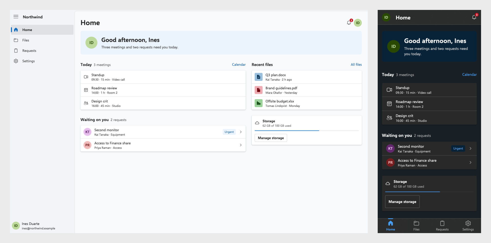
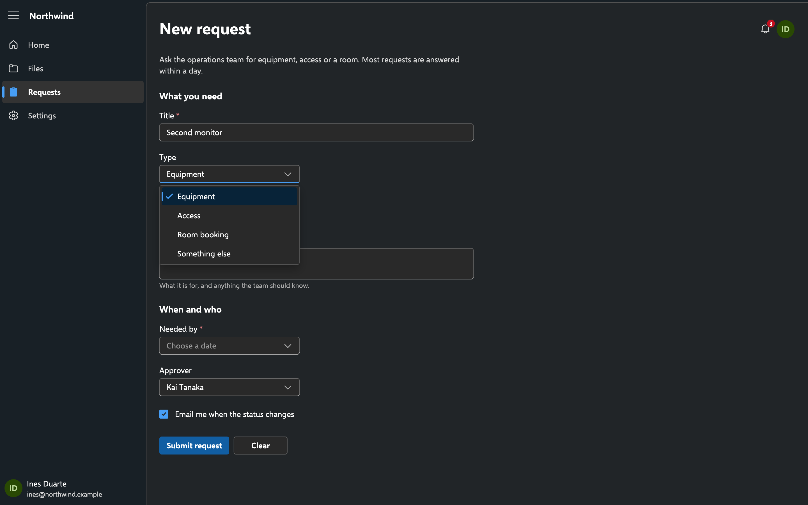
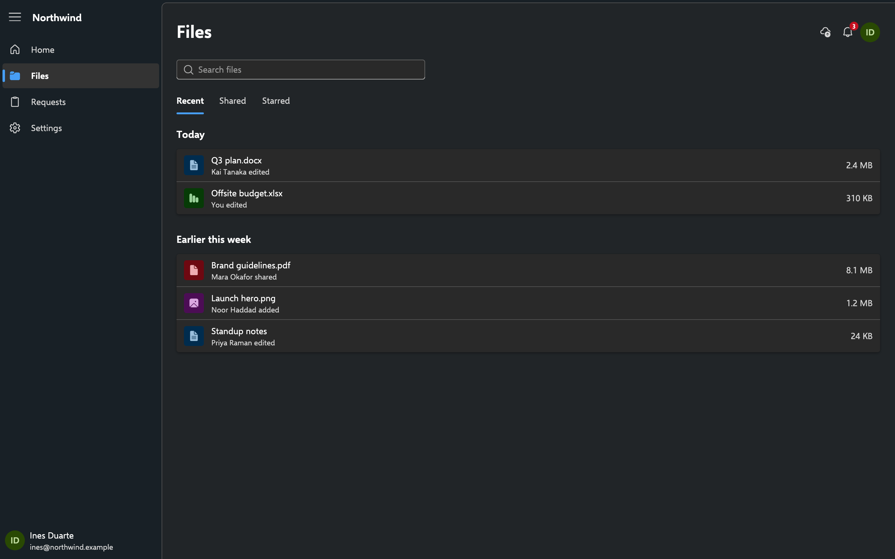
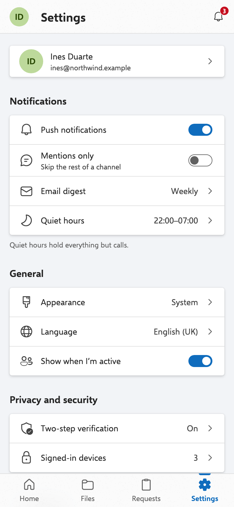

# fluent2_design_ui

Fluent 2 widgets and themes for Flutter, including text fields, menus, navigation, data grids,
charts, and dialogs. Six brand presets include light and dark themes. This is an independent
implementation of Microsoft's Fluent 2 design system.



**[Docs and demo](https://wenkaifan0720.github.io/flutter_design_systems/docs/looks/fluent2/)** · [Try it in Stint](https://wenkaifan0720.github.io/flutter_design_systems/docs/stint/?look=fluent2) · [API reference](https://pub.dev/documentation/fluent2_design_ui/latest/) · [All the looks](https://wenkaifan0720.github.io/flutter_design_systems/docs/)

## Install

```sh
flutter pub add fluent2_design_ui
```

A whole app: Fluent 2's theme over a bare `WidgetsApp`, one screen and one button.

```dart
import 'package:flutter/widgets.dart';
import 'package:fluent2_design_ui/fluent2_design_ui.dart';

void main() => runApp(
  WidgetsApp(
    color: const Color(0xFF0F6CBD),
    builder: (context, _) => Fluent2Theme(
      data: Fluent2ThemeData.lapis(),
      child: Fluent2Scaffold(body: Fluent2Button('Compose', onPressed: () {})),
    ),
  ),
);
```

## Quick start

Load the bundled fonts before `runApp` and wrap your app's navigator in `Fluent2Theme`.
This example uses `MaterialApp` from `material_ui` (`flutter pub add material_ui`). Its page transition theme also applies
Fluent motion to routes your app pushes.

```dart
import 'package:fluent2_design_ui/fluent2_design_ui.dart';
import 'package:material_ui/material_ui.dart';

Future<void> main() async {
  WidgetsFlutterBinding.ensureInitialized();
  await fluent2LoadFonts();
  runApp(const App());
}

class App extends StatelessWidget {
  const App({super.key});

  @override
  Widget build(BuildContext context) => MaterialApp(
    theme: ThemeData(
      pageTransitionsTheme: const PageTransitionsTheme(builders: fluent2PageTransitions),
    ),
    builder: (context, child) => Fluent2Theme(
      data: Fluent2ThemeData.lapis(),
      darkData: Fluent2ThemeData.lapis(Brightness.dark),
      child: child!,
    ),
    home: Fluent2Scaffold(
      topBar: const Fluent2AppBar(title: 'Inbox'),
      body: Center(
        child: Fluent2Button(
          'Compose',
          appearance: Fluent2ButtonAppearance.primary,
          icon: Fluent2Icons.edit,
          onPressed: () {},
        ),
      ),
    ),
  );
}
```

## In pictures



| | |
|---|---|
|  |  |
|  |  |

## Set up the theme

Use the same builder with a `CupertinoApp` or `WidgetsApp`. Read colors, typography, spacing,
and shadows through `Fluent2Theme.of(context)` or `context.fluent2Theme`. A nested
`Fluent2Theme` can override part of the widget tree.

```dart
CupertinoApp(
  builder: (context, child) => Fluent2Theme(
    data: Fluent2ThemeData.iris(MediaQuery.platformBrightnessOf(context)),
    child: child!,
  ),
  home: const InboxPage(),
);
```

`WidgetsApp` has no page route of its own; give it one:

```dart
WidgetsApp(
  color: const Color(0xFF0F6CBD),
  builder: (context, child) => Fluent2Theme(
    data: Fluent2ThemeData.iris(MediaQuery.platformBrightnessOf(context)),
    child: child!,
  ),
  pageRouteBuilder: <T>(settings, builder) => PageRouteBuilder<T>(
    settings: settings,
    pageBuilder: (context, _, _) => builder(context),
  ),
  home: const InboxPage(),
);
```

## Common widgets

Show a validation message below a text field.

```dart
Fluent2TextField(
  label: 'Email',
  hintText: 'name@example.com',
  onChanged: (value) => setState(() => email = value),
  validationMessage: email.contains('@') ? null : 'Enter an email address',
);
```

Use a typed select for a fixed set of options.

```dart
Fluent2Select<String>(
  label: 'Priority',
  options: const [
    Fluent2Option('low', 'Low'),
    Fluent2Option('normal', 'Normal'),
    Fluent2Option('high', 'High'),
  ],
  value: priority,
  onChanged: (value) => setState(() => priority = value),
);
```

Group related items in a list.

```dart
Fluent2ListGroup(
  title: 'Recent files',
  children: [
    Fluent2ListItem(icon: Fluent2Icons.document, title: 'Q3 plan.docx', subtitle: 'Edited 2h ago', onTap: open),
    Fluent2ListItem(icon: Fluent2Icons.folder, title: 'Designs', chevron: true, onTap: browse),
  ],
);
```

Await a dialog result.

```dart
final delete = await showFluent2Dialog<bool>(
  context,
  builder: (context) => Fluent2Dialog(
    title: 'Delete Q3 plan.docx?',
    message: 'It moves to the recycle bin for 30 days.',
    actions: [
      Fluent2Button('Cancel', onPressed: () => Navigator.pop(context, false)),
      Fluent2Button(
        'Delete',
        appearance: Fluent2ButtonAppearance.primary,
        onPressed: () => Navigator.pop(context, true),
      ),
    ],
  ),
);
```

Use a navigation bar for destinations and a tab list for sections of a page.

```dart
Fluent2NavigationBar(
  items: const [
    Fluent2NavItem(Fluent2Icons.home, 'Home'),
    Fluent2NavItem(Fluent2Icons.folder, 'Files'),
    Fluent2NavItem(Fluent2Icons.settings, 'Settings'),
  ],
  selectedIndex: tab,
  onDestinationSelected: (index) => setState(() => tab = index),
);

Fluent2TabList(
  tabs: const ['Activity', 'Files', 'Members'],
  selectedIndex: section,
  onChanged: (index) => setState(() => section = index),
);
```

## Customize a theme

The default preset is `lapis`. The other presets are `iris`, `juniper`, `pumpkin`, `berry`, and
`flint`. To use your own brand color, call
`Fluent2ThemeData.from(brand: color, brightness: Brightness.light)`.

Use `copyWith` to set density, select a typeface from your app's assets, or replace acrylic
blur with an opaque surface using `solidAcrylic: true`. You can also override a component
theme or pass a `Fluent2Style` to an individual widget. Style properties can resolve
different values for hover, focus, selection, and press.

```dart
final theme = Fluent2ThemeData.juniper(Brightness.dark);
Fluent2Theme(
  data: theme.copyWith(
    checkboxTheme: Fluent2Style(
      edge: WidgetStateProperty.resolveWith(
        (states) => states.contains(WidgetState.selected) ? null : theme.colors.neutralForeground1,
      ),
    ),
  ),
  child: const SettingsPage(),
);
```

## Accessibility and localization

Controls support keyboard traversal and screen readers. The two-tone focus ring works on both
light and dark surfaces. Components follow the ambient reading direction and text scale.
The package respects the system's reduced-motion setting.

Use `RawWidgetsLocalizations.delegate` for shared labels such as Cancel and Search, and
`Fluent2Localizations.delegate` for Fluent-specific labels. The calendars' month and day
names, a time picker's hour and minute, the AM and PM marks, and the date and time pickers'
titles in another language ("Select time") come from `RawWidgetsLocalizations`, in its 30
languages. You can
provide translations by extending `Fluent2LocalizationsEn` and adding a localization delegate
to your app.
The standalone `Fluent2Format` helpers use US English.

The bundled text font is Selawik. Other scripts use platform fallback fonts, or the families
you name in `Fluent2ThemeData.fontFamilyFallback`, which reaches every text style.
`Fluent2Icons` includes Fluent UI System Icons.

## Requirements

Flutter 3.47.0 or later. The package runs on Android, iOS, the web, macOS, Windows and Linux.

## Example

`example/` sets every component on its page, in each palette, by day and by night, beside a sample
file-sharing app. Run it with `flutter run` from that directory.

## Licences

The package is BSD-3-Clause. It is drawn from Fluent's tokens and component styles under the MIT License:

> @fluentui/tokens, @fluentui/react-components. Copyright (c) Microsoft Corporation. All rights reserved. MIT License.
> Permission is hereby granted, free of charge, to any person obtaining a copy of this software and associated
> documentation files (the "Software"), to deal in the Software without restriction, including without limitation the
> rights to use, copy, modify, merge, publish, distribute, sublicense, and/or sell copies of the Software, and to
> permit persons to whom the Software is furnished to do so, subject to the following conditions: The above copyright
> notice and this permission notice shall be included in all copies or substantial portions of the Software. THE
> SOFTWARE IS PROVIDED "AS IS", WITHOUT WARRANTY OF ANY KIND, EXPRESS OR IMPLIED, INCLUDING BUT NOT LIMITED TO THE
> WARRANTIES OF MERCHANTABILITY, FITNESS FOR A PARTICULAR PURPOSE AND NONINFRINGEMENT. IN NO EVENT SHALL THE AUTHORS OR
> COPYRIGHT HOLDERS BE LIABLE FOR ANY CLAIM, DAMAGES OR OTHER LIABILITY, WHETHER IN AN ACTION OF CONTRACT, TORT OR
> OTHERWISE, ARISING FROM, OUT OF OR IN CONNECTION WITH THE SOFTWARE OR THE USE OR OTHER DEALINGS IN THE SOFTWARE.

It bundles Selawik under the SIL Open Font License 1.1 and a subset of Fluent UI System Icons under the MIT License.
The full texts are in `LICENSE` and `THIRD_PARTY_NOTICES/`. Fluent and the names of Microsoft products are trademarks of
Microsoft Corporation; this package uses the name only to say which design system it implements.
