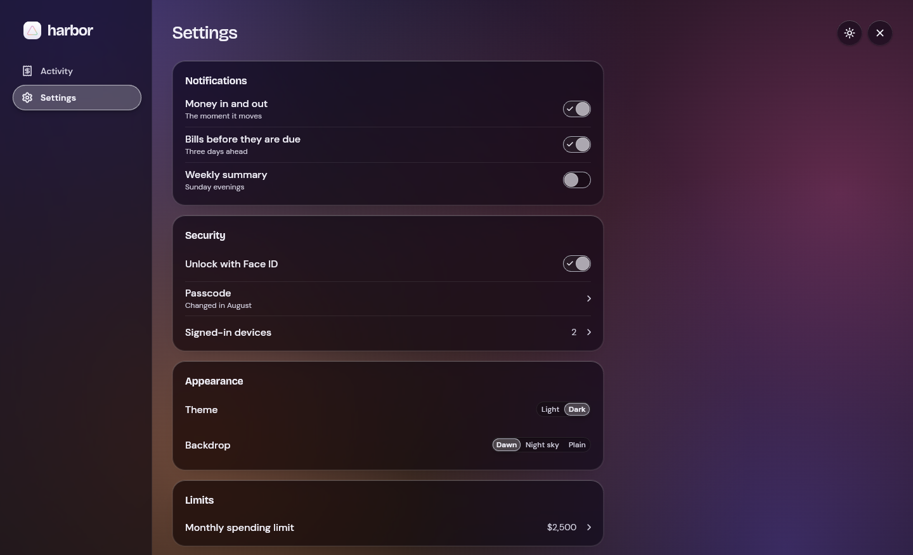

# frosted_ui

Frosted is a Flutter component library for translucent forms, transaction lists, charts and navigation. Choose from seven colour presets, each with a light and dark appearance.


**[Live gallery](https://wenkaifan0720.github.io/flutter_design_systems/frosted/)** · [API reference](https://pub.dev/documentation/frosted_ui/latest/) · [All the looks](https://wenkaifan0720.github.io/flutter_design_systems/)

## Install

```sh
flutter pub add frosted_ui material_ui
```

```dart
import 'package:frosted_ui/frosted_ui.dart';
```

`material_ui` is for the app's `MaterialApp`, as in the set-up below; under a `CupertinoApp` (from `cupertino_ui`) or a
bare `WidgetsApp`, `frosted_ui` is all an app adds.

## Set up

Mount `FrostedHost` in the app builder so controls, pages, dialogs and toasts share a theme. It follows the platform brightness by default. Load the bundled fonts before `runApp` to use them from the first frame.

```dart
import 'package:frosted_ui/frosted_ui.dart';
import 'package:frosted_ui/frosted_host.dart';
import 'package:material_ui/material_ui.dart';

Future<void> main() async {
  WidgetsFlutterBinding.ensureInitialized();
  await frostedLoadFonts();
  runApp(const App());
}

class App extends StatelessWidget {
  const App({super.key});

  @override
  Widget build(BuildContext context) => MaterialApp(
    builder: (context, child) => FrostedHost(
      light: FrostedThemeData.opal(),
      dark: FrostedThemeData.opal(Brightness.dark),
      child: child!,
    ),
    home: const FrostedScaffold(
      topBar: FrostedAppBar(title: 'Today', caption: 'Tuesday'),
      body: FrostedListTile(title: 'Blue Fern Café', meta: 'Dining out · 8:12 AM'),
    ),
  );
}
```

Under a `CupertinoApp` it is the same `builder:`:

```dart
CupertinoApp(
  builder: (context, child) => FrostedHost(light: FrostedThemeData.glacier(), dark: FrostedThemeData.glacier(Brightness.dark), child: child!),
  home: const TodayPage(),
);
```

And under a bare `WidgetsApp`, which asks for its colour and how to build a route:

```dart
WidgetsApp(
  color: const Color(0xFF0B0B0F),
  builder: (context, child) => FrostedHost(light: FrostedThemeData.jade(), dark: FrostedThemeData.jade(Brightness.dark), child: child!),
  pageRouteBuilder: <T>(RouteSettings settings, WidgetBuilder builder) =>
      PageRouteBuilder<T>(settings: settings, pageBuilder: (context, _, _) => builder(context)),
  home: const TodayPage(),
);
```

To theme just one subtree, wrap it in `FrostedTheme(data: …)`. Its `data` is the active appearance. The optional `darkData` supplies the dark counterpart for controls drawn over media and defaults to `data.darkTwin`.

## The look

Panes of glass rimmed with light stand on a pale canvas lit by soft washes of colour; one ink act carries the page's
action, money is set in a display face with its dollars carrying the weight, and a spectrum of pastel hues names the
categories and objects an app keeps. Seven presets (opal, quartz, garnet, glacier, cobalt, jade and copper), each
designed by day and by night, from a phone to a desktop.

| | |
|---|---|
|  |  |
|  |  |

The components carry the names Material gives them (`FrostedButton`, `FrostedTextField`, `FrostedAppBar`,
`FrostedNavigationBar`, `FrostedListTile`, `FrostedCheckbox`, `FrostedSwitch`, `FrostedSlider`,
`FrostedSegmentedButton`, `FrostedTabBar`, `FrostedDialog`, `FrostedSnackBar`, ...) and the parameters a Flutter
developer expects: a press is `onPressed`, a control is `value` with `onChanged`, a destination is `selectedIndex`. The
theme is shaped like Material's: `FrostedThemeData` holds a `colorScheme`, a `textTheme` and `shadows`, beside the look's
own `glass`, `pearl` and `toast`.

## Everyday parts

A page: the canvas and its light, a top bar, and tiles of glass.

```dart
class TodayPage extends StatelessWidget {
  const TodayPage({super.key});

  @override
  Widget build(BuildContext context) => FrostedScaffold(
    topBar: const FrostedAppBar(title: 'Today', caption: 'Tuesday 12 November'),
    body: Column(
      crossAxisAlignment: CrossAxisAlignment.stretch,
      spacing: FrostedSpacing.s10,
      children: [
        FrostedCard(child: Text('Good morning', style: context.frostedTheme.textTheme.titleLarge)),
      ],
    ),
  );
}
```

Buttons: the ink pill is the page's act, the glass pill everything beside it.

```dart
FrostedButton('Review transfer', expand: true, onPressed: review);
FrostedButton.glass('Clear filters', icon: FrostedGlyphs.close, onPressed: clear);
```

A text field and a select, each with its label over a well:

```dart
FrostedTextField(
  label: 'Name',
  hint: 'What are you saving for?',
  value: name,
  onChanged: (value) => setState(() => name = value),
);
FrostedSelect<String>(
  label: 'Room',
  options: const [FrostedSelectOption('k', 'Kitchen'), FrostedSelectOption('s', 'Study')],
  value: room,
  onChanged: (value) => setState(() => room = value),
);
```

A list: rows on a tile, under the section's title.

```dart
FrostedListSection(
  title: 'Transactions',
  aside: '3 today',
  rows: [
    FrostedListTile(title: 'Blue Fern Café', meta: 'Dining out · 8:12 AM', trailing: const FrostedAmount(-6.75), onPressed: open),
    FrostedListTile(title: 'Northline Transit', meta: 'Travel · 7:40 AM', trailing: const FrostedAmount(-2.90), onPressed: open),
  ],
);
```

A dialog, raised and answered in one call:

```dart
final freeze = await FrostedDialog.show(
  context,
  title: 'Freeze this card?',
  message: 'Payments stop until you unfreeze it.',
  confirmLabel: 'Freeze',
  cancelLabel: 'Cancel',
);
```

Navigation: the tab bar on a phone (from 1024 wide, `FrostedNavigationDrawer` down the left edge).

```dart
FrostedNavigationBar(
  items: const [
    FrostedNavItem(FrostedGlyphs.house, 'Home'),
    FrostedNavItem(FrostedGlyphs.receipt, 'Activity'),
    FrostedNavItem(FrostedGlyphs.person, 'Profile'),
  ],
  selectedIndex: tab,
  onDestinationSelected: (index) => setState(() => tab = index),
);
```

## Theme

`FrostedTheme.of(context)` (or `context.frostedTheme`) returns the `FrostedThemeData` in scope. Restyle a part of the
tree with a nested `FrostedTheme`, and animate between themes with `AnimatedFrostedTheme`.

- **Presets**: `FrostedThemeData.opal()`, `.quartz()`, `.garnet()`, `.glacier()`, `.cobalt()`, `.jade()` and
  `.copper()`, each taking a brightness; `FrostedThemeData.preset(id, brightness)` by name.
- **Your own colours**: `FrostedThemeData.from(accent: plum, brightness: Brightness.dark)` builds the whole palette from
  one colour, moving what it derives until words read 4.5:1 on every ground they stand on.
- **Groups**: `colorScheme` (the page, its words, the accent, the tones), `textTheme` (`displayLarge` to `labelSmall`,
  and the look's figures), `shadows`, `glass`, `pearl`, `toast`, `hues` (the spectrum), each with `copyWith`. The
  theme's `copyWith` takes the shadows and the glass, pearl and sheen tints from its preset: setting them is
  deprecated, since a free shadow can make the soft lift a hard one and an opaque tint turns glass into paint.
  `opaqueMaterials: true` is the solid form, for high contrast.
- **Density**: `FrostedDensity.standard`, `.comfortable` or `.compact`. Unset, it follows the platform
  (`FrostedDensity.adaptivePlatformDensity`: compact on macOS, Windows and Linux, standard on touch); the 44 and 48 px
  targets never shrink.
- **Typeface**: `FrostedTypeface` for a brand's own faces (`FrostedTypeface.app`) or a script the bundled faces lack.
- **Tokens**: `FrostedCorners` (the radii, and the look's outlines `extraSmall`, `small`, `medium`, `large` and `full`),
  `FrostedSpacing`, `FrostedStrokes` and `FrostedMotion` (its timings, which Reduce Motion turns to cuts) are constants
  for your own parts.

```dart
final theme = FrostedThemeData.from(accent: const Color(0xFF7C3AED)).copyWith(
  density: FrostedDensity.compact,
  components: const FrostedComponentThemes(
    card: FrostedStyle(padding: WidgetStatePropertyAll(EdgeInsets.all(24))),
  ),
);
```

## One component

A value comes from the widget's `style:`, then its component theme (`FrostedThemeData.components`), then Frosted's
own. `style:` takes a `FrostedStyle` with the slots of Material's `ButtonStyle` (`fill`, `foreground`, `edge`,
`overlay`, `side`, `shape`, `padding`, `minimumSize`, `textStyle`, `iconSize`), each a `WidgetStateProperty` resolved
per state (pressed, hovered, focused, selected, disabled, error). A `shape` takes any `OutlinedBorder`: a rounded border
is drawn at its radius; a superellipse, a bevel or any other is cut to its outline, fill, edge, glass and focus
clearing alike. The ink act (`FrostedButton`) keeps its pill: a shape of its own that squares its ends fails a debug assert, and
the theme's button shape, which shapes the glass buttons, passes it by.

```dart
FrostedButton(
  'Save',
  onPressed: save,
  style: FrostedStyle(
    fill: WidgetStateProperty.resolveWith(
      (states) => states.contains(WidgetState.pressed) ? const Color(0xFF1D4ED8) : const Color(0xFF2563EB),
    ),
  ),
);
FrostedButton.glass(
  'Share',
  onPressed: share,
  style: const FrostedStyle(
    shape: WidgetStatePropertyAll(
      RoundedSuperellipseBorder(borderRadius: BorderRadius.all(Radius.circular(14))),
    ),
  ),
);
```

What stays Frosted's whatever you set: the canvas's washes of light, the glass's rim of light along its top, the
spectrum, the ink act's pill, the press read as the face dimming, the 44 and 48 px targets and the motion.

## Composing a page

Place related rows in one glass panel with dividers. Use wells for inputs and raised slabs for menus, dialogs and sheets. Frosted draws each surface’s rim and chooses its opacity from the theme. Keep spacing transparent so the backdrop remains visible between panels.

Use the solid ink button for the page’s primary action and glass buttons for secondary actions. A brighter glass plate marks a selected option. Controls respect reduced motion and high contrast.

## Glass on the web

Three parts blur what stands behind them, each inside its own clip: the navigation bar, the frost under the top bar and
the pearl credit card. The page's tiles, sheets and menus are translucent glass without a blur, so a long page of tiles
costs no blur at all. The canvas's washes are painted once and cached.

## Accessibility and languages

- **Screen readers.** Every control says its role, its label, its value and its state (checked, selected, expanded,
  disabled); paint that only decorates is left out.
- **Keyboard.** Every control takes focus (each single control takes a `focusNode` and `autofocus`), Enter and Space act, Tab
  moves on, the arrow keys move a slider and a rating (toward the end of the line, right to left too), a radio group
  and a one-at-a-time toggle strip are one Tab stop whose arrows choose as they move (Flutter's `RadioGroup`, with ui_core's `RadioGroupKeyboardFix`), and while the
  keyboard holds focus the part's frost clears and its rim lights: more of the colour behind it comes through and its
  own thin rim brightens to white (a hairline just inside its outline where it has none), with no colour of its own. By
  day the part also lifts: its soft shadow deepens a little, as a pane rising off the glass. A pointer over a part only
  clears it a little. Chosen parts stay glass, marked by a printed check or dot and a little more clearing. A row in a
  list or a menu clears within its edge, and the row the keys hold lights its rim. Focus follows the reading order,
  right to left too.
- **Targets.** 44 px under a pointer and 48 px under a finger (Android, iOS and Fuchsia), as Material pads its targets.
- **Contrast.** Words hold 4.5:1 on their glass (3:1 when large), by day and by night, over any backdrop, focused or
  not: the clearing never takes the glass below the ground its words are held on. Focus is a quiet cue: on Frosted's
  own backdrop the cleared glass differs from the resting one by about 1.0:1 to 1.3:1. The lit rim stands out where
  white falls on something darker (glass by night, the ink button by day: 5:1 to 18:1 along the rim) and barely shows
  where it falls on pale glass (about 1.1:1 by day), so focus does not hold 3:1 on every part. By day the lift darkens
  the ground in the 16 px round a focused part by about 1.1:1 to 1.4:1, most round a field, a list row or a menu row.
  A chosen part's printed check, dot or tick stands 9.7:1 or more against the part unchosen, by day and by night.
  Glass has no dark edge: an unchosen part at rest (an empty check, an unchosen radio, an empty star, an off switch, a
  segmented strip) is a bead of glass whose darkest pixel stands no darker on the glass than a field's edge, about
  1.2:1 by day. It shows by its lit rim and inner shade, so its boundary does not hold WCAG 1.4.11's 3:1; its label
  and its state, once chosen, do.
- **Motion.** Every change of state eases from where it is; Reduce Motion makes each one a cut. The dialog and the
  sheets ride ui_core's critically damped springs: nothing overshoots, and a sheet let go mid-drag carries the finger's
  speed. A page pushed over
  another clears in as it settles 24 px toward the end, the page under it standing still, and pops back the way it
  came, on every platform. A `FrostedPage` moves so wherever it is pushed, and `FrostedTheme` hands the motion to the
  page routes of an app on `material_ui`, the Material Frosted is built on, as the set-up above is. Flutter's own
  `MaterialApp` (`package:flutter/material.dart`, which Flutter 3.50 deprecates) keeps its theme above `FrostedTheme`,
  out of its reach: give that theme `pageTransitionsTheme: const PageTransitionsTheme(builders:
  frostedPageTransitions)`, and its `MaterialPageRoute`s and go_router's pages match (a `CupertinoPageRoute` keeps iOS's own slide). On iOS a drag
  from the leading edge still takes a page back: the map's iOS entry stands Frosted's motion inside ui_core's
  `DesignSwipeBackPageTransitionsBuilder`. Tabs and sidebar destinations change the page in place.
- **Large text.** Pages lay out up to 200% text (the host caps a larger size there); controls grow taller rather than
  cut their words.
- **Right to left.** Under a right-to-left `Directionality` every part mirrors: the glyphs that point a way turn round,
  sliders, progress and steppers run from the start side, swipes, carousels and tabs follow the reading direction, and
  a field's leading and trailing parts swap. Figures, times and codes stay left to right: an amount keeps its sign and
  `$` in front, a card number, keycaps, badge counts and the clock wheels keep their order, the wordmark does not
  mirror, and charts with their time axes run left to right. Times and dates an app passes in as words are the app's
  to write in its language. The gallery's Customize panel switches the direction and the text size.
- **Strings.** Install `RawWidgetsLocalizations.delegate` and `FrostedLocalizations.delegate`, and use `RawWidgetsLocalizations.supportedLocales`, for shared control labels in 30 languages. `FrostedLocalizations` supplies labels specific to the look, including Send, Swap, Pending and Frozen. Its delegate serves every locale with the English labels. Where a part says a word every design system shares (Done, Try again, a day's or a month's name, a time, the time wheel's columns), a reader of another language hears `RawWidgetsLocalizations`' word for it. To translate Frosted's own labels, extend `FrostedLocalizationsEn` and register a delegate for your locale; your words then win. The example gallery includes an Arabic delegate.
- **Dates and amounts.** Calendars use `RawWidgetsLocalizations` for the start of the week. For an English reader, `FrostedLocalizations` supplies picker month names, date captions and the 12- or 24-hour clock. For a reader of another language, they come from `RawWidgetsLocalizations` unless your app gives Frosted words of its own. The separate `FrostedFormat` utility formats US English dates and dollar amounts. Supply localized strings to components that accept preformatted text when your app uses another currency or locale.
- **Other scripts.** Frosted's fonts carry Latin. Arabic, Hebrew, Chinese, Japanese, Hindi and Thai fall back to the
  platform's fonts (on the web, Flutter's Noto fallback).

## Labels and icons

Pass a string for a button label and an `IconData` for its optional icon, for example `FrostedButton('Pay', icon: FrostedGlyphs.creditCard, onPressed: pay)`. A `FrostedListTile` accepts a title and optional meta text. Its `leading`, `mid` and `trailing` slots accept widgets for an avatar, account information or a custom action.

## Example

`example/` is the gallery: every component on its page, in every preset, by day and by night, and its Customize panel
(preset, your own accent, density, backdrop, direction, text size).

## Licences

The package is BSD-3-Clause. It bundles Bricolage Grotesque and DM Sans under the SIL Open Font License 1.1, and depends
on `lucide_icons_flutter` (Lucide, ISC; Feather, MIT). The notices are in `LICENSE`.
