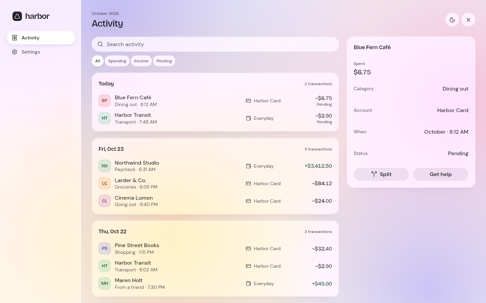
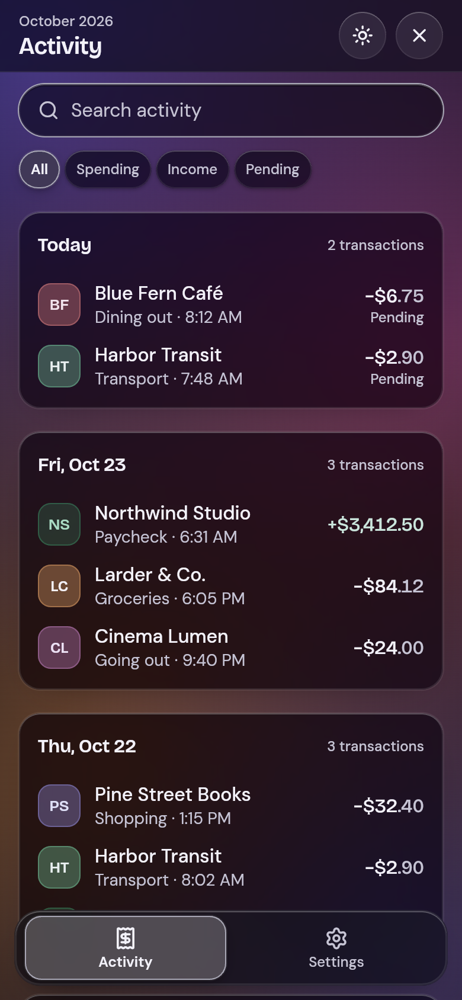
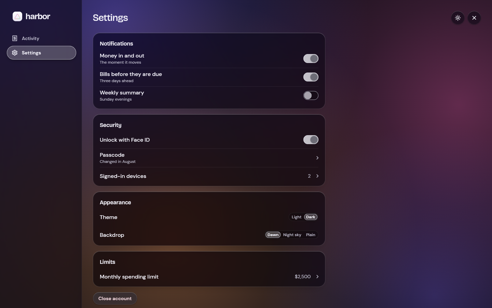
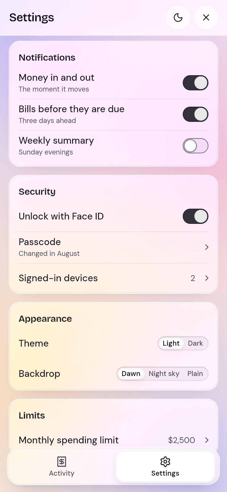
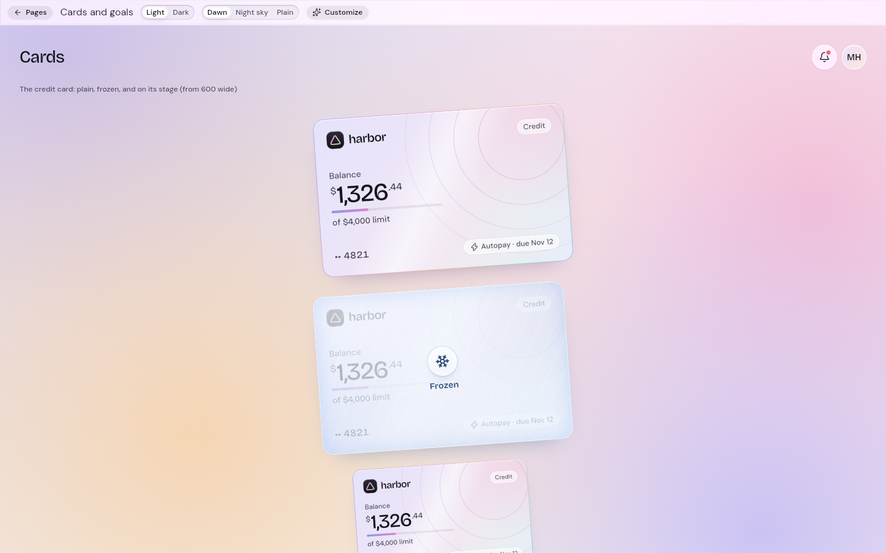
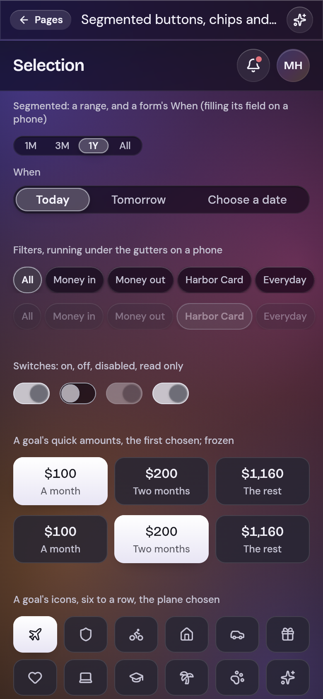

# frosted_ui

Frosted glass widgets for Flutter. Panes of glass rimmed with light stand on a pale canvas lit by soft washes of colour;
one ink act carries the page's action, money is set in a display face with its dollars carrying the weight, and a
spectrum of pastel hues names the categories and objects an app keeps. Seven presets (opal, quartz, garnet, glacier,
cobalt, jade and copper), each designed by day and by night, from a phone to a desktop.

| | |
|---|---|
|  |  |
|  |  |
|  |  |

The components carry the names Material gives them (`FrostedButton`, `FrostedTextField`, `FrostedAppBar`,
`FrostedNavigationBar`, `FrostedListTile`, `FrostedCheckbox`, `FrostedSwitch`, `FrostedSlider`,
`FrostedSegmentedButton`, `FrostedTabBar`, `FrostedDialog`, `FrostedSnackBar`, ...) and the parameters a Flutter
developer expects: a press is `onPressed`, a control is `value` with `onChanged`, a destination is `selectedIndex`. The
theme is shaped like Material's: `FrostedThemeData` holds a `colorScheme`, a `textTheme` and `shadows`, beside the look's
own `glass`, `pearl` and `toast`.

## Install

```yaml
dependencies:
  frosted_ui: ^0.1.0
```

```dart
import 'package:frosted_ui/frosted_ui.dart';
```

## Set up

`FrostedTheme` is the whole install. Put it in your app's `builder:`, under a `MaterialApp`, a `CupertinoApp` or a
`WidgetsApp`; Frosted has no app widget of its own. Call `frostedLoadFonts()` before `runApp` so the first frame is set
in the bundled faces (on the web a font otherwise arrives after it).

```dart
import 'package:flutter/material.dart';
import 'package:frosted_ui/frosted_ui.dart';

Future<void> main() async {
  WidgetsFlutterBinding.ensureInitialized();
  await frostedLoadFonts();
  runApp(const App());
}

class App extends StatelessWidget {
  const App({super.key});

  @override
  Widget build(BuildContext context) => MaterialApp(
    builder: (context, child) => FrostedTheme(
      data: FrostedThemeData.opal(),
      darkData: FrostedThemeData.opal(Brightness.dark),
      child: child!,
    ),
    home: const TodayPage(),
  );
}
```

Under a `CupertinoApp` it is the same `builder:`:

```dart
CupertinoApp(
  builder: (context, child) => FrostedTheme(data: FrostedThemeData.glacier(), child: child!),
  home: const TodayPage(),
);
```

And under a bare `WidgetsApp`, which asks for its colour and how to build a route:

```dart
WidgetsApp(
  color: const Color(0xFF0B0B0F),
  builder: (context, child) => FrostedTheme(data: FrostedThemeData.jade(), child: child!),
  pageRouteBuilder: <T>(RouteSettings settings, WidgetBuilder builder) =>
      PageRouteBuilder<T>(settings: settings, pageBuilder: (context, _, _) => builder(context)),
  home: const TodayPage(),
);
```

`darkData:` is the theme for the platform's dark appearance; leave it out and every brightness takes `data`. Nothing of
Material shows under Frosted: no ink, and the text field's caret, selection, handles and menu, and the scroll bar, are
Frosted's. No Material or Cupertino type appears in Frosted's API.

## Everyday parts

A page: the canvas and its light, a top bar, and tiles of glass.

```dart
class TodayPage extends StatelessWidget {
  const TodayPage({super.key});

  @override
  Widget build(BuildContext context) => FrostedScaffold(
    topBar: const FrostedAppBar(title: 'Today', caption: 'Tuesday 12 November'),
    body: Column(
      crossAxisAlignment: CrossAxisAlignment.stretch,
      spacing: FrostedSpacing.s10,
      children: [
        FrostedCard(child: Text('Good morning', style: context.frostedTheme.textTheme.titleLarge)),
      ],
    ),
  );
}
```

Buttons: the ink pill is the page's act, the glass pill everything beside it.

```dart
FrostedButton('Review transfer', expand: true, onPressed: review);
FrostedButton.glass('Clear filters', icon: FrostedGlyphs.close, onPressed: clear);
```

A text field and a select, each with its label over a well:

```dart
FrostedTextField(
  label: 'Name',
  hint: 'What are you saving for?',
  value: name,
  onChanged: (value) => setState(() => name = value),
);
FrostedSelect<String>(
  label: 'Room',
  options: const [FrostedSelectOption('k', 'Kitchen'), FrostedSelectOption('s', 'Study')],
  value: room,
  onChanged: (value) => setState(() => room = value),
);
```

A list: rows on a tile, under the section's title.

```dart
FrostedListSection(
  title: 'Transactions',
  aside: '3 today',
  rows: [
    FrostedListTile(title: 'Blue Fern Café', meta: 'Dining out · 8:12 AM', trailing: const FrostedAmount(-6.75), onPressed: open),
    FrostedListTile(title: 'Northline Transit', meta: 'Travel · 7:40 AM', trailing: const FrostedAmount(-2.90), onPressed: open),
  ],
);
```

A dialog, raised and answered in one call:

```dart
final freeze = await FrostedDialog.show(
  context,
  title: 'Freeze this card?',
  message: 'Payments stop until you unfreeze it.',
  confirmLabel: 'Freeze',
  cancelLabel: 'Cancel',
);
```

Navigation: the tab bar on a phone (from 1024 wide, `FrostedNavigationDrawer` down the left edge).

```dart
FrostedNavigationBar(
  items: const [
    FrostedNavItem(FrostedGlyphs.house, 'Home'),
    FrostedNavItem(FrostedGlyphs.receipt, 'Activity'),
    FrostedNavItem(FrostedGlyphs.person, 'Profile'),
  ],
  selectedIndex: tab,
  onDestinationSelected: (index) => setState(() => tab = index),
);
```

## Theme

`FrostedTheme.of(context)` (or `context.frostedTheme`) returns the `FrostedThemeData` in scope. Restyle a part of the
tree with a nested `FrostedTheme`, and animate between themes with `AnimatedFrostedTheme`.

- **Presets**: `FrostedThemeData.opal()`, `.quartz()`, `.garnet()`, `.glacier()`, `.cobalt()`, `.jade()` and
  `.copper()`, each taking a brightness; `FrostedThemeData.preset(id, brightness)` by name.
- **Your own colours**: `FrostedThemeData.from(accent: plum, brightness: Brightness.dark)` builds the whole palette from
  one colour, moving what it derives until words read 4.5:1 on every ground they stand on.
- **Groups**: `colorScheme` (the page, its words, the accent, the tones), `textTheme` (`displayLarge` to `labelSmall`,
  and the look's figures), `shadows`, `glass`, `pearl`, `toast`, `hues` (the spectrum), each with `copyWith`.
- **Density**: `FrostedDensity.standard`, `.comfortable` or `.compact`. Unset, it follows the platform
  (`FrostedDensity.adaptivePlatformDensity`: compact on macOS, Windows and Linux, standard on touch); the 44 and 48 px
  targets never shrink.
- **Typeface**: `FrostedTypeface` for a brand's own faces (`FrostedTypeface.app`) or a script the bundled faces lack.
- **Tokens**: `FrostedCorners` (the radii, and the look's outlines `extraSmall`, `small`, `medium`, `large` and `full`),
  `FrostedSpacing`, `FrostedStrokes` and `FrostedMotion` (its timings, which Reduce Motion turns to cuts) are constants
  for your own parts.

```dart
final theme = FrostedThemeData.from(accent: const Color(0xFF7C3AED)).copyWith(
  density: FrostedDensity.compact,
  components: const FrostedComponentThemes(
    card: FrostedStyle(padding: WidgetStatePropertyAll(EdgeInsets.all(24))),
  ),
);
```

## One component

A value comes from the widget's `style:`, then its component theme (`FrostedThemeData.components`), then Frosted's
own. `style:` takes a `FrostedStyle` with the slots of Material's `ButtonStyle` (`fill`, `foreground`, `edge`,
`overlay`, `side`, `shape`, `padding`, `minimumSize`, `textStyle`, `iconSize`), each a `WidgetStateProperty` resolved
per state (pressed, hovered, focused, selected, disabled, error). A `shape` takes any `OutlinedBorder`: a rounded border
is drawn at its radius; a superellipse, a bevel or any other is cut to its outline, fill, edge, glass and focus light
alike.

```dart
FrostedButton(
  'Save',
  onPressed: save,
  style: FrostedStyle(
    fill: WidgetStateProperty.resolveWith(
      (states) => states.contains(WidgetState.pressed) ? const Color(0xFF1D4ED8) : const Color(0xFF2563EB),
    ),
    shape: const WidgetStatePropertyAll(
      RoundedSuperellipseBorder(borderRadius: BorderRadius.all(Radius.circular(14))),
    ),
  ),
);
```

What stays Frosted's whatever you set: the canvas's washes of light, the glass's rim of light along its top, the
spectrum, the press read as the face dimming, the 44 and 48 px targets and the motion.

## How Frosted is built

Eight laws make the look. A part of your own follows them too, and stays Frosted.

1. **Two substances.** Everything is glass or paint. Glass (sheer for a card, pane for a section or a control, well for a field, slab for what is raised, bar for what holds the page) shows what is behind it, blurred and tinted. Paint (the one ink act, a track's fill, a mark, a pearl, a figure) is opaque and lies on a glass.
2. **Light comes from above.** Every glass catches it along its edge, as a lit rim and a sheen across its top. A well is cut into its glass and shaded along its top inside edge. By day no edge is a dark line.
3. **Depth is thickness.** A nearer glass is thicker, and its lift is softer and wider. What lies under a raised slab (a sheet, a dialog, a menu) dims and softens. Nothing has a bevel or a hard shadow.
4. **Glass stacks one way.** A glass lies on the backdrop or on one other glass. Glasses of one layer stand side by side and never overlap; only a raised slab passes over another. Content scrolls under the bars, and a list is one glass holding rows with hairlines, not a pane per row.
5. **Nothing pretends to be the ground.** A gap between two things is cut, so the glass and the backdrop show through it; it is never painted in the ground's colour.
6. **One act; choosing is glass.** The ink pill is the only solid thing that acts. A choice is a brighter, thicker glass that slides under the words.
7. **Motion moves glass.** A slab rises while the page dims, a chosen pill slides, a light passes over a loading pane. Nothing springs or bounces, and Reduce Motion turns each movement to a cut. A pointer over a button or a glass changes only the cursor; in a menu, a list of choices or a table it lights the row a press would pick, and over a handle the handle.
8. **Words hold whatever is behind.** Text keeps 4.5:1 on its glass over black, white or any backdrop, and every glass has an opaque form that high contrast turns on.

## Glass on the web

Three parts blur what stands behind them, each inside its own clip: the navigation bar, the frost under the top bar and
the pearl credit card. The page's tiles, sheets and menus are translucent glass without a blur, so a long page of tiles
costs no blur at all. The canvas's washes are painted once and cached.

## Accessibility and languages

- **Screen readers.** Every control says its role, its label, its value and its state (checked, selected, expanded,
  disabled); paint that only decorates is left out.
- **Keyboard.** Every control takes focus (each single control takes a `focusNode` and `autofocus`), Enter and Space act, Tab
  moves on, the arrow keys move a slider and a rating (toward the end of the line, right to left too), and the focus
  light shows while the keyboard, not a pointer, holds focus. Focus follows the reading order, right to left too.
- **Targets.** 44 px under a pointer and 48 px under a finger (Android, iOS and Fuchsia), as Material pads its targets.
- **Contrast.** Words hold 4.5:1 on their glass (3:1 when large), by day and by night, over any backdrop. Known limit: by
  day a field's rim and the focus light are white light on pale glass, under 3:1 against the page (about 1.1 to 1.3:1);
  a field is found by its well and its label, and focus also changes the well itself.
- **Motion.** Every change of state eases from where it is; Reduce Motion makes each one a cut.
- **Large text.** Pages lay out up to 200% text (the host caps a larger size there); controls grow taller rather than
  cut their words.
- **Right to left.** Under a right-to-left `Directionality` every part mirrors: the glyphs that point a way turn round,
  sliders, progress and steppers run from the start side, swipes, carousels and tabs follow the reading direction, and
  a field's leading and trailing parts swap. Figures, times and codes stay left to right: an amount keeps its sign and
  `$` in front, a card number, keycaps, badge counts and the clock wheels keep their order, the wordmark does not
  mirror, and charts with their time axes run left to right. Times and dates an app passes in as words are the app's
  to write in its language. The gallery's Customize panel switches the direction and the text size.
- **Words.** What a part says by itself comes from two places, both English unless the app installs its language:
  the words every design system shares (Cancel, OK, Close, Back, Clear, Delete, More, Loading, No results, Today,
  Previous month, Show password, Refresh, Carousel, Menu bar, the weekday names) from ui_core's `DesignLocalizations`,
  under the names `MaterialLocalizations` gives them; Frosted's own (Done, Try again, the composer's Send, a
  transfer's Swap, the card's Balance, number and CVC, the text menu's Cut, Copy and Paste) from `FrostedLocalizations`. To translate,
  extend `DefaultDesignLocalizations` and subclass `FrostedLocalizations`, and add a delegate for each to the app's
  `localizationsDelegates`. Still English-only in 0.1.0: a goal's "On track" and "Behind", "Over budget", "Pending",
  "Frozen card", "Back to <page>" and the keycaps' names.
- **Dates and numbers.** The calendar and the pickers take the first day of the week and the weekday names from
  `DesignLocalizations`, and 12- or 24-hour time from `FrostedLocalizations`. Month names, "Yesterday" and "In 3 days"
  in rows and cards, and money and number formats are English (en-US) in 0.1.0.
- **Other scripts.** Frosted's fonts carry Latin. Arabic, Hebrew, Chinese, Japanese, Hindi and Thai fall back to the
  platform's fonts (on the web, Flutter's Noto fallback).

## Words and glyphs as values

A part takes the words it shows as a `String` and its glyph as an `IconData` (`FrostedButton('Pay', icon:
FrostedGlyphs.creditCard)`, `FrostedListTile(title: 'Rent')`), where Flutter's own widgets take a `Widget`: the look sets their
type, size and ink. These are the `label`, `title`, `subtitle`, `message`, `body`, `caption`, `text` and `action`
strings and the `icon` glyphs across the parts. 0.2.0 adds a `Widget` slot beside each one, with the `String` made
optional, so nothing written against 0.1.0 breaks.

## Example

`example/` is the gallery: every component on its page, in every preset, by day and by night, and its Customize panel
(preset, your own accent, density, backdrop, direction, text size).

## Licences

The package is BSD-3-Clause. It bundles Bricolage Grotesque and DM Sans under the SIL Open Font License 1.1, and depends
on `lucide_icons_flutter` (Lucide, ISC; Feather, MIT). The notices are in `LICENSE`.
