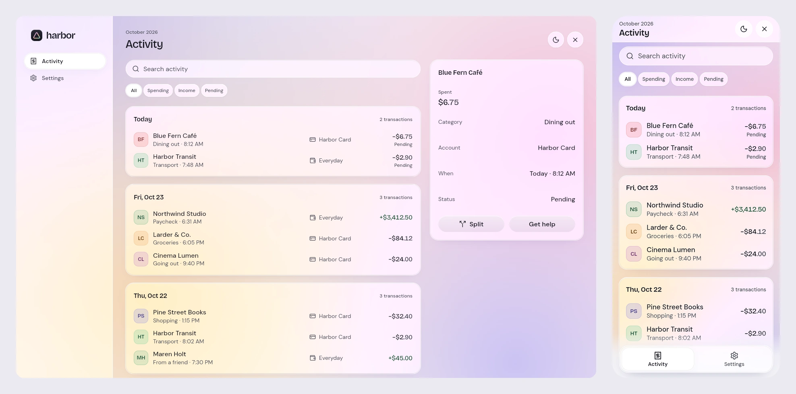
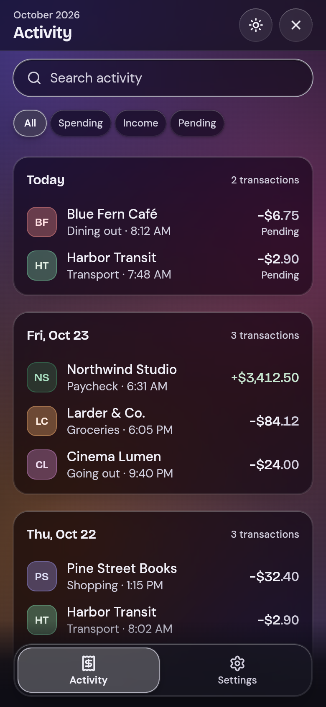
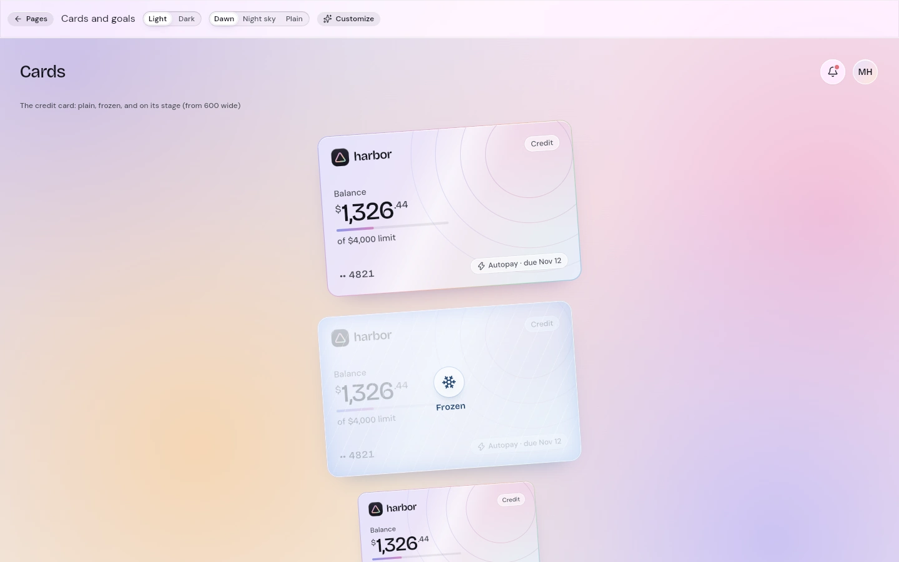
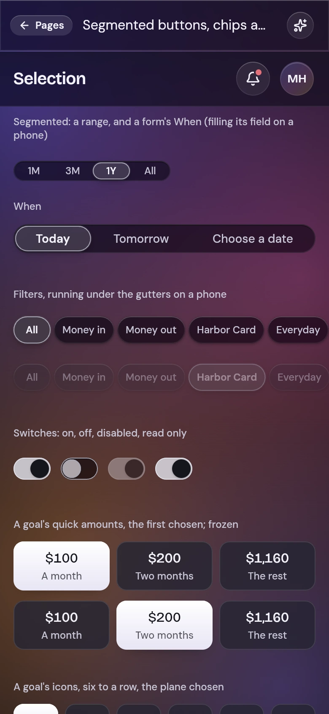

# frosted_ui

Frosted is a Flutter component library for translucent forms, transaction lists, charts and navigation. Choose from six colour palettes, each with a light and dark appearance.



**[Docs and demo](https://wenkaifan0720.github.io/flutter_design_systems/docs/looks/frosted/)** · [Try it in Stint](https://wenkaifan0720.github.io/flutter_design_systems/docs/stint/?look=frosted) · [API reference](https://pub.dev/documentation/frosted_ui/latest/) · [All the looks](https://wenkaifan0720.github.io/flutter_design_systems/docs/)

## Install

```sh
flutter pub add frosted_ui material_ui
```

Every snippet on this page compiles after that line (on a Flutter 3.50 template `material_ui` is already there, and
`flutter pub add frosted_ui` is enough). The icons in them are `FrostedGlyphs`, the glyphs Frosted draws with, an
app's everyday ones among them (`book`, `settings`, `heart`, `star`, `edit`); for an icon of your own, add
`lucide_icons_flutter`, the set they come from (`import 'package:lucide_icons_flutter/lucide_icons.dart';`, then
`LucideIcons.bookmark`).

Each file imports the look and the Material it is built on:

```dart
import 'package:frosted_ui/frosted_ui.dart';
import 'package:material_ui/material_ui.dart';
```

`frosted_ui.dart` holds every part, `FrostedHost` included, and ui_core's `Raw*` parts. It doesn't export
`package:flutter/widgets.dart`: `material_ui` does, with `MaterialApp`. Import `material_ui` rather than
`package:flutter/material.dart`; Frosted's theme is `material_ui`'s, so its page routes take Frosted's motion.

## Mount the host

`FrostedHost`, in the app's `builder`, is the one mount: it picks the light or dark theme, holds the toasts, eases a
change of palette or appearance, and caps the text scale at 200%. Load the bundled faces before `runApp` so the first
frame is set in them.

```dart
import 'package:frosted_ui/frosted_ui.dart';
import 'package:material_ui/material_ui.dart';

Future<void> main() async {
  WidgetsFlutterBinding.ensureInitialized();
  await frostedLoadFonts();
  runApp(const App());
}

class App extends StatelessWidget {
  const App({super.key});

  @override
  Widget build(BuildContext context) => MaterialApp(
    title: 'Ledger',
    // The parts' own words in 30 languages, and Material's (from material_ui).
    localizationsDelegates: const [
      RawWidgetsLocalizations.delegate,
      FrostedLocalizations.delegate,
      ...GlobalMaterialLocalizations.delegates,
    ],
    supportedLocales: RawWidgetsLocalizations.supportedLocales,
    // brightness: null follows the platform; Brightness.light or
    // Brightness.dark pins it. palette: one of the six, opal by default.
    builder: (context, child) => FrostedHost(
      palette: FrostedThemeData.palettes.first,
      brightness: null,
      child: child!,
    ),
    home: const FrostedScaffold(
      topBar: FrostedAppBar(title: 'Today', caption: 'Tuesday'),
      body: FrostedListTile(title: 'Blue Fern Café', meta: 'Dining out · 8:12 AM'),
    ),
  );
}
```

These delegates are the whole list: `RawWidgetsLocalizations.delegate` (the words every look shares: Cancel, Today,
Close, in 30 languages), `FrostedLocalizations.delegate` (the look's own) and `GlobalMaterialLocalizations.delegates`,
which `material_ui` exports with Flutter's translations: an app on material_ui needs no `flutter_localizations`
dependency. A `CupertinoApp` (from `cupertino_ui`) or a bare `WidgetsApp` takes the same `builder:` and delegates.

`FrostedHost(theme:, darkTheme:)` takes themes of your own instead of a palette's: a light theme given is the light
theme whatever `palette` says, and a dark theme left out is the light theme's night. `density:` stands over both, so
a stored palette and a density from your settings go together:
`FrostedHost(palette: palette, density: FrostedDensity.compact, child: child!)`. The window's width changes none of
these: the parts follow the width themselves. To theme one subtree, wrap it in `FrostedTheme(data: …)`;
`AnimatedFrostedTheme` eases between two.

## Build an app

The example app, `example/lib/main.dart`, is all of this in one file: a reading list with three places, a list
with a pushed page, a form, a dialog and settings. Copy it and grow it.

### The shell

`FrostedAppShell` is the app's frame: its places in the glass tab bar along a phone's foot, in the sidebar from
1024 wide. Each place keeps its own stack of pages; a page pushed in a place keeps the sidebar beside it while the tab
bar steps away, and back pops it. Toasts keep clear of the tab bar.

```dart
import 'package:frosted_ui/frosted_ui.dart';
import 'package:material_ui/material_ui.dart';

class Home extends StatefulWidget {
  const Home({super.key});

  @override
  State<Home> createState() => _HomeState();
}

class _HomeState extends State<Home> {
  int _place = 0;

  @override
  Widget build(BuildContext context) => FrostedAppShell(
    header: const FrostedWordmark('Ledger'),
    destinations: const [
      RawNavigationDestination(label: 'Today', icon: FrostedGlyphs.house),
      RawNavigationDestination(label: 'Activity', icon: FrostedGlyphs.receipt),
      RawNavigationDestination(label: 'Profile', icon: FrostedGlyphs.person),
    ],
    selectedIndex: _place,
    onDestinationSelected: (index) => setState(() => _place = index),
    branches: [
      (context) => const FrostedScaffold(topBar: FrostedAppBar(title: 'Today'), body: SizedBox()),
      (context) => const FrostedScaffold(topBar: FrostedAppBar(title: 'Activity'), body: SizedBox()),
      (context) => const FrostedScaffold(topBar: FrostedAppBar(title: 'Profile'), body: SizedBox()),
    ],
  );
}
```

`FrostedWordmark('Ledger', logo: …)` sets the app's name as written, beside your own logo.

### A list, and its page

A page is a `FrostedScaffold`: its bar, its body and a footer for its acts. `maxWidth` holds all three to one
column on a wide window. Where the page doesn't own the window's foot (over the app shell's tab bar, at desktop
width) the footer floats on a slab of the tab bar's glass. A row pushes its record's page in the same place; the pushed page's bar names where back
goes.

```dart
import 'package:frosted_ui/frosted_ui.dart';
import 'package:material_ui/material_ui.dart';

class Payee {
  const Payee(this.name, this.note, {this.overdue = false});

  final String name;
  final String note;
  final bool overdue;
}

class PayeesPage extends StatelessWidget {
  const PayeesPage({super.key, required this.payees});

  final List<Payee> payees;

  @override
  Widget build(BuildContext context) => FrostedScaffold(
    maxWidth: 760,
    topBar: const FrostedAppBar(title: 'Payees'),
    body: FrostedRowGroup(
      hairlines: true,
      children: [
        for (final payee in payees)
          FrostedListTile(
            leading: FrostedMonogram(payee.name),
            title: payee.name,
            meta: payee.note,
            trailing: payee.overdue ? const FrostedTag('Overdue', tone: FrostedTone.danger) : null,
            onPressed: () => Navigator.of(context).push(
              MaterialPageRoute<void>(builder: (context) => PayeePage(payee: payee)),
            ),
          ),
      ],
    ),
  );
}

class PayeePage extends StatelessWidget {
  const PayeePage({super.key, required this.payee});

  final Payee payee;

  @override
  Widget build(BuildContext context) => FrostedScaffold(
    maxWidth: 760,
    topBar: FrostedAppBar(title: payee.name, backLabel: 'Payees'),
    body: FrostedDescriptionList(
      children: [
        FrostedKeyValue(label: 'Name', value: payee.name),
        FrostedKeyValue(label: 'Note', value: payee.note),
      ],
    ),
    footer: FrostedButtonRow(
      children: [FrostedButton('Pay', onPressed: () {})],
    ),
  );
}
```

### Forms

`FrostedTextFormField` is a Flutter `FormField`: put it in a `Form`, and `validate()` shows its error under it. The
other parts a form holds are controlled, as Material's are: `FrostedDateField` and `FrostedSwitchRow` take a value
and `onChanged`; keep their values in your state.

Set the form's `autovalidateMode` to `AutovalidateMode.onUserInteraction` after a save that fails, and each error
clears as its field is put right. A text form field resets as Material's `TextFormField` does: with a controller, its
initial value is the controller's text when it was last built, so `reset()` brings back the words typed. To clear the
form after a save and stay on the page, call `reset()` and then clear the controllers, as `_save` does here:

```dart
import 'package:frosted_ui/frosted_ui.dart';
import 'package:material_ui/material_ui.dart';

class NewGoalPage extends StatefulWidget {
  const NewGoalPage({super.key, required this.onAdd});

  final void Function(String name, DateTime? by, bool remind) onAdd;

  @override
  State<NewGoalPage> createState() => _NewGoalPageState();
}

class _NewGoalPageState extends State<NewGoalPage> {
  final _form = GlobalKey<FormState>();
  final _name = TextEditingController();
  var _check = AutovalidateMode.disabled;
  DateTime? _by;
  bool _remind = true;

  @override
  void dispose() {
    _name.dispose();
    super.dispose();
  }

  void _save() {
    if (!_form.currentState!.validate()) {
      setState(() => _check = AutovalidateMode.onUserInteraction);
      return;
    }
    widget.onAdd(_name.text.trim(), _by, _remind);
    // Clear the form after a save: reset() takes the errors away, then the
    // controller and the controlled values empty the fields.
    _form.currentState!.reset();
    _name.clear();
    setState(() {
      _check = AutovalidateMode.disabled;
      _by = null;
      _remind = true;
    });
  }

  @override
  Widget build(BuildContext context) => FrostedScaffold(
    maxWidth: 760,
    topBar: const FrostedAppBar(title: 'New goal', backLabel: 'Goals'),
    body: Form(
      key: _form,
      autovalidateMode: _check,
      child: Column(
        crossAxisAlignment: CrossAxisAlignment.stretch,
        spacing: FrostedSpacing.s16,
        children: [
          FrostedTextFormField(
            labelText: 'Name',
            controller: _name,
            hintText: 'What are you saving for?',
            validator: (value) => (value ?? '').trim().isEmpty ? 'Name the goal' : null,
          ),
          FrostedDateField(
            labelText: 'By',
            value: _by,
            hintText: 'Any time',
            onChanged: (value) => setState(() => _by = value),
          ),
          FrostedSwitchRow(
            label: 'Remind me',
            value: _remind,
            onChanged: (value) => setState(() => _remind = value),
          ),
        ],
      ),
    ),
    footer: FrostedButtonRow(children: [FrostedButton('Save', onPressed: _save)]),
  );
}
```

A date field shows its day as "Nov 9, 2026" and opens Frosted's calendar; `FrostedFormat.date(day, year: true)` writes
the same.

### Dialogs and toasts

`FrostedDialog.show` raises a dialog over the whole app and completes with the answer: true when confirmed, false
when declined, null when dismissed. A dialog of your own pops its route with the answer.

```dart
import 'package:frosted_ui/frosted_ui.dart';
import 'package:material_ui/material_ui.dart';

Future<void> freeze(BuildContext context) async {
  final sure = await FrostedDialog.show(
    context,
    title: 'Freeze this card?',
    message: 'Payments stop until you unfreeze it.',
    confirmLabel: 'Freeze',
    cancelLabel: 'Cancel',
  );
  if (sure != true || !context.mounted) return;
  FrostedToast.show(context, 'Card frozen', actionLabel: 'Undo', onAction: () {});
}

Future<String?> pickRoom(BuildContext context) => showFrostedDialog<String>(
  context,
  builder: (context) => FrostedDialog(
    title: 'Move to',
    content: Column(
      mainAxisSize: MainAxisSize.min,
      children: [
        for (final room in ['Kitchen', 'Study'])
          FrostedListTile(title: room, onPressed: () => Navigator.of(context).pop(room)),
      ],
    ),
    cancelLabel: 'Cancel',
    onCancel: () => Navigator.of(context).pop(),
  ),
);
```

### The palette picker

`FrostedThemeData.palettes` are the six palettes, each a `RawNamedPalette`: an `id` to store, a `label` to
show, and the swatches to draw beside it (`swatchesFor` the brightness shown). Hand the chosen one to the host.

```dart
import 'dart:math' as math;

import 'package:frosted_ui/frosted_ui.dart';
import 'package:material_ui/material_ui.dart';

class PalettePicker extends StatelessWidget {
  const PalettePicker({super.key, required this.palette, required this.onChanged});

  final RawNamedPalette palette;
  final ValueChanged<RawNamedPalette> onChanged;

  @override
  Widget build(BuildContext context) {
    final brightness = FrostedTheme.of(context).brightness;
    return FrostedRadioGroup<String>(
      labelText: 'Palette',
      value: palette.id,
      onChanged: (id) => onChanged(FrostedThemeData.palettes.firstWhere((p) => p.id == id)),
      options: [
        // Each palette by its name, its colours right after it.
        for (final p in FrostedThemeData.palettes)
          FrostedRadio(p.id, p.label, suffix: Swatches(p.swatchesFor(brightness))),
      ],
    );
  }
}

/// A palette's colours as Material's palette pickers show them: one disc split
/// between them, in a hairline so a pale colour reads on a pale page and a dark
/// one on a dark page.
class Swatches extends StatelessWidget {
  const Swatches(this.colors, {super.key});

  final List<Color> colors;

  @override
  Widget build(BuildContext context) => SizedBox.square(
    dimension: 24,
    child: CustomPaint(
      painter: _SplitDisc(colors, FrostedTheme.of(context).colorScheme.textSecondary),
    ),
  );
}

class _SplitDisc extends CustomPainter {
  _SplitDisc(this.colors, this.ring);

  final List<Color> colors;
  final Color ring;

  @override
  void paint(Canvas canvas, Size size) {
    final disc = Offset.zero & size;
    final share = 2 * math.pi / colors.length;
    for (final (i, color) in colors.indexed) {
      canvas.drawArc(disc, -3 * math.pi / 4 + share * i, share, true, Paint()..color = color);
    }
    canvas.drawCircle(
      disc.center,
      size.shortestSide / 2 - .5,
      Paint()
        ..style = PaintingStyle.stroke
        ..color = ring,
    );
  }

  @override
  bool shouldRepaint(_SplitDisc old) => old.colors != colors || old.ring != ring;
}
```

`FrostedThemeData.preset(id, brightness)` builds a stored id's theme again; an id it doesn't know gives the first
palette.

## Building blocks

| For | Use |
|---|---|
| The app's frame | `FrostedHost`, `FrostedAppShell`, `FrostedWordmark` |
| A page | `FrostedScaffold`, `FrostedAppBar`, `FrostedTabBar`, `FrostedBreadcrumb`, `FrostedPagination` |
| Acts | `FrostedButton` (`.glass`, `.destructive`), `FrostedIconButton`, `FrostedButtonRow`, `FrostedSplitButton`, `FrostedLink` |
| Words in | `FrostedTextField`, `FrostedTextFormField`, `FrostedTextArea`, `FrostedPasswordField`, `FrostedSearchField`, `FrostedNumberField`, `FrostedAmountField` |
| Choices | `FrostedSelect`, `FrostedCombobox`, `FrostedMultiSelect`, `FrostedRadioGroup`, `FrostedCheckbox`, `FrostedSwitch`, `FrostedSegmentedButton`, `FrostedToggleGroup`, `FrostedChip`, `FrostedFilterChipGroup`, `FrostedSlider`, `FrostedRangeSlider`, `FrostedRating` |
| Dates and times | `FrostedDateField`, `FrostedCalendar`, `FrostedDatePicker`, `FrostedDateRangePicker`, `FrostedTimePicker`, `showFrostedDatePicker` |
| Lists and tables | `FrostedListTile`, `FrostedRowGroup`, `FrostedListSection`, `FrostedDescriptionList`, `FrostedReorderableListView`, `FrostedTreeView`, `FrostedTable`, `FrostedDataTable` |
| Settings and form rows | `FrostedSettingsGroup`, `FrostedFormSection`, `FrostedSwitchRow`, `FrostedCheckRow`, `FrostedValueRow`, `FrostedFormRow`, `FrostedPickerRow`, `FrostedKeyValue` |
| Over the page | `FrostedDialog`, `showFrostedDialog`, `showFrostedBottomSheet`, `FrostedActionSheet`, `showFrostedMenu`, `FrostedPopover`, `FrostedHoverCard`, `FrostedTooltip`, `FrostedContextMenu`, `FrostedToast` |
| Status | `FrostedTag`, `FrostedBadge`, `FrostedBanner`, `FrostedEmptyState`, `FrostedErrorState`, `FrostedLoadingState`, `FrostedSkeleton`, `FrostedLinearProgressIndicator`, `FrostedCircularProgressIndicator`, `FrostedMeter`, `FrostedStepProgress` |
| Cards and marks | `FrostedCard`, `FrostedAvatar`, `FrostedMonogram`, `FrostedIconMark` |
| Money | `FrostedAmount`, `FrostedMoney`, `FrostedTransactionRow`, `FrostedCreditCard` |
| Charts | `FrostedLineChart`, `FrostedAreaChart`, `FrostedBarChart`, `FrostedPieChart`, `FrostedSparkline` |

### Which row

| Row | Holds | A screen reader hears |
|---|---|---|
| `FrostedListTile` | a record in a list: its title, meta, a trailing tag or amount, and its own `action` | one button, its action a stop of its own |
| `FrostedSwitchRow` | a setting and its switch; a press anywhere flips it | one switch named by the row |
| `FrostedCheckRow` | a choice and its check | one checkbox named by the row |
| `FrostedValueRow` | a setting that opens a page, its current value at the end | one link with its value |
| `FrostedFormRow` | a labelled row of a form: a value, a control at the end, or a chevron | its words and its control, or one link |
| `FrostedPickerRow` | a choice that opens a picker, in a well under its label | one button |
| `FrostedKeyValue` | a fact in a `FrostedDescriptionList`: a label and its value | the label and the value; a link when it opens something |

## The look

Panes of glass rimmed with light stand on a pale canvas lit by soft washes of colour; one ink act carries the page's
action, money is set in a display face with its dollars carrying the weight, and a spectrum of pastel hues names the
categories and objects an app keeps. Six palettes (opal, quartz, garnet, glacier, jade and copper), each
designed by day and by night, from a phone to a desktop.

| | |
|---|---|
|  |  |
|  |  |

The components carry the names Material gives them (`FrostedButton`, `FrostedTextField`, `FrostedAppBar`,
`FrostedListTile`, `FrostedCheckbox`, `FrostedSwitch`, `FrostedSlider`,
`FrostedSegmentedButton`, `FrostedTabBar`, `FrostedDialog`, `FrostedSnackBar`, ...) and the parameters a Flutter
developer expects: a press is `onPressed`, a control is `value` with `onChanged`, a destination is `selectedIndex`. The
theme is shaped like Material's: `FrostedThemeData` holds a `colorScheme`, a `textTheme` and `shadows`, beside the look's
own `glass`, `pearl` and `toast`.

## Theme

`FrostedTheme.of(context)` (or `context.frostedTheme`) returns the `FrostedThemeData` in scope. Restyle a part of the
tree with a nested `FrostedTheme`, and animate between themes with `AnimatedFrostedTheme`.

- **Palettes**: `FrostedThemeData.palettes`, the six as `RawNamedPalette`s; `FrostedThemeData(palette: p,
  brightness: b)` builds one's theme, as do `FrostedThemeData.opal()`, `.quartz()`, `.garnet()`, `.glacier()`,
  `.jade()` and `.copper()`; `FrostedThemeData.preset(id, brightness)` by its stored id.
- **Your own colours**: `FrostedThemeData.from(accent: plum, brightness: Brightness.dark)` builds the whole palette from
  one colour, moving what it derives until words read 4.5:1 on every ground they stand on.
- **Groups**: `colorScheme` (the page, its words, the accent, the tones), `textTheme` (`displayLarge` to `labelSmall`,
  and the look's figures), `shadows`, `glass`, `pearl`, `toast`, `hues` (the spectrum), each with `copyWith`. The
  shadows and the glass, pearl and sheen tints come with the palette and the theme's `copyWith` doesn't take them: a
  free shadow could make the soft lift a hard one, and an opaque tint would turn glass into paint.
  `opaqueMaterials: true` is the solid form, for high contrast.
- **Density**: `FrostedDensity.standard`, `.comfortable` (one step tighter, as Flutter's `VisualDensity` names
  it) or `.compact` (two steps). Set it on the host beside the palette (`FrostedHost(palette: p, density: d)`), or on
  a theme. Unset, it follows the platform (`FrostedDensity.adaptivePlatformDensity`: compact on macOS, Windows and
  Linux, standard on touch). Each step takes 4 off a key's, a chip's, a segment's and a toggle's height, and off a
  list's, a setting's, a form's and a menu's rows; a field's well keeps its line's height; no target goes under the
  40 px floor.
- **Shapes**: `shapeScheme`, the corner scale (`RawShapeScheme`), held to Frosted's bands
  (`FrostedThemeData.shapeLimits`) so every end still reads as glass: a field from 8 to 16, a card from 12 to 24, a
  sheet from 16 to 28. `theme.corner(step, own)` moves a corner of your own part as Frosted's move.
- **Typeface**: `FrostedTypeface` for a brand's own faces (`FrostedTypeface.app`) or a script the bundled faces lack.
- **Tokens**: `FrostedCorners` (the radii, and the look's outlines `extraSmall`, `small`, `medium`, `large` and `full`),
  `FrostedSpacing`, `FrostedStrokes` and `FrostedMotion` (its timings, which Reduce Motion turns to cuts) are constants
  for your own parts.

```dart
import 'package:frosted_ui/frosted_ui.dart';
import 'package:material_ui/material_ui.dart';

final theme = FrostedThemeData.from(accent: const Color(0xFF7C3AED)).copyWith(
  density: FrostedDensity.compact,
  components: const FrostedComponentThemes(
    card: FrostedStyle(padding: WidgetStatePropertyAll(EdgeInsets.all(24))),
  ),
);
```

## One component

A value comes from the widget's `style:`, then its component theme (`FrostedThemeData.components`), then Frosted's
own. `style:` takes a `FrostedStyle` with the slots of Material's `ButtonStyle` (`fill`, `foreground`, `edge`,
`overlay`, `side`, `shape`, `padding`, `minimumSize`, `textStyle`, `iconSize`), each a `WidgetStateProperty` resolved
per state (pressed, hovered, focused, selected, disabled, error). A `shape` takes any `OutlinedBorder`: a rounded border
is drawn at its radius; a superellipse, a bevel or any other is cut to its outline, fill, edge, glass and focus
clearing alike. `corners` names a step per corner (`RawCorners`): `RawCorners(topStart: RawCorner.extraLarge, topEnd:
RawCorner.extraLarge, bottomStart: RawCorner.extraSmall, bottomEnd: RawCorner.extraSmall)` rounds a card's top corners
further and keeps its foot nearly square, start and end mirroring right to left; a corner left out keeps the part's
own. A part of several pieces (a segmented strip, a menu) takes them on its outer corners, and a `shape` wins over
them. The ink act (`FrostedButton`) keeps its pill: a shape or corners of its own that square its ends fail a debug
assert, and the theme's button shape and corners, which shape the glass buttons, pass it by. A bead (a switch, a
slider's thumb, a radio, a calendar's day) stays round.

```dart
import 'package:frosted_ui/frosted_ui.dart';
import 'package:material_ui/material_ui.dart';

List<Widget> acts({required VoidCallback save, required VoidCallback share}) => [
  FrostedButton(
    'Save',
    onPressed: save,
    style: FrostedStyle(
      fill: WidgetStateProperty.resolveWith(
        (states) => states.contains(WidgetState.pressed) ? const Color(0xFF1D4ED8) : const Color(0xFF2563EB),
      ),
    ),
  ),
  FrostedButton.glass(
    'Share',
    onPressed: share,
    style: const FrostedStyle(
      shape: WidgetStatePropertyAll(
        RoundedSuperellipseBorder(borderRadius: BorderRadius.all(Radius.circular(14))),
      ),
    ),
  ),
];
```

What stays Frosted's whatever you set: the canvas's washes of light, the glass's rim of light along its top, the
spectrum, the ink act's pill, the press read as the face dimming, the 40 px target floor and the motion.

## Composing a page

Place related rows in one glass panel with dividers. Use wells for inputs and raised slabs for menus, dialogs and sheets. Frosted draws each surface’s rim and chooses its opacity from the theme. Keep spacing transparent so the backdrop remains visible between panels.

Use the solid ink button for the page’s primary action and glass buttons for secondary actions. A brighter glass plate marks a selected option. Controls respect reduced motion and high contrast.

## Glass on the web

Three parts blur what stands behind them, each inside its own clip: the navigation bar, the frost under the top bar and
the pearl credit card. The page's tiles, sheets and menus are translucent glass without a blur, so a long page of tiles
costs no blur at all. The canvas's washes are painted once and cached.

## Accessibility and languages

- **Screen readers.** Every control says its role, its label, its value and its state (checked, selected, expanded,
  disabled); paint that only decorates is left out.
- **Keyboard.** Every control takes focus (each single control takes a `focusNode` and `autofocus`), Enter and Space act, Tab
  moves on, the arrow keys move a slider and a rating (toward the end of the line, right to left too), a radio group
  and a one-at-a-time toggle strip are one Tab stop whose arrows choose as they move (Flutter's `RadioGroup`, with ui_core's `RadioGroupKeyboardFix`), and while the
  keyboard holds focus the part's frost clears and its rim lights: more of the colour behind it comes through and its
  own thin rim brightens to white (a hairline just inside its outline where it has none), with no colour of its own. By
  day the part also lifts: its soft shadow deepens a little, as a pane rising off the glass. A pointer over a part only
  clears it a little. Chosen parts stay glass, marked by a printed check or dot and a little more clearing. A row in a
  list or a menu clears within its edge, and the row the keys hold lights its rim. Focus follows the reading order,
  right to left too.
- **Targets.** 40 px or more under a finger and a pointer (ui_core's floor, WCAG 2.2's target size minimum); chips in a
  group stand their spacing apart, each target reaching into the room between them.
- **Contrast.** Words hold 4.5:1 on their glass (3:1 when large), by day and by night, over any backdrop, focused or
  not: the clearing never takes the glass below the ground its words are held on. Focus is a quiet cue: on Frosted's
  own backdrop the cleared glass differs from the resting one by about 1.0:1 to 1.3:1. The lit rim stands out where
  white falls on something darker (glass by night, the ink button by day: 5:1 to 18:1 along the rim) and barely shows
  where it falls on pale glass (about 1.1:1 by day), so focus does not hold 3:1 on every part. By day the lift darkens
  the ground in the 16 px round a focused part by about 1.1:1 to 1.4:1, most round a field, a list row or a menu row.
  A chosen part's printed check, dot or tick stands 9.7:1 or more against the part unchosen, by day and by night.
  Glass has no dark edge: an unchosen part at rest (an empty star, a segmented strip) is a bead of glass whose darkest
  pixel stands no darker on the glass than a field's edge, about 1.2:1 by day. An empty opening (an empty check, an
  unchosen radio, an off switch) stands a grey step of glass deeper by day: 1.25:1 to 1.37:1 against the canvas
  across the six palettes. Neither holds WCAG 1.4.11's 3:1 at its boundary; each shows by its lit rim and inner shade,
  and its label and its state, once chosen, do.
- **Motion.** Every change of state eases from where it is; Reduce Motion makes each one a cut. The dialog and the
  sheets ride ui_core's critically damped springs: nothing overshoots, and a sheet let go mid-drag carries the finger's
  speed. A page pushed over
  another clears in as it settles 24 px toward the end, the page under it standing still, and pops back the way it
  came, on every platform. A `FrostedPage` moves so wherever it is pushed, and `FrostedTheme` hands the motion to the
  page routes of an app on `material_ui`, the Material Frosted is built on, as the set-up above is. Flutter's own
  `MaterialApp` (`package:flutter/material.dart`, which Flutter 3.50 deprecates) keeps its theme above `FrostedTheme`,
  out of its reach: give that theme `pageTransitionsTheme: const PageTransitionsTheme(builders:
  frostedPageTransitions)`, and its `MaterialPageRoute`s and go_router's pages match (a `CupertinoPageRoute` keeps iOS's own slide). On iOS a drag
  from the leading edge still takes a page back: the map's iOS entry stands Frosted's motion inside ui_core's
  `SwipeBackPageTransitionsBuilder`. Tabs and sidebar destinations change the page in place.
- **Large text.** Pages lay out up to 200% text (the host caps a larger size there); controls grow taller rather than
  cut their words.
- **Right to left.** Under a right-to-left `Directionality` every part mirrors: the glyphs that point a way turn round,
  sliders, progress and steppers run from the start side, swipes, carousels and tabs follow the reading direction, and
  a field's leading and trailing parts swap. Figures, times and codes stay left to right: an amount keeps its sign and
  `$` in front, a card number, keycaps, badge counts and the clock wheels keep their order, the wordmark does not
  mirror, and charts with their time axes run left to right. Times and dates an app passes in as words are the app's
  to write in its language. The gallery's Customize panel (`example/lib/gallery.dart`) switches the direction and
  the text size.
- **Strings.** Install `RawWidgetsLocalizations.delegate` and `FrostedLocalizations.delegate`, and use `RawWidgetsLocalizations.supportedLocales`, for shared control labels in 30 languages (the list under Mount the host). `FrostedLocalizations` supplies labels specific to the look, including Send, Swap, Pending and Frozen. Its delegate serves every locale with the English labels. Where a part says a word every design system shares (Done, Try again, a day's or a month's name, a time, the time wheel's columns), a reader of another language hears `RawWidgetsLocalizations`' word for it. To translate Frosted's own labels, extend `FrostedLocalizationsEn` and register a delegate for your locale; your words then win. The gallery includes an Arabic delegate.
- **Dates and amounts.** Calendars use `RawWidgetsLocalizations` for the start of the week. For an English reader, `FrostedLocalizations` supplies picker month names, date captions and the 12- or 24-hour clock. For a reader of another language, they come from `RawWidgetsLocalizations` unless your app gives Frosted words of its own. The separate `FrostedFormat` utility formats US English dates and dollar amounts. Supply localized strings to components that accept preformatted text when your app uses another currency or locale.
- **Other scripts.** Frosted's fonts carry Latin. Arabic, Hebrew, Chinese, Japanese, Hindi and Thai fall back to the
  platform's fonts (on the web, Flutter's Noto fallback).

## Labels and icons

A control's `label` is drawn: a button's words, a switch row's title, a field's `labelText`. A name that is only
spoken, for a control that draws no words of its own (an icon button, a switch alone, a slider), is its
`semanticLabel`: `FrostedIconButton(FrostedGlyphs.more, semanticLabel: 'More', onPressed: open)`. A control inside
`FrostedFormField` is heard once, by the field's label. A row's name is its words and its status tag; a monogram that
repeats its title is decoration and stays out of it. A button takes an `IconData` for its optional icon, for example
`FrostedButton('Pay', icon: FrostedGlyphs.creditCard, onPressed: pay)`.

## Example

`example/lib/main.dart` is one app to copy: the host by day, by night or as the platform is, the shell with three
places, a list with a pushed page, a form that checks itself and takes a date, a dialog answered and settings with the
six palettes. `example/lib/gallery.dart` (`flutter run -t lib/gallery.dart`) sets every component on its page, in
each palette, by day and by night, with a Customize panel (palette, your own accent, density, backdrop, direction, text
size).

## Requirements

Flutter 3.47.0 or later (Dart 3.13), on Android, iOS, web, macOS, Windows and Linux. The package depends on ui_core ^0.8.7
and re-exports it, so `RawWidgetsLocalizations`, `RawNamedPalette` and the `Raw*` parts come with the one import.

## Licences

The package is BSD-3-Clause. It bundles Bricolage Grotesque and DM Sans under the SIL Open Font License 1.1, and depends
on `lucide_icons_flutter` (Lucide, ISC; Feather, MIT). The notices are in `LICENSE`.
