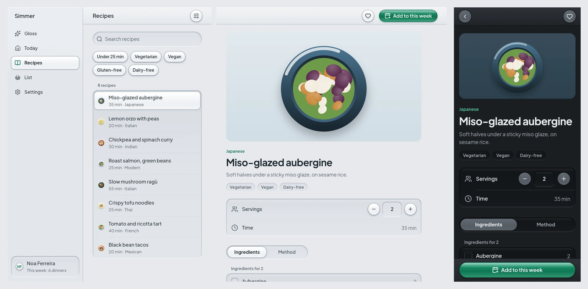

# gloss_ui

Gloss is a skeuomorphic Flutter component library with glazed buttons, recessed fields, and porcelain panels.
It includes forms, navigation, calendars, charts, dialogs, and matching light and dark themes.


**[Docs and demo](https://wenkaifan0720.github.io/flutter_design_systems/docs/looks/gloss/)** · [Try it in Stint](https://wenkaifan0720.github.io/flutter_design_systems/docs/stint/?look=gloss) · [API reference](https://pub.dev/documentation/gloss_ui/latest/) · [All the looks](https://wenkaifan0720.github.io/flutter_design_systems/docs/)

## Getting started

```yaml
dependencies:
  gloss_ui: ^0.5.0
```

The smallest app: `GlossHost` in the app's `builder` gives everything under it Gloss's theme, by day and by night as
the platform is.

```dart
import 'package:flutter/widgets.dart';
import 'package:gloss_ui/gloss_ui.dart';

void main() => runApp(
  WidgetsApp(
    color: const Color(0xFF0E7652),
    builder: (context, _) => GlossHost(
      child: Center(child: GlossButton.filled('Start', onPressed: () {})),
    ),
  ),
);
```

A fuller app on Material (`flutter pub add gloss_ui material_ui`) loads the bundled font before `runApp`, so the first
frame is set in it, and wraps the navigator in `GlossTheme` in the app's `builder`, so routes and overlays share the
same colors and typography. `GlossToaster` shows toasts.

```dart
import 'package:gloss_ui/gloss_ui.dart';
import 'package:material_ui/material_ui.dart';

Future<void> main() async {
  WidgetsFlutterBinding.ensureInitialized();
  await glossLoadFonts();
  runApp(
    MaterialApp(
      theme: ThemeData(
        pageTransitionsTheme: const PageTransitionsTheme(
          builders: glossPageTransitions,
        ),
      ),
      builder: (context, child) => GlossTheme(
        data: GlossThemeData.jade(MediaQuery.platformBrightnessOf(context)),
        child: GlossToaster(child: child!),
      ),
      home: const TodayPage(),
    ),
  );
}

class TodayPage extends StatelessWidget {
  const TodayPage({super.key});

  @override
  Widget build(BuildContext context) => GlossScaffold(
    body: Center(
      child: GlossButton.filled('Start cooking', onPressed: () {}),
    ),
  );
}
```

`glossPageTransitions` supplies page transitions on each platform, including the iOS swipe-back gesture.

Under a `CupertinoApp` (from `cupertino_ui`, which an app adds itself) or a bare `WidgetsApp`, the theme goes in the
same place:

```dart
import 'package:cupertino_ui/cupertino_ui.dart';

CupertinoApp(
  builder: (context, child) => GlossTheme(
    data: GlossThemeData.light(),
    child: GlossToaster(child: child!),
  ),
  home: const TodayPage(),
);

WidgetsApp(
  color: const Color(0xFF2E9E7A),
  builder: (context, _) => GlossTheme(
    data: GlossThemeData.dark(),
    child: const GlossToaster(child: TodayPage()),
  ),
);
```

## Components

- **Forms** include text, password, search and tag fields, date and range pickers, switches, sliders and steppers.
- **Navigation** includes tabs, a bottom bar, a rail, and a sidebar. `GlossAppShell` selects a layout for the window width.
- **Data display** includes lists, tables, cards, sparklines, and line, area, bar and pie charts.
- **Overlays** include dialogs, sheets, menus, popovers, tooltips, and toasts.

The example app, Simmer, uses these widgets to plan meals, adjust recipe servings, and manage a shopping list.



## Customize the theme

Gloss comes in six gels on the same porcelain, each by day and by night: `jade` (the default), `sapphire`,
`amethyst`, `amber`, `rose` and `teal` (`GlossThemeData.presets`). Hand one to the theme:

```dart
GlossTheme(
  data: GlossThemeData.preset('sapphire', MediaQuery.platformBrightnessOf(context)),
  child: GlossToaster(child: child!),
);
```

For a brand's own colour, `GlossThemeData.from(gel: color)` moulds the gel in it, at the nearest tone its white
label reads on; `finish` tints the porcelain and pearl toward a hue at the look's own tones. Words, links, the focus
and errors read on every ground they stand on, by day and by night. Theme defaults cover typography, density, and
component styles. Widgets with a `style` parameter can override them locally.

```dart
// A coral gel for the one action; its label stays readable.
final theme = GlossThemeData.from(gel: const Color(0xFFE4572E));

// The same theme, denser, for a desk app.
final dense = theme.copyWith(density: GlossDensity.compact);
```

## Platforms

Gloss supports Android, iOS, web, macOS, Windows, and Linux.

## Accessibility

Use Tab to reach a control and the arrow keys to move within tabs, ratings, and wheels.
Keyboard focus sharpens the reflection on a glazed control; a recessed field lights its rim in the gel's colour.
Charts expose values to screen readers and scale axis labels with system text size. Dialogs, sheets, tabs, and toasts
respect reduced motion. Controls stand at ui_core's touch floor, 40 by 40, or an app's `RawTapTargetScope`. Below 600
wide the date pickers open their month in a sheet, as Material's open full width on a phone.

## Right to left and languages

Controls follow the ambient `Directionality`. Add `RawWidgetsLocalizations.delegate` to your app for
control labels in ui_core's 30 languages. Use `glossPlural` for phrases that depend on a count.

## Requirements

Flutter 3.47.0 or later (Dart 3.13), on Android, iOS, web, macOS, Windows and Linux.

## Licence

The package uses the BSD 3-Clause License. Plus Jakarta Sans uses the SIL Open Font License 1.1.
Lucide icons use the ISC and MIT licenses. Full notices are in `THIRD_PARTY_NOTICES/`.
