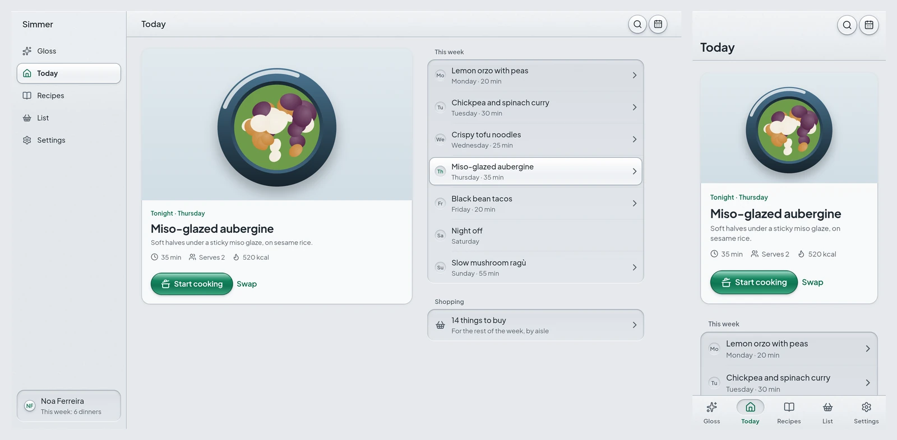

# gloss_ui

Skeuomorphic Flutter widgets of glazed, moulded parts under one light: jade gel for the main action, pearl for what
you handle, wells pressed into porcelain.



**[Live gallery](https://wenkaifan0720.github.io/flutter_design_systems/gloss/)** · [API reference](https://pub.dev/documentation/gloss_ui/latest/) · [All the looks](https://wenkaifan0720.github.io/flutter_design_systems/)

## Install

```sh
flutter pub add gloss_ui material_ui
```

`material_ui` is Flutter's Material library as a package (Flutter 3.50 deprecates `package:flutter/material.dart`);
the quick start takes its `MaterialApp`, and Gloss's own parts stand on it too.

## Quick start

`GlossTheme` is the whole install. Put it in your app's `builder:`, under a `MaterialApp`, a `CupertinoApp` or a
`WidgetsApp`; Gloss has no app widget of its own. Give the app Gloss's page change too, and load the face before the
first frame so the web never shows a fallback.

```dart
import 'package:gloss_ui/gloss_ui.dart';
import 'package:material_ui/material_ui.dart';

Future<void> main() async {
  WidgetsFlutterBinding.ensureInitialized();
  await glossLoadFonts();
  runApp(
    MaterialApp(
      theme: ThemeData(
        pageTransitionsTheme: const PageTransitionsTheme(
          builders: glossPageTransitions,
        ),
      ),
      builder: (context, child) => GlossTheme(
        data: GlossThemeData.jade(MediaQuery.platformBrightnessOf(context)),
        child: GlossToaster(child: child!),
      ),
      home: const TodayPage(),
    ),
  );
}

class TodayPage extends StatelessWidget {
  const TodayPage({super.key});

  @override
  Widget build(BuildContext context) => GlossScaffold(
    body: Center(
      child: GlossButton.filled('Start cooking', onPressed: () {}),
    ),
  );
}
```

`glossPageTransitions` plays Gloss's push and pop on every platform, and keeps iOS's swipe back from the screen's
edge.

## What is inside

A jade gel key for the one thing a screen is for, pearl keys and beads for what you handle, groups of rows in wells
pressed into a porcelain page, bars of fine-grained glaze with their words letterpressed in. Every part is raised,
level or sunken, and moves between them when you press it.

Take away the colour and the font and a settings form is still Gloss's: its rows sit in wells pressed into the page,
its switches are pearl beads in sunken slots, its keys are raised capsules that sink when pressed, and keyboard focus
is a ring outside each part, concentric with it.

The parts: keys, beads and split keys; text, password, search, combobox and tag fields; switches, checks, radios,
segments, sliders, steppers and a rating; a calendar, date pickers, time and wheel drums; lists, swipe rows, cards and
tables; dialogs, sheets, side sheets, action sheets, menus, popovers, tooltips and toasts; tabs, a bar, a rail, a
sidebar and an app shell that picks between them by width; line, bar, area and pie charts. The example app, Simmer, plans a week of
dinners on them.

## Make it yours

The parts take the parameters a Flutter developer expects: a press is `onPressed`, a row's tap `onTap`, a control is
`value` with `onChanged`, a destination is `selectedIndex` with `onSelected`, a null callback disables, and every
part takes a `style:` over its part theme on `GlossThemeData`.

A brand's colour goes on the gel with `GlossThemeData.from(gel: …)`, which darkens it until white words on it read at
4.5:1. Night is designed, not inverted: `GlossThemeData.jade(Brightness.dark)` is the same objects in low light.

## Platforms

Gloss is Flutter widgets with no platform code of its own, so it runs wherever Flutter does: Android, iOS, the web,
macOS, Windows and Linux. Its tests run on macOS and Linux; the live gallery is its web build.

## Accessibility

Every part is reached by the keyboard and read by a screen reader with its role, name and state. A group (a tab bar,
a rating, a wheel, an app shell's places) is one tab stop, and the arrows move within it. Focus is a jade ring outside
the part. Words on the gel read at 4.5:1 or more, by day and by night, and the parts grow with the reader's text
size. The dialogs, side sheets, toasts, tabs and swipe rows follow the reader's Reduce Motion (ui_core's).

## Right to left and languages

Gloss mirrors right to left, the arrows with it. Its words come from ui_core's `DesignLocalizations`, and a counted
phrase ("1 recipe", "3 recipes") takes the form a language's plural rules give it, never a number pasted before a
noun.

## On ui_core

Gloss paints; [ui_core](https://pub.dev/packages/ui_core) runs the behaviour under the paint: focus and the keys, what
a screen reader hears, the routes' springs, a sheet's drag, the app shell's places.

## Licence

The code is MIT. Plus Jakarta Sans is under the SIL Open Font License 1.1, and Lucide's icons under ISC and MIT
(THIRD_PARTY_NOTICES).
