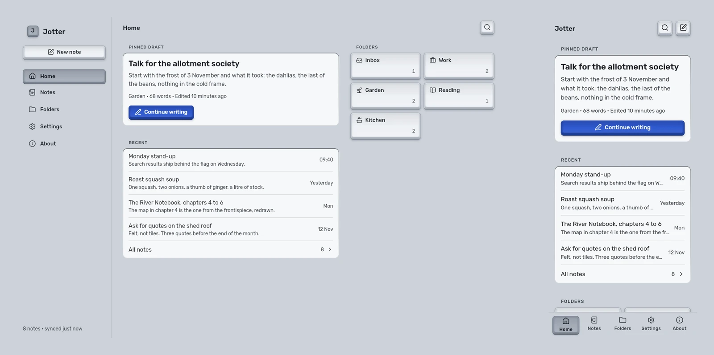
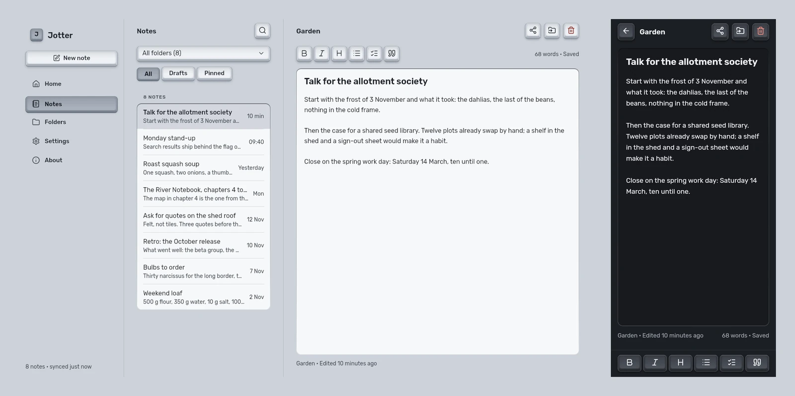
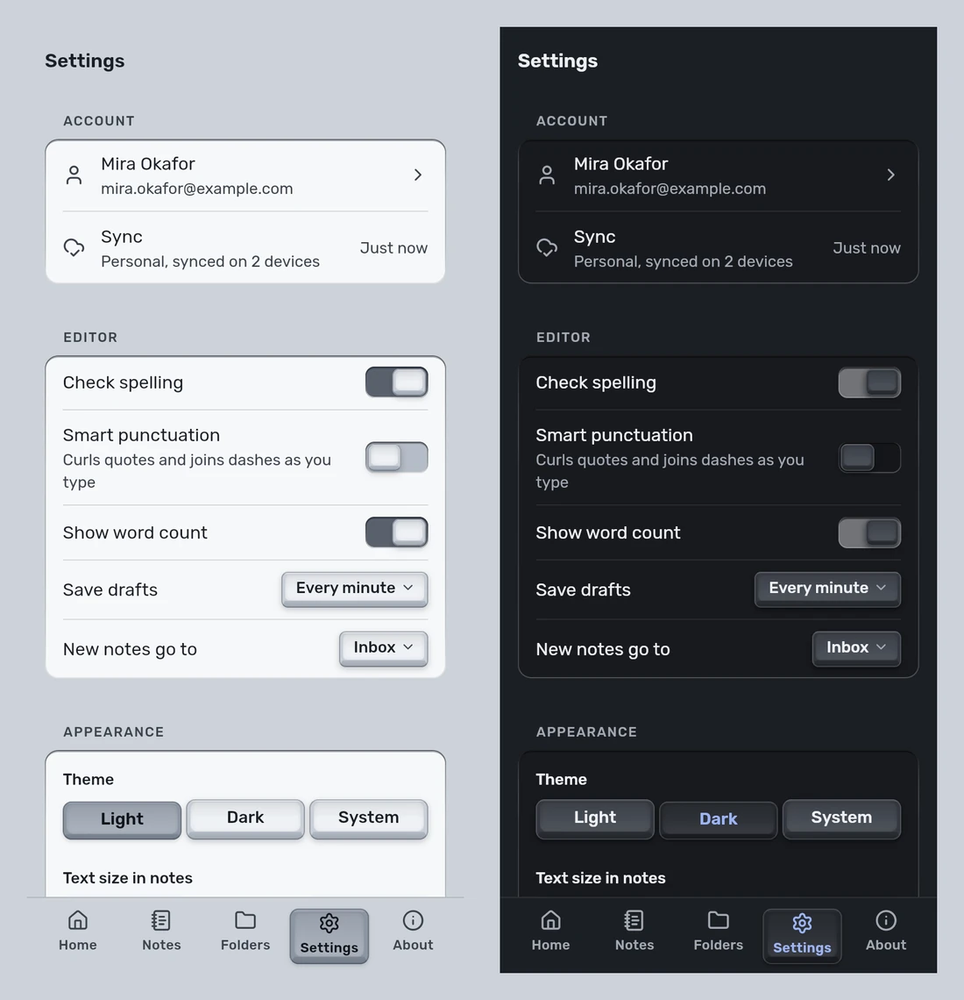

# keycap_ui

Keycap is a Flutter widget library that draws an app's controls as keycaps on a mechanical keyboard. Keys are sculpted, with their walls showing round a dished top face, and they travel down when pressed. Choices latch. Lists, cards and fields sit in wells cut into the case. It includes forms, navigation, dialogs, sheets and toasts in light and dark colourways.



**[Docs and demo](https://wenkaifan0720.github.io/flutter_design_systems/docs/looks/keycap/)** · [Try it in Stint](https://wenkaifan0720.github.io/flutter_design_systems/docs/stint/?look=keycap) · [API reference](https://pub.dev/documentation/keycap_ui/latest/) · [All the looks](https://wenkaifan0720.github.io/flutter_design_systems/docs/)

## Getting started

```yaml
dependencies:
  keycap_ui: ^0.5.0
```

The smallest app: `KeycapHost` in the app's `builder` gives everything under it Keycap's theme, by day and by night as the platform is.

```dart
import 'package:flutter/widgets.dart';
import 'package:keycap_ui/keycap_ui.dart';

void main() => runApp(
  WidgetsApp(
    color: const Color(0xFF2F59CF),
    builder: (context, _) => KeycapHost(
      child: Center(child: KeycapButton.accent(onPressed: () {}, child: const Text('New note'))),
    ),
  ),
);
```

A fuller app: load the bundled Rubik font before calling `runApp`, and place `KeycapHost` in the app's `builder` so pages and overlays share the same theme. This example uses `material_ui` for the app shell (`flutter pub add material_ui`).

```dart
import 'package:keycap_ui/keycap_ui.dart';
import 'package:material_ui/material_ui.dart';

Future<void> main() async {
  WidgetsFlutterBinding.ensureInitialized();
  await keycapLoadFonts();
  runApp(
    MaterialApp(
      theme: ThemeData(
        pageTransitionsTheme: const PageTransitionsTheme(builders: keycapPageTransitions),
      ),
      builder: (context, child) => KeycapHost(child: child!),
      home: const Notes(),
    ),
  );
}

class Notes extends StatelessWidget {
  const Notes({super.key});

  @override
  Widget build(BuildContext context) => KeycapScreen(
    topBar: const KeycapAppBar(title: 'Notes'),
    body: Center(
      child: KeycapButton.accent(onPressed: () {}, child: const Text('New note')),
    ),
  );
}
```

`keycapPageTransitions` gives every platform Keycap's page change: the new page comes a short way in from the reading end and settles while the page beneath steps back and dims. On iOS it keeps the swipe back from the screen's edge.

### CupertinoApp and WidgetsApp

`KeycapHost` goes in the builder of any app widget. With `CupertinoApp` from `cupertino_ui`:

```dart
CupertinoApp(
  builder: (context, child) => KeycapHost(child: child!),
  home: const Notes(),
)
```

With Flutter's `WidgetsApp`:

```dart
WidgetsApp(
  color: const Color(0xFF3B5BDB),
  builder: (context, child) => KeycapHost(child: child!),
  pageRouteBuilder: <T>(settings, builder) =>
      PageRouteBuilder<T>(settings: settings, pageBuilder: (context, _, _) => builder(context)),
  home: const Notes(),
)
```

## Everyday parts

A form: a field, a select and a key to save.

```dart
Column(
  crossAxisAlignment: CrossAxisAlignment.stretch,
  children: [
    KeycapTextField(labelText: 'Title', controller: title),
    const SizedBox(height: 24),
    KeycapSelect<String>(
      labelText: 'Folder',
      value: folder,
      items: const [
        KeycapSelectItem(value: 'work', label: 'Work'),
        KeycapSelectItem(value: 'home', label: 'Home'),
      ],
      onChanged: (value) => setState(() => folder = value),
    ),
    const SizedBox(height: 24),
    KeycapButton.accent(onPressed: save, child: const Text('Save')),
  ],
)
```

A group of rows, a switch that applies at once, and a key's menu with a destructive entry:

```dart
KeycapListGroup(
  header: 'Editor',
  children: [
    KeycapSwitchListTile(
      title: 'Check spelling',
      value: spellcheck,
      onChanged: (value) => setState(() => spellcheck = value),
    ),
    KeycapListTile(
      title: 'Groceries',
      trailing: KeycapMenu(
        semanticLabel: 'Note',
        entries: [
          RawMenuEntry(label: 'Pin', onPressed: pin),
          const RawMenuEntry.divider(),
          RawMenuEntry(label: 'Delete', isDestructiveAction: true, onPressed: delete),
        ],
        builder: (context, anchor) => KeycapIconButton(
          icon: const Icon(LucideIcons.ellipsis),
          semanticLabel: 'More',
          onPressed: anchor.toggle,
        ),
      ),
    ),
  ],
)
```

A dialog that confirms a loss ends in the danger key:

```dart
final delete = await showKeycapDialog<bool>(
  context: context,
  builder: (context) => KeycapDialog(
    title: 'Delete note?',
    content: const Text('It goes for good.'),
    actions: [
      KeycapButton(onPressed: () => Navigator.pop(context, false), child: const Text('Keep')),
      KeycapButton.accent(
        isDestructiveAction: true,
        onPressed: () => Navigator.pop(context, true),
        child: const Text('Delete'),
      ),
    ],
  ),
);
```



## Keys

Each kind of key has its own constructor and its own component theme:

- `KeycapButton`: a light key for a neutral action.
- `KeycapButton.modifier`: a darker key for a secondary action.
- `KeycapButton.accent`: the coloured key for the screen's main action. With `isDestructiveAction: true` it is the danger key a confirming dialog ends with; on a page, a destructive `KeycapButton` keeps its plastic and prints its words in the danger colour.
- `KeycapButton.text`: words printed on the case, with no key under them.
- `KeycapIconButton`: a square key. Give it `selected` and it latches.

A key that does nothing (`onPressed: null`) stands as a level, matte plate faded toward the case: no dish, no rim, no shadow. A coloured key goes neutral first, since its colour says what it does.

## What's inside

- **Fields**: `KeycapTextField`, `KeycapSearchField`, `KeycapPasswordField`, `KeycapOtpField`, `KeycapStepper`, `KeycapSelect`, `KeycapCombobox`, `KeycapTagInput`, `KeycapInputGroup`, `KeycapChip`, `KeycapColorPicker`, `KeycapDropZone`. A select and a combobox both end in the same chevron, the sign of a field that opens a list.
- **Choices**: `KeycapCheckbox`, `KeycapRadioGroup`, `KeycapSwitch`, `KeycapSwitchListTile`, `KeycapSegmentedButton`, `KeycapToggleGroup`, `KeycapTabBar`.
- **Dates and values**: `KeycapCalendar`, `KeycapDatePicker`, `KeycapDateRangePicker`, `KeycapTimePicker`, `KeycapSlider`, `KeycapRangeSlider`, `KeycapRating`, `KeycapWheelPicker`. A date or time field opens its month or its wheels over the keyboard from 600 wide, and in a sheet on a phone.
- **Lists and layout**: `KeycapListGroup`, `KeycapListTile`, `KeycapCard`, `KeycapTable`, `KeycapDataTable`, `KeycapTree`, `KeycapTimeline`, `KeycapDisclosure`, `KeycapCarousel`, `KeycapReorderableList`, `KeycapSwipeActions`, `KeycapRefresh`, `KeycapSplitView`, `KeycapScrollArea`.
- **Navigation**: `KeycapScaffold` (a row of places at a phone's foot, a rail from 600, a side column from 1024), `KeycapAppBar`, `KeycapBreadcrumb`, `KeycapPagination`, `KeycapStepProgress`, `KeycapPageDots`, `KeycapLegendKey`.
- **Over the keyboard**: `showKeycapDialog`, `showKeycapBottomSheet`, `showKeycapSideSheet`, `showKeycapActionSheet`, `KeycapMenu`, `KeycapContextMenu`, `KeycapMenuBar`, `showKeycapCommandPalette`, `KeycapPopover`, `KeycapHoverCard`, `KeycapTooltip` and toasts through `KeycapToaster`.
- **Feedback and charts**: `KeycapProgressBar`, `KeycapSpinner`, `KeycapMeter`, `KeycapSkeleton`, `KeycapBanner`, `KeycapEmptyState`, `KeycapStatusView`, `KeycapBarChart`, `KeycapLineChart`, `KeycapAreaChart`, `KeycapDonutChart`, `KeycapSparkline`.

The example app, Jotter, is a notebook built only from these widgets.

## Theming

`KeycapHost` follows the platform brightness. Keycap comes in six colourways, each by day and by night: `classic` (cool grey alphas, slate modifiers and a cobalt key, the default), `retro` (beige alphas, warm grey modifiers, an amber key), `sage`, `rose`, `lilac` and `ocean`. Each is the classic keyboard's plastics at the same tones in other hues, so every legend reads as it does in classic. Pick one with `KeycapHost(theme: KeycapThemeData.preset('sage', Brightness.light), darkTheme: KeycapThemeData.preset('sage', Brightness.dark), child: child!)`; `KeycapThemeData.presets` lists them and `KeycapColors.preset` gives a colourway's colours.

For a brand, wrap the app in `KeycapTheme` and pass `KeycapThemeData.from`, which moulds the accent key in the brand colour and keeps every legend readable:

```dart
final theme = KeycapThemeData.from(
  brightness: Brightness.light,
  accent: const Color(0xFF16807A),
  fontFamily: 'Inter',
);
```

Set a part's defaults on the theme (`buttonStyle`, `selectStyle`, `wellStyle` and the rest) or pass a `KeycapStyle` to one control. A style sets colours, padding and sizes; the cap's sculpt, the wells and the light stay the look's. `KeycapThemeData.density` takes `KeycapDensity.compact` or `comfortable`; by default it follows the platform. The cap, the well and the panel are public: `KeycapCap`, `KeycapWell` and `KeycapPanel`, for a part of your own in the look.



## Accessibility

Words read at WCAG AA on every key, well and panel, by day and by night, in every colourway; a calendar's days from the months either side stand quieter, at 3:1, as Cupertino's do. Keyboard focus is the keyboard's own backlight: a band of light round a focused key's foot, and a lit band inside a field's well. Tab reaches each control; a radio group, a one-choice segmented button and a one-at-a-time toggle group are one Tab stop each, and the arrows choose within them, as Flutter's `RadioGroup` does. A screen reader hears a checkbox, a radio and a switch as Flutter's own, with their state, and a latching key as a button that is selected, as `IconButton(isSelected:)` is. Dialogs and sheets keep the focus inside and give it back to the key that opened them. Every key travels on a short, calm spring that settles without a bounce, and under Reduce Motion every spring is critically damped. Text at 200% grows keys and rows rather than cutting their words.

## Languages and right to left

Add `RawWidgetsLocalizations.delegate` to the app's `localizationsDelegates` for the controls' own words (a pager's "next page", a tag's "remove", a search's "no results") in 30 languages. In a right-to-left locale the layout mirrors: keys, menus, charts and the side column read from the right. Figures follow the locale: dates, times, the number fields, the charts' scales, readouts and shares, and a meter's percentage write the reader's digits, Arabic-Indic in Arabic.

## Requirements

Flutter 3.47.0 or later. Keycap runs on Android, iOS, the web, macOS, Windows and Linux.

## Fonts

Rubik (SIL Open Font License 1.1) for the words; glyphs are Lucide's (ISC). Full notices are in `THIRD_PARTY_NOTICES/`.
