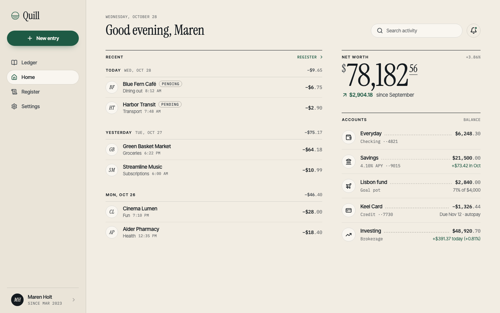
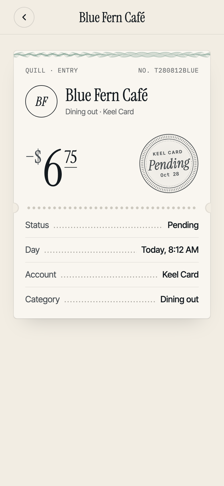
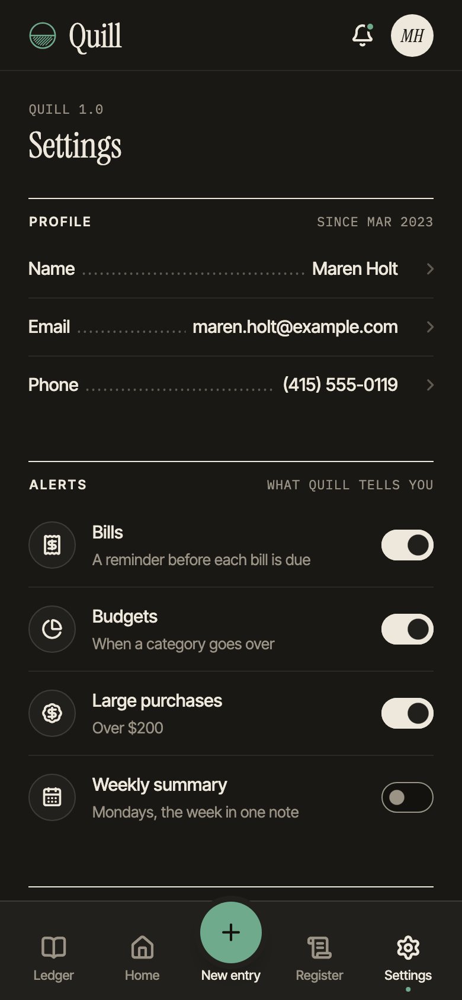

# ledger_ui

A Flutter design system kept in ink. A private bank statement on warm paper: ink rules where other looks draw boxes,
dot leaders between a line's words and its figure, engraved figures for the amounts that matter and a mono for every
other amount, one green for the act and the money that came in, a vermilion for what went over. Five presets (quire,
terracotta, indigo, verdigris, carbon), each designed by day and by lamplight, at three densities.

Take away the colour and the font and a settings form is still Ledger's: its fields are written on a rule rather than
boxed, its rows are ruled lists, its sections head on an ink rule, its amounts hang on their decimal point. Its states
are said in the same rules and ink: keyboard focus is the accountant's double rule under a control, a pressed act sinks
into the paper like a stamp, a hovered row's dot leader inks in, a disabled act is written in pencil, and a page
waiting for its records draws a dot leader in, dot by dot.



The parts take the parameters a Flutter developer expects: a press is `onPressed`, a row's tap `onTap`, a control is
`value` with `onChanged`, a destination is `selectedIndex` with `onDestinationSelected`, a null callback disables.

## Install

```yaml
dependencies:
  ledger_ui: ^0.1.0
```

## Use

`LedgerTheme` is the whole install. Put it in your app's `builder:`, under a `MaterialApp`, a `CupertinoApp` or a
`WidgetsApp`; Ledger has no app widget of its own.

```dart
import 'package:flutter/material.dart';
import 'package:ledger_ui/ledger_ui.dart';

Future<void> main() async {
  WidgetsFlutterBinding.ensureInitialized();
  await ledgerLoadFonts(); // the first frame is set in Ledger's faces
  runApp(const App());
}

class App extends StatelessWidget {
  const App({super.key});

  @override
  Widget build(BuildContext context) => MaterialApp(
    builder: (context, child) => LedgerTheme(
      data: MediaQuery.platformBrightnessOf(context) == Brightness.dark
          ? LedgerThemeData.dark()
          : LedgerThemeData.light(),
      child: child!,
    ),
    home: const AccountsPage(),
  );
}
```

Under a `CupertinoApp` or a `WidgetsApp` it is the same `builder:`; Ledger supplies the words Flutter's text field asks
Material for, so a field works under either. Every text under `LedgerTheme` falls back on Ledger's body style.

## Examples

A page is a `LedgerScreen` with its top bar and body:

```dart
LedgerScreen(
  topBar: const LedgerTopBar(title: 'Accounts'),
  body: LedgerSection(
    head: const LedgerHead('Everyday', note: 'Balance'),
    child: LedgerRows(
      children: [
        LedgerRow(
          leading: const LedgerGlyph(LucideIcons.wallet),
          title: 'Checking',
          subtitle: '··4821',
          subtitleMonospace: true,
          value: const LedgerAmount(6248.30),
          onTap: () => openAccount('checking'),
        ),
        LedgerRow(
          leading: const LedgerGlyph(LucideIcons.piggyBank),
          title: 'Savings',
          value: const LedgerAmount(18420.00),
          onTap: () => openAccount('savings'),
        ),
      ],
    ),
  ),
)
```

Buttons: `LedgerButton` is the ordinary act (ringed), `.filled` the page's one act in the green, `.ink` a firm act
filled with the ink, `.text` no frame; `isDestructiveAction: true` sets it in the vermilion.

```dart
LedgerButton.filled('Transfer', onPressed: transfer, expand: true);
LedgerButton('Cancel', onPressed: () => Navigator.pop(context));
```

A field is written on a rule; a select is a choice on the same rule:

```dart
LedgerTextField(label: 'Note', hint: 'What it is for', controller: note);

LedgerSelect<String>(
  label: 'Currency',
  value: currency,
  items: const [
    LedgerSelectItem(value: 'USD', label: 'US dollar'),
    LedgerSelectItem(value: 'EUR', label: 'Euro'),
  ],
  onChanged: (value) => setState(() => currency = value),
);
```

A dialog asks before an act and answers with the choice:

```dart
final confirmed = await LedgerDialog.show(
  context,
  title: 'Delete this entry?',
  body: 'It leaves your records for good.',
  type: LedgerDialogType.destructive,
  confirmLabel: 'Delete',
);
```

Navigation: `LedgerNavigationFrame` gives the window the navigation it earns, the tab bar under 600, the rail from 600
and the side bar with your wordmark from 1024.

```dart
LedgerNavigationFrame(
  destinations: const [
    LedgerNavItem(LucideIcons.house, 'Home'),
    LedgerNavItem(LucideIcons.list, 'Activity'),
    LedgerNavItem(LucideIcons.settings, 'Settings'),
  ],
  selectedIndex: tab,
  onDestinationSelected: (i) => setState(() => tab = i),
  brand: 'Quill',
  body: pages[tab],
);
```

| | |
|---|---|
|  |  |

## Theme

`LedgerTheme.of(context)` (or `context.ledgerTheme`) returns the `LedgerThemeData` in scope: its colours, its type
(the serif for heads and figures, the sans for words, the mono for amounts), its density and its radii. Restyle a part
of the tree with a nested `LedgerTheme`; `AnimatedLedgerTheme` animates between two.

```dart
// A preset by its id, for the platform's brightness.
LedgerThemeData.preset('verdigris', Brightness.dark);

// Your own paper, ink and accent; the rest is derived from them, words held to 4.5:1 on every ground.
LedgerThemeData.from(
  paper: const Color(0xFFF4EFE6),
  ink: const Color(0xFF1F2A2E),
  accent: const Color(0xFF2F6B4F),
);

// Density: standard is the touch size (a 48 button, a 52 row), comfortable 4 off each, compact 8; the default is
// compact under a pointer and standard on touch. A tap target stays 44 at every density.
LedgerThemeData.light().copyWith(density: LedgerDensity.compact);
```

## How Ledger is built

The rules every part follows, so a part you add can follow them too:

- **One sheet of paper, ink on it.** Everything is drawn in rules, figures, type and engraved hatching; a box is drawn
  only where a rule cannot carry it.
- **Order comes from rules, not containers.** An ink rule heads a section, a hairline parts the rows, a dot leader
  ties a name to its figure, and figures hang on their decimal point.
- **Only paper rises.** A slip (a receipt, a dialog, a sheet, a menu, a toast) is a separate leaf laid on the page,
  its soft drop from one lamp overhead; the page's green act stands on it like a seal and sinks when pressed. Nothing
  else lifts: a control lies flat on the page.
- **Ink never lies over ink.** Marks stand side by side on their line, as signatures do on a form.
- **Colour is ink.** One green for the act and for money in, one vermilion for what went over, each also laid as a
  pale wash; the rest is the paper and three strengths of ink. No glass, no glow.
- **A state is written.** Keyboard focus is the double rule under a control, a press sinks like a stamp, a disabled
  act is in pencil, an error is the vermilion line, and waiting is a dot leader drawn in.
- **Motion is the pen's and the page's.** Every change of state moves from where it is to where it is going: ink fades
  in, a rule is drawn in, a figure re-inked, a leaf laid down or lifted, day fades to lamplight. Nothing rolls,
  springs or curves away, and with reduced motion on it changes at once.

## The API, Flutter's way

Ledger's widgets take what Flutter's take: a value with `onChanged`, and a null callback disables a control (only
`LedgerTextField`, `LedgerSettingRow` and `LedgerSelectItem` keep an `enabled`, as `TextField`, `ListTile` and
`DropdownMenuItem` do). Every single control takes an optional `focusNode` and `autofocus`, and a widget that takes a
`TextEditingController` makes its own when none is given, keeps the words when you take yours back, and never disposes
one it was given. The theme is an immutable `LedgerThemeData` with `copyWith`, `lerp` and equality, read through an
inherited theme.

Labels and glyphs are a `String` and an `IconData` where Flutter would take a `Widget`, as in
`LedgerButton.filled('Save', icon: LucideIcons.check)`. They stay in 0.1.0; 0.2.0 adds an optional `Widget` slot beside
each, with the `String` made optional, so no call written for 0.1.0 breaks.

## Change one component

Copy a component's file from `lib/src/ledger/` into your app, rename its class, and replace its `src/` imports with
one import of `package:ledger_ui/ledger_parts.dart`, which exports everything the components are drawn with (the
pressable, the rules, the leader, the engraving and the other helpers). The rest of your app stays on the package.

## Accessibility and languages

- **Screen readers.** Every control says its role, its label, its value and its state (checked, selected, on,
  expanded, disabled); rules, leaders and engravings are drawn, not spoken. The tests sweep every gallery page and
  every screen of the example for a label on each control's face, at each density, on a phone and on the desktop,
  and hold the main pages to Flutter's tap-target, label and text-contrast guidelines by day and by night.
- **Keyboard.** Everything works from the keyboard, in reading order (right to left too): Tab to move, Enter and
  Space to press, the arrow keys in a select's list and on a slider, Escape to close. Focus is the double rule
  under the face.
- **Targets and contrast.** A target of 44 at every density (a density shrinks the drawn face, never the reach);
  words at 4.5:1 or more on their paper, by day and by lamplight.
- **Large text.** Words follow the platform's text size to 200% (past it, a page stands at 200%): controls and
  rows grow taller rather than cut words, long labels wrap, a name and its value on a leader turn onto two lines,
  two acts side by side stack, dialogs and sheets scroll; a tab's name too wide for its column sets smaller on its
  line rather than lose its end; a seal pressed beside a memo's or a cheque's words is pressed under them; a chart's labels inside its plot and the months under it, set where the engraving
  puts them, grow to 130% (its key and day ruler to 200%, a day that would close up on its neighbour giving way; a
  screen reader reads the chart whole), as do a tag's word and a footnote's mark. Words set inside a fixed shape
  keep their size: the engraved figures, written or typed (already large; one wider than its column is set
  smaller), a wordmark, a monogram's initials, a seal's lettering, a card face's printing, a counter, a calendar's weekdays and
  day numbers, a time wheel's figures and a badge's count.
- **Reduced motion.** With the platform's reduced motion on, every change of state lands at once.
- **Right to left.** Under a right-to-left `Directionality` the layout mirrors: the side bar and the rail stand at
  the right, rows and fields read from the right, chevrons and arrows turn (a button's too), and switches, sliders,
  gauges and the stack bar run from the reading start. Amounts and counters stay left to right, as do a sum typed
  after its sign, an account's masked number, the time wheel's hour and minute and a cheque's foot line. A time, a
  mask or a sign inside a line of words follows the platform's bidirectional order, so English words under a
  right-to-left page can carry them to the far end; translated words read as written. The example's Settings has a right-to-left
  switch, and the gallery's `/#/settings?dir=rtl` opens it that way.
- **Other scripts.** Ledger's three faces are Latin. Arabic, Hebrew, Chinese, Japanese, Hindi or Thai falls back
  on the platform's fonts (on the web, Flutter's Noto fallback).
- **Words.** The words a part says by itself (Cancel, Close, Back, Delete, Clear, Search, Loading, Today, Previous
  month, Next month, Dismiss) come from ui_core's `DesignLocalizations`, under `MaterialLocalizations`' names. They
  are English with nothing to set up, under any app. To translate them, extend `DefaultDesignLocalizations`,
  override the words, and add a delegate for your subclass to `localizationsDelegates`. Words the shared set does
  not have yet stay English in 0.1.0, most of them a parameter you can word yourself: a dialog's Confirm and Got
  it, a select's Choose one, Back to a page, Try again, the date picker's Done, Hour and Minute, the composer's
  words and the charts' spoken names. A text field's menu (Cut, Copy, Paste, Select all) and a sheet's spoken name
  are `material_ui`'s `MaterialLocalizations`: English when the app gives none, translated when it adds
  `material_ui`'s `GlobalMaterialLocalizations.delegates`.
- **Dates and amounts.** Dates, times and amounts print in English with US dollars (`LedgerFormat`); 0.2.0 reads
  them from the locale.
- **Known limits.** The charts read left to right in any page, their labels, keys and rulers with them.

## Example

`example/` is Quill, a household ledger built on Ledger: its Home, the register, a new entry and Settings, moved
between by Ledger's own navigation, then the index of every part's page, in every preset, by day and by lamplight.

## Licences

The package is BSD-3-Clause. It bundles Instrument Serif, Inter Tight and IBM Plex Mono under the SIL Open Font
License 1.1, and depends on `lucide_icons_flutter` (Lucide, ISC; Feather, MIT). The notices are in `LICENSE` and
`THIRD_PARTY_NOTICES/`.
