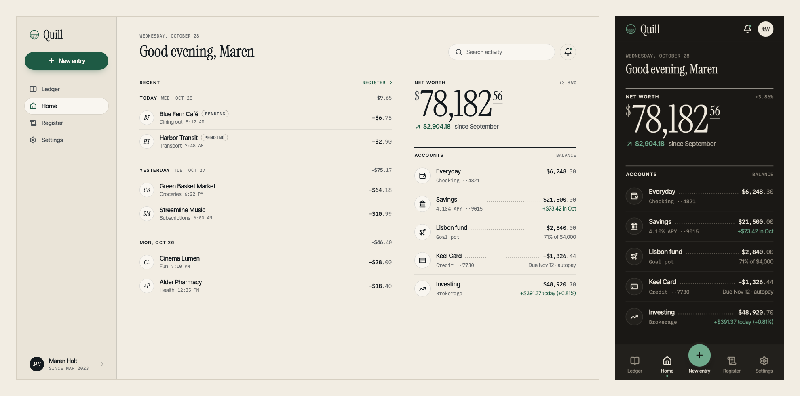
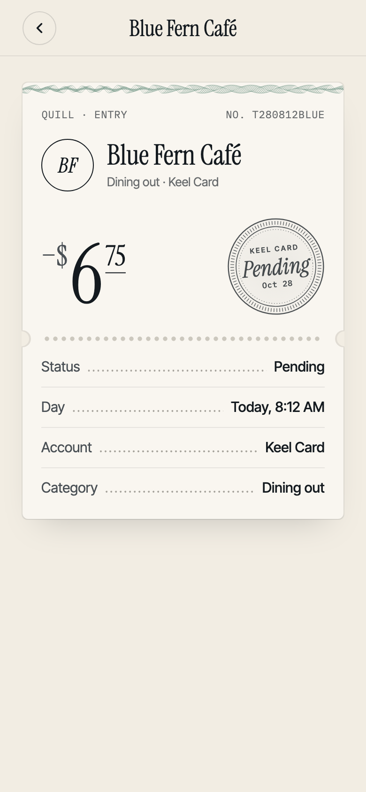
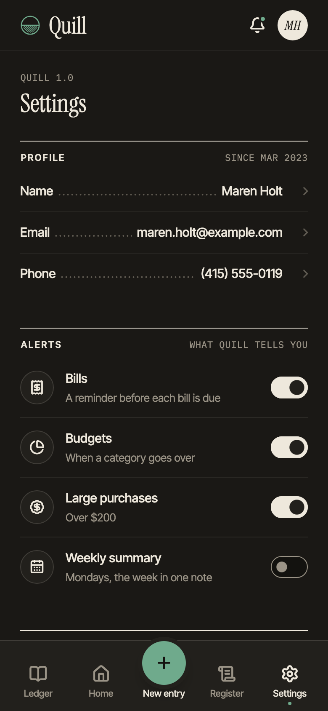

# ledger_ui

A Flutter design system kept in ink on warm paper, with ruled tables, tabular amounts, accessible form controls and responsive navigation. Choose from five colour presets in light or dark mode.



**[Live gallery](https://wenkaifan0720.github.io/flutter_design_systems/ledger/)** ·
[Docs](https://wenkaifan0720.github.io/flutter_design_systems/docs/looks/ledger/) ·
[API reference](https://pub.dev/documentation/ledger_ui/latest/) ·
[All the looks](https://wenkaifan0720.github.io/flutter_design_systems/)

## Install

```sh
flutter pub add ledger_ui material_ui
```

`material_ui` is the Material library Ledger is built on, for the quick start's `MaterialApp` (Flutter 3.50
deprecates `package:flutter/material.dart`).

## Quick start

Put `LedgerTheme` in the app’s `builder` so routes, dialogs and overlays inherit the theme. It works with `MaterialApp`, `CupertinoApp` and `WidgetsApp`.

```dart
import 'package:ledger_ui/ledger_ui.dart';
import 'package:material_ui/material_ui.dart';

Future<void> main() async {
  WidgetsFlutterBinding.ensureInitialized();
  await ledgerLoadFonts();
  runApp(const App());
}

class App extends StatelessWidget {
  const App({super.key});

  @override
  Widget build(BuildContext context) => MaterialApp(
    theme: ThemeData(pageTransitionsTheme: const PageTransitionsTheme(builders: ledgerPageTransitions)),
    builder: (context, child) => LedgerTheme(
      data: MediaQuery.platformBrightnessOf(context) == Brightness.dark
          ? LedgerThemeData.dark()
          : LedgerThemeData.light(),
      child: child!,
    ),
    home: const Center(child: Text('Accounts')),
  );
}
```

Under a `CupertinoApp` (from `cupertino_ui`) it is the same `builder:`. With no Material words in the app, `LedgerTheme` supplies them to its fields:

```dart
CupertinoApp(
  builder: (context, child) => LedgerTheme(
    data: LedgerThemeData.light(),
    child: child!,
  ),
  home: const AccountsPage(),
);
```

A bare `WidgetsApp` asks for its colour and how to build a route:

```dart
WidgetsApp(
  color: const Color(0xFF2F6B4F),
  builder: (context, child) => LedgerTheme(
    data: LedgerThemeData.light(),
    child: child!,
  ),
  pageRouteBuilder: <T>(RouteSettings settings, WidgetBuilder builder) =>
      PageRouteBuilder<T>(
        settings: settings,
        pageBuilder: (context, _, _) => builder(context),
      ),
  home: const AccountsPage(),
);
```

`ledgerPageTransitions` applies Ledger’s short fade and 8-pixel slide to pushed routes. Navigation destinations switch in place. The iOS back gesture and Android system back are supported. Reduced motion follows the platform setting.

## Examples

A page is a `LedgerScreen` with its top bar and body:

```dart
LedgerScreen(
  topBar: const LedgerTopBar(title: 'Accounts'),
  body: LedgerSection(
    head: const LedgerHead('Everyday', note: 'Balance'),
    child: LedgerRows(
      children: [
        LedgerRow(
          leading: const LedgerGlyph(LucideIcons.wallet),
          title: 'Checking',
          subtitle: '··4821',
          subtitleMonospace: true,
          value: const LedgerAmount(6248.30),
          onTap: () => openAccount('checking'),
        ),
        LedgerRow(
          leading: const LedgerGlyph(LucideIcons.piggyBank),
          title: 'Savings',
          value: const LedgerAmount(18420.00),
          onTap: () => openAccount('savings'),
        ),
      ],
    ),
  ),
)
```

Use `LedgerButton.filled` for the primary action. The default button is outlined, `.ink` uses a dark fill, and `.text` has no border. Set `isDestructiveAction` for a destructive action.

```dart
LedgerButton.filled('Transfer', onPressed: transfer, expand: true);
LedgerButton('Cancel', onPressed: () => Navigator.pop(context));
```

Text fields and selects share the same labelled underline.

```dart
LedgerTextField(label: 'Note', hint: 'What it is for', controller: note);

LedgerSelect<String>(
  label: 'Currency',
  value: currency,
  items: const [
    LedgerSelectItem(value: 'USD', label: 'US dollar'),
    LedgerSelectItem(value: 'EUR', label: 'Euro'),
  ],
  onChanged: (value) => setState(() => currency = value),
);
```

For a number in a form, such as an estimate in minutes or a number of copies, use `LedgerStepper(size: LedgerStepperSize.field, …)`. The number sits on a text field's rule at the same height, accepts typing within `min` and `max`, and shows the plain number. `format` sets what a screen reader announces. The default size is the budget's large figure. Both sizes show the plain number in the reader's digits; money is yours to ask for, for instance `format: (value) => LedgerFormat.money(value, showCents: false)` for a budget in whole dollars. `LedgerPieChart` works the same way: pass `format: LedgerFormat.money` when its shares are money.

To display tab content, give `LedgerTabs` a bounded height and supply one child per tab. The pages follow the tab selection, accept swipes and use their tab labels as accessible names.

`LedgerDialog.show` returns the user’s choice. A destructive confirmation initially focuses Cancel. Escape, tapping the scrim and system back dismiss the dialog with `null`.

```dart
final confirmed = await LedgerDialog.show(
  context,
  title: 'Delete this entry?',
  body: 'It leaves your records for good.',
  type: LedgerDialogType.destructive,
  confirmLabel: 'Delete',
);
```

`LedgerNavigationFrame` displays a bottom bar below 600 logical pixels, a rail from 600, and a sidebar from 1024. The current page keeps its state as the window resizes. Arrow keys move between destinations and F6 switches focus between navigation and the page.

```dart
LedgerNavigationFrame(
  destinations: const [
    LedgerNavItem(LucideIcons.house, 'Home'),
    LedgerNavItem(LucideIcons.list, 'Activity'),
    LedgerNavItem(LucideIcons.settings, 'Settings'),
  ],
  selectedIndex: tab,
  onDestinationSelected: (i) => setState(() => tab = i),
  brand: 'Quill',
  body: pages[tab],
);
```

| | |
|---|---|
|  |  |

## Theme

`LedgerTheme.of(context)` (or `context.ledgerTheme`) returns the `LedgerThemeData` in scope: its colours, its type
(the serif for heads and figures, the sans for words, the mono for amounts), its density and its radii. Restyle a part
of the tree with a nested `LedgerTheme`; `AnimatedLedgerTheme` animates between two.

```dart
// A preset by its id, for the platform's brightness.
LedgerThemeData.preset('verdigris', Brightness.dark);

// Your own paper, ink and accent; the rest is derived from them, words held to 4.5:1 on every ground.
LedgerThemeData.from(
  paper: const Color(0xFFF4EFE6),
  ink: const Color(0xFF1F2A2E),
  accent: const Color(0xFF2F6B4F),
);

// Density: standard is the touch size (a 48 button, a 52 row), comfortable 4 off each, compact 8; the default is
// compact under a pointer and standard on touch. A tap target stays 44 at every density.
LedgerThemeData.light().copyWith(density: LedgerDensity.compact);
```

Use `LedgerThemeData.from` to derive a coordinated palette from your accent. Use `copyWith` for individual overrides. The semantic money colours are `moneyIn` for income, `over` for spending over a limit, and `move` for transfers. The preset corner radii and all three densities can be customized.

## Component styles

Most controls accept `value` and `onChanged`. A null callback disables the control. Supply a `TextEditingController` when you need to manage field contents from your app.

Use `LedgerThemeData.components` for app-wide component defaults. On widgets with a `style` parameter, a local `LedgerStyle` overrides those defaults. Buttons, fields, chips, switches, banners and dialogs support styles. Selects, sliders, navigation and sheets use the surrounding theme. Field styles control the underline, paper, padding and text.

```dart
// Use the accent colour while the button is enabled.
final green = context.ledgerTheme.accentText;
final inGreen = WidgetStateProperty.resolveWith(
  (states) => states.contains(WidgetState.disabled) ? null : green,
);
LedgerButton(
  'Export',
  onPressed: export,
  style: LedgerStyle(edge: inGreen, foreground: inGreen),
)
```

Labels and glyphs are a `String` and an `IconData` where Flutter would take a `Widget`, as in
`LedgerButton.filled('Save', icon: LucideIcons.check)`. Use the label for the action’s accessible name.

## Change one component

Copy a component's file from `lib/src/ledger/` into your app, rename its class, and replace its `src/` imports with
one import of `package:ledger_ui/ledger_parts.dart`, which exports everything the components are drawn with (the
pressable, the rules, the leader, the engraving and the other helpers). The rest of your app stays on the package.

## Accessibility and localization

- Use Tab to move between controls, Enter or Space to activate them, and Escape to close overlays. A set of radios, a segmented control or a one-choice toggle group is one Tab stop, on the chosen option, and the arrow keys move and choose. Selects support arrow keys, Home, End and type-ahead. Sliders respond to arrow keys. Keyboard focus is shown with a double underline.
- Control hit targets stay at least 44 logical pixels across densities. Labels and form rows wrap at large text sizes. Calendar days and weekday names scale within the seven-column grid. Chart legends and rulers scale separately from labels inside the plot.
- The layout follows `Directionality`. Money, masked account numbers and step counts preserve their numeric order in right-to-left layouts. Charts retain their left-to-right time axis.
- Add `RawWidgetsLocalizations.delegate` to `localizationsDelegates` and `RawWidgetsLocalizations.supportedLocales` to `supportedLocales` to localize shared control labels. Supply translated application labels, chart names and prompts yourself. The bundled fonts cover Latin scripts. Other scripts use platform fallback fonts.
- `LedgerFormat` prints dates and times in English and currency amounts in US dollars. Use `LedgerStepper.format` to display a different unit in a stepper.

## Example app

Run the app in `example/` to explore Quill, a household ledger with an account overview, transaction register, entry form and settings. Its component gallery includes every preset in light and dark mode.

## Requirements

Flutter 3.47 or later (Dart 3.13). The package depends on ui_core ^0.4.1 and re-exports it, so `RawWidgetsLocalizations`
and the `Raw*` parts come with the one import.

## Licences

The package is BSD-3-Clause. It bundles Instrument Serif, Inter Tight and IBM Plex Mono under the SIL Open Font
License 1.1, and depends on `lucide_icons_flutter` (Lucide, ISC; Feather, MIT). The notices are in `LICENSE` and
`THIRD_PARTY_NOTICES/`.
