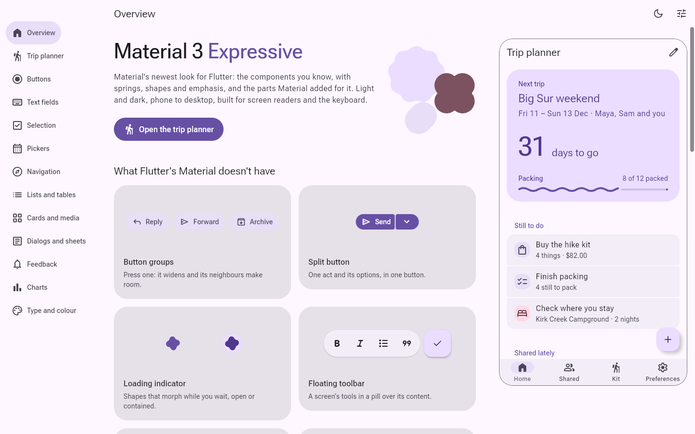
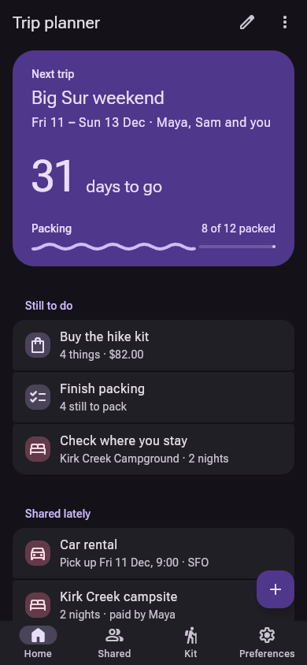
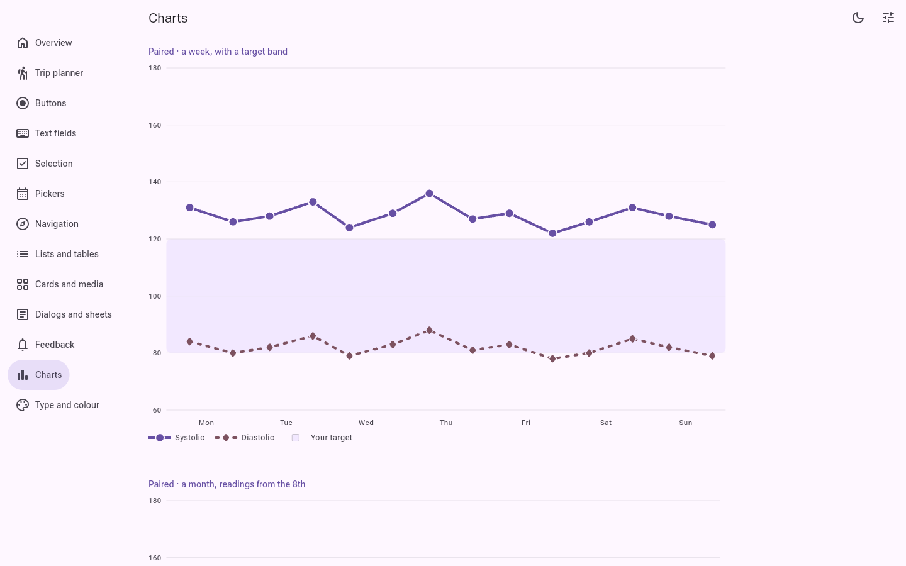
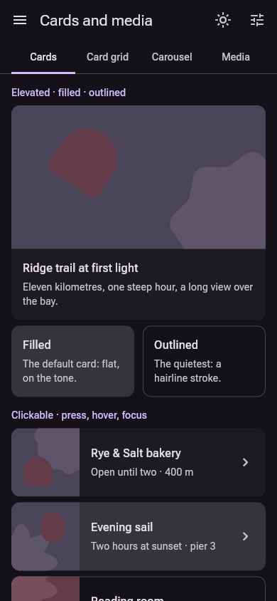

# material_expressive_ui

An independent Flutter implementation of Material 3 Expressive; not affiliated with or endorsed by Google.

Material 3 Expressive is Material's newest look, and its loudest: shapes that morph on springs, a library of
thirty-five shapes (cookies, clovers, bursts, a heart) for avatars, pictures and indicators, emphasized type, colour
used in large tonal fields, and motion that overshoots and settles. This package ports it from Jetpack Compose's
`material3` 1.5.0-alpha29 (the tokens, the motion springs, the shape library and the components: the button group that
widens the pressed button, the loading indicator's seven shapes, wavy progress, the floating toolbar, the FAB menu, the
carousel's masks), each checked against Compose's own renders on an Android emulator. Five presets ship, each light and
dark at three contrast levels, and any seed colour makes a scheme.

| Desktop, by day | Phone, by night |
| --- | --- |
|  |  |
|  |  |

The components carry the names Material gives them (`ExpressiveButton`, `ExpressiveTextField`,
`ExpressiveNavigationBar`, `ExpressiveSnackBar`, `ExpressiveLinearProgressIndicator`, ...) and the parameters a Flutter
developer expects: a press is `onPressed`, a control is `value` with `onChanged`, a destination is `selectedIndex`.

## Install

```yaml
dependencies:
  material_expressive_ui: ^0.1.0
```

## Set up

`ExpressiveTheme` is the whole install. Put it in your app's `builder:`, under a `MaterialApp`, a `CupertinoApp` or a
`WidgetsApp`; there is no app widget of Expressive's own. Load the bundled faces (Roboto Flex, Jost and the Material
Symbols subset) before the first frame:

```dart
import 'package:flutter/material.dart';
import 'package:material_expressive_ui/material_expressive_ui.dart';

Future<void> main() async {
  WidgetsFlutterBinding.ensureInitialized();
  await expressiveLoadFonts();
  runApp(const App());
}

class App extends StatelessWidget {
  const App({super.key});

  @override
  Widget build(BuildContext context) => MaterialApp(
    localizationsDelegates: const [
      DefaultDesignLocalizations.delegate,
      ExpressiveLocalizations.delegate,
      DefaultMaterialLocalizations.delegate,
      DefaultWidgetsLocalizations.delegate,
    ],
    builder: (context, child) => ExpressiveTheme(
      data: ExpressiveThemeData.grove(MediaQuery.platformBrightnessOf(context)),
      child: child!,
    ),
    home: Builder(
      builder: (context) => ColoredBox(
        color: context.expressiveTheme.colors.surface,
        child: Center(
          child: ExpressiveFilledButton('Book a table', onPressed: () {}),
        ),
      ),
    ),
  );
}
```

A `CupertinoApp` or a `WidgetsApp` takes the same `builder:`. The text fields are Flutter's `EditableText` under
Material's `TextField`, so such an app lists `DefaultMaterialLocalizations.delegate` (or `GlobalMaterialLocalizations`)
among its `localizationsDelegates`, as for any Material widget. `ExpressiveTheme` sets the text-selection colours below
it as Compose's `MaterialTheme` does (handles and caret in `primary`, the selection at 40%), whatever Material theme the
app wears.

## Everyday parts

```dart
// A button: filled, tonal, outlined, elevated or text. In a group, the pressed
// button widens and its neighbours give way.
ExpressiveButtonGroup(
  children: [
    ExpressiveFilledButton('Book', onPressed: book),
    ExpressiveOutlinedButton('Save for later', onPressed: save),
  ],
);

// A field: filled or outlined, the label floating up as you type.
ExpressiveTextField(label: 'Where to?', hintText: 'A city or a park', controller: place);

// A select: a field that opens a menu of options.
ExpressiveSelect<String>(
  label: 'Room',
  value: room,
  options: const [
    ExpressiveSelectOption('single', 'Single'),
    ExpressiveSelectOption('double', 'Double'),
  ],
  onChanged: (value) => setState(() => room = value),
);

// A list row: its corners round up as you press it.
ExpressiveListTile(
  leading: const Icon(ExpressiveSymbols.hotel),
  title: const Text('Casa do Rio'),
  subtitle: const Text('3 nights, from 14 March'),
  onTap: openStay,
);

// A dialog, raised over the scrim on the effects spring.
showExpressiveDialog<void>(
  context: context,
  builder: (context) => const ExpressiveDialog(
    title: 'Discard this trip?',
    text: 'Its stays and notes go with it.',
    actions: [
      ExpressiveDialogAction('Keep'),
      ExpressiveDialogAction('Discard', filled: true),
    ],
  ),
);

// Navigation: the bar's pill springs to the chosen destination.
ExpressiveNavigationBar(
  destinations: const [
    ExpressiveNavItem(ExpressiveSymbols.home, 'Home'),
    ExpressiveNavItem(ExpressiveSymbols.explore, 'Explore'),
    ExpressiveNavItem(ExpressiveSymbols.bookmark, 'Saved'),
  ],
  selectedIndex: tab,
  onDestinationSelected: (index) => setState(() => tab = index),
);
```

The parts follow Flutter's conventions. A null `onPressed`, `onTap` or `onChanged` disables a part at its full size;
there is no separate `enabled` flag where Flutter's own widget has none. Every single-target part takes an optional
`focusNode` and `autofocus`, and a part that owns a controller or focus node disposes only its own. Labels and icons
take a `String` and an `IconData` (`ExpressiveFilledButton('Save', icon: ExpressiveSymbols.add)`), as
`NavigationDestination.label` and `Tab.text` do; a button also takes a `child` widget in place of its words, and the
other parts gain widget slots beside their strings in 0.2.0.

## Theme

`ExpressiveTheme.of(context)` (or `context.expressiveTheme`) returns the `ExpressiveThemeData` in scope: its colour
roles (`colors`, Material's 48 roles), the type scale (`type`), the corner scale (`shapes`) and the motion scheme
(`motion`, standard or expressive springs). There are five presets, each baked by material-color-utilities from a seed
at the 2025 spec, light and dark, at standard, medium and high contrast:

| Preset | Seed | Variant | Motion |
|---|---|---|---|
| `baseline` | #6750A4 | tonal spot | expressive |
| `slate` | #52667A | neutral | standard |
| `bloom` | #B5487A | vibrant | expressive |
| `grove` | #2E7D5B | tonal spot | expressive |
| `ember` | #C25A1F | expressive | expressive |

Each has a factory (`ExpressiveThemeData.ember(Brightness.dark)`), and `ExpressiveThemeData.preset(id, brightness)`
takes the id. Restyle part of the tree with a nested `ExpressiveTheme`; `AnimatedExpressiveTheme` springs from one theme
to the next as Compose animates colour, and `ExpressiveThemeData.lerp` blends two.

`ExpressiveThemeData.from(seed:, brightness:)` derives a colour scheme from an app's seed; `shapes` is M3's shape scale
(`extraSmall` to `extraExtraLarge`, and `full`), the one way to an app's corners; `density` is `ExpressiveDensity`, in
Flutter's steps (`standard`, `comfortable`, `compact`), which adapts to the platform when unset (compact where a pointer
is the norm, standard on touch); `motion` picks the Expressive or Standard motion scheme; the type scale takes a
brand's own display and text families.

```dart
final theme = ExpressiveThemeData.from(seed: const Color(0xff00695c)).copyWith(
  density: ExpressiveDensity.compact,
);
```

Components with a frame or plate take `style:` and a matching component theme, such as `buttonTheme`, `cardTheme`,
`textFieldTheme`, `datePickerTheme`, `carouselTheme` or `chartTheme`. `ExpressiveComponentThemeData` holds the stateful
slots `backgroundColor`, `foregroundColor`, `outline`, `overlayColor`, `side`, `shape`, `padding`, `minimumSize`,
`textStyle` and `iconSize`. Each is a `WidgetStateProperty`; resolution is widget style, component theme, global knob,
then the original token, and a slot resolving to null falls through to the next layer. A `shape` takes any
`OutlinedBorder`, among them `ExpressiveMaterialShapeBorder`, the shape library's shapes, which morph from one to the
next when they change.

```dart
ExpressiveFilledButton(
  'Save',
  onPressed: save,
  style: ExpressiveComponentThemeData(
    shape: WidgetStateProperty.resolveWith(
      (states) => states.contains(WidgetState.pressed)
          ? const ExpressiveMaterialShapeBorder(ExpressiveMaterialShape.cookie9Sided)
          : null,
    ),
  ),
);
```

`theme.status.success` and `theme.status.warning` are two more custom colours (colour, on-colour, container,
on-container), harmonised to each preset's seed and baked for light and dark; `ExpressiveBanner` and `ExpressiveTag`
take them as tones.

## How Material Expressive is built

These are Material's own principles as the package keeps them. A part Material never drew (breadcrumbs, a file drop
area, a group of faces) is built from them and from Material's own parts, never copied from another system in
Material's colours; build yours the same way.

- **Made of** flat surfaces of tonal colour: a container in one colour role, its content in the paired on-colour. No
  gradients, textures, bevels, glass or inner shadows; a picture or a chart's data is content, not surface.
- **Depth is tone first.** A surface higher up takes a higher surface-container tone. Only what floats over the page
  (a FAB, a menu, a sheet, a dialog, an item being dragged) also casts Material's shadow, lit from above, at one of its
  six elevation levels.
- **Surfaces stack whole.** One lies over another or stands beside it, never through it: parts on one surface stand
  side by side across the spacing scale (a group of faces is a row, not a pile), a badge rides on the corner of what it
  counts, and a modal surface lies over a scrim.
- **An edge is a solid hairline**: `outline` round a field or a control, `outlineVariant` between things. Never dashed,
  and never drawn to fake depth.
- **Shape** comes from the shape scale; the thirty-five library shapes mark emphasis (faces, pictures, indicators), and
  a pressed or chosen part changes shape.
- **Motion is springs.** Spatial springs (place, size, shape) may overshoot and settle; effects springs (colour,
  opacity) never do; under Reduce Motion nothing overshoots.
- **Interaction** is a state layer of the content colour in the part's own shape (8% hover, 10% focus and press with
  the ripple, 16% drag), the 3 dp focus ring, and a target of at least 48 dp.

## The host library

`package:material_expressive_ui/material_expressive_host.dart` holds the app's frame: `ExpressivePage`,
`ExpressiveSheetPage` and `ExpressiveFullScreenDialogPage` (`Page`s for any `Navigator`'s `pages`, with the platform's
push, the predictive back on Android and the edge swipe on iOS); `ExpressiveShellScaffold`, the app's navigation (the
flexible bar on a phone and the rail from 600 dp, the floating action button and an accessory docked on the bar); the
preview frame, the chrome metrics, the formatters and the inventory. No router package is needed; the example runs its
live apps on plain navigators.

## The parts library

Copy a component's file from `lib/src/material_expressive/components/` into your app, rename its class, and replace
its sibling imports with one import of `package:material_expressive_ui/material_expressive_parts.dart`, which exports
everything the components are drawn with (tokens, shapes and their morphs, springs, state layers). The rest of your app
stays on the package. The package's tests copy every component file this way and analyze it.

The parts library's generated token and behaviour classes keep Compose's names (`ButtonSmallTokens`,
`AlertDialogBehavior`, ...): they are generated from Compose's source, the docs cite them by those names, and a value
checked against Compose is found under the same name there. Everything hand-written in it carries the `Expressive`
prefix. The shape port under `internal/shape/graphics/` is AndroidX's graphics-shapes kept as one library in parts; it
is not one to copy. Its `ExpressiveShapeCubic` is AndroidX's `Cubic`, renamed so it never hides Flutter's `Cubic`
curve.

## Accessibility and languages

- **Right to left.** Every part mirrors under a right-to-left `Directionality`: rows, fields' leading and trailing
  icons and their prefix and suffix, tabs, segments, navigation, dialogs' actions, chevrons and arrows, sliders and
  progress (which fill from the start side), carousels and swipe actions. Parameters say start and end and take
  `EdgeInsetsGeometry` and `AlignmentGeometry`. The example's Customize switches the direction for every page.
- **Large text.** Parts follow the platform's text scale and grow taller rather than cut words; the package's tests lay
  out every gallery page at 2.0 with no overflow. Dialogs and sheets scroll.
- **Other scripts.** Roboto Flex and Jost cover Latin, Greek and Cyrillic. Other scripts (Arabic, Hebrew, Chinese,
  Japanese, Devanagari, Thai) draw in the platform's fallback fonts, and on the web Flutter fetches Noto for them.
- **Words.** A component says 98 words by itself, English until you give others. 26 of them (Back, Close, Cancel,
  OK, Today, Next month, Clear, Search, "Slide 2 of 5", ...) come from ui_core's `DesignLocalizations`, the one set
  every look shares, under `MaterialLocalizations`' names; the other 72 (the pickers' titles and modes, a chat
  bubble's status, the toolbar's and FAB menu's actions, ...) are `ExpressiveLocalizations`' parameters. Another
  language gives both, each through a delegate (`ExpressiveLocalizationsScope` gives a subtree its own):

  ```dart
  class FrenchWords extends DefaultDesignLocalizations {
    const FrenchWords();
    @override
    String get cancelButtonLabel => 'Annuler';
  }

  class French<T> extends LocalizationsDelegate<T> {
    const French(this.words);
    final T words;
    @override
    bool isSupported(Locale locale) => locale.languageCode == 'fr';
    @override
    Future<T> load(Locale locale) => SynchronousFuture(words);
    @override
    bool shouldReload(French<T> old) => false;
  }

  // MaterialApp(localizationsDelegates: [...], ...)
  const french = [
    French<DesignLocalizations>(FrenchWords()),
    French<ExpressiveLocalizations>(ExpressiveLocalizations(selectDate: 'Choisir une date')),
  ];
  ```

  A part that takes its own label still uses yours.
- **Dates and numbers.** The time picker follows the platform's 12- or 24-hour setting, and the date pickers' and the
  calendar's weeks start on `DesignLocalizations.firstDayOfWeek`. Month and weekday names and number formats are
  English in 0.1.0.
- **Screen readers and keyboard.** Every control has a semantics role, name, value and state (checked, selected,
  expanded, disabled), and decorative paint is excluded. Every control takes focus and the keyboard (Enter and Space
  press it, and keyboard focus draws Material's 3 dp focus ring in `secondary`, 2 dp out from the edge and concentric
  with the part's corners; a tab draws it inside, as Material's tabs do, so a neighbour never clips it). Focus follows
  reading order, right to left too. Every target is at least 48 dp, Compose's `minimumInteractiveComponentSize`: the
  face keeps its size and the room around it takes the touch.
- **Contrast and motion.** Text and controls take their colours from Material's tone pairs, which hold 4.5:1 for
  words. Under Reduce Motion springs settle without overshoot and the indeterminate indicators hold still; state
  colours still ease rather than switch at once.
- **Tests.** Flutter's tap target, label and text contrast guidelines run on every gallery page in every preset, light
  and dark; every gallery page lays out right to left and at text scale 2.0. Each everyday part runs the checks every
  look shares (`test/world_checks.dart`): it mirrors right to left, lays out at text scale 2.0 and meets the
  guidelines, light and dark.

## Example

`example/` is an app built on the package. It opens on an overview and a trip planner (its home, a plan form, a shared
list, a packing checkout and settings), then the component families: Buttons, Text fields, Selection, Pickers,
Navigation, Lists and tables, Cards and media, Dialogs and sheets, Feedback, Charts, Type and colour. Its destinations
stand in the expanded navigation rail at a wide window and in the modal drawer on a phone. Every exported widget is
live on one of its pages. Customize, in the app bar, re-themes every page, the app's own chrome included: preset or
seed colour, density and the motion scheme.

## Licences

The package is BSD-3-Clause. It bundles Roboto Flex and Jost under the SIL Open Font License 1.1 and a subset of Material
Symbols Rounded under the Apache License 2.0, and ports code from AndroidX (graphics-shapes, Apache 2.0) and
`material_new_shapes` (MIT). The notices are in `LICENSE` and `THIRD_PARTY_NOTICES/`.
