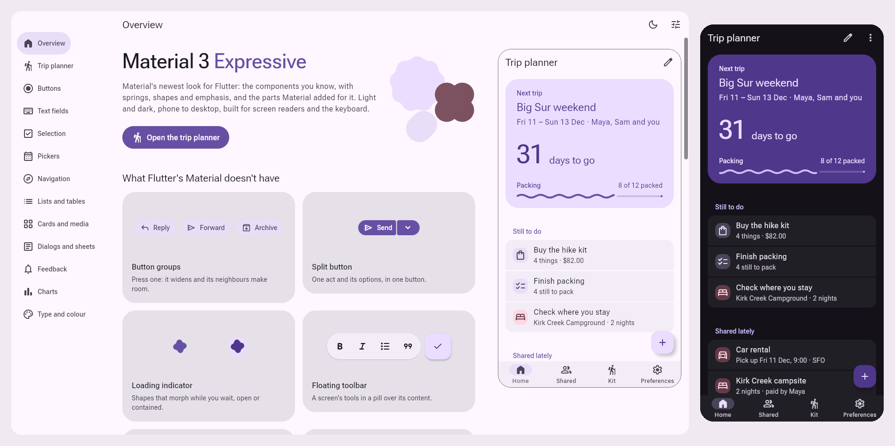

# material_expressive_ui

Material 3 Expressive components for Flutter. The package includes spring-animated buttons, form fields, pickers, charts and adaptive navigation. Its shapes, colour schemes and motion follow the AndroidX Compose implementation.



[Live gallery](https://wenkaifan0720.github.io/flutter_design_systems/material_expressive/) · [API reference](https://pub.dev/documentation/material_expressive_ui/latest/)

## Getting started

```sh
flutter pub add material_expressive_ui material_ui
```

Load the bundled fonts before the first frame and install `ExpressiveTheme` in the app builder. This example uses `MaterialApp` from `material_ui`. A `WidgetsApp` or `CupertinoApp` can use the same builder and localization delegates.

```dart
import 'package:material_expressive_ui/material_expressive_ui.dart';
import 'package:material_ui/material_ui.dart';

Future<void> main() async {
  WidgetsFlutterBinding.ensureInitialized();
  await expressiveLoadFonts();
  runApp(const App());
}

class App extends StatelessWidget {
  const App({super.key});

  @override
  Widget build(BuildContext context) => MaterialApp(
    theme: ThemeData(
      pageTransitionsTheme: const PageTransitionsTheme(
        builders: expressivePageTransitions,
      ),
    ),
    localizationsDelegates: const [
      DefaultDesignLocalizations.delegate,
      ExpressiveLocalizations.delegate,
      DefaultMaterialLocalizations.delegate,
      DefaultWidgetsLocalizations.delegate,
    ],
    builder: (context, child) => ExpressiveTheme(
      data: ExpressiveThemeData.grove(MediaQuery.platformBrightnessOf(context)),
      child: child!,
    ),
    home: Builder(
      builder: (context) => ColoredBox(
        color: context.expressiveTheme.colors.surface,
        child: Center(
          child: ExpressiveFilledButton('Book a table', onPressed: () {}),
        ),
      ),
    ),
  );
}
```

## Themes

Choose a preset with `ExpressiveThemeData.preset(id, brightness)` or derive a colour scheme with `ExpressiveThemeData.from(seed: brand, brightness: brightness)`. The presets provide light, dark and high-contrast colours. Pass `contrastLevel: 1` for a high-contrast preset.

| Preset | Seed | Variant | Motion |
|---|---|---|---|
| `baseline` | #6750A4 | tonal spot | expressive |
| `slate` | #52667A | neutral | standard |
| `bloom` | #B5487A | vibrant | expressive |
| `grove` | #2E7D5B | tonal spot | expressive |
| `ember` | #C25A1F | expressive | expressive |

Widgets read their theme from `context.expressiveTheme`. Use `copyWith` to set density, typography, shapes, motion or a component theme. An individual widget's `style` overrides the component theme for that widget. A `WidgetStateProperty` can vary a colour or shape for focus, selection and other states.

## Navigation and localization

Import `package:material_expressive_ui/material_expressive_host.dart` for `ExpressiveHost`, adaptive app navigation and page transitions. `ExpressiveShellScaffold` places destinations in a bottom bar on phones and a rail on wider screens. `ExpressivePage`, `ExpressiveSheetPage` and `ExpressiveFullScreenDialogPage` work with the Navigator pages API.

Use `ExpressiveLocalizations` for component text and `DesignLocalizations` for shared actions. Both include English defaults, and `ExpressiveLocalizations.delegate` takes every locale. Supply delegates for your app's other languages. Until you do, a time picker's words come from `DesignLocalizations`, which ui_core speaks in 30 languages. Give icon-only controls a `semanticLabel` and give the rating a name such as “Rate this trip” so a screen reader can announce its current score in context.

## Custom components

To adapt a component, copy its source into your app and import `package:material_expressive_ui/material_expressive_parts.dart` for its drawing and animation helpers. Check copied components when updating the package because these helpers may change between releases.

## Example

The example app includes a Trip planner and an interactive component gallery. Switch between light and dark themes, change text size, or try right-to-left layout from the gallery settings. Run it from the repository with `cd example` and `flutter run`.

## Licences

The package is BSD-3-Clause. Roboto Flex and Jost use the SIL Open Font License 1.1. Material Symbols Rounded and the AndroidX graphics-shapes port use Apache 2.0. The `material_new_shapes` port uses the MIT licence. Notices ship in `LICENSE` and `THIRD_PARTY_NOTICES/`.

This is an independent implementation of Material 3 Expressive.
