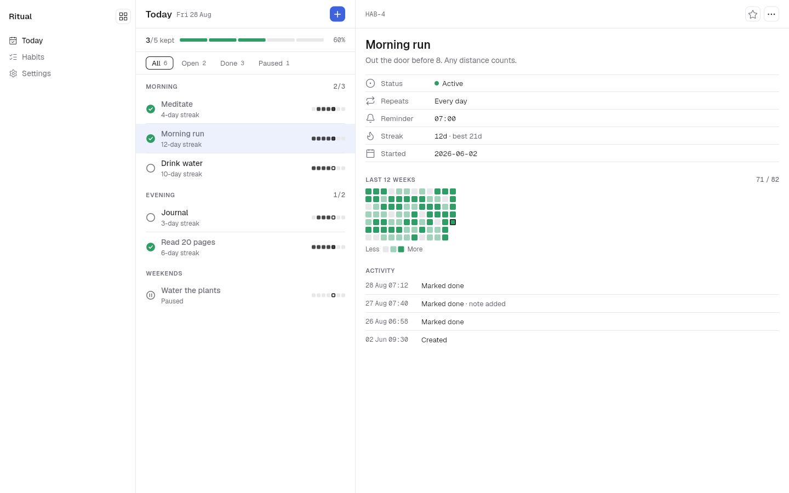
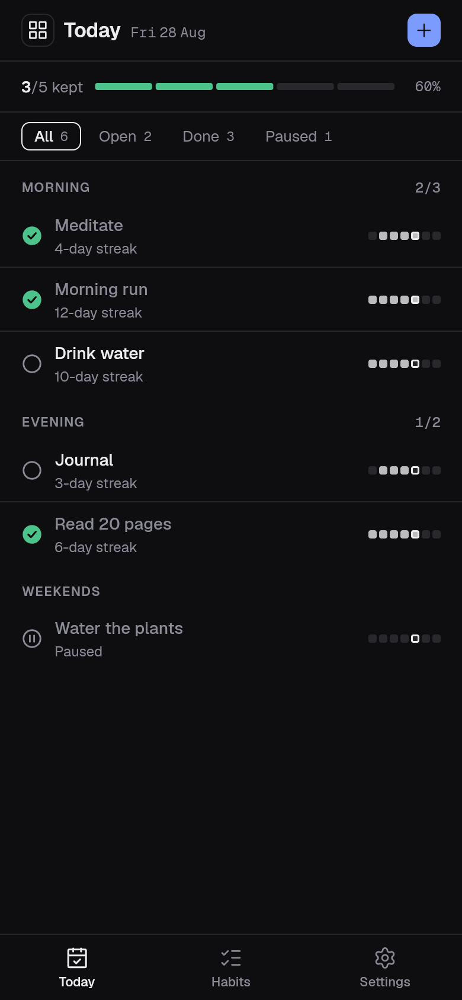
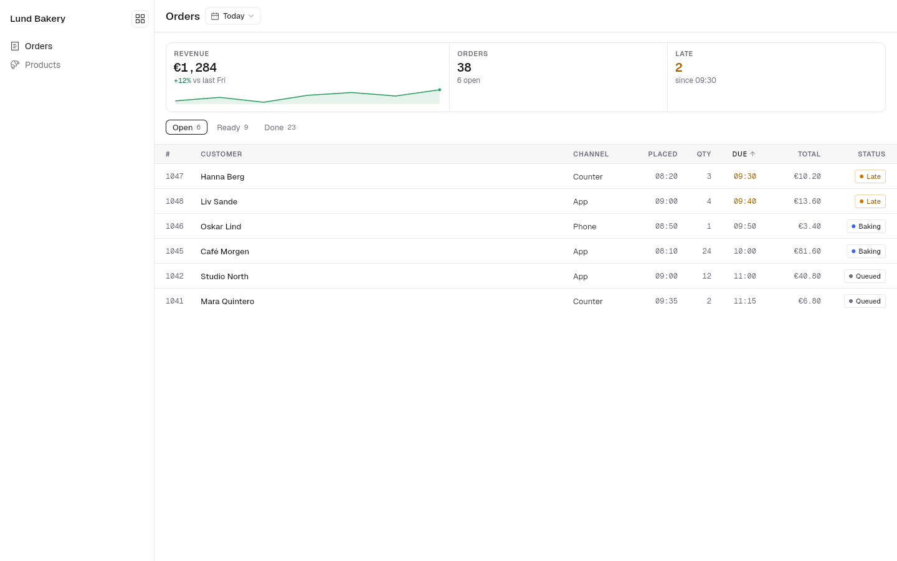
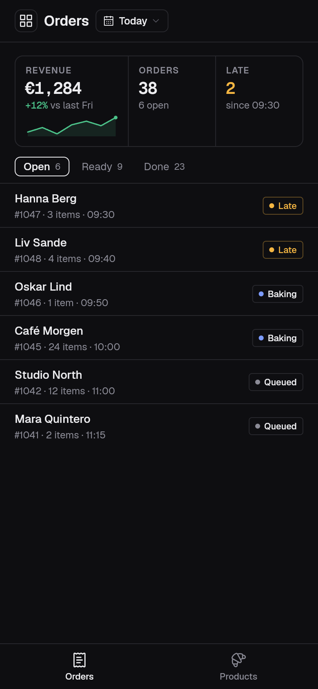

# minimal_ui

A precise, quiet design system for Flutter, in the family of Linear and shadcn/ui: hairlines instead of containers,
dense 44 px rows, hierarchy from weight rather than size, numbers in mono tabular figures, and one primary colour spent
on the action. It ships three presets (standard, graphite, ember), each designed by day and by night, and it reads as
well on a 1440 px desktop window as on a phone.

| Desktop, by day | Phone, by night |
| --- | --- |
|  |  |
|  |  |

The parts carry the names Material gives them (`MinimalButton`, `MinimalTextField`, `MinimalAppBar`,
`MinimalNavigationBar`, `MinimalListTile`, `MinimalCheckbox`, `MinimalSwitch`, `MinimalSegmentedButton`,
`MinimalTabBar`, ...) and shadcn's names for its colours (`primary`, `foreground`, `muted`, `destructive`, `ring`).

## Install

```yaml
dependencies:
  minimal_ui: ^0.1.0
```

## Set up

`MinimalTheme` is the whole install. Put it in your app's `builder:`, under a `MaterialApp`, a `CupertinoApp` or a
`WidgetsApp`, with a `MinimalToaster` inside it if the app shows snack bars:

```dart
import 'package:flutter/material.dart';
import 'package:minimal_ui/minimal_ui.dart';

Future<void> main() async {
  WidgetsFlutterBinding.ensureInitialized();
  await minimalLoadFonts(); // the bundled Geist faces, before the first frame
  runApp(const App());
}

class App extends StatelessWidget {
  const App({super.key});

  @override
  Widget build(BuildContext context) => MaterialApp(
    builder: (context, child) => MinimalTheme(
      data: MinimalThemeData.preset('standard', MediaQuery.platformBrightnessOf(context)),
      child: MinimalToaster(child: child!),
    ),
    home: const MinimalScaffold(
      topBar: MinimalAppBar(title: 'Requests'),
      body: MinimalListTile(title: 'Replace the lobby lights', meta: 'REQ-142'),
    ),
  );
}
```

A `CupertinoApp` or a `WidgetsApp` takes the same `builder:`; nothing in the package needs Material's app around it.
`context.minimalTheme` (or `MinimalTheme.of(context)`) reads the theme, a nested `MinimalTheme` restyles a subtree,
and `AnimatedMinimalTheme` eases between two. The package takes no router: its pages are plain widgets for any
navigator.

## Everyday parts

```dart
// A button: primary by default; secondary, ghost and destructive beside it.
MinimalButton('Create habit', onPressed: create);
MinimalButton('Cancel', variant: MinimalButtonVariant.secondary, onPressed: close);

// A field: the label above, the hint inside, the error below.
MinimalTextField(label: 'Name', hint: 'Stretch before bed', controller: name);

// A select: a field-shaped row whose list opens on the field's edges.
MinimalSelect(
  label: 'Repeats',
  value: repeat,
  options: const [
    MinimalSelectOption('daily', 'Every day'),
    MinimalSelectOption('weekdays', 'Weekdays'),
  ],
  onChanged: (value) => setState(() => repeat = value),
);

// A list: hairline rows with a mono meta at the end.
MinimalListSection(
  children: [
    for (final habit in habits)
      MinimalListTile(title: habit.name, meta: '${habit.streak}d', onTap: () => open(habit)),
  ],
);

// A dialog that asks before something destructive.
final sure = await showMinimalDialog<bool>(
  context,
  builder: (context) => const MinimalDialog(
    title: 'Delete habit?',
    message: 'Its history goes too.',
    confirmLabel: 'Delete',
    cancelLabel: 'Keep',
    destructive: true,
  ),
) ?? false;

// Navigation: a tab bar on a phone, a rail (MinimalNavigationRail) on a wide window.
MinimalNavigationBar(
  items: const [
    MinimalNavItem(LucideIcons.calendarCheck, 'Today'),
    MinimalNavItem(LucideIcons.listChecks, 'Habits'),
  ],
  selectedIndex: tab,
  onDestinationSelected: (index) => setState(() => tab = index),
);
```

The example app (`example/`) shows every part on its own page and three whole apps built on them: a habit tracker, an
issue tracker and a bakery's back office.

## How Minimal is built

Minimal is type, ink and space. A part the style never had is built from these rules rather than borrowed from
another system, and a part you add should follow them too.

- **Material.** Everything stands on one flat ground, in type and ink. A hairline divides only where space can't;
  a card is a hairline round a group, not a raised slab.
- **Choice.** A choice is said in ink and weight. The current page, a chosen row, chip or card, a toggled glyph turn
  to the full ink (the words at medium weight, or a hairline turning to ink); the rest stay muted. No tinted pill,
  no glow.
- **Colour.** The accent goes on the act to take and on a control's own value (a checked box, a switch that is on,
  a picked day). The status tones go on what has that status. The one wash is the selection's, behind the row the
  keyboard is on or the rows picked in a table. Nothing else is coloured.
- **Depth.** Two layers: the page, and what floats over it while it is needed (a menu, a dialog, a sheet, a toast,
  a row held in a drag). Only a floating thing has a shadow, one soft one; nothing on the page casts any.
- **Light.** None falls on it: no gradient, bevel, inner shadow or glow. A key cap is flat; a colour picker's
  gradients are its content, not light.
- **Stacking.** Parts stand side by side or one above another, divided by space. Where faces must stack (an avatar
  group), a ring of the ground cuts them apart.
- **Motion.** Short and plain: a fade or a few-pixel slide in 90 to 160 ms, easing out. Nothing springs, bounces or
  overshoots, and reduced motion shows the end state.

So a swipe reveals its acts as words on the muted ground, not blocks of colour; a pull to refresh shows a bare
spinner in the space the pull opens, not a floating disc; an action sheet is one card with Cancel as its quiet last
row; the current step of a run is an ink rim, not the accent.

## Make it yours

`MinimalThemeData` is shaped like Material's `ThemeData`: `copyWith`, `lerp`, value equality. Start from a preset
(`MinimalThemeData.standard()`, `.graphite()`, `.ember()`) or from your own colours, then turn the knobs:

```dart
final theme = MinimalThemeData.from(
  primary: const Color(0xFF7A1F5C), // the one colour spent on the action
  neutral: const Color(0xFF8B7355), // tints the greys warm or cool
).copyWith(
  shapes: const MinimalShapes(radius: 12), // one radius, as shadcn's --radius
  density: MinimalDensity.compact, // unset, the platform's own
);
```

- `MinimalThemeData.from` adjusts rather than asserts: the label on the primary colour, the primary colour as text,
  the inks and every mark keep their contrast whatever colours you give it.
- `shapes` is one radius and the corner scale derived from it (mark, small, medium, large), and every part reads its
  role's step: a tag the mark, a button or a field the small step, a card the medium, a dialog the large. Capsules by
  role (chips, a switch's track, progress and slider tracks, count badges, page dots) take `shapes.pill`, so they
  square up at `MinimalShapes(radius: 0)`. A part inside another is its frame's outline moved in
  (`MinimalShapes.inset`). What is round by meaning stays round: a radio, a slider's thumb, an avatar, a step's marker.
- `components` holds a style per part (`MinimalStyle`, with `ButtonStyle`'s slots as `WidgetStateProperty`s); the same
  style also goes on one widget through its `style:` (a text field's box through `fieldStyle:`). A widget's style
  beats its component theme, which beats the knobs, which beat the look; each part's doc lists the slots it reads.
- A hovering pointer changes nothing by default. An app that wants a hover wash sets `overlay` for
  `WidgetState.hovered`.

```dart
MinimalButton(
  'Save',
  onPressed: save,
  style: MinimalStyle(
    shape: const WidgetStatePropertyAll(StadiumBorder()),
    fill: WidgetStateProperty.resolveWith(
      (states) => states.contains(WidgetState.pressed) ? pressedInk : null,
    ),
  ),
);
```

## The host library

`package:minimal_ui/minimal_host.dart` holds the layer an app builder's host draws pages under: `MinimalHost` (the
theme, page transitions, ground and toasts in one mount), `MinimalPreview`, the route pages and the chrome metrics. An
ordinary app does not need it.

## Accessibility and languages

- **Right to left.** Every part lays out from its start edge: insets and alignments are directional, back and next
  chevrons and arrows flip, sliders and progress fill from the start side, tabs, carousels and swipe-to-dismiss follow
  the reading direction. Code stays left to right. Public parameters take `EdgeInsetsGeometry` and say start and end,
  never left and right. The example gallery's Customize panel has a Direction control (`?dir=rtl` in its address).
- **Large text.** Parts follow the platform's text scale up to 130%: `MinimalHost` clamps larger settings at
  `MinimalChromeMetrics.maxTextScale` (1.3), the largest a 44 px row was drawn to hold. This is the main known limit:
  a person who sets 200% sees 130%. Up to the clamp, controls grow taller rather than cut words, and long labels wrap
  or end in an ellipsis. The gallery's Customize panel shows every page at 115% and 130% (`?text=1.3`).
- **Other scripts.** Geist covers Latin. Arabic, Hebrew, Chinese, Japanese, Hindi, Thai and the rest are
  drawn by the platform's fallback fonts (on the web, Flutter fetches Noto). Line heights are set for Latin; tall
  scripts are not yet checked in every part.
- **Built-in words.** The words a part says on its own that every look shares (Back, Close, Cancel, OK, Search,
  Clear, Today, Next month, Loading, "Slide 2 of 5", a screen reader's names for a carousel, a menu bar or a split
  view's handle) come from `DesignLocalizations`, exported with the package. English ships. For another language,
  extend `DefaultDesignLocalizations`, override the words you translate, and add a
  `LocalizationsDelegate<DesignLocalizations>` that loads it to your app's `localizationsDelegates`. Words only Minimal
  says (Try again, Copy, "Step 2 of 4", the composer's buttons, short month names) stay English in 0.1.0.
- **Dates and numbers.** The month and year over a calendar, a day's full name and the first day of the week come
  from `DesignLocalizations`, and the time pickers take `use24HourFormat`. Numbers and money print as you pass them;
  the parts do no locale formatting of their own.
- **Screen readers and keyboard.** Every control announces its role, label, value and state (checked, selected,
  expanded, disabled); decorative paint is excluded. Everything works by keyboard, with a visible ring, and focus
  follows reading order in both directions. Interactive parts take an optional `focusNode` and `autofocus`. Touch
  targets are at least 44 px, text meets 4.5:1 contrast, and with reduced motion
  (`MediaQuery.disableAnimations`) every change switches at once.
- **Labels as strings.** Some parts take a `String` label or an `IconData` where Flutter would take a widget
  (`MinimalButton`'s label, `MinimalListTile`'s title, `MinimalChip`'s label). They stay in 0.1.0; 0.2.0 adds an
  optional widget slot beside each, so nothing that compiles today breaks.

## Fonts and icons

Geist and Geist Mono are bundled (SIL OFL 1.1). Icons come from Lucide (ISC) through `lucide_icons_flutter`.
