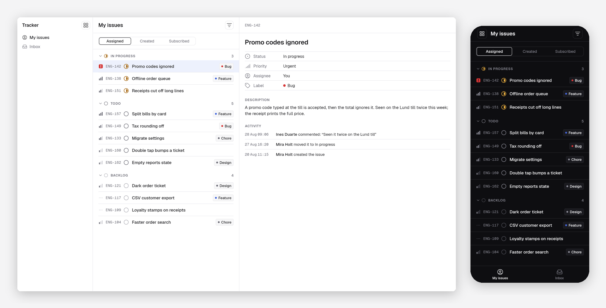
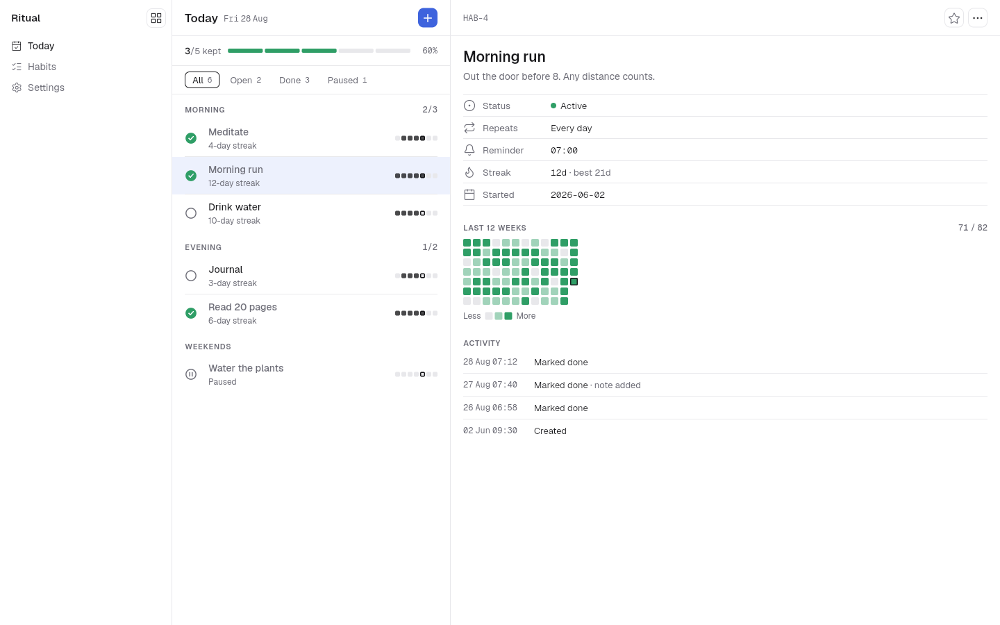
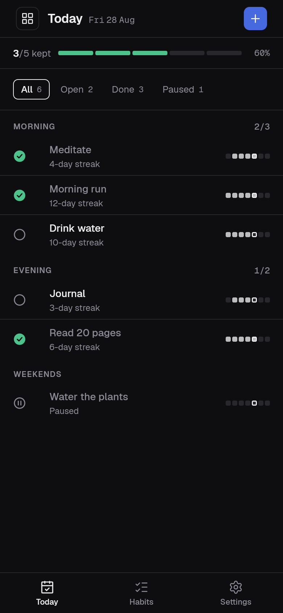
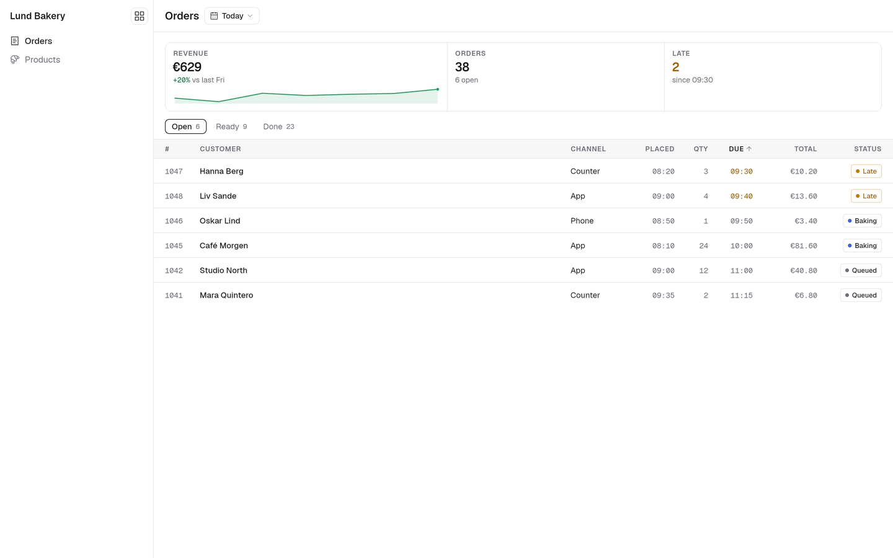

# minimal_ui

Minimal is a Flutter component library for dashboards, forms and data tables: hairlines instead of boxes, tabular figures and one accent colour. Choose from six palettes, each with a light and dark appearance.

If you know shadcn/ui, Minimal is the same kind of library for Flutter: neutral surfaces, hairline borders, one accent and dense data views, as Flutter widgets with their own API.



**[Docs and demo](https://wenkaifan0720.github.io/flutter_design_systems/docs/looks/minimal/)** · [Try it in Stint](https://wenkaifan0720.github.io/flutter_design_systems/docs/stint/?look=minimal) · [API reference](https://pub.dev/documentation/minimal_ui/latest/) · [All the looks](https://wenkaifan0720.github.io/flutter_design_systems/docs/)

## Install

```sh
flutter pub add minimal_ui material_ui lucide_icons_flutter
```

Every snippet on this page compiles after that line. Each file imports the look, the Material it is built on, and the Lucide icons Minimal's own glyphs are drawn to sit beside:

- `package:minimal_ui/minimal_ui.dart` holds every part, `MinimalHost` included, and ui_core's `Raw*` parts.
- `package:material_ui/material_ui.dart` brings `MaterialApp` and Flutter's widgets, which `minimal_ui.dart` doesn't export. Import it rather than `package:flutter/material.dart`, which Flutter deprecates after 3.47.
- `package:lucide_icons_flutter/lucide_icons.dart` brings `LucideIcons`.

A first app:

```dart
import 'package:material_ui/material_ui.dart';
import 'package:minimal_ui/minimal_ui.dart';

void main() => runApp(
  MaterialApp(
    builder: (context, child) => MinimalHost(child: child!),
    home: const MinimalScaffold(
      topBar: MinimalAppBar(title: 'Books'),
      body: MinimalListTile(title: 'Middlemarch', meta: 'George Eliot'),
    ),
  ),
);
```

## Mount the host

`MinimalHost`, in the app's `builder`, is the one mount: it builds the palette's light and dark themes, follows the platform's appearance unless you pin one, eases a change of palette or appearance, holds the toasts, and caps the text scale at 200%. Load the bundled Geist faces before `runApp` so the first frame is set in them.

```dart
import 'package:lucide_icons_flutter/lucide_icons.dart';
import 'package:material_ui/material_ui.dart';
import 'package:minimal_ui/minimal_ui.dart';

Future<void> main() async {
  WidgetsFlutterBinding.ensureInitialized();
  await minimalLoadFonts(); // the bundled Geist faces, before the first frame
  runApp(const App());
}

class App extends StatelessWidget {
  const App({super.key});

  @override
  Widget build(BuildContext context) => MaterialApp(
    title: 'Shelf',
    // Minimal's push and pop for the pages the app pushes.
    theme: ThemeData(pageTransitionsTheme: const PageTransitionsTheme(builders: minimalPageTransitions)),
    // brightness: null follows the platform; Brightness.light or Brightness.dark pins it.
    // palette: one of the six, standard by default.
    builder: (context, child) => MinimalHost(
      palette: MinimalThemeData.palettes.first,
      brightness: null,
      child: child!,
    ),
    home: const MinimalScaffold(
      topBar: MinimalAppBar(title: 'Books'),
      body: MinimalEmptyState(icon: LucideIcons.bookOpen, title: 'Nothing here yet'),
    ),
  );
}
```

A `CupertinoApp` (from `cupertino_ui`) or a bare `WidgetsApp` takes the same `builder:`. `MinimalHost(light:, dark:)` takes themes of your own instead of a palette. To theme one subtree, wrap it in `MinimalTheme(data: …)`; `AnimatedMinimalTheme` eases between two. Read the theme with `context.minimalTheme`.

## Build an app

The example app, `example/lib/main.dart`, is all of this in one file: a reading list with three places, a list with a pushed page, a form, a dialog and settings. Copy it and grow it.

### The shell

`MinimalAppShell` is the app's frame: its places in a tab bar along a phone's foot, in a rail from `MinimalLayout.compact` (600 wide) and in a sidebar from `MinimalLayout.expanded` (960). With `branches`, each place keeps its own stack of pages: a page pushed in a place keeps the rail or the sidebar beside it while a phone's tab bar steps away, and back pops it. Toasts keep clear of the tab bar. `extended: false` folds the sidebar to the rail on a wide window, as `NavigationRail.extended` does; give `onExtendedChanged` and a key at the sidebar's head folds and unfolds it.

```dart
import 'package:lucide_icons_flutter/lucide_icons.dart';
import 'package:material_ui/material_ui.dart';
import 'package:minimal_ui/minimal_ui.dart';

class Home extends StatefulWidget {
  const Home({super.key});

  @override
  State<Home> createState() => _HomeState();
}

class _HomeState extends State<Home> {
  int _place = 0;

  @override
  Widget build(BuildContext context) => MinimalAppShell.branches(
    header: Text('Shelf', style: context.minimalTheme.h3),
    destinations: const [
      MinimalNavItem(LucideIcons.libraryBig, 'Books'),
      MinimalNavItem(LucideIcons.bookOpen, 'Reading'),
      MinimalNavItem(LucideIcons.settings, 'Settings'),
    ],
    selectedIndex: _place,
    onDestinationSelected: (index) => setState(() => _place = index),
    branches: [
      (context) => const MinimalScaffold(topBar: MinimalAppBar(title: 'Books'), body: SizedBox()),
      (context) => const MinimalScaffold(topBar: MinimalAppBar(title: 'Reading'), body: SizedBox()),
      (context) => const MinimalScaffold(topBar: MinimalAppBar(title: 'Settings'), body: SizedBox()),
    ],
  );
}
```

`MinimalLayout` holds the two widths every part that changes with the window reads; lay out by them, not by numbers of your own.

### A list, and its page

A page is a `MinimalScaffold`: its bar, its body and a footer for its acts. `maxWidth: MinimalLayout.contentWidth(context)` holds all three to the page's measure on a wide window. A row pushes its record's page in the same place; the pushed page's bar names where back goes (`parent`). A swipe reveals a row's acts; each is in the full ink unless it says otherwise, so a delete says `destructive: true` (the danger ink) and takes a bin glyph. Minimal never guesses it from the word, which is "Delete" in one language only.

```dart
import 'package:lucide_icons_flutter/lucide_icons.dart';
import 'package:material_ui/material_ui.dart';
import 'package:minimal_ui/minimal_ui.dart';

class Book {
  const Book(this.title, this.author, {this.reading = false});

  final String title;
  final String author;
  final bool reading;
}

class BooksPage extends StatelessWidget {
  const BooksPage({super.key, required this.books, this.onDelete});

  final List<Book> books;
  final ValueChanged<Book>? onDelete;

  @override
  Widget build(BuildContext context) => MinimalScaffold(
    maxWidth: MinimalLayout.contentWidth(context),
    padding: EdgeInsets.zero,
    topBar: const MinimalAppBar(title: 'Books'),
    body: MinimalListSection(
      children: [
        for (final book in books)
          MinimalSwipeActions(
            trailing: [
              MinimalSwipeAction(
                'Delete',
                icon: LucideIcons.trash2,
                destructive: true,
                onPressed: () => onDelete?.call(book),
              ),
            ],
            child: MinimalListTile(
              title: book.title,
              subtitle: book.author,
              trailing: book.reading ? const MinimalTag('Reading', tone: MinimalTone.primary) : null,
              chevron: true,
              onTap: () => Navigator.of(context).push(
                MaterialPageRoute<void>(builder: (context) => BookPage(book: book)),
              ),
            ),
          ),
      ],
    ),
  );
}

class BookPage extends StatelessWidget {
  const BookPage({super.key, required this.book});

  final Book book;

  @override
  Widget build(BuildContext context) => MinimalScaffold(
    maxWidth: MinimalLayout.contentWidth(context),
    topBar: MinimalAppBar(title: book.title, parent: 'Books'),
    body: Column(
      crossAxisAlignment: CrossAxisAlignment.stretch,
      children: [
        MinimalProperty(icon: LucideIcons.user, label: 'Author', value: book.author),
        MinimalProperty(icon: LucideIcons.circleDot, label: 'Status', value: book.reading ? 'Reading' : 'Want to read'),
      ],
    ),
    footer: Row(
      mainAxisAlignment: MainAxisAlignment.end,
      children: [MinimalButton('Start reading', onPressed: () {})],
    ),
  );
}
```

### Forms

`MinimalForm` is the form: `MinimalTextFormField`s in it validate, and so does any other control (a select, a date, a checkbox, a radio group) inside ui_core's `RawFormField`, as Flutter's `FormField` takes any control. `MinimalForm.submit(context)` checks every field, shows each error under its field and moves focus to the first, or saves each field and calls `onSubmit`. In a column, every field takes the column's width.

```dart
import 'package:material_ui/material_ui.dart';
import 'package:minimal_ui/minimal_ui.dart';

class NewBookPage extends StatefulWidget {
  const NewBookPage({super.key});

  @override
  State<NewBookPage> createState() => _NewBookPageState();
}

class _NewBookPageState extends State<NewBookPage> {
  final _startedFocus = FocusNode();
  String _title = '';
  DateTime? _started;
  bool _favourite = false;

  @override
  void dispose() {
    _startedFocus.dispose();
    super.dispose();
  }

  @override
  Widget build(BuildContext context) => MinimalForm(
    // Called once every field is fine, after each field's onSaved.
    onSubmit: () => Navigator.of(context).pop(_title),
    child: MinimalScaffold(
      maxWidth: MinimalLayout.contentWidth(context),
      topBar: const MinimalAppBar(title: 'New book', parent: 'Books'),
      body: Column(
        crossAxisAlignment: CrossAxisAlignment.stretch,
        spacing: MinimalSpacing.s16,
        children: [
          MinimalTextFormField(
            labelText: 'Title',
            required: true,
            validator: (value) => (value ?? '').trim().isEmpty ? 'Enter the title' : null,
            onSaved: (value) => _title = value!.trim(),
          ),
          // Any other control takes part through ui_core's RawFormField: its
          // error on a MinimalFormField round the control, its focus node on
          // the three, so a failed submit can focus it.
          RawFormField<DateTime>(
            focusNode: _startedFocus,
            validator: (value) => value == null ? 'Pick the day you started' : null,
            onSaved: (value) => _started = value,
            builder: (field) => MinimalFormField(
              errorText: field.errorText,
              focusNode: _startedFocus,
              child: MinimalDatePicker(
                labelText: 'Started',
                mode: MinimalDatePickerMode.date,
                // The label over a box, as the title's: one field style.
                presentation: MinimalDatePickerPresentation.field,
                value: field.value,
                hintText: 'Not yet',
                focusNode: _startedFocus,
                onChanged: field.didChange,
              ),
            ),
          ),
          MinimalSwitch(
            label: 'Favourite',
            showLabel: true,
            value: _favourite,
            onChanged: (value) => setState(() => _favourite = value),
          ),
        ],
      ),
      footer: Row(
        mainAxisAlignment: MainAxisAlignment.end,
        children: [
          // Under the form, so submit finds it.
          Builder(
            builder: (context) => MinimalButton('Save', onPressed: () => MinimalForm.submit(context)),
          ),
        ],
      ),
    ),
  );
}
```

A date field with no value shows its hint; one with a day shows it as the app's language writes a date in a field ("Nov 9, 2026" in English, "9 Nov 2026" in British English, `RawWidgetsLocalizations.formatMediumDate`), so it reads like the calendar it opens. `MinimalFormat.date` stays the app's own day-first helper. A field in error turns its edge to the danger colour, focused or not.

A form that is itself a place (an "Add" tab) is this same page as a nav root: its Save stays in the footer, which docks above a phone's tab bar and at the page's foot beside the sidebar, so the form pushed to edit and the form as a place are one widget.

Keep one field style in a form. Beside boxed text fields, a date stands boxed too (`MinimalDatePickerPresentation.field`) and a choice from a list is a `MinimalCombobox(requireSelection: true)`. The row controls (`MinimalSelect`, the compact `MinimalDatePicker`, a `MinimalSwitch` row) belong in a form of rows, a settings list in a `MinimalFormSection`.

### Dialogs and toasts

`showMinimalDialog` raises a dialog over the whole app and completes with the answer the dialog pops with: a `MinimalDialog` with a confirm and a cancel pops true or false, and null when dismissed. A destructive one draws its confirm in the danger colour and focuses the safe action first. A dialog of your own pops it with the answer. Pass `isAlert: true` for a question that wants an answer: a screen reader hears an alert, and a tap on the scrim leaves it standing.

```dart
import 'package:material_ui/material_ui.dart';
import 'package:minimal_ui/minimal_ui.dart';

Future<void> delete(BuildContext context, String title) async {
  final sure = await showMinimalDialog<bool>(
    context,
    isAlert: true,
    builder: (context) => MinimalDialog(
      title: 'Delete "$title"?',
      message: 'It leaves your shelf. This cannot be undone.',
      confirmLabel: 'Delete',
      cancelLabel: 'Keep',
      destructive: true,
    ),
  );
  if (sure != true || !context.mounted) return;
  showMinimalSnackBar(context, 'Deleted "$title"', actionLabel: 'Undo', onAction: () {});
}

Future<String?> pickShelf(BuildContext context) => showMinimalDialog<String>(
  context,
  builder: (context) => MinimalDialog(
    title: 'Move to',
    actions: [
      RawDialogAction(label: 'Reading', onPressed: () => Navigator.of(context).pop('reading')),
      RawDialogAction(label: 'Finished', isDefaultAction: true, onPressed: () => Navigator.of(context).pop('finished')),
    ],
  ),
);
```

### The palette picker

`MinimalThemeData.palettes` are the six palettes, each a `RawNamedPalette`: an `id` to store, a `label` to show, and the swatches to draw it by. Hand the chosen one to the host.

```dart
import 'package:material_ui/material_ui.dart';
import 'package:minimal_ui/minimal_ui.dart';

class PalettePicker extends StatelessWidget {
  const PalettePicker({super.key, required this.palette, required this.onChanged});

  final RawNamedPalette palette;
  final ValueChanged<RawNamedPalette> onChanged;

  @override
  Widget build(BuildContext context) => MinimalFormField(
    labelText: 'Palette',
    group: true,
    child: MinimalRadioGroup<RawNamedPalette>(
      value: palette,
      onChanged: onChanged,
      options: [
        for (final p in MinimalThemeData.palettes)
          MinimalRadioOption(value: p, label: p.label, secondary: _Swatches(p)),
      ],
    ),
  );
}

// Each palette's colours in the brightness on screen, beside its name: its
// accent on a tile of its ground. The ground is a page's own colour, so it
// stands as a tile, ringed in the hairline, never as a ring alone.
class _Swatches extends StatelessWidget {
  const _Swatches(this.palette);

  final RawNamedPalette palette;

  @override
  Widget build(BuildContext context) {
    final theme = context.minimalTheme;
    final swatches = palette.swatchesFor(theme.brightness);
    // The last swatch is the ground; the others are dots on it.
    final ground = swatches.length > 1 ? swatches.last : null;
    final dots = ground == null ? swatches : swatches.sublist(0, swatches.length - 1);
    return Container(
      margin: const EdgeInsetsDirectional.only(start: 4),
      padding: const EdgeInsets.symmetric(horizontal: 5, vertical: 3),
      decoration: BoxDecoration(
        color: ground,
        borderRadius: BorderRadius.circular(4),
        border: Border.all(color: theme.border),
      ),
      child: Row(
        mainAxisSize: MainAxisSize.min,
        spacing: 3,
        children: [
          for (final color in dots)
            Container(
              width: 10,
              height: 10,
              decoration: BoxDecoration(color: color, shape: BoxShape.circle),
            ),
        ],
      ),
    );
  }
}
```

`MinimalThemeData.preset(id, brightness)` builds a stored id's theme again.

## Building blocks

Each linked part opens its page on the docs site, with Minimal chosen: a live preview, its code to copy, by day and night, left to right and right to left.

| For | Use |
|---|---|
| The app's frame | `MinimalHost`, [`MinimalAppShell`](https://wenkaifan0720.github.io/flutter_design_systems/docs/app-shell/?look=minimal), `MinimalShellAction`, `MinimalLayout` |
| A page | `MinimalScaffold`, [`MinimalAppBar`](https://wenkaifan0720.github.io/flutter_design_systems/docs/app-bar/?look=minimal), [`MinimalTabBar`](https://wenkaifan0720.github.io/flutter_design_systems/docs/tabs/?look=minimal), [`MinimalBreadcrumb`](https://wenkaifan0720.github.io/flutter_design_systems/docs/breadcrumbs/?look=minimal), [`MinimalPagination`](https://wenkaifan0720.github.io/flutter_design_systems/docs/pagination/?look=minimal), `MinimalSection`, [`MinimalSectionHeader`](https://wenkaifan0720.github.io/flutter_design_systems/docs/section-header/?look=minimal) |
| Acts | [`MinimalButton`](https://wenkaifan0720.github.io/flutter_design_systems/docs/button/?look=minimal), [`MinimalIconButton`](https://wenkaifan0720.github.io/flutter_design_systems/docs/icon-button/?look=minimal), [`MinimalButtonGroup`](https://wenkaifan0720.github.io/flutter_design_systems/docs/button-group/?look=minimal), [`MinimalSplitButton`](https://wenkaifan0720.github.io/flutter_design_systems/docs/split-button/?look=minimal), [`MinimalLink`](https://wenkaifan0720.github.io/flutter_design_systems/docs/link/?look=minimal), `MinimalActionBar` |
| Words in | [`MinimalTextField`](https://wenkaifan0720.github.io/flutter_design_systems/docs/text-field/?look=minimal), [`MinimalTextFormField`](https://wenkaifan0720.github.io/flutter_design_systems/docs/form-field/?look=minimal), [`MinimalTextArea`](https://wenkaifan0720.github.io/flutter_design_systems/docs/text-area/?look=minimal), [`MinimalPasswordField`](https://wenkaifan0720.github.io/flutter_design_systems/docs/password-field/?look=minimal), [`MinimalSearchField`](https://wenkaifan0720.github.io/flutter_design_systems/docs/search-field/?look=minimal), [`MinimalNumberField`](https://wenkaifan0720.github.io/flutter_design_systems/docs/number-field/?look=minimal), [`MinimalInputGroup`](https://wenkaifan0720.github.io/flutter_design_systems/docs/input-group/?look=minimal), [`MinimalInputOtp`](https://wenkaifan0720.github.io/flutter_design_systems/docs/one-time-code/?look=minimal), `MinimalComposer` |
| Choices | [`MinimalSelect`](https://wenkaifan0720.github.io/flutter_design_systems/docs/select/?look=minimal), [`MinimalCombobox`](https://wenkaifan0720.github.io/flutter_design_systems/docs/combobox/?look=minimal), [`MinimalRadioGroup`](https://wenkaifan0720.github.io/flutter_design_systems/docs/radio-group/?look=minimal), [`MinimalCheckbox`](https://wenkaifan0720.github.io/flutter_design_systems/docs/checkbox/?look=minimal), [`MinimalSwitch`](https://wenkaifan0720.github.io/flutter_design_systems/docs/switch/?look=minimal), [`MinimalSegmentedButton`](https://wenkaifan0720.github.io/flutter_design_systems/docs/segmented-control/?look=minimal), [`MinimalToggleGroup`](https://wenkaifan0720.github.io/flutter_design_systems/docs/toggle-group/?look=minimal), [`MinimalChip`](https://wenkaifan0720.github.io/flutter_design_systems/docs/chips/?look=minimal), [`MinimalSlider`](https://wenkaifan0720.github.io/flutter_design_systems/docs/slider/?look=minimal), [`MinimalRangeSlider`](https://wenkaifan0720.github.io/flutter_design_systems/docs/range-slider/?look=minimal), [`MinimalRating`](https://wenkaifan0720.github.io/flutter_design_systems/docs/rating/?look=minimal), [`MinimalColorPicker`](https://wenkaifan0720.github.io/flutter_design_systems/docs/color-picker/?look=minimal) |
| Dates and times | [`MinimalDatePicker`](https://wenkaifan0720.github.io/flutter_design_systems/docs/date-picker/?look=minimal), [`MinimalDateRangePicker`](https://wenkaifan0720.github.io/flutter_design_systems/docs/date-range-picker/?look=minimal), [`MinimalTimePicker`](https://wenkaifan0720.github.io/flutter_design_systems/docs/time-picker/?look=minimal), [`MinimalCalendar`](https://wenkaifan0720.github.io/flutter_design_systems/docs/calendar/?look=minimal) |
| Forms | [`MinimalForm`](https://wenkaifan0720.github.io/flutter_design_systems/docs/form-field/?look=minimal), [`MinimalFormField`](https://wenkaifan0720.github.io/flutter_design_systems/docs/form-field/?look=minimal), `MinimalFormSection`, `MinimalFormRow` |
| Lists and tables | [`MinimalListTile`](https://wenkaifan0720.github.io/flutter_design_systems/docs/list-row/?look=minimal), [`MinimalListSection`](https://wenkaifan0720.github.io/flutter_design_systems/docs/grouped-list/?look=minimal), [`MinimalSwipeActions`](https://wenkaifan0720.github.io/flutter_design_systems/docs/swipe-actions/?look=minimal), `MinimalProperty`, [`MinimalDescriptionList`](https://wenkaifan0720.github.io/flutter_design_systems/docs/description-list/?look=minimal), [`MinimalTable`](https://wenkaifan0720.github.io/flutter_design_systems/docs/table/?look=minimal), [`MinimalTreeView`](https://wenkaifan0720.github.io/flutter_design_systems/docs/tree-view/?look=minimal), [`MinimalTimeline`](https://wenkaifan0720.github.io/flutter_design_systems/docs/timeline/?look=minimal) |
| Over the page | [`MinimalDialog`](https://wenkaifan0720.github.io/flutter_design_systems/docs/dialog/?look=minimal), [`showMinimalDialog`](https://wenkaifan0720.github.io/flutter_design_systems/docs/dialog/?look=minimal), [`showMinimalSheet`](https://wenkaifan0720.github.io/flutter_design_systems/docs/side-sheet/?look=minimal), [`showMinimalBottomSheet`](https://wenkaifan0720.github.io/flutter_design_systems/docs/bottom-sheet/?look=minimal), [`showMinimalActionSheet`](https://wenkaifan0720.github.io/flutter_design_systems/docs/action-sheet/?look=minimal), [`MinimalMenu`](https://wenkaifan0720.github.io/flutter_design_systems/docs/menu/?look=minimal), [`showMinimalMenu`](https://wenkaifan0720.github.io/flutter_design_systems/docs/menu/?look=minimal), [`MinimalMenuBar`](https://wenkaifan0720.github.io/flutter_design_systems/docs/menu-bar/?look=minimal), [`MinimalPopover`](https://wenkaifan0720.github.io/flutter_design_systems/docs/popover/?look=minimal), [`MinimalHoverCard`](https://wenkaifan0720.github.io/flutter_design_systems/docs/hover-card/?look=minimal), [`MinimalTooltip`](https://wenkaifan0720.github.io/flutter_design_systems/docs/tooltip/?look=minimal), [`MinimalCommand`](https://wenkaifan0720.github.io/flutter_design_systems/docs/command-palette/?look=minimal), [`showMinimalSnackBar`](https://wenkaifan0720.github.io/flutter_design_systems/docs/toast/?look=minimal) |
| Status | [`MinimalTag`](https://wenkaifan0720.github.io/flutter_design_systems/docs/tag/?look=minimal), [`MinimalBadge`](https://wenkaifan0720.github.io/flutter_design_systems/docs/badge/?look=minimal), `MinimalStatusBadge`, `MinimalStatusIcon`, `MinimalPriorityIcon`, [`MinimalBanner`](https://wenkaifan0720.github.io/flutter_design_systems/docs/banner/?look=minimal), [`MinimalEmptyState`](https://wenkaifan0720.github.io/flutter_design_systems/docs/empty-state/?look=minimal), [`MinimalErrorState`](https://wenkaifan0720.github.io/flutter_design_systems/docs/status-view/?look=minimal), [`MinimalLoadingState`](https://wenkaifan0720.github.io/flutter_design_systems/docs/status-view/?look=minimal), [`MinimalSkeleton`](https://wenkaifan0720.github.io/flutter_design_systems/docs/skeleton/?look=minimal), [`MinimalLinearProgressIndicator`](https://wenkaifan0720.github.io/flutter_design_systems/docs/linear-progress/?look=minimal), [`MinimalCircularProgressIndicator`](https://wenkaifan0720.github.io/flutter_design_systems/docs/circular-progress/?look=minimal), [`MinimalMeter`](https://wenkaifan0720.github.io/flutter_design_systems/docs/meter/?look=minimal), [`MinimalStepProgress`](https://wenkaifan0720.github.io/flutter_design_systems/docs/step-progress/?look=minimal) |
| Cards and marks | [`MinimalCard`](https://wenkaifan0720.github.io/flutter_design_systems/docs/card/?look=minimal), [`MinimalAvatar`](https://wenkaifan0720.github.io/flutter_design_systems/docs/avatar/?look=minimal), [`MinimalAvatarGroup`](https://wenkaifan0720.github.io/flutter_design_systems/docs/avatar-group/?look=minimal), `MinimalIconTile`, [`MinimalKbd`](https://wenkaifan0720.github.io/flutter_design_systems/docs/keyboard-key/?look=minimal), `MinimalCodeBlock` |
| Figures and charts | `MinimalStat`, `MinimalStatRow`, [`MinimalLineChart`](https://wenkaifan0720.github.io/flutter_design_systems/docs/line-chart/?look=minimal), [`MinimalAreaChart`](https://wenkaifan0720.github.io/flutter_design_systems/docs/area-chart/?look=minimal), [`MinimalBarChart`](https://wenkaifan0720.github.io/flutter_design_systems/docs/bar-chart/?look=minimal), [`MinimalPieChart`](https://wenkaifan0720.github.io/flutter_design_systems/docs/pie-chart/?look=minimal), [`MinimalSparkline`](https://wenkaifan0720.github.io/flutter_design_systems/docs/sparkline/?look=minimal), `MinimalHeatmap` |

## What is inside

Six palettes, standard, graphite, ember, iris, lagoon and berry, each designed by day and by night. The example's gallery shows the same apps on a desktop and a phone.

| Desktop, by day | Phone, by night |
| --- | --- |
|  |  |
|  |  |

## Customization

Start from a palette (`MinimalThemeData.preset(id, brightness)`), or derive a theme from your app's colours with `MinimalThemeData.from`. Use `copyWith` to change individual settings.

```dart
import 'package:material_ui/material_ui.dart';
import 'package:minimal_ui/minimal_ui.dart';

final theme = MinimalThemeData.from(
  primary: const Color(0xFF7A1F5C),
  neutral: const Color(0xFF8B7355),
).copyWith(
  shapeScheme: const MinimalShapes(radius: 12).scheme,
  density: MinimalDensity.compact,
);
```

- `MinimalThemeData.from` derives readable label and accent colours from the supplied palette.
- `shapeScheme` holds the corners every part reads (4, 8, 10, 14 and 18 by default), each step held to Minimal's band, from square to the most a control holds before it reads as a pill. `MinimalShapes(radius: r).scheme` sets every step from one radius. A small step of zero squares off capsules. Radios, slider thumbs and avatars stay round.
- A style's `corners` give one part corners of its own, a step per corner, start and end as the part reads (so they mirror in a right-to-left app): `MinimalStyle(corners: WidgetStatePropertyAll(RawCorners(topStart: RawCorner.none, bottomEnd: RawCorner.none)))`. Each is held to Minimal's steps, a corner the style leaves keeps the part's own, and a `shape` wins over `corners`. In a joined strip (a segmented control, a button group) they shape the strip's ends.
- `MinimalTypeface.app(sans:, mono:)` selects your fonts. The theme also exposes density, shadow styles and icon stroke width.
- To keep a palette and change it, hand the host both: `MinimalHost(palette: palette, customize: (theme) => theme.copyWith(shapeScheme: const MinimalShapes(radius: 12).scheme), child: child!)` changes the palette's day and night themes alike, and a change of palette or appearance still blends.
- Set a `MinimalStyle` in `theme.components` to style a component throughout the app. A widget's `style` takes precedence. Text fields use `fieldStyle`. Use `WidgetStateProperty` to distinguish hover, press and focus.

```dart
import 'package:material_ui/material_ui.dart';
import 'package:minimal_ui/minimal_ui.dart';

Widget saveButton(VoidCallback save) => MinimalButton(
  'Save',
  onPressed: save,
  style: MinimalStyle(
    shape: const WidgetStatePropertyAll(StadiumBorder()),
    fill: WidgetStateProperty.resolveWith(
      (states) => states.contains(WidgetState.pressed) ? const Color(0xFF5B1645) : null,
    ),
  ),
);
```

## Labels and icons

A control's `label` is drawn: a button's words, a switch's title, a field's `labelText`. A name that is only spoken, for a control that draws no words of its own (an icon button, a checkbox alone, a progress indicator), is its `semanticLabel`: `MinimalIconButton(LucideIcons.plus, semanticLabel: 'Add a book', onPressed: add)`. A control inside `MinimalFormField` is heard once, by the field's label. A row's name is its words and its status tag; an avatar that repeats its title stays out of it. `dart fix --apply` moves code written for 0.7 to these names.

## Accessibility and languages

- **Direction and text size.** Controls follow the reading direction. The gallery's Customize panel (`example/lib/gallery.dart`) lets you try RTL and text sizes up to 200%; tags, glyphs and monograms grow with the text. `MinimalHost` caps larger scales at 200%. Geist supplies Latin glyphs. Other scripts use Flutter's font fallback.
- **Keyboard and screen readers.** Tab moves between controls. Arrow keys select tabs, inspect chart values and navigate menus. Enter activates the focused action. Escape dismisses menus, dialogs and sheets and returns focus to the opener. A destructive dialog focuses its safe action first. A row's trailing menu is a stop of its own.
- **Touch and motion.** The minimum hit area is ui_core's tap floor, `RawTapTargets.of(context).floorOn()`: 40 × 40 for touch and 24 × 24 for a pointer. Controls honour the platform's reduced-motion setting.
- **Navigation.** Push transitions fade and move 8 px; tabs switch in place. `MinimalFadeRoute` replaces a page with a fade. `minimalPageTransitions`, as in the mount above, keeps the iOS back gesture. On Android, Back dismisses an open menu, dialog or sheet before leaving the page.
- **Localization.** English is the default. For the shared labels in 30 languages, register `RawWidgetsLocalizations.delegate` beside Material's delegates. For Minimal's own words (status names, composer actions), extend `MinimalLocalizationsEn` and register `MinimalLocalizations.delegateOf(yourWords)`. Calendars use localized month and day names and the local first day of the week. Time pickers accept `use24HourFormat`. Format numeric and monetary values before passing them to the components.

```dart
import 'package:material_ui/material_ui.dart';
import 'package:minimal_ui/minimal_ui.dart';

final app = MaterialApp(
  localizationsDelegates: const [
    RawWidgetsLocalizations.delegate,
    ...GlobalMaterialLocalizations.delegates,
  ],
  supportedLocales: RawWidgetsLocalizations.supportedLocales,
  builder: (context, child) => MinimalHost(child: child!),
  home: const MinimalScaffold(body: SizedBox()),
);
```

## The host library

`package:minimal_ui/minimal_host.dart` is for a tool that shows Minimal's screens inside a frame of its own (a preview, a design tool); an app doesn't need it. It is outside semver.

## Example

`example/lib/main.dart` is one app to copy: the host by day, by night or as the platform is, the shell with three places, a list with a pushed page, a form that checks itself and takes a date, a dialog answered and settings with the six palettes. `example/lib/gallery.dart` (`flutter run -t lib/gallery.dart`) sets every component on its page, in each palette, by day and by night, with a Customize panel, and three fuller apps: a habit tracker, an issue tracker and a bakery's back office.

## Requirements

Flutter 3.47.0 or later (Dart 3.13), on Android, iOS, web, macOS, Windows and Linux. The package depends on ui_core ^0.8.0 and re-exports it, so `RawWidgetsLocalizations`, `RawNamedPalette` and the `Raw*` parts come with the one import.

## Licences

The package is BSD-3-Clause. It bundles Geist and Geist Mono under the SIL Open Font License 1.1, and depends on `lucide_icons_flutter` (Lucide, ISC). The notices are in `LICENSE`.
