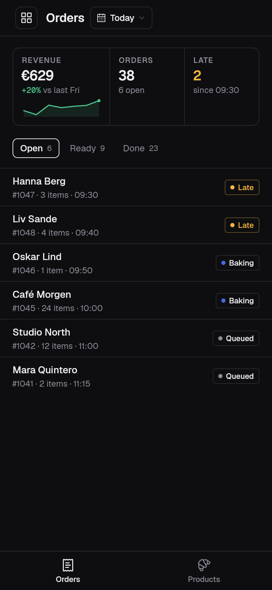

# minimal_ui

Compact Flutter components for dashboards, forms and data tables. Minimal uses fine borders, tabular numbers and a single accent color, with light and dark themes.


**[Live gallery](https://wenkaifan0720.github.io/flutter_design_systems/minimal/)** · [API reference](https://pub.dev/documentation/minimal_ui/latest/) · [All the looks](https://wenkaifan0720.github.io/flutter_design_systems/)

## Install

```sh
flutter pub add minimal_ui
```

## Set up

Wrap your app’s navigator in `MinimalTheme`. Add `MinimalToaster` if the app shows snack bars.

```dart
import 'package:flutter/material.dart';
import 'package:minimal_ui/minimal_ui.dart';

Future<void> main() async {
  WidgetsFlutterBinding.ensureInitialized();
  await minimalLoadFonts(); // the bundled Geist faces, before the first frame
  runApp(const App());
}

class App extends StatelessWidget {
  const App({super.key});

  @override
  Widget build(BuildContext context) => MaterialApp(
    // Use Minimal’s page transitions.
    theme: ThemeData(pageTransitionsTheme: const PageTransitionsTheme(builders: minimalPageTransitions)),
    builder: (context, child) => MinimalTheme(
      data: MinimalThemeData.preset('standard', MediaQuery.platformBrightnessOf(context)),
      child: MinimalToaster(child: child!),
    ),
    home: const MinimalScaffold(
      topBar: MinimalAppBar(title: 'Requests'),
      body: MinimalListTile(title: 'Replace the lobby lights', meta: 'REQ-142'),
    ),
  );
}
```

The same builder works with `CupertinoApp` and `WidgetsApp`. Read the theme with `context.minimalTheme`. Nest `MinimalTheme` to style a subtree or use `AnimatedMinimalTheme` to animate changes.

**Navigation.** Push transitions fade and move 8 px. Tabs switch in place.
`MinimalFadeRoute` replaces a page with a fade. When using Flutter's
`MaterialApp`, set `ThemeData.pageTransitionsTheme` to `minimalPageTransitions`
as shown above. This also preserves the iOS back gesture. On Android, Back
dismisses an open menu, dialog or sheet before leaving the page.

## What is inside

Choose from the standard, graphite and ember presets. Each includes light and dark colors. The examples below show the same application on desktop and phone.

| Desktop, by day | Phone, by night |
| --- | --- |
|  |  |
|  |  |

The package includes buttons and fields, navigation, lists and tables, charts, menus, dialogs and sheets. The gallery includes a habit tracker, an issue tracker and a bakery back office.

## Everyday parts

```dart
// A button: primary by default; secondary, ghost and destructive beside it.
MinimalButton('Create habit', onPressed: create);
MinimalButton('Cancel', variant: MinimalButtonVariant.secondary, onPressed: close);

// A field: the label above, the hint inside, the error below.
MinimalTextField(label: 'Name', hint: 'Stretch before bed', controller: name);

// A select: a field-shaped row whose list opens on the field's edges.
MinimalSelect(
  label: 'Repeats',
  value: repeat,
  options: const [
    MinimalSelectOption('daily', 'Every day'),
    MinimalSelectOption('weekdays', 'Weekdays'),
  ],
  onChanged: (value) => setState(() => repeat = value),
);

// A list: hairline rows with a mono meta at the end.
MinimalListSection(
  children: [
    for (final habit in habits)
      MinimalListTile(title: habit.name, meta: '${habit.streak}d', onTap: () => open(habit)),
  ],
);

// A dialog that asks before something destructive.
final sure = await showMinimalDialog<bool>(
  context,
  builder: (context) => const MinimalDialog(
    title: 'Delete habit?',
    message: 'Its history goes too.',
    confirmLabel: 'Delete',
    cancelLabel: 'Keep',
    destructive: true,
  ),
) ?? false;

// Navigation: a tab bar on a phone, a rail (MinimalNavigationRail) on a wide window.
MinimalNavigationBar(
  items: const [
    MinimalNavItem(LucideIcons.calendarCheck, 'Today'),
    MinimalNavItem(LucideIcons.listChecks, 'Habits'),
  ],
  selectedIndex: tab,
  onDestinationSelected: (index) => setState(() => tab = index),
);
```

## Customization

Start with `MinimalThemeData.standard()`, `.graphite()` or `.ember()`, or supply your app’s colors. Use `copyWith` to change individual settings.

```dart
final theme = MinimalThemeData.from(
  primary: const Color(0xFF7A1F5C),
  neutral: const Color(0xFF8B7355),
).copyWith(
  shapes: const MinimalShapes(radius: 12),
  density: MinimalDensity.compact,
);
```

- `MinimalThemeData.from` derives readable label and accent colors from the supplied palette.
- `MinimalShapes` derives corners for tags, fields, cards and dialogs from one radius. A radius of zero squares off capsules. Radios, slider thumbs and avatars stay round.
- `MinimalTypeface.app(sans:, mono:)` selects your fonts. The theme also exposes density, shadow styles and icon stroke width.
- Set a `MinimalStyle` in `theme.components` to style a component throughout the app. A widget’s `style` takes precedence. Text fields use `fieldStyle`. Use `WidgetStateProperty` to distinguish hover, press and focus.

```dart
MinimalButton(
  'Save',
  onPressed: save,
  style: MinimalStyle(
    shape: const WidgetStatePropertyAll(StadiumBorder()),
    fill: WidgetStateProperty.resolveWith(
      (states) => states.contains(WidgetState.pressed) ? pressedInk : null,
    ),
  ),
);
```

## The host library

Import `package:minimal_ui/minimal_host.dart` for `MinimalHost`, which sets up the theme, transitions and toaster together. The library also includes `MinimalPreview` for embedding a themed preview.

## Accessibility and languages

- **Direction and text size.** Controls follow the reading direction. The gallery’s Customize panel lets you try RTL and text sizes up to 200%. `MinimalHost` caps larger scales at 200%. Geist supplies Latin glyphs. Other scripts use Flutter’s font fallback.
- **Keyboard and screen readers.** Tab moves between controls. Arrow keys select tabs, inspect chart values and navigate menus. Enter activates the focused action. Escape dismisses menus, dialogs and sheets and returns focus to the opener. A destructive dialog focuses its safe action first.
- **Touch and motion.** The minimum hit area is 44 × 44 for touch and 24 × 24 for a pointer. Controls honor the platform’s reduced-motion setting.
- **Localization.** English is the default. To use the built-in translations for shared labels, add `flutter_localizations` from the Flutter SDK and register `DesignLocalizations.delegate` alongside Flutter’s delegates.

  ```dart
  import 'package:flutter_localizations/flutter_localizations.dart';

  MaterialApp(
    localizationsDelegates: const [
      DesignLocalizations.delegate,
      ...GlobalMaterialLocalizations.delegates,
    ],
    supportedLocales: DesignLocalizations.supportedLocales,
    // ...
  )
  ```

For Minimal-specific words such as status names and composer actions, extend `MinimalLocalizationsEn` and register `MinimalLocalizations.delegateOf(yourWords)`. `MinimalLocalizations.delegate` gives every locale the shared words in its language with Minimal's own in English, as no delegate does. Calendars use localized month and day names and the local first day of the week. Time pickers accept `use24HourFormat`. Format numeric and monetary values before passing them to the components.

## Fonts and icons

Geist and Geist Mono are bundled (SIL OFL 1.1). Icons come from Lucide (ISC) through `lucide_icons_flutter`.
