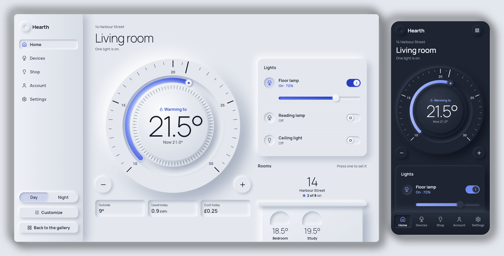
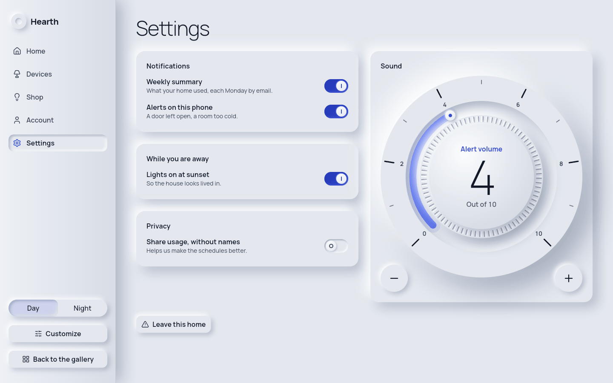
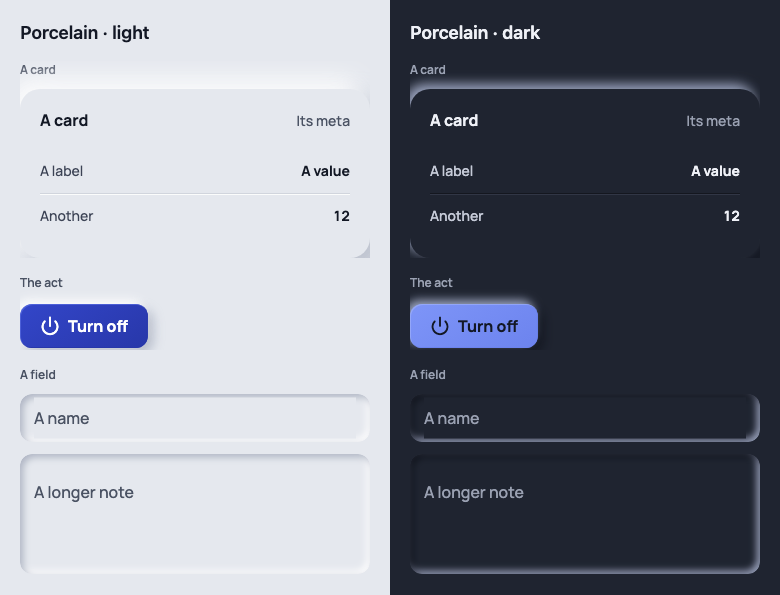
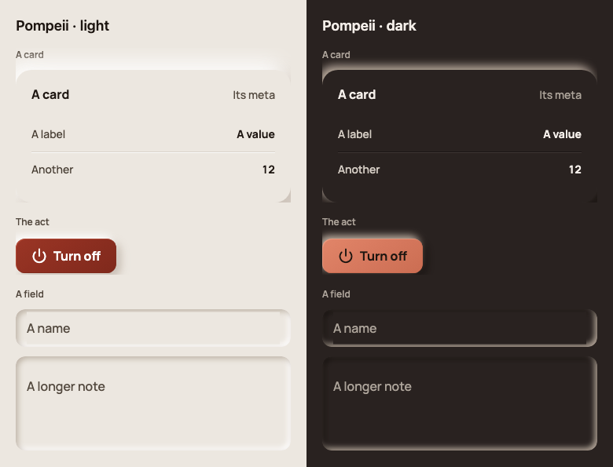
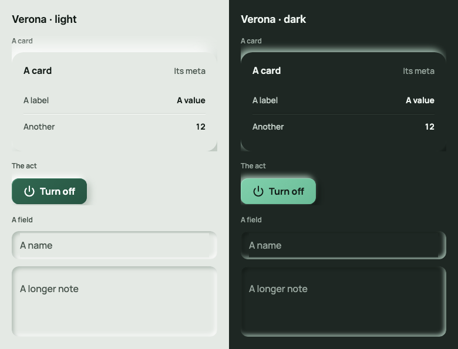
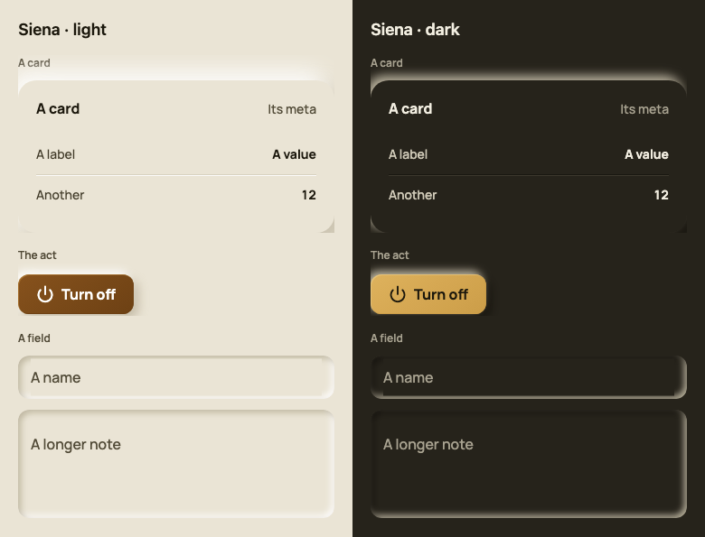
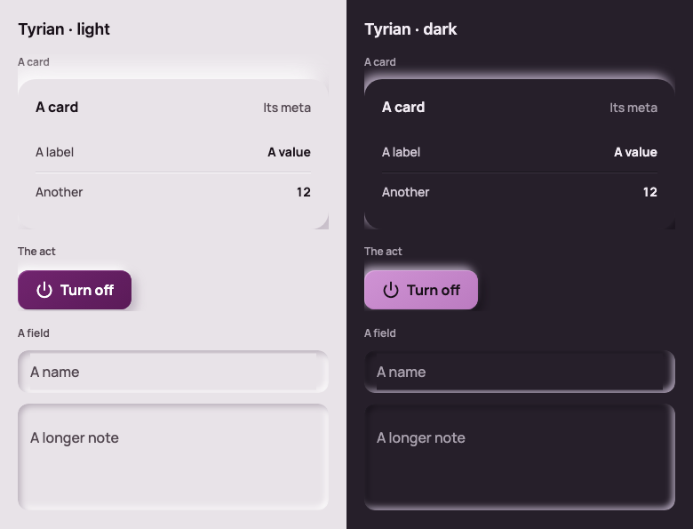

# neumorphism_ui

A soft UI design system for Flutter: every part is moulded from one wall colour, raised or pressed in by paired light
and shadow, with one pigment marking what acts. An optional high-contrast setting adds firmer edges.



**[Live gallery](https://wenkaifan0720.github.io/flutter_design_systems/neumorphism/)** · [Docs](https://wenkaifan0720.github.io/flutter_design_systems/docs/looks/neumorphism/) · [API reference](https://pub.dev/documentation/neumorphism_ui/latest/) · [All the looks](https://wenkaifan0720.github.io/flutter_design_systems/)

## Install

```sh
flutter pub add neumorphism_ui material_ui
```

`material_ui` is Flutter's Material library as a package; the quick start's `MaterialApp` comes from it.

## Use

`NeumorphicTheme` installs the design system under a `MaterialApp`, `CupertinoApp` or `WidgetsApp`. It supplies the text styles, localizations, scrolling behavior and private bridge used by the controls.

```dart
import 'package:material_ui/material_ui.dart';
import 'package:neumorphism_ui/neumorphism_ui.dart';

Future<void> main() async {
  WidgetsFlutterBinding.ensureInitialized();
  await neumorphicLoadFonts();
  runApp(MaterialApp(
    // The look's page change for the app's own routes (a MaterialPageRoute), on every platform; iOS keeps its
    // swipe back from the screen's edge round it.
    theme: ThemeData(
      pageTransitionsTheme: const PageTransitionsTheme(
        builders: neumorphicPageTransitions,
      ),
    ),
    builder: (context, child) => NeumorphicTheme(
      data: NeumorphicThemeData.porcelain(
        MediaQuery.platformBrightnessOf(context),
      ),
      child: child!,
    ),
    home: NeumorphicScaffold(
      topBar: const NeumorphicAppBar(title: 'Your day'),
      body: NeumorphicSections(children: [
        NeumorphicCard(
          title: 'A quiet start',
          children: [NeumorphicButton('Continue', onPressed: () {})],
        ),
      ]),
    ),
  ));
}
```

Controls use Flutter conventions: `onPressed`, `value` and `onChanged`, and `selectedIndex`. Each raised component has its own presenter, such as `showNeumorphicDialog` and `showNeumorphicBottomSheet`. The package requires no router.

A form in a card, its action live once the terms are agreed:

```dart
NeumorphicCard(
  title: 'Create an account',
  children: [
    NeumorphicTextField(labelText: 'Full name', onChanged: setName),
    NeumorphicTextField(
      labelText: 'Email',
      keyboardType: TextInputType.emailAddress,
      onChanged: setEmail,
    ),
    NeumorphicPasswordField(labelText: 'Password', onChanged: setPassword),
    NeumorphicSegmentedButton<String>(
      label: 'Plan',
      segments: const [
        NeumorphicButtonSegment('monthly', 'Monthly'),
        NeumorphicButtonSegment('yearly', 'Yearly'),
      ],
      value: plan,
      onChanged: (next) => setState(() => plan = next),
    ),
    NeumorphicSwitchRow(
      label: 'Reminders',
      subtitle: 'A note each morning',
      value: reminders,
      onChanged: (on) => setState(() => reminders = on),
    ),
    NeumorphicCheckbox(
      value: agreed,
      label: 'I agree to the terms',
      onChanged: (on) => setState(() => agreed = on ?? false),
    ),
    NeumorphicButton.filled(
      'Create account',
      onPressed: agreed ? submit : null,
    ),
  ],
);
```

A dialog that returns a value:

```dart
final keep = await showNeumorphicDialog<bool>(
  context,
  builder: (context) => NeumorphicDialog(
    title: 'Keep this draft?',
    message: 'You can finish it later.',
    actions: [
      NeumorphicButton('Discard', onPressed: () => Navigator.pop(context, false)),
      NeumorphicButton.filled('Keep', onPressed: () => Navigator.pop(context, true)),
    ],
  ),
);
```

A select, its options in a raised menu:

```dart
NeumorphicSelect<String>(
  label: 'Country',
  value: country,
  options: const [
    NeumorphicMenuItem('ca', 'Canada'),
    NeumorphicMenuItem('fr', 'France'),
    NeumorphicMenuItem('jp', 'Japan'),
  ],
  onChanged: (next) => setState(() => country = next),
);
```

A list in a card, each row pressed in when tapped:

```dart
NeumorphicListSection(
  label: 'Account',
  children: [
    NeumorphicListTile(
      title: 'Profile',
      subtitle: 'Name, photo and email',
      onPressed: openProfile,
    ),
    NeumorphicListTile(title: 'Security', onPressed: openSecurity),
  ],
);
```

A tappable row announces its title, subtitle and note together. Set `semanticLabel` when the row needs a different spoken name.

On a phone, the navigation bar gives destinations a second row when their labels need more space. The selected destination stays visible.

```dart
NeumorphicNavigationBar(
  items: const [
    NeumorphicNavItem(label: 'Home', icon: NeumorphicGlyphs.house),
    NeumorphicNavItem(label: 'Search', icon: NeumorphicGlyphs.search),
    NeumorphicNavItem(label: 'Settings', icon: NeumorphicGlyphs.settings),
  ],
  selectedIndex: tab,
  onDestinationSelected: (index) => setState(() => tab = index),
);
```

## Pictures

Hearth, the example app in the gallery, built from this package:





## How Neumorphism is built

These are the look's laws. A part the original style never had is made by them, so you can extend the look the same way.

1. Everything is one material. The wall, cards, keys and wells are the same material in the same colour. Nothing is laid on from elsewhere: no glass, no paper, and no drawn outline except the fine one high contrast prints.
2. Light comes from the top start: the top left, and the top right in a right-to-left app. A raised part is lit on its top-start side and shaded on its bottom-end side; a pressed part is the reverse.
3. Depth is state. Raised means it can be pressed, or it holds things. Pressed in means on, chosen, or a place to put something (a field, a track). Shallow, its colours moved toward the wall, means out of use: the part keeps its moulding at half strength.
4. Bumps of one surface never stack. Parts stand side by side. When two must touch, they are cast as one piece with one light and one shadow: a bank of cells, the avatar cluster. A part on a part is a plain step, and a well in a well is a plain floor. Many small equal choices, such as a month's days, are figures on their holder's surface; only the chosen one is a well, and a chosen range is one moulded channel.
5. Ink and pigment are colours of a face, never bodies of their own. Ink is for words; the pigment marks what is live and the page's one act.
6. Only what is in your hand, or what you call up, leaves the wall: a row being dragged, a menu, a dialog, a sheet, a toast. At rest, nothing floats over the page.
7. Motion is the material moving. A press sinks, keyboard focus lifts, a field's well deepens. Nothing bounces. With reduced motion a part jumps to its end, and a dialog or a sheet dissolves where it stands.
8. No corner is sharp. The smallest corner is 6. A face inside another follows the outer corner: its radius is the outer radius minus the inset, and never less than 6.

## Presets

Every preset has a separately designed light and dark appearance. Use its named factory with a positional `Brightness`, or `NeumorphicThemeData.preset(id, brightness)`.

| Preset | Character |
| --- | --- |
| `porcelain` | Neutral porcelain and a cool action pigment |
| `pompeii` | Warm plaster and an earthy red pigment |
| `verona` | A pale wall and a green pigment |
| `siena` | Warm mineral tones |
| `tyrian` | A purple pigment |

Cards, actions and fields in each preset, light on the left and dark on the right:











The example gallery shows every preset and appearance. Run it with `flutter run` from `example/`.

## Theme and styles

`NeumorphicTheme.of(context)` returns immutable `NeumorphicThemeData`, with `copyWith`, `lerp`, value equality and diagnostics. `AnimatedNeumorphicTheme` animates changes and respects reduced motion.

```dart
final theme = NeumorphicThemeData.porcelain().copyWith(
  density: NeumorphicDensity.compact,
  elevation: const NeumorphicElevation(depth: .5),
);

final custom = NeumorphicThemeData.from(
  ground: const Color(0xFFE9E4DD),
  pigment: const Color(0xFF315B83),
  brightness: Brightness.light,
);
```

The settings are the ones a product team turns: a preset or your own colours, light and dark, `density` (the platform's by default: compact with a pointer, standard on touch), `elevation` (the depth) and `highContrast`. A theme's depth stays between `NeumorphicElevation.leastDepth` and `mostDepth` and its strength at `leastStrength` or more: shallower reads as flat print and deeper as a skeuomorphic object, so the theme clamps a value outside that band to its nearer end. The corners are the look's: radios, avatars, stepper keys and moving thumbs are circles, chips, badges, switches and segmented tracks capsules, fields, cards and raised panels their own frame steps, and nested faces subtract their inset from the enclosing radius, never going under the smallest corner (6). A component theme's or a style's `shape` changes one part within the look's family: a `NeumorphicRoundedBorder` at least 6 round, a `NeumorphicStadiumBorder` or a `NeumorphicCircleBorder`. A sharper corner or another `OutlinedBorder` fails an assert in debug builds, naming the rule: the surface is moulded, with no sharp corner, and its relief is drawn round its own borders only.

Nothing draws a dark outline: the relief alone finds every edge, an empty checkbox, an unselected radio, a switch that is off and an empty field included. High contrast follows the device (`MediaQuery.highContrastOf`) and prints a fine outline on every part; `theme.copyWith(highContrast: true)` forces it on. Selection uses depth and the accent colour. `style.side` and `style.edge` print a rim, which is off the look's rule: relief is the only edge, and the fine outline is what high contrast draws. They take precedence in either mode, so keep them for a high-contrast rim of your own; on an ordinary part a printed rim reads as flat outlined UI, not a moulded surface.

Component themes cover buttons, fields, chips, checkbox/radio/switch/slider, segmented buttons, options, steppers, date/time pickers, cards, raised surfaces, badges and avatars. A local `style:` takes priority over its component theme, followed by theme knobs and the component's default drawing.

```dart
NeumorphicButton.filled(
  'Save',
  onPressed: () {},
  style: NeumorphicStyle(
    foreground: WidgetStateProperty.resolveWith(
      (states) => states.contains(WidgetState.pressed) ? Colors.white : null,
    ),
  ),
);
```

Style slots are `fill`, `foreground`, `edge`, `overlay`, `side`, `shape`, `padding`, `minimumSize`, `textStyle` and `iconSize`, each a `WidgetStateProperty`. Fields take the same `style:` API; their editable words use its `textStyle` slot. Slabs and wells pass content styles to plain child text and icons, while explicit child styles take precedence. Data-driven dials and charts retain their geometric vocabulary.

## Interaction and localization

Controls support keyboard activation, focus, disabled states and padded targets of 48 logical pixels on every platform. Editing follows each platform's gestures and Cmd/Ctrl shortcuts. The selection menu and selection handles are drawn by this system. States are shown through relief rather than lines or fades. On keyboard focus a raised part (a button, a key, a chip, a row) rises off the wall: its shadows go deeper and sharper in its own light and shade, with no line and no glow. A field, a select, a checkbox's box, a radio's socket and every other well stays inset and goes a little deeper instead, its inner shadow longer and softer, and a field's label turns to the pigment's ink. A switch's thumb rises inside its slot, which deepens softly. The hollows inside a focused part keep their depth, so focus shows once. A part that is out of use keeps its moulding: its colours move halfway toward the wall, so its relief is shallow and its words are quiet.

Hover changes nothing on a part's face: no wash, tint or shadow. The pointer says what a part does instead: a hand over what presses, the text beam over fields, grab over a slider, the arrow over what is disabled. A press sinks the part in its own outline, and keyboard focus lifts a raised part or deepens a well. Hover stays only where it tells you something: the active row of an open menu, a tooltip, a chart's readout, a rating's preview, a day of a month (which has no face of its own until it is chosen) and a file drop target with a drag over it. Every part still receives `WidgetState.hovered`, but a wash or a tint on hover breaks the look's state rules (a press sinks, focus lifts, hover says nothing), so the look draws none. To make a part or a region say more or less, use the look's own two means: the pigment, for what is live (`NeumorphicButton.filled` for the one act that matters), and depth. A quieter side panel, for instance, is the same surface cast shallower:

```dart
NeumorphicTheme(
  data: NeumorphicTheme.of(context).copyWith(
    elevation: const NeumorphicElevation(depth: .75),
  ),
  child: sidePanel,
);
```

The parts' built-in words come from `RawWidgetsLocalizations`, the words every look of the kit shares. Dates and numbers use `intl`. Your app owns its content and localization delegates.

## Accessibility and languages

- **Right to left.** Every part mirrors under a right-to-left `Directionality`: chevrons and arrows turn, sliders, progress and steppers fill from the start, fields swap their leading and trailing parts, and the light moves to the top right, so every relief is lit and shaded as the mirror of its left-to-right self. Figures, times and codes stay left to right. Public geometry takes the directional types (`EdgeInsetsGeometry`, `AlignmentGeometry`). The example gallery has a Right to left switch.
- **Large text.** Controls get taller as the reader increases the text size. Navigation destinations can span multiple rows, and dialogs and sheets scroll. On a thermostat, the setting stays in the centre if it fits and longer descriptions move below it. Calendar day numbers and the numbers printed between dial ticks scale up to 1.3×. Their complete labels are also available to screen readers.
- **Screen readers and keyboard.** Each part reports its role, label, value and state (checked, selected, expanded, disabled), and decorative paint is excluded from semantics. Everything works from the keyboard, and focus follows reading order. Targets are at least 48 px. Text meets 4.5:1 contrast in every preset, by day and by night. With reduced motion, parts change state at once, and dialogs and sheets dissolve in place.
- **Edges and states.** A part's edge is soft light and shadow, faint by night, and nothing depends on it alone.
  Every state (on, chosen, checked, a slider's value) and every part without words reaches 3:1 through its colour, words or mark, by day and by night; high contrast adds a fine outline. Keyboard focus is said in the material, a raised part rising and a well deepening softly, so it is quieter than a printed ring.
- **Other scripts.** The bundled Manrope covers Latin. Other scripts fall back to the platform's fonts; on the web, Flutter fetches them.

Known limits in 0.3.0:

- The words every look shares (Cancel, Today, Close, "3 of 10" and the rest) come from ui_core's `RawWidgetsLocalizations`, which speaks 30 languages once your app adds `RawWidgetsLocalizations.delegate` beside Flutter's delegates (ui_core's README shows how). Install `NeumorphicLocalizations.delegate` beside it: it serves every locale, and the time picker's words (its hour, minute and AM and PM), Done, Try again, the required mark and a table's sort hints come from `RawWidgetsLocalizations` in the reader's language. The rest of the look's own words (a file drop's prompts and a few more) stay English unless your app subclasses `NeumorphicLocalizations` and adds a delegate that loads it.
- Dates and numbers are formatted with `intl`: in the app's locale with `NeumorphicLocalizations.delegate` installed (in English where `intl` lacks the locale), else in English unless your subclass names another `localeName`. Short weekday names are English, and times show in 24-hour form.

## Fonts and copying components

Manrope is bundled under SIL OFL 1.1. `neumorphicLoadFonts()` loads it before the first frame; `NeumorphicTypeface.app` selects fonts supplied by your app. Icons come from Lucide under its ISC licence.

To adapt a component, copy its file from `lib/src/neumorphism/`, rename it, and replace its sibling imports with `package:neumorphism_ui/neumorphism_parts.dart`. The parts library exports the tokens, painters and helpers used to draw the public components.

## Requirements

Flutter 3.47.0 or later (Dart 3.13), on Android, iOS, web, macOS, Windows and Linux.

## Licence

BSD-3-Clause.
