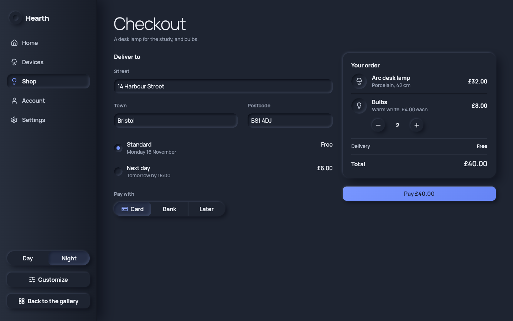
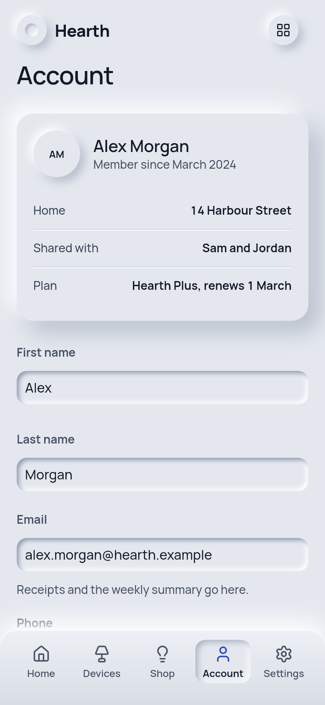
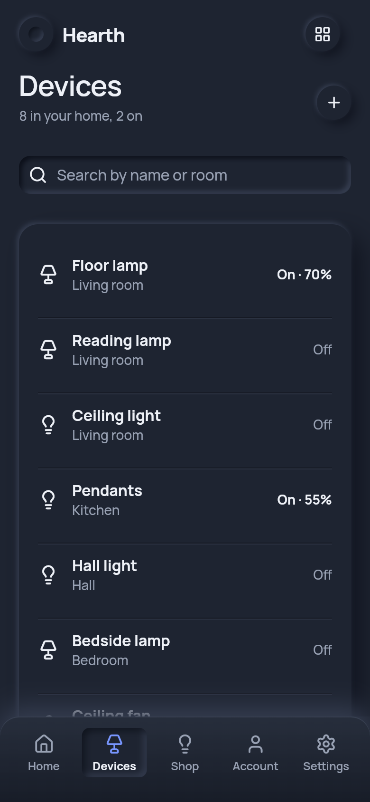

# neumorphism_ui

A soft UI design system for Flutter: every part is moulded from one wall colour, raised or pressed in by paired light
and shadow, with one pigment marking what acts. An optional high-contrast setting adds firmer edges. Choose from six
palettes, each with a light and a dark appearance.


**[Docs and demo](https://wenkaifan0720.github.io/flutter_design_systems/docs/looks/neumorphism/)** · [Try it in Stint](https://wenkaifan0720.github.io/flutter_design_systems/docs/stint/?look=neumorphism) · [API reference](https://pub.dev/documentation/neumorphism_ui/latest/) · [All the looks](https://wenkaifan0720.github.io/flutter_design_systems/docs/)

## Install

```sh
flutter pub add neumorphism_ui material_ui
```

Every snippet on this page compiles after that line. The icons in them are `NeumorphicGlyphs`, the glyphs Neumorphism
draws with; for an icon of your own, add `lucide_icons_flutter`, the set they come from.

Each file imports the look and the Material it is built on:

```dart
import 'package:material_ui/material_ui.dart';
import 'package:neumorphism_ui/neumorphism_ui.dart';
```

`neumorphism_ui.dart` holds the parts, `NeumorphicHost` included, and the ui_core types their API takes
(`RawNavigationDestination`, `RawNamedPalette`). `neumorphism_parts.dart` adds the tokens, painters and the
lower-level pieces (`NeumorphicChart`, `NeumorphicPanel`) for parts of your own. `material_ui` is Flutter's Material
library as a package, with `MaterialApp`; import it rather than `package:flutter/material.dart`.

## Mount the host

`NeumorphicHost`, in the app's `builder`, is the one mount: it picks the light or dark theme from the palette, gives
the app's own routes (a `MaterialPageRoute`) the look's page change, paints the wall behind the app, holds the toasts,
and eases a change of palette or appearance (a cut under Reduce Motion). Load the bundled face before `runApp` so the
first frame is set in it.

```dart
import 'package:material_ui/material_ui.dart';
import 'package:neumorphism_ui/neumorphism_ui.dart';

Future<void> main() async {
  WidgetsFlutterBinding.ensureInitialized();
  await neumorphicLoadFonts();
  runApp(const App());
}

class App extends StatelessWidget {
  const App({super.key});

  @override
  Widget build(BuildContext context) => MaterialApp(
    title: 'Shelf',
    // The parts' own words in 30 languages, and Material's (from material_ui).
    localizationsDelegates: const [
      RawWidgetsLocalizations.delegate,
      NeumorphicLocalizations.delegate,
      ...GlobalMaterialLocalizations.delegates,
    ],
    supportedLocales: RawWidgetsLocalizations.supportedLocales,
    // brightness: null follows the platform; Brightness.light or
    // Brightness.dark pins it. palette: one of the six, porcelain by default.
    builder: (context, child) => NeumorphicHost(
      palette: NeumorphicThemeData.palettes.first,
      brightness: null,
      child: child!,
    ),
    home: const NeumorphicScaffold(
      topBar: NeumorphicAppBar(title: 'Today', subtitle: 'Thursday'),
      body: NeumorphicListTile(title: 'Stoner', subtitle: 'John Williams'),
    ),
  );
}
```

These delegates are the whole list: `RawWidgetsLocalizations.delegate` (the words every look shares: Cancel, Today,
Close, in 30 languages), `NeumorphicLocalizations.delegate` (the look's own) and `GlobalMaterialLocalizations.delegates`,
which `material_ui` exports with Flutter's translations: an app on material_ui needs no `flutter_localizations`
dependency. A `CupertinoApp` (from `cupertino_ui`) or a bare `WidgetsApp` takes the same `builder:` and delegates.

`NeumorphicHost(theme:, darkTheme:)` takes themes of your own instead of a palette's; the one you leave out is the
palette's in that appearance. `density:` and `shapeScheme:` (the corners and the relief's depth) stand over both, so a
stored palette and a depth from your settings go together:
`NeumorphicHost(palette: palette, shapeScheme: NeumorphicThemeData.defaultShapeScheme.copyWith(depth: depth), child: child!)`.
The window's width changes none of these: the parts follow the width themselves. To theme one subtree, wrap it in
`NeumorphicTheme(data: …)`; `AnimatedNeumorphicTheme` eases between two.

The look has a few words of its own, used through this page: the **wall** is the background every part is moulded
from, the **pigment** is the accent colour (it marks what is live and the page's one action), a **well** is a part
pressed into the wall (a field, a track), a **place** is a navigation destination, and the **pilaster** is the
sidebar.

## Build an app

The example app, `example/lib/main.dart`, is all of this in one file: Shelf, a reading list with three places, a
list with a pushed page, a form, a dialog and settings with the six palettes. Copy it and grow it.
`example/lib/gallery.dart` shows every part.

### The shell

`NeumorphicAppShell` is the app's frame: a bottom tab bar on a phone, and a sidebar (the pilaster) down the start edge
from 1024 wide, each holding the app's destinations (its places). The destination shown is pressed into the wall. Each place keeps its own stack of pages; a
page pushed in a place keeps the pilaster beside it while the tab bar steps away, and back pops it. Toasts keep clear
of the tab bar.

```dart
import 'package:material_ui/material_ui.dart';
import 'package:neumorphism_ui/neumorphism_ui.dart';

class Home extends StatefulWidget {
  const Home({super.key});

  @override
  State<Home> createState() => _HomeState();
}

class _HomeState extends State<Home> {
  int _place = 0;

  @override
  Widget build(BuildContext context) => NeumorphicAppShell(
    header: const NeumorphicBrandRow('Shelf'),
    destinations: const [
      RawNavigationDestination(label: 'Books', icon: NeumorphicGlyphs.layers),
      RawNavigationDestination(label: 'Reading', icon: NeumorphicGlyphs.bookOpen),
      RawNavigationDestination(label: 'Settings', icon: NeumorphicGlyphs.settings),
    ],
    selectedIndex: _place,
    onDestinationSelected: (index) => setState(() => _place = index),
    branches: [
      (context) => const NeumorphicScaffold(topBar: NeumorphicAppBar(title: 'Books'), body: SizedBox()),
      (context) => const NeumorphicScaffold(topBar: NeumorphicAppBar(title: 'Reading'), body: SizedBox()),
      (context) => const NeumorphicScaffold(topBar: NeumorphicAppBar(title: 'Settings'), body: SizedBox()),
    ],
  );
}
```

`NeumorphicBrandRow('Shelf')` sets the app's name at the head of the pilaster.

### A list, and its page

A page is a `NeumorphicScaffold`: its bar, its body and a footer for its acts. `maxWidth` holds all three to one
column on a wide window (1264 by default, margins included). A row pushes its record's page in the same place; the
pushed page's bar has the back key.

```dart
import 'package:material_ui/material_ui.dart';
import 'package:neumorphism_ui/neumorphism_ui.dart';

class Book {
  const Book(this.name, this.author, {this.reading = false});

  final String name;
  final String author;
  final bool reading;
}

class BooksPage extends StatelessWidget {
  const BooksPage({super.key, required this.books});

  final List<Book> books;

  @override
  Widget build(BuildContext context) => NeumorphicScaffold(
    maxWidth: 760,
    topBar: const NeumorphicAppBar(title: 'Books'),
    body: NeumorphicListSection(
      children: [
        for (final book in books)
          NeumorphicListTile(
            leading: NeumorphicMonogram(book.name.substring(0, 1)),
            title: book.name,
            subtitle: book.author,
            // A status in words; the one under way now is live, in the pigment.
            trailing: NeumorphicStatus(book.reading ? 'Reading' : 'To read', live: book.reading),
            onPressed: () => Navigator.of(context).push(
              MaterialPageRoute<void>(builder: (context) => BookPage(book: book)),
            ),
          ),
      ],
    ),
  );
}

class BookPage extends StatelessWidget {
  const BookPage({super.key, required this.book});

  final Book book;

  @override
  Widget build(BuildContext context) => NeumorphicScaffold(
    maxWidth: 760,
    topBar: NeumorphicAppBar(title: book.name),
    body: NeumorphicDescriptionList([
      NeumorphicDescription('Author', book.author),
      // What is under way now is live: it takes the pigment.
      NeumorphicDescription('Status', book.reading ? 'Reading' : 'Want to read', live: book.reading),
    ]),
    footer: NeumorphicButton.filled('Start reading', wide: true, onPressed: () {}),
  );
}
```

A status that matters now is `live`: `NeumorphicStatus` sets it in the pigment with a lit LED, and every other status
in plain ink, so the books being read stand out from the rest. A `NeumorphicTag` is a kind or a count, the same
stamped grey whatever it says. A description list takes its column's width up to 760, a reading page's measure: on
such a page its details end where the page's words and its bar's keys end.

### Forms

`NeumorphicTextFormField` is a Flutter `FormField`: put it in a `Form`, and `validate()` shows its error under it,
marked as an error: its words and the warning glyph in the danger ink (`NeumorphicColors.danger`, a red at 4.5:1 or
more on every face), the glyph once, at the field's end or else on the line. The other parts a form holds are
controlled, as Material's are: `NeumorphicDateField`, `NeumorphicSelect`, `NeumorphicSegmentedButton` and
`NeumorphicSwitchRow` take a value and `onChanged`. Keep their values in your state and check them when the form
saves; a date field and a select take an `errorText`, and a segmented button or a radio group takes its label and its
error from a `NeumorphicFormField` round it. In a column every field takes the column's width.

Set the form's `autovalidateMode` to `AutovalidateMode.onUserInteraction` after a save that fails, and each error
clears as its field is put right. A text form field resets as Material's `TextFormField` does: with a controller, its
initial value is the controller's text when it was last built, so `reset()` brings back the words typed. To clear the
form after a save and stay on the page, call `reset()` and then clear the controllers, as `_save` does here:

```dart
import 'package:material_ui/material_ui.dart';
import 'package:neumorphism_ui/neumorphism_ui.dart';

class NewBookPage extends StatefulWidget {
  const NewBookPage({super.key, required this.onAdd});

  final void Function(String title, String status, DateTime? started) onAdd;

  @override
  State<NewBookPage> createState() => _NewBookPageState();
}

class _NewBookPageState extends State<NewBookPage> {
  final _form = GlobalKey<FormState>();
  final _title = TextEditingController();
  var _check = AutovalidateMode.disabled;
  String _status = 'toRead';
  DateTime? _started;
  String? _startedError;
  bool _favourite = false;

  @override
  void dispose() {
    _title.dispose();
    super.dispose();
  }

  void _save() {
    // The date is controlled: the page checks it and hands the field its error.
    final started = _status != 'toRead' && _started == null ? 'Pick the day you started' : null;
    final titled = _form.currentState!.validate();
    setState(() => _startedError = started);
    if (!titled || started != null) {
      setState(() => _check = AutovalidateMode.onUserInteraction);
      return;
    }
    widget.onAdd(_title.text.trim(), _status, _started);
    // Clear the form after a save: reset() takes the errors away, then the
    // controller and the controlled values empty the fields.
    _form.currentState!.reset();
    _title.clear();
    setState(() {
      _check = AutovalidateMode.disabled;
      _status = 'toRead';
      _started = null;
      _favourite = false;
    });
  }

  @override
  Widget build(BuildContext context) => NeumorphicScaffold(
    maxWidth: 760,
    topBar: const NeumorphicAppBar(title: 'New book'),
    body: Form(
      key: _form,
      autovalidateMode: _check,
      child: Column(
        crossAxisAlignment: CrossAxisAlignment.stretch,
        spacing: 20,
        children: [
          NeumorphicTextFormField(
            labelText: 'Title',
            controller: _title,
            validator: (value) => (value ?? '').trim().isEmpty ? 'Enter the title' : null,
          ),
          NeumorphicFormField(
            labelText: 'Status',
            child: NeumorphicSegmentedButton<String>(
              semanticLabel: 'Status',
              segments: const [
                NeumorphicButtonSegment('toRead', 'To read'),
                NeumorphicButtonSegment('reading', 'Reading'),
                NeumorphicButtonSegment('done', 'Done'),
              ],
              value: _status,
              onChanged: (value) => setState(() => _status = value),
            ),
          ),
          NeumorphicDateField(
            labelText: 'Started',
            value: _started,
            hintText: 'Not yet',
            errorText: _startedError,
            lastDate: DateTime.now(),
            onChanged: (value) => setState(() {
              _started = value;
              _startedError = null;
            }),
          ),
          NeumorphicSwitchRow(
            label: 'Favourite',
            value: _favourite,
            onChanged: (value) => setState(() => _favourite = value),
          ),
        ],
      ),
    ),
    footer: NeumorphicButton.filled('Save', wide: true, onPressed: _save),
  );
}
```

A date field shows its day with the year, "Nov 26, 2026" in American English, and opens the look's calendar;
`NeumorphicFormat.mediumDate(context, day)` writes the same.

### Dialogs and toasts

`showNeumorphicDialog` raises a dialog over the whole app and completes with what its route pops: here true to
delete, false or null (dismissed) to keep. A destructive act says so: `isDestructiveAction` gives the key its mark.
`showNeumorphicToast` shows a short note over the app, clear of the tab bar.

```dart
import 'package:material_ui/material_ui.dart';
import 'package:neumorphism_ui/neumorphism_ui.dart';

Future<void> deleteBook(BuildContext context, String name) async {
  final sure = await showNeumorphicDialog<bool>(
    context,
    builder: (context) => NeumorphicDialog(
      title: 'Delete "$name"?',
      message: 'It leaves your shelf. This cannot be undone.',
      actions: [
        NeumorphicButton('Keep', onPressed: () => Navigator.of(context).pop(false)),
        NeumorphicButton.filled(
          'Delete',
          isDestructiveAction: true,
          onPressed: () => Navigator.of(context).pop(true),
        ),
      ],
    ),
  );
  if (sure != true || !context.mounted) return;
  showNeumorphicToast(context, message: 'Deleted "$name"');
}
```

### The palette picker

Each palette by its name, its colours right beside it (`swatchesFor` the brightness shown); hand the chosen one to
the host, with a depth or a density of your own beside it (`NeumorphicHost(palette:, shapeScheme:, density:)`, under
Mount the host). A slider shows no number of its own: to show the reader a value, write it in its field's help, as
`NeumorphicFormField(labelText: 'Depth', helperText: '${depth.toStringAsFixed(2)}×', child: …)`.

```dart
import 'dart:math' as math;

import 'package:material_ui/material_ui.dart';
import 'package:neumorphism_ui/neumorphism_ui.dart';

class PalettePicker extends StatelessWidget {
  const PalettePicker({super.key, required this.palette, required this.onChanged});

  final RawNamedPalette palette;
  final ValueChanged<RawNamedPalette> onChanged;

  @override
  Widget build(BuildContext context) {
    final brightness = NeumorphicTheme.of(context).dark ? Brightness.dark : Brightness.light;
    return NeumorphicFormField(
      labelText: 'Palette',
      child: NeumorphicRadioGroup<String>(
        semanticLabel: 'Palette',
        value: palette.id,
        onChanged: (id) => onChanged(NeumorphicThemeData.palettes.firstWhere((p) => p.id == id)),
        options: [
          for (final p in NeumorphicThemeData.palettes)
            NeumorphicRadio(p.id, p.label, suffix: Swatches(p.swatchesFor(brightness))),
        ],
      ),
    );
  }
}

/// A palette's colours as Material's palette pickers show them: one disc split
/// between them, in a hairline so a pale colour reads on a pale wall and a dark
/// one on a dark wall.
class Swatches extends StatelessWidget {
  const Swatches(this.colors, {super.key});

  final List<Color> colors;

  @override
  Widget build(BuildContext context) => SizedBox.square(
    dimension: 24,
    child: CustomPaint(
      painter: _SplitDisc(colors, NeumorphicTheme.of(context).colors.inkSecondary),
    ),
  );
}

class _SplitDisc extends CustomPainter {
  _SplitDisc(this.colors, this.ring);

  final List<Color> colors;
  final Color ring;

  @override
  void paint(Canvas canvas, Size size) {
    final disc = Offset.zero & size;
    final share = 2 * math.pi / colors.length;
    for (final (i, color) in colors.indexed) {
      canvas.drawArc(disc, -3 * math.pi / 4 + share * i, share, true, Paint()..color = color);
    }
    canvas.drawCircle(
      disc.center,
      size.shortestSide / 2 - .5,
      Paint()
        ..style = PaintingStyle.stroke
        ..color = ring,
    );
  }

  @override
  bool shouldRepaint(_SplitDisc old) => old.colors != colors || old.ring != ring;
}
```

## Building blocks

| For | Use |
|---|---|
| The app's frame | `NeumorphicHost`, `NeumorphicAppShell`, `NeumorphicBrandRow`, `NeumorphicNavigationBar`, `NeumorphicNavigationRail`, `NeumorphicNavigationDrawer` |
| A page | `NeumorphicScaffold`, `NeumorphicAppBar`, `NeumorphicSections`, `NeumorphicTabBar`, `NeumorphicBreadcrumb`, `NeumorphicPagination` |
| Acts | `NeumorphicButton` (`.filled`, `.text`), `NeumorphicIconButton`, `NeumorphicRoundButton`, `NeumorphicButtonGroup`, `NeumorphicSplitButton`, `NeumorphicLink` |
| Words in | `NeumorphicTextField`, `NeumorphicTextFormField`, `NeumorphicTextArea`, `NeumorphicPasswordField`, `NeumorphicSearchField`, `NeumorphicNumberField`, `NeumorphicInputOtp` |
| Choices | `NeumorphicSelect`, `NeumorphicCombobox`, `NeumorphicMultiSelect`, `NeumorphicRadioGroup`, `NeumorphicCheckbox`, `NeumorphicSwitch`, `NeumorphicSegmentedButton`, `NeumorphicToggleGroup`, `NeumorphicChip`, `NeumorphicSlider`, `NeumorphicRangeSlider`, `NeumorphicRating`, `NeumorphicColorPicker` |
| Dates and times | `NeumorphicDateField`, `NeumorphicCalendar`, `NeumorphicDatePicker`, `NeumorphicDateRangePicker`, `NeumorphicTimePicker`, `showNeumorphicDatePicker` |
| Lists and tables | `NeumorphicListTile`, `NeumorphicListSection`, `NeumorphicDescriptionList`, `NeumorphicReorderableListView`, `NeumorphicTreeView`, `NeumorphicTable`, `NeumorphicDataTable` |
| Form and settings rows | `NeumorphicFormField`, `NeumorphicSwitchRow`, `NeumorphicCheckRow`, `NeumorphicSelectField` |
| Over the page | `NeumorphicDialog`, `showNeumorphicDialog`, `NeumorphicBottomSheet`, `NeumorphicActionSheet`, `NeumorphicMenu`, `NeumorphicPopover`, `NeumorphicHoverCard`, `NeumorphicTooltip`, `NeumorphicContextMenu`, `showNeumorphicToast` |
| Status | `NeumorphicTag`, `NeumorphicBadge`, `NeumorphicBanner`, `NeumorphicEmptyState`, `NeumorphicErrorState`, `NeumorphicLoadingState`, `NeumorphicSkeleton`, `NeumorphicLinearProgressIndicator`, `NeumorphicCircularProgressIndicator`, `NeumorphicMeter`, `NeumorphicStepProgress` |
| Cards and marks | `NeumorphicCard`, `NeumorphicAvatar`, `NeumorphicAvatarGroup`, `NeumorphicMonogram`, `NeumorphicMedia` |
| Dials | `NeumorphicDial`, `NeumorphicKnob`, `NeumorphicGauge` |
| Charts | `NeumorphicLineChart`, `NeumorphicAreaChart`, `NeumorphicBarChart`, `NeumorphicPieChart`, `NeumorphicSparkline` |

## How Neumorphism is built

These are the look's laws. A part the original style never had is made by them, so you can extend the look the same way.

1. Everything is one material. The wall, cards, keys and wells are the same material in the same colour. Nothing is laid on from elsewhere: no glass, no paper, and no drawn outline except the fine one high contrast prints.
2. Light comes from the top start: the top left, and the top right in a right-to-left app. A raised part is lit on its top-start side and shaded on its bottom-end side; a pressed part is the reverse.
3. Depth is state. Raised means it can be pressed, or it holds things. Pressed in means on, chosen, or a place to put something (a field, a track). Shallow, its colours moved toward the wall, means out of use: the part keeps its moulding at half strength.
4. Bumps of one surface never stack. Parts stand side by side. When two must touch, they are cast as one piece with one light and one shadow: a bank of cells, the avatar cluster. A part on a part is a plain step, and a well in a well is a plain floor. Many small equal choices, such as a month's days, are figures on their holder's surface; only the chosen one is a well, and a chosen range is one moulded channel.
5. Ink and pigment are colours of a face, never bodies of their own. Ink is for words; the pigment marks what is live and the page's one act.
6. Only what is in your hand, or what you call up, leaves the wall: a row being dragged, a menu, a dialog, a sheet, a toast. At rest, nothing floats over the page.
7. Motion is the material moving. A press sinks, keyboard focus lifts, a field's well deepens. Nothing bounces. With reduced motion a part jumps to its end, and a dialog or a sheet dissolves where it stands.
8. No corner is sharp. The smallest corner is 6. A face inside another follows the outer corner: its radius is the outer radius minus the inset, and never less than 6.

## Palettes

`NeumorphicThemeData.palettes` are the six palettes, porcelain first and the default, each designed by day and by
night. Each is a `RawNamedPalette`: an `id` to store, a `label` to show and the swatches to draw beside it. Give
the chosen one to `NeumorphicHost(palette:)`; `NeumorphicThemeData.preset(id, brightness)` builds a stored id's theme
again (an id it doesn't know gives porcelain), and each palette has a factory of its own that takes `Brightness.light`
(the default) or `Brightness.dark`.

| Factory | Appearance |
| --- | --- |
| `NeumorphicThemeData.porcelain()` | Grey-blue plaster with ultramarine; blue-slate and a clear cobalt at night. |
| `NeumorphicThemeData.pompeii()` | Warm limestone with cinnabar; dark umber and a coral glow at night. |
| `NeumorphicThemeData.verona()` | Green-grey plaster with malachite; deep green and mint at night. |
| `NeumorphicThemeData.siena()` | Ochre plaster with burnt umber; olive-brown and amber at night. |
| `NeumorphicThemeData.tyrian()` | Mauve-grey plaster with Tyrian purple; aubergine and orchid at night. |
| `NeumorphicThemeData.capri()` | Sea-grey plaster with Capri's blue-green; sea-slate and aqua at night. |

`NeumorphicThemeData.from(ground:, pigment:, brightness:)` derives a whole palette from a wall colour and a pigment:
the wall keeps the ground's hue at a plaster's lightness, and the words, the pigment's ink and the bars each take the
nearest tone of their own hue that reads on every face and well (ui_core's `RawPalette`).

## Theme and styles

`NeumorphicTheme.of(context)` returns immutable `NeumorphicThemeData`, with `copyWith`, `lerp`, value equality and diagnostics. `AnimatedNeumorphicTheme` animates changes and respects reduced motion.

```dart
import 'package:material_ui/material_ui.dart';
import 'package:neumorphism_ui/neumorphism_ui.dart';

final theme = NeumorphicThemeData.porcelain().copyWith(
  density: NeumorphicDensity.compact,
  shapeScheme: NeumorphicThemeData.defaultShapeScheme.copyWith(depth: .5),
);

final custom = NeumorphicThemeData.from(
  ground: const Color(0xFFE9E4DD),
  pigment: const Color(0xFF315B83),
  brightness: Brightness.light,
);
```

The settings are the ones a product team turns: a palette or your own colours, light and dark, the `typeface` (its `fallback` faces reach every text style, as `ThemeData.fontFamilyFallback` does, for a script Manrope lacks), `density` (the platform's by default: compact with a pointer, standard on touch), `shapeScheme` (the corners and the depth) and `highContrast`. The shape scheme opens within the look's bands, `NeumorphicThemeData.shapeLimits`, and the theme clamps a value outside one to its nearer end: the least corner is 6, small 6 to 10, medium 8 to 16, large and extra large 14 to 28, a capsule's end 24, and the depth 0.5 to 1.5, since shallower reads as flat print and deeper as a skeuomorphic object. There is no stroke: depth alone draws every edge. Every radius moves with its step, nested faces with it. The corners are the look's: radios, avatars, stepper keys and moving thumbs are circles, chips, badges, switches and segmented tracks capsules, fields, cards and raised panels their own frame steps, and nested faces subtract their inset from the enclosing radius, never going under the smallest corner (6). A component theme's or a style's `shape` changes one part within the look's family: a `NeumorphicRoundedBorder` at least 6 round, a `NeumorphicStadiumBorder` or a `NeumorphicCircleBorder`. A sharper corner or another `OutlinedBorder` fails an assert in debug builds, naming the rule: the surface is moulded, with no sharp corner, and its relief is drawn round its own borders only.

A style's `corners` takes one part's corners by step, the start and end ones following the reading direction: a card's top corners one step and its bottom corners another, say. Each is held to the look's bands (a square corner to the least, 6, since the relief wraps every fillet) and drawn at the theme's scale; the others keep the part's own. A circle stays a circle, a switch's slot and a slider's track keep their capsule, and a segmented button's strip takes the corners at its ends. A style's `shape` wins over its `corners`.

```dart
import 'package:material_ui/material_ui.dart';
import 'package:neumorphism_ui/neumorphism_ui.dart';

const card = NeumorphicCard(
  title: 'On pace',
  style: NeumorphicStyle(
    corners: WidgetStatePropertyAll(
      RawCorners(
        topStart: RawCorner.extraLarge,
        topEnd: RawCorner.extraLarge,
        bottomStart: RawCorner.extraSmall,
        bottomEnd: RawCorner.extraSmall,
      ),
    ),
  ),
);
```

Nothing draws a dark outline: the relief alone finds every edge, an empty checkbox, an unselected radio, a switch that is off and an empty field included. High contrast follows the device (`MediaQuery.highContrastOf`) and prints a fine outline on every part; `theme.copyWith(highContrast: true)` forces it on. Selection uses depth and the accent colour. `style.side` and `style.edge` print a rim, which is off the look's rule: relief is the only edge, and the fine outline is what high contrast draws. They take precedence in either mode, so keep them for a high-contrast rim of your own; on an ordinary part a printed rim reads as flat outlined UI, not a moulded surface.

Component themes cover buttons, fields, chips, checkbox/radio/switch/slider, segmented buttons, options, steppers, date/time pickers, cards, raised surfaces, badges and avatars. A local `style:` takes priority over its component theme, followed by theme knobs and the component's default drawing.

```dart
import 'package:material_ui/material_ui.dart';
import 'package:neumorphism_ui/neumorphism_ui.dart';

final save = NeumorphicButton.filled(
  'Save',
  onPressed: () {},
  style: NeumorphicStyle(
    foreground: WidgetStateProperty.resolveWith(
      (states) => states.contains(WidgetState.pressed) ? Colors.white : null,
    ),
  ),
);
```

Style slots are `fill`, `foreground`, `edge`, `overlay`, `side`, `shape`, `corners`, `padding`, `minimumSize`, `textStyle` and `iconSize`, each a `WidgetStateProperty`. Fields take the same `style:` API; their editable words use its `textStyle` slot. Slabs and wells pass content styles to plain child text and icons, while explicit child styles take precedence. Data-driven dials and charts retain their geometric vocabulary.

## Interaction and localization

Controls support keyboard activation, focus, disabled states and targets of at least 40 logical pixels, ui_core's touch floor (`RawTapTargets`), on every platform; an app's `RawTapTargetScope` raises it. A medium control in a row stands at the density's line, `NeumorphicChromeMetrics.lineOf(context)`: 48 standard, 44 comfortable, 40 compact. Editing follows each platform's gestures and Cmd/Ctrl shortcuts. The selection menu and selection handles are drawn by this system. States are shown through relief rather than lines or fades. On keyboard focus a raised part (a button, a key, a chip, a row) rises off the wall: its shadows go deeper and sharper in its own light and shade, with no line and no glow. A field, a select, a checkbox's box, a radio's socket and every other well stays inset and goes a little deeper instead, its inner shadow longer and softer, and a field's label turns to the pigment's ink. A switch's thumb rises inside its slot, which deepens softly. The hollows inside a focused part keep their depth, so focus shows once. A part that is out of use keeps its moulding: its colours move halfway toward the wall, so its relief is shallow and its words are quiet.

Hover changes nothing on a part's face: no wash, tint or shadow. The pointer says what a part does instead: a hand over what presses, the text beam over fields, grab over a slider, the arrow over what is disabled. A press sinks the part in its own outline, and keyboard focus lifts a raised part or deepens a well. Hover stays only where it tells you something: the active row of an open menu, a tooltip, a chart's readout, a rating's preview, a day of a month (which has no face of its own until it is chosen) and a file drop target with a drag over it. Every part still receives `WidgetState.hovered`, but a wash or a tint on hover breaks the look's state rules (a press sinks, focus lifts, hover says nothing), so the look draws none. To make a part or a region say more or less, use the look's own two means: the pigment, for what is live (`NeumorphicButton.filled` for the one act that matters), and depth. A quieter side panel, for instance, is the same surface cast shallower:

```dart
import 'package:material_ui/material_ui.dart';
import 'package:neumorphism_ui/neumorphism_ui.dart';

/// [panel], cast shallower than the page round it.
Widget quieter(BuildContext context, Widget panel) => NeumorphicTheme(
  data: NeumorphicTheme.of(context).copyWith(
    shapeScheme: NeumorphicTheme.of(context).shapeScheme.copyWith(depth: .75),
  ),
  child: panel,
);
```

The parts' built-in words come from `RawWidgetsLocalizations`, the words every look of the kit shares. Dates use `intl`; numbers are written in the reader's digits through ui_core's `formatDecimal`. Your app owns its content; its delegates are the list under Mount the host.

## Accessibility and languages

- **Right to left.** Every part mirrors under a right-to-left `Directionality`: chevrons and arrows turn, sliders, progress and steppers fill from the start, fields swap their leading and trailing parts, and the light moves to the top right, so every relief is lit and shaded as the mirror of its left-to-right self. Figures, times and codes stay left to right. Public geometry takes the directional types (`EdgeInsetsGeometry`, `AlignmentGeometry`). The example gallery has a Right to left switch.
- **Large text.** Controls get taller as the reader increases the text size. Navigation destinations can span multiple rows, and dialogs and sheets scroll. On a thermostat, the setting stays in the centre if it fits and longer descriptions move below it. Calendar day numbers and the numbers printed between dial ticks scale up to 1.3×. Their complete labels are also available to screen readers.
- **Screen readers and keyboard.** Each part reports its role, label, value and state (checked, selected, expanded, disabled), and decorative paint is excluded from semantics. Everything works from the keyboard, and focus follows reading order. Targets are at least 40 px. Text meets 4.5:1 contrast in every preset, by day and by night. With reduced motion, parts change state at once, and dialogs and sheets dissolve in place.
- **Edges and states.** A part's edge is soft light and shadow, faint by night, and nothing depends on it alone.
  Every on or checked mark, a slider's value and every part without words reach 3:1 through their colour or mark, by day and by night; high contrast adds a fine outline. A chosen segment is told as iOS tells one, by its depth and its words together: it sits pressed in (its well 1.2:1 from its neighbours), its words bold in the full ink, the others' regular in the tertiary ink (2.0 to 2.3:1 apart, each 4.5:1 or more on its face); no one of these reaches 3:1 alone. Keyboard focus is said in the material, a raised part rising and a well deepening softly, so it is quieter than a printed ring.
- **Other scripts.** The bundled Manrope covers Latin. Other scripts fall back to the platform's fonts; on the web, Flutter fetches them. To name your own, give `NeumorphicTypeface(fallback: [...])`: every text style takes the list.

Known limits:

- The words every look shares (Cancel, Today, Close, "3 of 10" and the rest) come from ui_core's `RawWidgetsLocalizations`, which speaks 30 languages once your app adds `RawWidgetsLocalizations.delegate` beside Flutter's delegates (the list under Mount the host). Install `NeumorphicLocalizations.delegate` beside it: it serves every locale, and the time picker's words (its hour, minute and AM and PM), Done, Try again, the required mark and a table's sort hints come from `RawWidgetsLocalizations` in the reader's language. The rest of the look's own words (a file drop's prompts and a few more) stay English unless your app subclasses `NeumorphicLocalizations` and adds a delegate that loads it.
- Dates are formatted with `intl`: in the app's locale with `NeumorphicLocalizations.delegate` installed (in English where `intl` lacks the locale), else in English unless your subclass names another `localeName`. Numbers take the reader's digits and separators from ui_core (Arabic-Indic in Arabic). Short weekday names are English, and the day tray's times show in 24-hour form.

## Pictures

Hearth, the home app in the example gallery (`example/lib/gallery.dart`), built from this package:








## Fonts and copying components

Manrope is bundled under SIL OFL 1.1. `neumorphicLoadFonts()` loads it before the first frame; `NeumorphicTypeface.app` selects fonts supplied by your app. Icons come from Lucide under its ISC licence.

To adapt a component, copy its file from `lib/src/neumorphism/`, rename it, and replace its sibling imports with `package:neumorphism_ui/neumorphism_parts.dart`. The parts library exports the tokens, painters and helpers used to draw the public components.

## Example

`example/lib/main.dart` is Shelf, the app the snippets above come from: copy it, rename it and grow it.
`example/lib/gallery.dart` is the gallery: every part the package exports, working, in every palette, by day and by
night; run it with `flutter run -t lib/gallery.dart` from `example/`.

## Requirements

Flutter 3.47.0 or later (Dart 3.13), on Android, iOS, web, macOS, Windows and Linux. The package depends on ui_core
^0.8.7 and re-exports it.

## Licence

BSD-3-Clause.
