# neumorphism_ui

A soft UI design system for Flutter. Raised surfaces and pressed grooves share one wall colour, while paired shadows give them depth and a single pigment marks actions. An optional high-contrast setting adds stronger boundaries.

## Install

```yaml
dependencies:
  neumorphism_ui: ^0.1.0
```

## Use

`NeumorphicTheme` installs the design system under a `MaterialApp`, `CupertinoApp` or `WidgetsApp`. It supplies the text styles, localizations, scrolling behavior and private bridge used by the controls.

```dart
import 'package:flutter/material.dart';
import 'package:neumorphism_ui/neumorphism_ui.dart';

Future<void> main() async {
  WidgetsFlutterBinding.ensureInitialized();
  await neumorphicLoadFonts();
  runApp(MaterialApp(
    builder: (context, child) => NeumorphicTheme(
      data: NeumorphicThemeData.porcelain(
        MediaQuery.platformBrightnessOf(context),
      ),
      child: child!,
    ),
    home: NeumorphicScaffold(
      topBar: const NeumorphicAppBar(title: 'Your day'),
      body: NeumorphicSections(children: [
        NeumorphicCard(
          title: 'A quiet start',
          children: [NeumorphicButton('Continue', onPressed: () {})],
        ),
      ]),
    ),
  ));
}
```

Controls use Flutter conventions: `onPressed`, `value` and `onChanged`, and `selectedIndex`. Each raised component has its own presenter, such as `showNeumorphicDialog` and `showNeumorphicBottomSheet`. The package requires no router.

A form in a card, its action live once the terms are agreed:

```dart
NeumorphicCard(
  title: 'Create an account',
  children: [
    NeumorphicTextField(label: 'Full name', onChanged: setName),
    NeumorphicTextField(
      label: 'Email',
      keyboardType: TextInputType.emailAddress,
      onChanged: setEmail,
    ),
    NeumorphicPasswordField(label: 'Password', onChanged: setPassword),
    NeumorphicSegmentedButton<String>(
      label: 'Plan',
      segments: const [
        NeumorphicButtonSegment('monthly', 'Monthly'),
        NeumorphicButtonSegment('yearly', 'Yearly'),
      ],
      value: plan,
      onChanged: (next) => setState(() => plan = next),
    ),
    NeumorphicSwitchRow(
      label: 'Reminders',
      note: 'A note each morning',
      value: reminders,
      onChanged: (on) => setState(() => reminders = on),
    ),
    NeumorphicCheckbox(
      value: agreed,
      label: 'I agree to the terms',
      onChanged: (on) => setState(() => agreed = on ?? false),
    ),
    NeumorphicButton.filled(
      'Create account',
      onPressed: agreed ? submit : null,
    ),
  ],
);
```

A dialog that returns a value:

```dart
final keep = await showNeumorphicDialog<bool>(
  context,
  builder: (context) => NeumorphicDialog(
    title: 'Keep this draft?',
    message: 'You can finish it later.',
    actions: [
      NeumorphicButton('Discard', onPressed: () => Navigator.pop(context, false)),
      NeumorphicButton.filled('Keep', onPressed: () => Navigator.pop(context, true)),
    ],
  ),
);
```

A select, its options in a raised menu:

```dart
NeumorphicSelect<String>(
  label: 'Country',
  value: country,
  options: const [
    NeumorphicMenuItem('ca', 'Canada'),
    NeumorphicMenuItem('fr', 'France'),
    NeumorphicMenuItem('jp', 'Japan'),
  ],
  onChanged: (next) => setState(() => country = next),
);
```

A list in a card, each row pressed in when tapped:

```dart
NeumorphicListSection(
  label: 'Account',
  children: [
    NeumorphicListTile(
      title: 'Profile',
      subtitle: 'Name, photo and email',
      onPressed: openProfile,
    ),
    NeumorphicListTile(title: 'Security', onPressed: openSecurity),
  ],
);
```

A phone's tab bar:

```dart
NeumorphicNavigationBar(
  items: const [
    NeumorphicNavItem(label: 'Home', icon: NeumorphicGlyphs.house),
    NeumorphicNavItem(label: 'Search', icon: NeumorphicGlyphs.search),
    NeumorphicNavItem(label: 'Settings', icon: NeumorphicGlyphs.settings),
  ],
  selectedIndex: tab,
  onDestinationSelected: (index) => setState(() => tab = index),
);
```

## Pictures

Hearth, the example app in the gallery, built from this package:

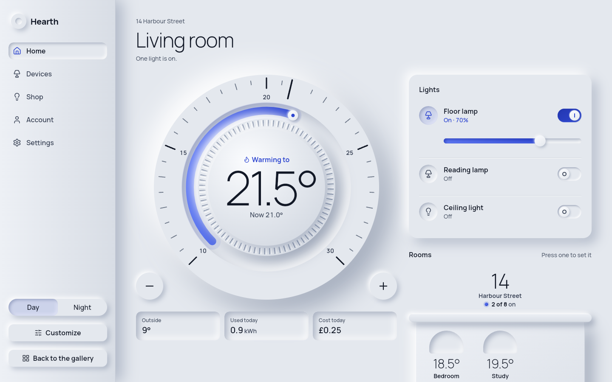

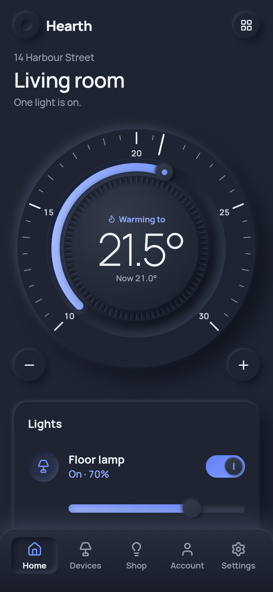

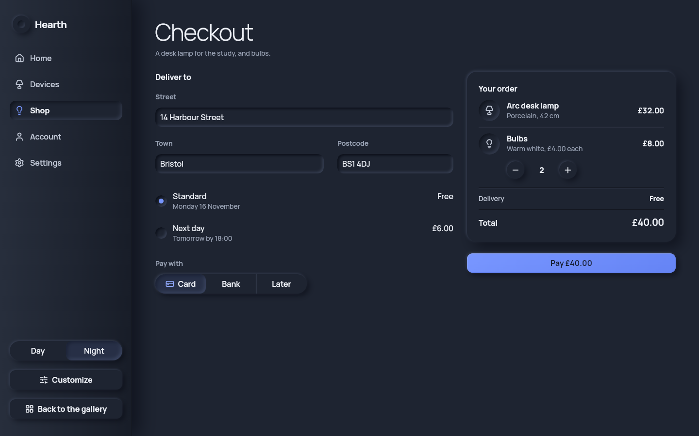

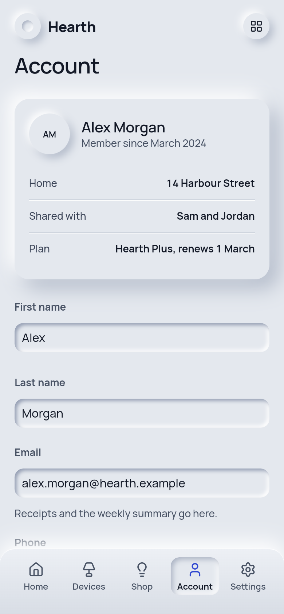

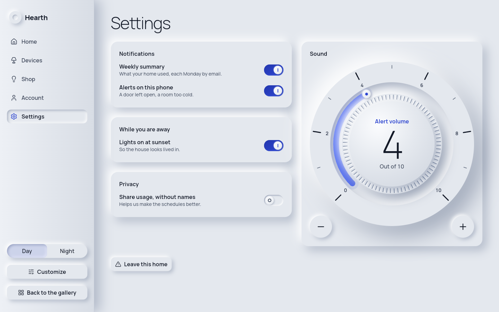

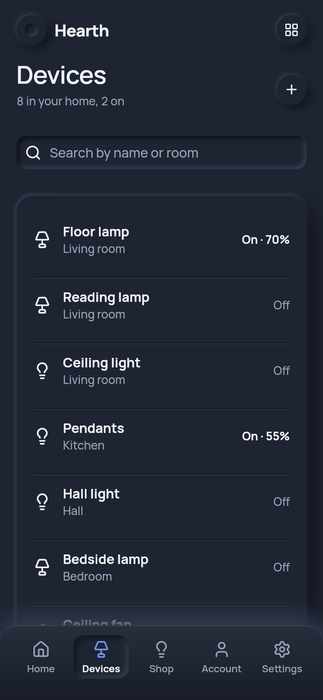

## How Neumorphism is built

These are the look's laws. A part the original style never had is made by them, so you can extend the look the same way.

1. Everything is one plaster. The wall, cards, keys and wells are the same material in the same colour. Nothing is laid on from elsewhere: no glass, no paper, and no drawn outline except the fine one high contrast prints.
2. Light comes from the top left, in either reading direction: it is the room's light, not the words'. A raised part is lit on its top-left side and shaded on its bottom-right side; a pressed part is the reverse.
3. Depth is state. Raised means it can be pressed, or it holds things. Pressed in means on, chosen, or a place to put something (a field, a track). Flat, flush with the wall, means out of use.
4. Bumps of one surface never stack. Parts stand side by side. When two must touch, they are cast as one piece with one light and one shadow: a bank of cells, the avatar cluster. A part on a part is a plain step, and a well in a well is a plain floor. Many small equal choices, such as a month's days, are figures on their holder's surface; only the chosen one is a well, and a chosen range is one moulded channel.
5. Ink and pigment are colours of a face, never bodies of their own. Ink is for words; the pigment marks what is live and the page's one act.
6. Only what is in your hand, or what you call up, leaves the wall: a row being dragged, a menu, a dialog, a sheet, a toast. At rest, nothing floats over the page.
7. Motion is the material moving. A press sinks, keyboard focus lifts, a field's well deepens. Nothing bounces, and reduced motion jumps.
8. No corner is sharp. The smallest corner is 6. A face inside another follows the outer corner: its radius is the outer radius minus the inset, and never less than 6.

## Presets

Every preset has a separately designed light and dark appearance. Use its named factory with a positional `Brightness`, or `NeumorphicThemeData.preset(id, brightness)`.

| Preset | Character |
| --- | --- |
| `porcelain` | Neutral porcelain and a cool action pigment |
| `pompeii` | Warm plaster and an earthy red pigment |
| `verona` | A pale wall and a green pigment |
| `siena` | Warm mineral tones |
| `tyrian` | A purple pigment |

Cards, actions and fields in each preset, light on the left and dark on the right:

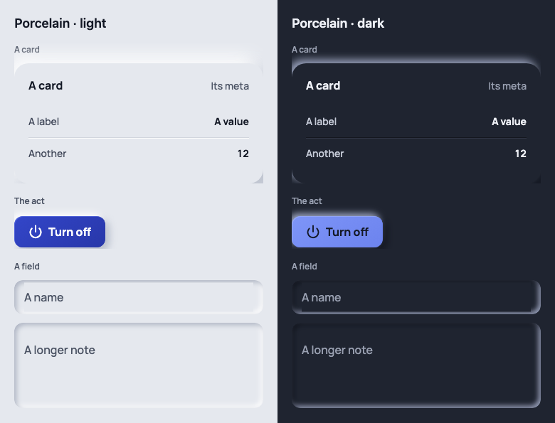

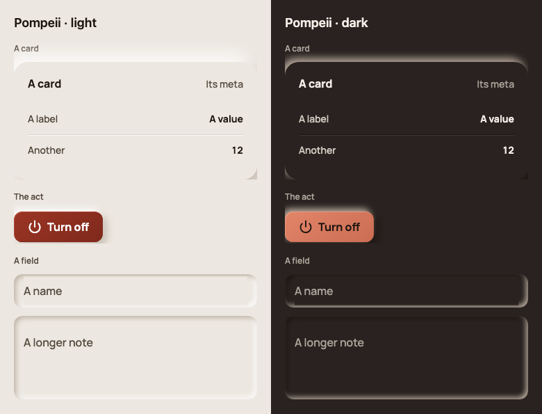

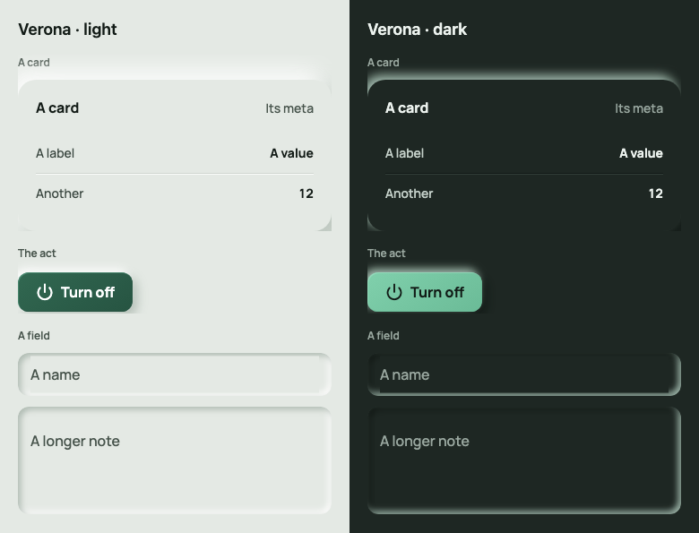

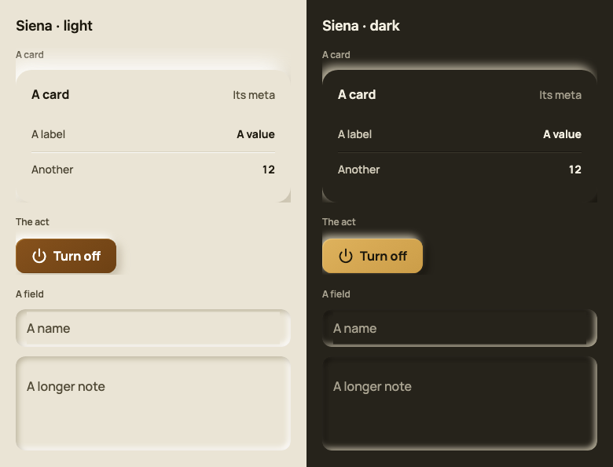

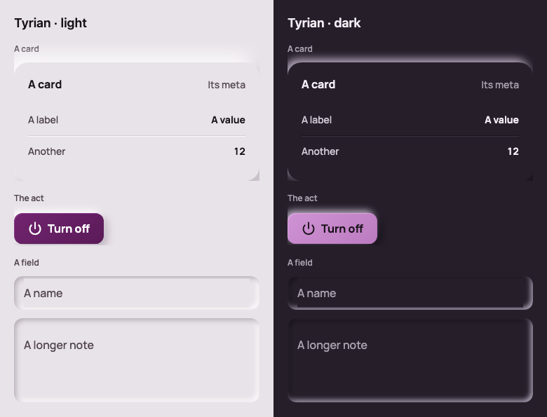

The example gallery shows every preset and appearance. Run it with `flutter run` from `example/`.

## Theme and styles

`NeumorphicTheme.of(context)` returns immutable `NeumorphicThemeData`, with `copyWith`, `lerp`, value equality and diagnostics. `AnimatedNeumorphicTheme` animates changes and respects reduced motion.

```dart
final theme = NeumorphicThemeData.porcelain().copyWith(
  density: NeumorphicDensity.compact,
  elevation: const NeumorphicElevation(depth: .5),
);

final custom = NeumorphicThemeData.from(
  ground: const Color(0xFFE9E4DD),
  pigment: const Color(0xFF315B83),
  brightness: Brightness.light,
);
```

The settings are the ones a product team turns: a preset or your own colours, light and dark, `density` (the platform's by default: compact with a pointer, standard on touch), `elevation` (the depth) and `highContrast`. The corners are the look's: radios, avatars, stepper keys and moving thumbs are circles, chips, badges, switches and segmented tracks capsules, fields, cards and raised panels their own frame steps, and nested faces subtract their inset from the enclosing radius, never going under the smallest corner (6). A component theme's `shape` changes one part; shapes are `OutlinedBorder`s.

Nothing draws a dark outline: the relief alone finds every edge, an empty checkbox, an unselected radio, a switch that is off and an empty field included. High contrast follows the device (`MediaQuery.highContrastOf`) and prints a fine outline on every part; `theme.copyWith(highContrast: true)` forces it on. Selection uses depth and the accent colour. An explicit `style.side` or `style.edge` takes precedence in either mode.

Component themes cover buttons, fields, chips, checkbox/radio/switch/slider, segmented buttons, options, steppers, date/time pickers, cards, raised surfaces, badges and avatars. A local `style:` takes priority over its component theme, followed by theme knobs and the component's default drawing.

```dart
NeumorphicButton.filled(
  'Save',
  onPressed: () {},
  style: NeumorphicStyle(
    foreground: WidgetStateProperty.resolveWith(
      (states) => states.contains(WidgetState.pressed) ? Colors.white : null,
    ),
  ),
);
```

Style slots are `fill`, `foreground`, `edge`, `overlay`, `side`, `shape`, `padding`, `minimumSize`, `textStyle` and `iconSize`, each a `WidgetStateProperty`. Fields take the same `style:` API; their editable words use its `textStyle` slot. Slabs and wells pass content styles to plain child text and icons, while explicit child styles take precedence. Data-driven dials and charts retain their geometric vocabulary.

## Interaction and localization

Controls support keyboard activation, focus, disabled states and padded targets of 48 logical pixels on every platform. Editing follows each platform's gestures and Cmd/Ctrl shortcuts. The selection menu and selection handles are drawn by this system. States are said in the relief rather than in lines or fades: a focused field's well deepens, any other part lifts off the wall on keyboard focus with its lit side warmed by the pigment, and a part out of use lies flat, flush with the ground, its words in the quiet ink.

Hover changes nothing on a part's face: no wash, tint or shadow. The pointer says what a part does instead: a hand over what presses, the text beam over fields, grab over a slider, the arrow over what is disabled. A press sinks the part in its own outline, and keyboard focus lifts it. Hover stays only where it tells you something: the active row of an open menu, a tooltip, a chart's readout, a rating's preview, a day of a month (which has no face of its own until it is chosen) and a file drop target with a drag over it. Every part still receives `WidgetState.hovered`, so you can give hover a style of your own through the `overlay` slot (or any other):

```dart
NeumorphicTheme(
  data: NeumorphicThemeData.porcelain().copyWith(
    buttonTheme: NeumorphicStyle(
      overlay: WidgetStateProperty.resolveWith(
        (states) => states.contains(WidgetState.hovered)
            ? const Color(0x14000000)
            : null,
      ),
    ),
  ),
  child: app,
);
```

The parts' built-in words come from `DesignLocalizations`, the words every look of the kit shares. Dates and numbers use `intl`. Your app owns its content and localization delegates.

## Accessibility and languages

- **Right to left.** Every part mirrors under a right-to-left `Directionality`: chevrons and arrows turn, sliders, progress and steppers fill from the start, and fields swap their leading and trailing parts. Figures, times and codes stay left to right. Public geometry takes the directional types (`EdgeInsetsGeometry`, `AlignmentGeometry`). The example gallery has a Right to left switch.
- **Large text.** Parts grow with the reader's text size up to 2.0: controls get taller rather than cutting their words, and dialogs and sheets scroll. Three kinds of words grow only to 1.3, as the platforms' own do: a month's day numbers (as Material's date picker's), a bar's tab words (as a platform tab bar's), and the numerals printed on a dial's scale, which stand between its ticks. Each is spoken whole at any size, and a dial's readout grows in full, under the face where it no longer fits in it. Every part and every gallery page is tested at 2.0.
- **Screen readers and keyboard.** Each part reports its role, label, value and state (checked, selected, expanded, disabled), and decorative paint is excluded from semantics. Everything works from the keyboard, and focus follows reading order. Targets are at least 48 px. Text meets 4.5:1 contrast in every preset, by day and by night. With reduced motion, parts change state at once.
- **Edges and states.** A part's edge is soft light and shadow, faint by night, and nothing depends on it alone.
  Every state (on, chosen, checked, focused, a slider's value) and every part without words reaches 3:1 through its colour, words or mark, by day and by night; high contrast adds a fine outline.
- **Other scripts.** The bundled Manrope covers Latin. Other scripts fall back to the platform's fonts; on the web, Flutter fetches them.

Known limits in 0.1.0:

- The built-in words (Cancel, Today, Close, "3 of 10" and the rest) are English. To translate them, extend `DefaultDesignLocalizations` and add its delegate to your app's `localizationsDelegates`. A few words of the look's own (a stepper's More and Less, a file drop's prompts, a picker's AM and PM) stay English in 0.1.0.
- Dates and numbers are formatted with `intl` in those words' language, so they are English too. Short weekday names are English, and times show in 24-hour form.

## Fonts and copying components

Manrope is bundled under SIL OFL 1.1. `neumorphicLoadFonts()` loads it before the first frame; `NeumorphicTypeface.app` selects fonts supplied by your app. Icons come from Lucide under its ISC licence.

To adapt a component, copy its file from `lib/src/neumorphism/`, rename it, and replace its sibling imports with `package:neumorphism_ui/neumorphism_parts.dart`. The parts library exports the tokens, painters and helpers used to draw the public components.

BSD-3-Clause.
