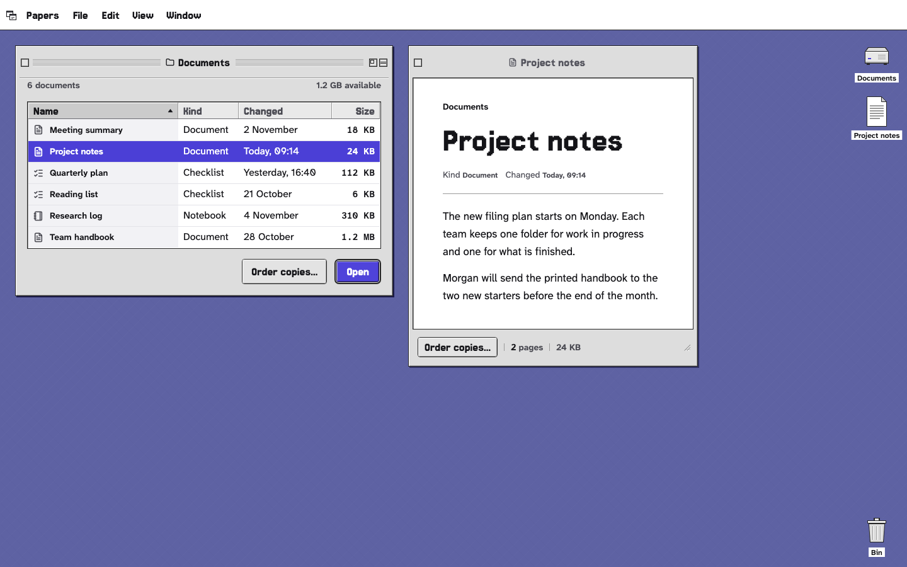
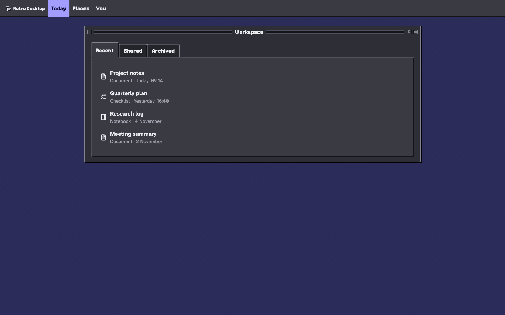
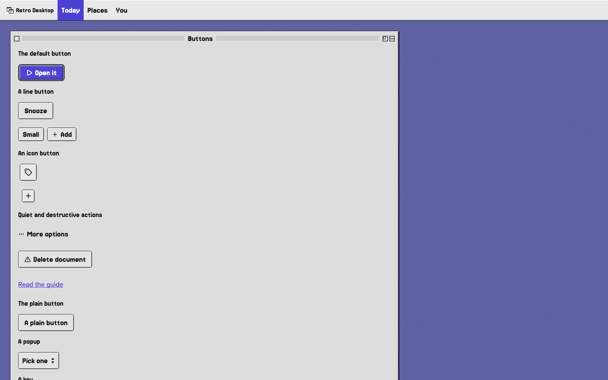
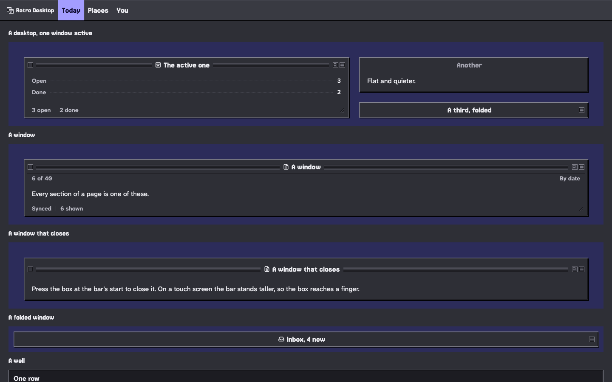
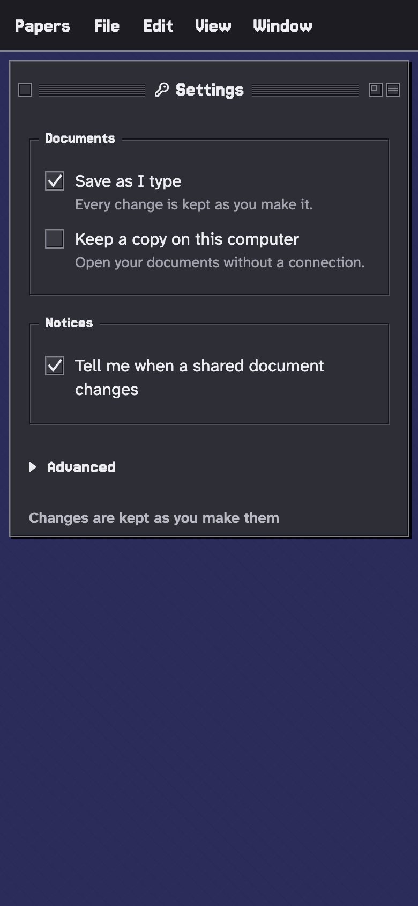

# retro_desktop_ui

Retro Desktop brings classic Mac and PC controls to Flutter. It includes beveled buttons, striped window titles,
menus, forms and tables, with six color palettes and light and dark themes.



**[Docs and demo](https://wenkaifan0720.github.io/flutter_design_systems/docs/looks/retro_desktop/)** · [Try it in Stint](https://wenkaifan0720.github.io/flutter_design_systems/docs/stint/?look=retro_desktop) · [API reference](https://pub.dev/documentation/retro_desktop_ui/latest/) · [All the looks](https://wenkaifan0720.github.io/flutter_design_systems/docs/)

## Install

```sh
flutter pub add retro_desktop_ui material_ui
```

A whole app: Retro Desktop's faces loaded, `RetroDesktopHost` over the app and one button.

```dart
import 'package:material_ui/material_ui.dart';
import 'package:retro_desktop_ui/retro_desktop_ui.dart';

Future<void> main() async {
  WidgetsFlutterBinding.ensureInitialized();
  await retroDesktopLoadFonts();
  runApp(
    MaterialApp(
      builder: (context, child) => RetroDesktopHost(child: child!),
      home: Center(child: RetroDesktopButton('Save', onPressed: () {})),
    ),
  );
}
```

`material_ui` is Flutter's Material as a package, as it is from Flutter 3.50; import it, not
`package:flutter/material.dart`. `retro_desktop_ui.dart` exports none of Flutter's libraries, so a file imports
`material_ui` (or `package:flutter/widgets.dart`) beside it. An app on `CupertinoApp` adds `cupertino_ui`; one on
`WidgetsApp` needs only `retro_desktop_ui`. The package bundles its faces (Jersey 15 for the chrome, Atkinson
Hyperlegible Next and Mono for the content) and its glyphs: `retroDesktopLoadFonts` loads the faces before the first
frame, so nothing draws in a fallback face.

## Mount RetroDesktopHost

`RetroDesktopHost` is the one mount an app needs, in its app's `builder`, above the navigator: Retro Desktop's theme
by day and by night, the palette, the desk's colour under the pages, and the toaster, so a notice
(`showRetroDesktopSnackBar`) stands over the app, above its bars. Its `brightness` is light, dark, or null for the
platform's setting; its `palette` is one of `RetroDesktopThemeData.palettes` (`light` and `dark` take whole themes
of your own instead, and the palette then builds neither). The appearance, Platinum or Chisel, is part of a theme: an
app that offers it gives the host both themes, built from the palette chosen,
`light: RetroDesktopThemeData.preset(palette.id, Brightness.light).copyWith(appearance: appearance)` and the same with
`Brightness.dark`. A new appearance or palette shows at once, as every change of state on the period's desktops
did; an app that wants it to cross-fade gives the host a `duration` (at once under Reduce Motion all the same).
Dialogs, sheets and menus need no mount of their own: each opens on the navigator's overlay in the theme it was raised
in. Your navigator, routes and localizations stay yours.

```dart
class HomePage extends StatelessWidget {
  const HomePage({super.key});

  @override
  Widget build(BuildContext context) => RetroDesktopScaffold(
    appBar: const RetroDesktopAppBar(title: 'Documents'),
    body: RetroDesktopCard(
      title: 'Your workspace',
      child: RetroDesktopButton('Create document', isDefaultAction: true, onPressed: () {}),
    ),
  );
}

class App extends StatefulWidget {
  const App({super.key});

  @override
  State<App> createState() => _AppState();
}

class _AppState extends State<App> {
  // Null follows the platform's light or dark setting.
  Brightness? brightness;
  RawNamedPalette palette = RetroDesktopThemeData.palettes.first;

  @override
  Widget build(BuildContext context) => MaterialApp(
    builder: (context, child) => RetroDesktopHost(
      brightness: brightness,
      palette: palette,
      child: child!,
    ),
    home: const HomePage(),
  );
}
```

A page is a `RetroDesktopScaffold`: on a desk (from 1024 wide) its body stands in a window on the desktop, on a phone
it fills the screen under the app bar.

**Pages change in place.** The period's screens changed at once: nothing in the look slides or zooms, and its pages,
sheets, dialogs and menus stand in their places as they open. retro_desktop_ui stands on material_ui, and
`RetroDesktopHost` (its `RetroDesktopTheme`) gives material_ui's `Theme` the look's page change, so a
`MaterialPageRoute` your app pushes on material_ui's `MaterialApp` changes in place already; `RetroDesktopPageRoute`
does the same under any app. On Flutter's own `MaterialApp` (`package:flutter/material.dart`, deprecated from Flutter
3.50) a `MaterialPageRoute` reads Flutter's `Theme`, which the look doesn't reach, and slides in unless that theme
carries `retroDesktopPageTransitions`: `theme: ThemeData(pageTransitionsTheme: const PageTransitionsTheme(builders:
retroDesktopPageTransitions))`. On iOS a page still pops with the swipe from the screen's leading edge, the page
following the finger while it swipes and standing in place otherwise: the map wraps the change there in ui_core's
`SwipeBackPageTransitionsBuilder`. A map of your own keeps the swipe the same way, through `rawSwipeBack(map)`.

With `CupertinoApp`, or with `WidgetsApp` for an app with no Material or Cupertino at all:

```dart
import 'package:cupertino_ui/cupertino_ui.dart';

CupertinoApp(
  builder: (context, child) => RetroDesktopHost(child: child!),
  home: const HomePage(),
);
```

```dart
WidgetsApp(
  color: const Color(0xff5e62a3),
  pageRouteBuilder: <T>(settings, builder) => RetroDesktopPageRoute<T>(settings: settings, builder: builder),
  builder: (context, child) => RetroDesktopHost(child: child!),
  home: const HomePage(),
);
```

`RetroDesktopTheme` alone restyles a part of the tree:
`RetroDesktopTheme(data: RetroDesktopThemeData.preset('lagoon', Brightness.dark), child: ...)`.

## Build an app

The example, `example/lib/main.dart`, is this app in one file to copy: a shelf of books in three places.

**A list and its page.** A list is a section of ruled rows; a row pushes its page with Flutter's own route, and the
pushed page's bar has its way back (Escape and the back gesture pop it too). A row's name reads its trailing tag, so a
screen reader hears "Piranesi, Susanna Clarke, To read".

```dart
class BookPage extends StatelessWidget {
  const BookPage({super.key, required this.title});

  final String title;

  @override
  Widget build(BuildContext context) => RetroDesktopScaffold(
    appBar: RetroDesktopAppBar(title: title),
    body: const RetroDesktopCard(title: 'Susanna Clarke', child: Text('Started 2 Oct 2026.')),
  );
}

class BooksPage extends StatelessWidget {
  const BooksPage({super.key});

  @override
  Widget build(BuildContext context) => RetroDesktopScaffold(
    appBar: const RetroDesktopAppBar(title: 'Books'),
    body: RetroDesktopListSection(
      children: [
        for (final (index, title) in ['Piranesi', 'Stoner'].indexed)
          RetroDesktopListTile(
            isFirst: index == 0,
            title: title,
            subtitle: 'Susanna Clarke',
            trailing: const RetroDesktopTag('To read', icon: RetroDesktopGlyphs.clock),
            onPressed: () => Navigator.of(context).push(
              MaterialPageRoute<void>(builder: (context) => BookPage(title: title)),
            ),
          ),
      ],
    ),
  );
}
```

**A dialog: pop it with the answer.** A dialog is a modal window, standing in place as it opens. Each
`RetroDesktopDialogAction` pops the dialog with its `value`, which `showRetroDesktopDialog` returns; Escape and the
back gesture return null, and Return presses the default action. Focus goes back where it was. A notice says what
happened.

```dart
Future<void> confirmRemove(BuildContext context, String title) async {
  final remove = await showRetroDesktopDialog<bool>(
    context,
    builder: (context) => RetroDesktopDialog(
      title: 'Remove $title?',
      message: 'It leaves your shelf. You can add it again.',
      actions: const [
        RetroDesktopDialogAction('Keep', value: false),
        RetroDesktopDialogAction('Remove', value: true, isDestructiveAction: true),
      ],
    ),
  );
  if (remove == true && context.mounted) showRetroDesktopSnackBar(context, 'Removed $title');
}
```

**A form.** `RawForm` (ui_core's, exported with retro_desktop_ui) checks every field's `validator` on submit: each
error shows under its field, with the field's heavier edge, the first wrong field takes the focus and a screen reader
hears how many need attention; after that the errors follow the typing. Each field brings its label and its help or
error, and takes the column's width up to a line that reads (`RetroDesktopTextField.measure`, 520), at the column's
start. A text field's starting words are its `initialValue`, as in Flutter. A `RetroDesktopDateField` raises
the calendar, and `RetroDesktopFormat.mediumDate` sets a day elsewhere on the page as the field shows it. The page's
`footer` holds the window's default button; `form.currentState!.reset()` takes every field back to its starting
value and hides the errors, for the next entry.

```dart
class AddBookPage extends StatefulWidget {
  const AddBookPage({super.key});

  @override
  State<AddBookPage> createState() => _AddBookPageState();
}

class _AddBookPageState extends State<AddBookPage> {
  final form = GlobalKey<RawFormState>();
  DateTime? started;

  @override
  Widget build(BuildContext context) => RetroDesktopScaffold(
    appBar: const RetroDesktopAppBar(title: 'Add a book'),
    footer: RetroDesktopButton('Save', isDefaultAction: true, onPressed: () => form.currentState!.submit()),
    body: RawForm(
      key: form,
      onSubmit: () => showRetroDesktopSnackBar(context, 'Added', tone: RetroDesktopTone.success),
      child: Column(
        crossAxisAlignment: CrossAxisAlignment.stretch,
        spacing: RetroDesktopSpacing.s16,
        children: [
          RetroDesktopTextField(
            labelText: 'Title',
            validator: (value) => (value ?? '').trim().isEmpty ? 'Enter the title' : null,
          ),
          RetroDesktopDateField(
            labelText: 'Started',
            hintText: 'Not yet',
            value: started,
            firstDate: DateTime(1900),
            lastDate: DateTime.now(),
            onChanged: (day) => setState(() => started = day),
          ),
        ],
      ),
    ),
  );
}
```

A select is a pop-up button (Platinum) or a sunken field with a drop button (Chisel), opening its list on its field,
the current choice ticked:

```dart
RetroDesktopSelect<String>(
  labelText: 'Sort by',
  value: 'name',
  options: const [
    RetroDesktopOption('name', 'Name'),
    RetroDesktopOption('date', 'Date modified'),
  ],
  onChanged: (value) {},
);
```

**Settings: the palette picker.** `RetroDesktopThemeData.palettes` are the six palettes as ui_core's
`RawNamedPalette`: an `id` to store, a `label` to show, and `swatchesFor(brightness)`, its colours by day or by
night. A row a palette, its swatches leading its name and the chosen one selected; give the chosen one to
`RetroDesktopHost(palette: ...)`.

```dart
class SettingsPage extends StatelessWidget {
  const SettingsPage({super.key, required this.palette, required this.onPalette});

  final RawNamedPalette palette;
  final ValueChanged<RawNamedPalette> onPalette;

  @override
  Widget build(BuildContext context) => RetroDesktopScaffold(
    appBar: const RetroDesktopAppBar(title: 'Settings'),
    body: RetroDesktopListSection(
      title: 'Palette',
      children: [
        for (final (index, option) in RetroDesktopThemeData.palettes.indexed)
          RetroDesktopListTile(
            isFirst: index == 0,
            leading: Swatches(option.swatchesFor(RetroDesktopTheme.of(context).colors.brightness)),
            title: option.label,
            selected: option.id == palette.id,
            onPressed: () => onPalette(option),
          ),
      ],
    ),
  );
}

/// A palette's colours side by side in one square, ruled in the row's ink.
class Swatches extends StatelessWidget {
  const Swatches(this.colors, {super.key});

  final List<Color> colors;

  @override
  Widget build(BuildContext context) => SizedBox.square(
    dimension: IconTheme.of(context).size ?? 16,
    child: DecoratedBox(
      position: DecorationPosition.foreground,
      decoration: BoxDecoration(border: Border.all(color: RetroDesktopTheme.of(context).colors.text)),
      child: Row(
        crossAxisAlignment: CrossAxisAlignment.stretch,
        // Colours have no reading direction: the stripes stand in one order in every language.
        textDirection: TextDirection.ltr,
        children: [for (final color in colors) Expanded(child: ColoredBox(color: color))],
      ),
    ),
  );
}
```

**The places: `RetroDesktopAppShell`.** On a phone the places are the strip at the foot; on a desk (from 1024 wide)
the menu bar across the top, with the app's `brand` at its start. `.branches` keeps a stack for each place: a pushed
page keeps the menu bar on a desk while the phone's strip steps away, and back pops it. A screen reader hears the
places as tabs. `modeForWidth` chooses the places' form at a width, as ui_core's `RawNavigationMode`: `(width) =>
width < 1024 ? RawNavigationMode.bar : RawNavigationMode.sidebar` sets a desk's places in a sidebar at the start in
place of the menu bar.

```dart
class Shelf extends StatefulWidget {
  const Shelf({super.key});

  @override
  State<Shelf> createState() => _ShelfState();
}

class _ShelfState extends State<Shelf> {
  int place = 0;
  RawNamedPalette palette = RetroDesktopThemeData.palettes.first;

  @override
  Widget build(BuildContext context) => RetroDesktopAppShell.branches(
    brand: 'Shelf',
    destinations: const [
      RetroDesktopNavItem(label: 'Books', short: 'Books', icon: RetroDesktopGlyphs.book),
      RetroDesktopNavItem(label: 'Add a book', short: 'Add', icon: RetroDesktopGlyphs.add),
      RetroDesktopNavItem(label: 'Settings', short: 'Settings', icon: RetroDesktopGlyphs.settings),
    ],
    selectedIndex: place,
    onDestinationSelected: (index) => setState(() => place = index),
    branches: [
      (context) => const BooksPage(),
      (context) => const AddBookPage(),
      (context) => SettingsPage(palette: palette, onPalette: (next) => setState(() => palette = next)),
    ],
  );
}
```

## Building blocks

| For | Retro Desktop's |
| --- | --- |
| The app's mount | `RetroDesktopHost`; `RetroDesktopTheme` for a part of the tree |
| Places | `RetroDesktopAppShell`, `RetroDesktopMenuBar`, `RetroDesktopNavigationBar`, `RetroDesktopNavigationRail`, `RetroDesktopNavigationDrawer`, `RetroDesktopTabBar` |
| A page | `RetroDesktopScaffold`, `RetroDesktopAppBar`, `RetroDesktopBackButton`, `RetroDesktopPageRoute` |
| Windows | `RetroDesktopWindow`, `RetroDesktopDesktop`, `RetroDesktopGroupBox`, `RetroDesktopToolbar` |
| Buttons | `RetroDesktopButton` (`.text`), `RetroDesktopIconButton`, `RetroDesktopSplitButton`, `RetroDesktopButtonGroup`, `RetroDesktopToggleGroup`, `RetroDesktopLink` |
| Text entry | `RetroDesktopTextField`, `RetroDesktopTextArea`, `RetroDesktopPasswordField`, `RetroDesktopSearchField`, `RetroDesktopNumberField`, `RetroDesktopInputOtp`, `RetroDesktopInputGroup`, `RetroDesktopCombobox` |
| Choices | `RetroDesktopSelect`, `RetroDesktopCheckbox`, `RetroDesktopCheckRow`, `RetroDesktopRadioGroup`, `RetroDesktopSwitch`, `RetroDesktopSwitchRow`, `RetroDesktopSegmentedButton`, `RetroDesktopChip` |
| Amounts | `RetroDesktopSlider`, `RetroDesktopRangeSlider`, `RetroDesktopRating`, `RetroDesktopMeter` |
| Dates and times | `RetroDesktopDateField`, `RetroDesktopCalendar`, `showRetroDesktopDatePicker`, `RetroDesktopDateRangePicker`, `showRetroDesktopTimePicker`, `RetroDesktopFormat` (a day or a time in words, as the fields show it) |
| A form | `RawForm`, `RetroDesktopFormField` |
| Lists and tables | `RetroDesktopListSection`, `RetroDesktopListTile`, `RetroDesktopReorderableListView`, `RetroDesktopTable`, `RetroDesktopDataTable`, `RetroDesktopListTable`, `RetroDesktopDescriptionList`, `RetroDesktopTreeView` |
| Surfaces | `RetroDesktopCard`, `RetroDesktopWell`, `RetroDesktopSections`, `RetroDesktopDisclosure`, `RetroDesktopDivider` |
| Raised | `showRetroDesktopDialog` with `RetroDesktopDialog`, `showRetroDesktopBottomSheet`, `showRetroDesktopSheet`, `showRetroDesktopActionSheet`, `showRetroDesktopMenu`, `RetroDesktopMenuAnchor`, `RetroDesktopPopover`, `RetroDesktopTooltip` |
| Feedback | `showRetroDesktopSnackBar`, `RetroDesktopBanner`, `RetroDesktopAlert`, `RetroDesktopLinearProgressIndicator`, `RetroDesktopCircularProgressIndicator`, `RetroDesktopSkeleton`, `RetroDesktopEmptyState`, `RetroDesktopErrorState` |
| Status | `RetroDesktopTag`, `RetroDesktopBadge`, `RetroDesktopFlag` |
| People | `RetroDesktopAvatar`, `RetroDesktopAvatarGroup`, `RetroDesktopMonogram` |
| Steps and pages | `RetroDesktopStepProgress`, `RetroDesktopPagination`, `RetroDesktopBreadcrumb`, `RetroDesktopPageDots` |
| Charts | `RetroDesktopLineChart`, `RetroDesktopBarChart`, `RetroDesktopAreaChart`, `RetroDesktopPieChart`, `RetroDesktopSparkline` |
| The desk's own | `RetroDesktopDeskIcon`, `RetroDesktopFolderGrid`, `RetroDesktopFileGrid`, `RetroDesktopScaleBar`, `RetroDesktopSpanBar`, `RetroDesktopPixelSky` |
| Layout | `RetroDesktopRow`, `RetroDesktopGridOf`, `RetroDesktopScrollArea`, `RetroDesktopResizable` |
| Glyphs | `RetroDesktopGlyphs` |

A button comes in Cupertino's pattern: `isDefaultAction` is the window's default button (the one Return presses, one
a window), `isDestructiveAction` marks an action that destroys, and `RetroDesktopButton.text` has no face at rest.

`RetroDesktopGlyphs` names the icons Retro Desktop's parts draw, Lucide's, so an app has them with no other package;
for the rest of Lucide, add `lucide_icons_flutter` and pass its `LucideIcons` where a part takes an `IconData`.

## The look

A desktop UI from the pixel era for Flutter: square windows on a woven desktop, fine one-pixel bevels, a pixel face for
the chrome and a clear reading face for the content, and one accent colour that means "the act and now". It comes in
two appearances, Platinum (the classic Mac, the default) and Chisel (the 95-era PC), and six palettes (classic,
lagoon, berry, marmalade, slate and lime), each designed for day and night. It is a desktop look that also stands on a
phone: its title bars, rows and day cells are sized for a finger there. Each state speaks in the era's own material:
an alert opens with its picture (the note, the caution triangle, the stop sign), work in progress shows the busy
pointer (Platinum's wristwatch, Chisel's hourglass), a placeholder is the 50% checkerboard, focus is Platinum's
ring round the focused thing or Chisel's dotted rectangle, and a selection takes the highlight, its words inverted.

| | |
|---|---|
|  |  |
|  |  |
|  |  |

## How Retro Desktop is built

The parts follow a few laws, and a part the period never had is built from them, not borrowed from another system. A
part of your own can follow them the same way.

- **Material.** Every part is a machine part drawn in whole pixels: grey plates and white paper, each edged by a
  one-pixel bevel. Nothing is glass, nothing blurs, and no corner is softer than the appearance's.
- **Light.** One light, from the top left, that never moves. Raised is light above and left and dark below and right;
  sunken or pressed is the same edge turned in. The only shadow is a window's hard drop shadow.
- **Stacking.** Only windows overlap: windows, and what a window opens (menus, alerts, tooltips). Inside a window the
  parts stand side by side or in rows, never on one another. One window is in front and active, its title bar striped;
  the rest are quieter, and nothing behind is dimmed.
- **State.** A state is said in the same materials: pressed is the bevel turned in, chosen is the highlight with its
  words inverted, focus is Platinum's ring or Chisel's dotted rectangle, unavailable is grey type. No tint, glow or
  borrowed ring.
- **Motion.** Things appear and go at once. What moves, moves in steps: the watch's hand, the hourglass's sand, a dotted
  outline following the pointer while a row is dragged, a line where it will land. Nothing springs, bounces, fades or
  slides.
- **Pictures.** Icons and alert pictures are pixel art in their own inks, drawn for this package; words are set in the
  look's typefaces.
- **Touch.** A phone keeps the desktop's materials: windows stack, and every control is a finger's reach. A gesture the
  desktop never had (a swipe, a pull) has no part of its own; its job goes to a button or a menu.

Use these controls for common desktop interactions.

| Elsewhere | In Retro Desktop |
| --- | --- |
| A list reordered by dragging | `RetroDesktopReorderableListView`: a dotted outline follows the pointer, a line shows where the row will land, nothing moves until the drop; Alt and the arrows move a row from the keyboard |
| A scrim behind a dialog or a sheet | nothing is dimmed: the window in front is the active one and blocks the rest |
| Swipe actions on a row | the row's actions in its contextual menu (`RetroDesktopMenuAnchor`) or a menu button |
| Pull to refresh | a Refresh button or menu item; the busy pointer shows while it works |
| A carousel | one picture with Previous and Next and where you are (`RetroDesktopPagination`) |
| Toasts | one notice window at a time (`RetroDesktopSnackBar`) |
| A hover card | `RetroDesktopTooltip` (Balloon Help showed words), or a `RetroDesktopPopover` on a press |
| A tag-style multi-select | check rows in a sunken list (`RetroDesktopCheckRow` in a `RetroDesktopWell`) |

### On ui_core

The look draws; ui_core behaves. Under the pixels, ui_core gives the parts their keys, focus, screen-reader words and
placement: the tooltip (Flutter's `RawTooltip`), the menus' rows and shortcut labels, the combobox's search, the number field
(`RawNumberField`), the rating (`RawRating`), the tab bar (`RawTabBar`), a chart's scale, the dialog and sheet
routes, the side sheet and the page transitions. Retro keeps its own where the period did something ui_core doesn't:
the menu bar across the top of every page, a chart that reads a whole column at once, and a lit menu row that only a
moving pointer or the keys can light. Its motion stays the period's, at once, unless an app sets a time.

## Palettes

Six palettes, classic the default, each designed by day and by night: every factory takes `Brightness.light` (the
default) or `Brightness.dark`, and `RetroDesktopThemeData.preset(name, brightness)` takes one of
`RetroDesktopThemeData.presets` by name.

| Factory | Appearance |
| --- | --- |
| `RetroDesktopThemeData.classic()` | Grey windows and indigo selection; graphite and a lit indigo at night. |
| `RetroDesktopThemeData.lagoon()` | Cool grey and deep teal; cyan over dark water at night. |
| `RetroDesktopThemeData.berry()` | Warm grey and berry selection; a berry lamp over dark plum at night. |
| `RetroDesktopThemeData.marmalade()` | Warm grey and orange selection; amber over dark brown at night. |
| `RetroDesktopThemeData.slate()` | Neutral grey and blue selection; a cool blue lamp at night. |
| `RetroDesktopThemeData.lime()` | Sage grey on a lime-green desk, deep lime selection; a lime lamp over moss at night. |

`RetroDesktopThemeData.from(primary:, brightness:)` derives a whole palette from one brand colour: the words, the
highlight and the edges each take the nearest tone of their own hue that reads on every ground (ui_core's
`RawPalette`), white words on the highlight by day and black by night.

## Theme and styles

`RetroDesktopTheme.of(context)` returns the theme. Nest another `RetroDesktopTheme` to restyle a subtree, or use
`AnimatedRetroDesktopTheme` to move between themes. The theme supports `copyWith`, equality and `lerp`.

```dart
final theme = RetroDesktopThemeData.from(
  primary: const Color(0xff2455aa),
  brightness: Brightness.light,
).copyWith(
  appearance: RetroDesktopAppearance.chisel,
  density: RetroDesktopDensity.comfortable,
);
```

The theme's settings are the ones a product changes: the palette (a preset or `from`), light or dark, the
appearance, the density and, for a brand or a script the bundled faces lack, the `typeface` (its `fallback` faces reach
every text style, as `ThemeData.fontFamilyFallback` does). Corners, line widths and
shadows belong to the appearance and are not settings (Retro Desktop opens none of ui_core's `RawShapeScheme`: its
steps are the appearance's, `RetroDesktopThemeData.shapes`), and neither is motion: things appear and go at once, as
the period's did. Text size follows the
platform's text scaling, and Reduce Motion is honoured wherever anything moves.

### Appearances

| | `RetroDesktopAppearance.platinum` (classic Mac, the default) | `RetroDesktopAppearance.chisel` (95-era PC) |
|---|---|---|
| Corners | Push buttons, popups and tabs rounded by 4; windows and fields square | Square everywhere |
| Edge | A dark outline and a soft one-step bevel | Two-step bevel: white and light grey above and left, dark grey and black below and right; fields sunk the other way |
| Default button | A heavier rounded ring round it | One more black line round it |
| Pressed | The face darkens; nothing moves | The bevel inverts and the label moves one pixel down and right |
| Keyboard focus | An accent ring outside the outline | A dotted rectangle inside the face |
| Title bar | Pinstripes, a centred title, the close box at the start | A solid accent band, the title at its start, bevelled buttons at its end |
| Checkbox and radio | Raised box with a tick; raised disc with a dot | Sunk white box with a black tick; sunk disc with a black dot |
| Select | A rounded popup with a double arrow | A sunk field with a bevelled arrow button |
| Progress | A continuous bar; a barber pole while indeterminate | A sunk trough filled with blocks |
| Busy | A wristwatch, its hand going round | An hourglass, its sand running |
| Alerts | The note balloon, the caution triangle, an octagonal stop sign | The same, the stop sign a disc, in brighter inks |
| Slider | A track and a ridged grip | A sunk groove and a pointed, bevelled grip |
| Tabs | Folder tabs with rounded top corners | Square bevelled folder tabs |

### Hover

Pointer hover changes nothing a part paints: the period's desktops drew no hover state, and a wash on hover would
leave the look. The pointer says what a part does instead (a click cursor over what presses, a grab cursor over what
drags, a text cursor over a field). To say more about what the pointer rests on, give it Balloon Help, as the period
did:

```dart
RetroDesktopTooltip(
  message: 'Opens the document in its own window',
  child: RetroDesktopButton('Open', onPressed: () {}),
);
```

### Density and component styles

`RetroDesktopDensity` has Flutter's three steps: `standard`, `comfortable` (a fifth more room) and `compact` (a fifth
less). It changes a part's padding and gaps; its touch target keeps its floor. Left unset, the theme takes
`RetroDesktopDensity.adaptivePlatformDensity`: compact on macOS, Windows and Linux, standard on touch platforms.

Each part's component theme (`buttonTheme`, `defaultButtonTheme`, `textFieldTheme` and the rest, set through
`copyWith`) and each widget's `style:` take a `RetroDesktopStyle`: state-resolved fill, foreground, edge, overlay,
side, shape, padding, minimum size, text style and icon size. A value the widget's style resolves wins over its
component theme; what neither resolves falls through to the look's defaults.

What keeps the look:

- **Shapes are the period's.** A style's or a component theme's `shape` takes the appearance's corners
  (`RetroDesktopShapes`, square or rounded by a few pixels), drawn on the pixel grid. Any other `OutlinedBorder` (a
  stadium, a large radius) is drawn smooth and off the grid, and no longer looks like Retro Desktop. A `side` keeps to
  the look's 1 and 2 pixel lines.
- **Colours: the content and the highlight are yours; the bevel is the look's.** The desktop, the paper, the text and
  the highlight change freely, and `RetroDesktopThemeData.from` derives a palette from one brand colour. The machine's
  greys, the bevel roles (`bevelLight`, `bevelDark`, `bevelDarker`) and the outlines (`outline`, `control`,
  `pixelOutline`) are steps of light on one face, lit from the top left: retune them together (a lighter or darker
  machine) or not at all.

## Accessibility and languages

- **Screen readers and keyboard.** Every control says its role, name, value and state (checked, selected, expanded,
  unavailable); drawn ornament is left out of the semantics tree. Everything works from the keyboard, and focus follows
  reading order. Every control reaches ui_core's touch floor (40 by 40, or the app's `RawTapTargetScope`) under a
  finger; the desk's rows and buttons stand at least 40 tall under a pointer; text keeps 4.5:1 contrast (3:1 when
  large); both are checked on every page of the example, in every preset, by day and by night.
- **States.** A disabled control keeps its size and dims; a part that only shows a value (a list row with no
  `onPressed`, a rating with no `onChanged`) is a still reading, not a disabled control. An error shows as the warning
  sign and the message in ink.
- **Text size.** Parts follow the user's text scale and grow taller rather than cut words: a long label wraps, a
  dialog or sheet scrolls. The pages are tested at twice the text size.
- **Right to left.** Under a right-to-left `Directionality` every part mirrors: arrows and disclosure triangles turn,
  sliders, progress and steppers fill from the start, a field's prefix and suffix change sides, rows and tabs read from
  the right. Digits keep their own left-to-right order inside right-to-left words. The example's settings have a
  reading direction switch.
- **Words.** The words a part says by itself that every look shares (Cancel, Close, Back, Today, Next month,
  Loading, Show password, Dismiss) come from ui_core's `RawWidgetsLocalizations`, under `MaterialLocalizations`' names.
  To translate them, extend `DefaultRawWidgetsLocalizations`, override the words you translate, and add a delegate for
  your subclass to `localizationsDelegates`; every ui_core look then speaks your language. The words only this look
  says (a pager's name, a time picker's wheels, a stepper's More and Less, a file drop's invitation) are
  `RetroDesktopLocalizations`. Its default language is English; a time picker's Hour, Minute and AM/PM are
  `RawWidgetsLocalizations`', so they follow the app's language.
- **Dates and numbers.** Month and weekday names, dates, numbers and percentages use `intl` in the locale
  `RetroDesktopLocalizations.delegate` loads (add it for a locale other than US English; it takes every locale); the
  calendar starts its week on the day `RawWidgetsLocalizations.firstDayOfWeek` names, and times are 12- or 24-hour as the
  platform says.
- **Scripts.** The look's faces (Jersey 15 for window titles and buttons, Atkinson Hyperlegible Next and Mono for the
  rest) cover the Latin alphabet. Other scripts (Arabic, Hebrew, Chinese, Japanese, Devanagari, Thai) are drawn in the
  platform's fallback fonts (on the web, the Noto fonts Flutter fetches), so they read, but without the pixel face.

The menu bar wraps titles on narrow screens. Segmented controls stack when their labels outgrow the row, and
input groups move long prefixes and suffixes above and below the field. Invoice totals stay in view as columns scroll.

## API notes

The API follows Flutter's: `onPressed`, `onChanged`, `value`, `selected`, `leading`, `trailing`, `child`, `style`,
`padding`; a null callback disables a control. A single control (a button, a check, a switch, a slider, a field, a chip,
a select, a list row) takes an optional `focusNode` and `autofocus`; a widget that is given a controller or a focus node
never disposes it, and makes and disposes its own when none is given. Groups (tabs, navigation, segments, radio groups,
the pickers) take none, as Flutter's do.

Pass text for button, chip, tab and menu labels. Windows, dialogs, cards and list rows take text for their titles.
Use `IconData` for a control's `icon` and a widget for a list row's `leading` or `trailing` slot. A part's `label` is
the words it draws; `semanticLabel` is a name only a screen reader hears (an icon button's, a chart's, a tab bar's).
Inside a field's label and help (`RetroDesktopFormField`, a field's own `labelText`), a control is read once, by that
label.

Sizes follow the period's: a button is as wide as its words, up to 300 on a desk and half the screen on a phone (never
under 160); `wide: true` fills its row. A table narrower than its columns' least widths scrolls sideways under the
look's own scroll bar. Menus hang from their bar or button, tooltips 4 below what they name. An alert stands as a
window of its own, with a window's hard shadow; `floating: false` sets it in a window's content, without one (only
windows cast shadows).

Two parts keep an `enabled` flag beside their callback: `RetroDesktopDialogAction`, which closes its dialog with its
`value` and needs no `onPressed`, and `RetroDesktopRating`, where no `onChanged` makes a still reading and `enabled:
false` a dimmed input.

## Customize one component

Copy a component file from `lib/src/retro_desktop/`, rename its class, and replace its sibling imports with:

```dart
import 'package:retro_desktop_ui/retro_desktop_parts.dart';
```

The parts library exposes the building blocks the components use. You can also vendor the whole package with
`dart pub unpack` and a path dependency.

`package:retro_desktop_ui/retro_desktop_host.dart` holds the host layer an app shell or router draws pages with (the
host, its pages and sheets, the page preview, the component inventory). An app built from the parts does not need it.

## Example

`example/lib/main.dart` is Shelf, the app in "Build an app" in one file: the host, the shell with three places, a
list pushing a book's page that asks before it removes the book, a checked form with a date, and settings with the
appearance and the six palettes. `flutter run -t lib/gallery.dart` runs the gallery of every part by kind, ordinary
screens built from them (a form, settings, a list, a checkout, a workspace, projects) and the look's own pieces (the
desktop and its windows, objects and figures, gauges and calendars), with a Customize panel for the palette, light or
dark, the appearance and the density. Its All components page answers every row of the shared component list; three
rows are absent by design: the floating action button (the toolbar's default button is the desktop's), the command
palette (the period ran commands from its menu bar and their keys) and the wheel picker (the period chose from a
pop-up button).

## Requirements

Flutter 3.47.0 or later (Dart 3.13), on Android, iOS, web, macOS, Windows and Linux.

## Licences

The package uses BSD-3-Clause. It bundles Jersey 15, Atkinson Hyperlegible Next and Atkinson Hyperlegible Mono under
SIL OFL 1.1. Lucide icons use ISC, with Feather-derived icons under MIT. The notices are in `LICENSE` and
`THIRD_PARTY_NOTICES`.
