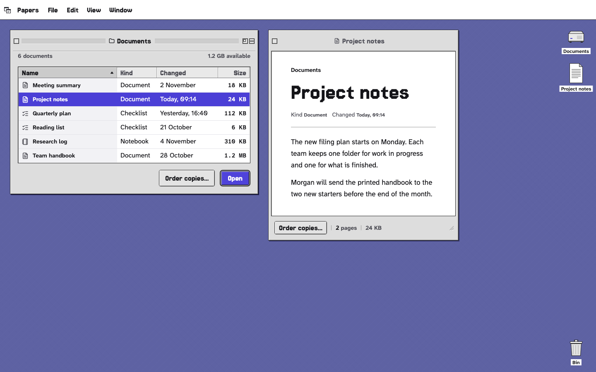
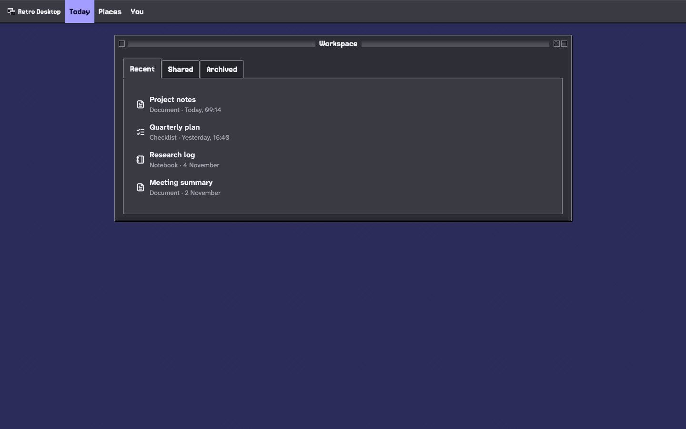
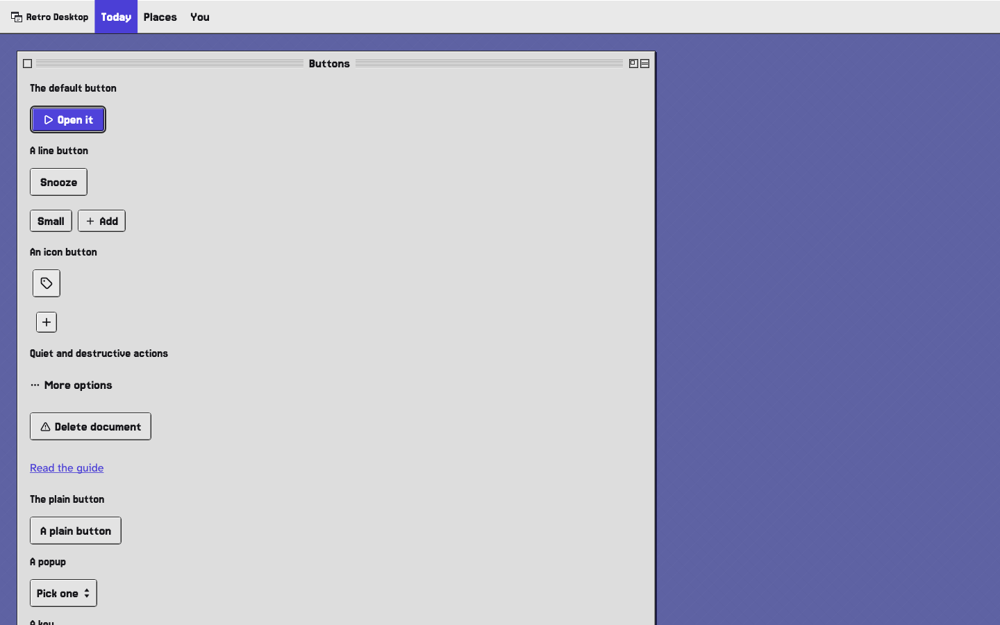
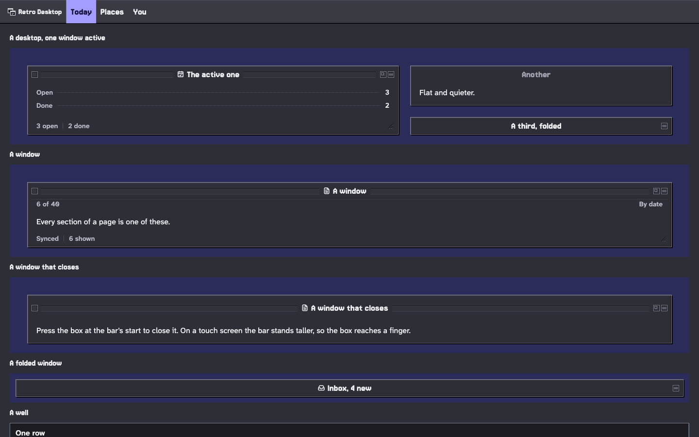
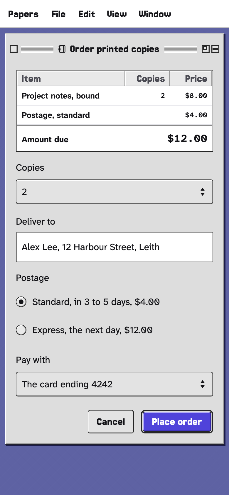
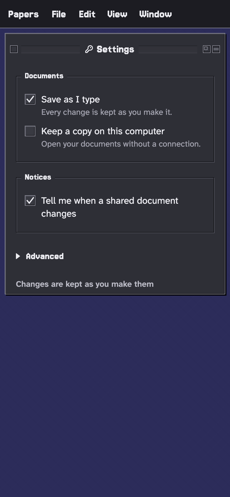

# retro_desktop_ui

A desktop UI from the pixel era for Flutter: square windows on a woven desktop, fine one-pixel bevels, a pixel face for
the chrome and a clear reading face for the content, and one accent colour that means "the act and now". It comes in
two appearances, Platinum (the classic Mac, the default) and Chisel (the 95-era PC), and five presets (classic,
lagoon, berry, marmalade and slate), each designed for day and night. It is a desktop look that also stands on a
phone: its title bars, rows and day cells are sized for a finger there. Each state speaks in the era's own material:
an alert opens with its picture (the note, the caution triangle, the stop sign), work in progress shows the busy
pointer (Platinum's wristwatch, Chisel's hourglass), a placeholder is the 50% checkerboard, focus is Platinum's
ring round the focused thing or Chisel's dotted rectangle, and a selection takes the highlight, its words inverted.

| | |
|---|---|
|  |  |
|  |  |
|  |  |

## Install

```yaml
dependencies:
  retro_desktop_ui: ^0.1.0
```

The package bundles its faces (Jersey 15, Atkinson Hyperlegible Next and Mono) and its icon font; an app needs no
font setup of its own. Load them before the first frame so nothing draws in a fallback face:

```dart
Future<void> main() async {
  WidgetsFlutterBinding.ensureInitialized();
  await retroDesktopLoadFonts();
  runApp(const MyApp());
}
```

## Theme setup

Put `RetroDesktopTheme` above your pages with the app's `builder`. The look's parts are plain Flutter widgets, so the
same setup works under a `MaterialApp`, a `CupertinoApp` or a bare `WidgetsApp`.

```dart
import 'package:flutter/material.dart';
import 'package:retro_desktop_ui/retro_desktop_ui.dart';

class MyApp extends StatelessWidget {
  const MyApp({super.key});

  @override
  Widget build(BuildContext context) => MaterialApp(
    builder: (context, child) => RetroDesktopTheme(
      // Follows the platform's light or dark setting.
      data: RetroDesktopThemeData.classic(MediaQuery.platformBrightnessOf(context)),
      child: child!,
    ),
    home: const HomePage(),
  );
}
```

```dart
import 'package:flutter/cupertino.dart';

CupertinoApp(
  builder: (context, child) => RetroDesktopTheme(
    data: RetroDesktopThemeData.lagoon(),
    child: child!,
  ),
  home: const HomePage(),
);
```

```dart
import 'package:flutter/widgets.dart';

WidgetsApp(
  color: const Color(0xff5e62a3),
  pageRouteBuilder: <T>(settings, builder) => PageRouteBuilder<T>(
    settings: settings,
    pageBuilder: (context, _, _) => builder(context),
  ),
  builder: (context, child) => RetroDesktopTheme(
    data: RetroDesktopThemeData.slate(Brightness.dark),
    child: child!,
  ),
  home: const HomePage(),
);
```

A page is a `RetroDesktopScaffold`: on a desk (from 1024 wide) its body stands in a window on the desktop, on a phone
it fills the screen under the app bar.

```dart
class HomePage extends StatelessWidget {
  const HomePage({super.key});

  @override
  Widget build(BuildContext context) => RetroDesktopScaffold(
    topBar: const RetroDesktopAppBar(title: 'Documents'),
    body: RetroDesktopCard(
      title: 'Your workspace',
      child: RetroDesktopButton('Create document', isDefaultAction: true, onPressed: () {}),
    ),
  );
}
```

## Everyday parts

Buttons take `onPressed`; inputs take `value` and `onChanged`; navigation takes `selectedIndex`. A null callback
shows the part disabled.

**Button.** One `RetroDesktopButton`, in Cupertino's pattern: `isDefaultAction` is the window's default button (the
one Return presses, one a window), `isDestructiveAction` marks an action that destroys, and `RetroDesktopButton.text`
has no face at rest.

```dart
Row(
  children: [
    RetroDesktopButton.text('Cancel', onPressed: () {}),
    const SizedBox(width: 12),
    RetroDesktopButton('Save', isDefaultAction: true, onPressed: () {}),
  ],
);
```

**Text field.** A sunken field with its label above, a helper or an error below.

```dart
RetroDesktopTextField(
  label: 'Name',
  hint: 'Your full name',
  helper: 'As it appears on the card',
  onChanged: (name) {},
);
```

**Select.** A pop-up button (Platinum) or a sunken field with a drop button (Chisel), opening its list on its field.

```dart
RetroDesktopSelect<String>(
  label: 'Sort by',
  value: sort,
  options: const [
    RetroDesktopOption('name', 'Name'),
    RetroDesktopOption('date', 'Date modified'),
    RetroDesktopOption('size', 'Size'),
  ],
  onChanged: (value) => setState(() => sort = value),
);
```

**List.** Rows in a sunken well, a rule between them; a row with `onPressed` shows its press.

```dart
RetroDesktopWell(
  child: RetroDesktopList(
    children: [
      RetroDesktopListTile(
        title: 'Quarterly report',
        subtitle: 'Document · edited today',
        leading: const Icon(RetroDesktopGlyphs.fileText),
        onPressed: () {},
      ),
      RetroDesktopListTile(
        title: 'Photos',
        subtitle: 'Folder · 38 items',
        leading: const Icon(RetroDesktopGlyphs.folder),
        onPressed: () {},
      ),
    ],
  ),
);
```

**Dialog.** A modal window; it returns the value of the action that closed it.

```dart
final save = await showRetroDesktopDialog<bool>(
  context,
  builder: (context) => const RetroDesktopDialog(
    title: 'Save changes?',
    message: 'Your document has changed since you opened it.',
    actions: [
      RetroDesktopDialogAction("Don't save", value: false),
      RetroDesktopDialogAction('Save', value: true, isDefaultAction: true),
    ],
  ),
);
```

**Navigation.** Folder tabs over one panel on a desk; the phone's strip at the foot of the screen.

```dart
RetroDesktopTabBar(
  tabs: const ['Recent', 'Shared', 'Archived'],
  selectedIndex: tab,
  onChanged: (index) => setState(() => tab = index),
  child: pages[tab],
);

RetroDesktopNavigationBar(
  items: const [
    RetroDesktopNavItem(label: 'Files', short: 'Files', icon: RetroDesktopGlyphs.folder),
    RetroDesktopNavItem(label: 'Inbox', short: 'Inbox', icon: RetroDesktopGlyphs.inbox),
  ],
  selectedIndex: place,
  onDestinationSelected: (index) => setState(() => place = index),
);
```

`showRetroDesktopBottomSheet`, `showRetroDesktopMenu`, `showRetroDesktopTooltip` and `showRetroDesktopSnackBar`
present their parts the same way. Charts take named series and numbers; folder, file, picture and empty-state art
slots take any widget.

## How Retro Desktop is built

The parts follow a few laws, and a part the period never had is built from them, not borrowed from another system. A
part of your own can follow them the same way.

- **Material.** Every part is a machine part drawn in whole pixels: grey plates and white paper, each edged by a
  one-pixel bevel. Nothing is glass, nothing blurs, and no corner is softer than the appearance's.
- **Light.** One light, from the top left, that never moves. Raised is light above and left and dark below and right;
  sunken or pressed is the same edge turned in. The only shadow is a window's hard drop shadow.
- **Stacking.** Only windows overlap: windows, and what a window opens (menus, alerts, tooltips). Inside a window the
  parts stand side by side or in rows, never on one another. One window is in front and active, its title bar striped;
  the rest are quieter, and nothing behind is dimmed.
- **State.** A state is said in the same materials: pressed is the bevel turned in, chosen is the highlight with its
  words inverted, focus is Platinum's ring or Chisel's dotted rectangle, unavailable is grey type. No tint, glow or
  borrowed ring.
- **Motion.** Things appear and go at once. What moves, moves in steps: the watch's hand, the hourglass's sand, a dotted
  outline following the pointer while a row is dragged, a line where it will land. Nothing springs, bounces, fades or
  slides.
- **Pictures.** Icons and alert pictures are pixel art in their own inks, drawn for this package; words are set in the
  look's typefaces.
- **Touch.** A phone keeps the desktop's materials: windows stack, and every control is a finger's reach. A gesture the
  desktop never had (a swipe, a pull) has no part of its own; its job goes to a button or a menu.

So some parts other kits have are made differently here, and some aren't in 0.1.0:

| Elsewhere | In Retro Desktop |
| --- | --- |
| A list reordered by dragging | `RetroDesktopReorderableListView`: a dotted outline follows the pointer, a line shows where the row will land, nothing moves until the drop; Alt and the arrows move a row from the keyboard |
| A scrim behind a dialog or a sheet | nothing is dimmed: the window in front is the active one and blocks the rest |
| Swipe actions on a row | the row's actions in its contextual menu (`RetroDesktopMenuAnchor`) or a menu button |
| Pull to refresh | a Refresh button or menu item; the busy pointer shows while it works |
| A carousel | one picture with Previous and Next and where you are (`RetroDesktopPagination`) |
| Toasts | one notice window at a time (`RetroDesktopSnackBar`) |
| A hover card | `RetroDesktopTooltip` (Balloon Help showed words), or a `RetroDesktopPopover` on a press |
| A tag-style multi-select | check rows in a sunken list (`RetroDesktopCheckRow` in a `RetroDesktopWell`) |

## Presets

Every preset takes `Brightness.light` (the default) or `Brightness.dark`.

| Factory | Appearance |
| --- | --- |
| `RetroDesktopThemeData.classic()` | Grey windows and indigo selection; graphite and a lit indigo at night. |
| `RetroDesktopThemeData.lagoon()` | Cool grey and deep teal; cyan over dark water at night. |
| `RetroDesktopThemeData.berry()` | Warm grey and berry selection; a berry lamp over dark plum at night. |
| `RetroDesktopThemeData.marmalade()` | Warm grey and orange selection; amber over dark brown at night. |
| `RetroDesktopThemeData.slate()` | Neutral grey and blue selection; a cool blue lamp at night. |

`RetroDesktopThemeData.from(primary:, brightness:)` derives a whole palette from one brand colour.

## Theme and styles

`RetroDesktopTheme.of(context)` returns the theme. Nest another `RetroDesktopTheme` to restyle a subtree, or use
`AnimatedRetroDesktopTheme` to move between themes. The theme supports `copyWith`, equality and `lerp`.

```dart
final theme = RetroDesktopThemeData.from(
  primary: const Color(0xff2455aa),
  brightness: Brightness.light,
).copyWith(
  appearance: RetroDesktopAppearance.chisel,
  density: RetroDesktopDensity.comfortable,
);
```

The theme's settings are the ones a product changes: the palette (a preset or `from`), light or dark, the
appearance, the density and, for a brand or a script the bundled faces lack, the `typeface`. Corners, line widths and
shadows belong to the appearance and are not settings. Text size follows the platform's text scaling and motion its
Reduce Motion setting.

### Appearances

| | `RetroDesktopAppearance.platinum` (classic Mac, the default) | `RetroDesktopAppearance.chisel` (95-era PC) |
|---|---|---|
| Corners | Push buttons, popups and tabs rounded by 4; windows and fields square | Square everywhere |
| Edge | A dark outline and a soft one-step bevel | Two-step bevel: white and light grey above and left, dark grey and black below and right; fields sunk the other way |
| Default button | A heavier rounded ring round it | One more black line round it |
| Pressed | The face darkens; nothing moves | The bevel inverts and the label moves one pixel down and right |
| Keyboard focus | An accent ring outside the outline | A dotted rectangle inside the face |
| Title bar | Pinstripes, a centred title, the close box at the start | A solid accent band, the title at its start, bevelled buttons at its end |
| Checkbox and radio | Raised box with a tick; raised disc with a dot | Sunk white box with a black tick; sunk disc with a black dot |
| Select | A rounded popup with a double arrow | A sunk field with a bevelled arrow button |
| Progress | A continuous bar; a barber pole while indeterminate | A sunk trough filled with blocks |
| Busy | A wristwatch, its hand going round | An hourglass, its sand running |
| Alerts | The note balloon, the caution triangle, an octagonal stop sign | The same, the stop sign a disc, in brighter inks |
| Slider | A track and a ridged grip | A sunk groove and a pointed, bevelled grip |
| Tabs | Folder tabs with rounded top corners | Square bevelled folder tabs |

### Hover

Pointer hover changes nothing a part paints: the period's desktops drew no hover state. The pointer says what a part
does instead (a click cursor over what presses, a grab cursor over what drags, a text cursor over a field). Every
pressable resolves its styles with `WidgetState.hovered`, so an app that wants a hover style gives one:

```dart
RetroDesktopButton(
  'Open',
  onPressed: () {},
  style: RetroDesktopStyle(
    overlay: WidgetStateProperty.resolveWith(
      (states) => states.contains(WidgetState.hovered) ? const Color(0x14000000) : null,
    ),
  ),
);
```

### Density and component styles

`RetroDesktopDensity` has Flutter's three steps: `standard`, `comfortable` (a fifth more room) and `compact` (a fifth
less). It changes a part's padding and gaps; its touch target keeps its floor. Left unset, the theme takes
`RetroDesktopDensity.adaptivePlatformDensity`: compact on macOS, Windows and Linux, standard on touch platforms.

Each part's component theme (`buttonTheme`, `defaultButtonTheme`, `textFieldTheme` and the rest, set through
`copyWith`) and each widget's `style:` take a `RetroDesktopStyle`: state-resolved fill, foreground, edge, overlay,
side, shape, padding, minimum size, text style and icon size. A value the widget's style resolves wins over its
component theme; what neither resolves falls through to the look's defaults.

## Accessibility and languages

- **Screen readers and keyboard.** Every control says its role, name, value and state (checked, selected, expanded,
  unavailable); drawn ornament is left out of the semantics tree. Everything works from the keyboard, and focus follows
  reading order. Targets are padded to 48 logical pixels for touch and 44 for a pointer, and text keeps 4.5:1 contrast
  (3:1 when large); both are checked on every page of the example, in every preset, by day and by night.
- **States.** A disabled control keeps its size and dims; a part that only shows a value (a list row with no
  `onPressed`, a rating with no `onChanged`) is a still reading, not a disabled control. An error shows as the warning
  sign and the message in ink.
- **Text size.** Parts follow the user's text scale and grow taller rather than cut words: a long label wraps, a
  dialog or sheet scrolls. The pages are tested at twice the text size.
- **Right to left.** Under a right-to-left `Directionality` every part mirrors: arrows and disclosure triangles turn,
  sliders, progress and steppers fill from the start, a field's prefix and suffix change sides, rows and tabs read from
  the right. Digits keep their own left-to-right order inside right-to-left words. The example's settings have a
  reading direction switch.
- **Words.** The words a part says by itself that every look shares (Cancel, Close, Back, Today, Next month,
  Loading, Show password, Dismiss) come from ui_core's `DesignLocalizations`, under `MaterialLocalizations`' names.
  To translate them, extend `DefaultDesignLocalizations`, override the words you translate, and add a delegate for
  your subclass to `localizationsDelegates`; every ui_core look then speaks your language. The words only this look
  says (a pager's name, a time picker's wheels, a stepper's More and Less, a file drop's invitation) are
  `RetroDesktopLocalizations`, English in 0.1.0.
- **Dates and numbers.** Month and weekday names, dates, numbers and percentages use `intl` in the locale
  `RetroDesktopLocalizations.delegate` loads (add it for a locale other than US English); the calendar starts its week
  on the day `DesignLocalizations.firstDayOfWeek` names, and times are 12- or 24-hour as the platform says.
- **Scripts.** The look's faces (Jersey 15 for window titles and buttons, Atkinson Hyperlegible Next and Mono for the
  rest) cover the Latin alphabet. Other scripts (Arabic, Hebrew, Chinese, Japanese, Devanagari, Thai) are drawn in the
  platform's fallback fonts (on the web, the Noto fonts Flutter fetches), so they read, but without the pixel face.

Known limits in 0.1.0: the look's own words ship in English only, and a title in another script loses the period's
pixel type. The glyphs on buttons, rows and fields (`RetroDesktopGlyphs`) are Lucide's line icons, smooth strokes beside
the pixel art: a pixel set on a 24 px grid stays sharp only at 24 and 48, and the parts draw their glyphs at 13 to 18,
so 0.2.0 brings pixel glyphs drawn for those sizes behind the same `RetroDesktopGlyphs` names.

## API notes

The API follows Flutter's: `onPressed`, `onChanged`, `value`, `selected`, `leading`, `trailing`, `child`, `style`,
`padding`; a null callback disables a control. A single control (a button, a check, a switch, a slider, a field, a chip,
a select, a list row) takes an optional `focusNode` and `autofocus`; a widget that is given a controller or a focus node
never disposes it, and makes and disposes its own when none is given. Groups (tabs, navigation, segments, radio groups,
the pickers) take none, as Flutter's do.

Some slots take words or an icon where Flutter would take a widget, because the look sets them itself: a button's,
chip's, tab's or menu item's `label`, a window's, dialog's, card's or list row's `title` and `subtitle`, an alert's
`body`, and `icon` as an `IconData`. A later version adds a widget slot beside each one, with the words made optional, so
nothing written against 0.1.0 breaks.

Sizes follow the period's: a button is as wide as its words, up to 300 on a desk and half the screen on a phone (never
under 160); `wide: true` fills its row. A table narrower than its columns' least widths scrolls sideways under the
look's own scroll bar. Menus hang from their bar or button, tooltips 4 below what they name. An alert stands as a
window of its own, with a window's hard shadow; `floating: false` sets it in a window's content, without one (only
windows cast shadows).

Two parts keep an `enabled` flag beside their callback: `RetroDesktopDialogAction`, which closes its dialog with its
`value` and needs no `onPressed`, and `RetroDesktopRating`, where no `onChanged` makes a still reading and `enabled:
false` a dimmed input.

## Customize one component

Copy a component file from `lib/src/retro_desktop/`, rename its class, and replace its sibling imports with:

```dart
import 'package:retro_desktop_ui/retro_desktop_parts.dart';
```

The parts library exposes the building blocks the components use. You can also vendor the whole package with
`dart pub unpack` and a path dependency.

`package:retro_desktop_ui/retro_desktop_host.dart` holds the host layer an app shell or router draws pages with (the
host, its pages and sheets, the page preview, the component inventory). An app built from the parts does not need it.

## Example

The example is the live gallery: every part by kind, ordinary applications built from them (a form, settings, a
list, a checkout, a workspace, projects), and the look's own pieces (the desktop and its windows, objects and figures,
gauges and calendars). Its Customize panel changes the preset, light or dark, the appearance, the density and the
colours. The All components page answers every row of the shared component list; three rows are absent by design: the
floating action button (the toolbar's default button is the desktop's), the command palette (the period ran commands
from its menu bar and their keys) and the wheel picker (the period chose from a pop-up button).

## Licences

The package uses BSD-3-Clause. It bundles Jersey 15, Atkinson Hyperlegible Next and Atkinson Hyperlegible Mono under
SIL OFL 1.1. Lucide icons use ISC, with Feather-derived icons under MIT. The notices are in `LICENSE` and
`THIRD_PARTY_NOTICES`.
