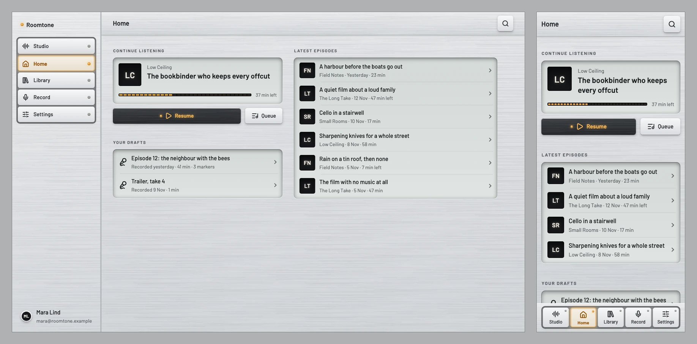

# studio_ui

Studio is a Flutter design system for audio and media apps. It includes transport controls, faders, meters, charts, and a full set of navigation and form widgets in coordinated light and dark themes.



**[Live gallery](https://wenkaifan0720.github.io/flutter_design_systems/studio/)** · [API reference](https://pub.dev/documentation/studio_ui/latest/) · [All the looks](https://wenkaifan0720.github.io/flutter_design_systems/)

## Getting started

The example below uses `MaterialApp` from `material_ui`. Add both packages, then load the bundled fonts before the first frame.

```sh
flutter pub add studio_ui material_ui
```

```dart
import 'package:material_ui/material_ui.dart';
import 'package:studio_ui/studio_ui.dart';

Future<void> main() async {
  WidgetsFlutterBinding.ensureInitialized();
  await studioLoadFonts();
  runApp(
    MaterialApp(
      theme: ThemeData(
        pageTransitionsTheme: const PageTransitionsTheme(builders: studioPageTransitions),
      ),
      builder: (context, child) => StudioHost(child: child!),
      home: StudioScreen(
        topBar: const StudioAppBar(title: 'Library'),
        body: const StudioDisplay(child: Text('Rooms that sound right, 38 min.')),
        footer: StudioButton.lit('Publish', onPressed: () {}),
      ),
    ),
  );
}
```

`StudioHost` installs the theme, chassis and toast overlay. It also works in the builder of a `CupertinoApp` or `WidgetsApp`. Add `studioPageTransitions` to a Material theme to use Studio's transitions and the iOS back gesture.

## Building a screen

Use `StudioAppShell` with `StudioTab` destinations for top-level navigation. The shell uses a bottom key bank below 600 logical pixels, a rail from 600, and a side panel from 1024. A `StudioScreen` arranges the app bar, body and optional footer. Use `StudioDisplay` for readable content on smooth glass.

Buttons, filters and pickers support keyboard navigation and right-to-left layouts. Arrow keys move between tabs. When a dialog closes, focus returns to its trigger. For a destructive confirmation, pass `isAlert: true` to `showStudioDialog`.

## Customizing Studio

Set the indicator and panel finish with `StudioThemeData.from`. Set a component style such as `buttonStyle` or `textFieldStyle` on the theme to apply it throughout an app, or pass a `StudioStyle` to an individual widget. Its state properties can change with focus, selection or a press.

`textureStrength` controls the grain on metal surfaces. High-contrast mode removes the grain. Build custom controls with the same materials using `StudioSurface`, `StudioFace`, `StudioLamp` and `StudioReadout`.

## Fonts

Studio bundles Barlow under the SIL Open Font License 1.1. The license is included in `assets/fonts/LICENSES/`.
