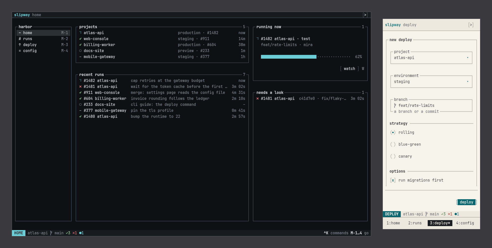
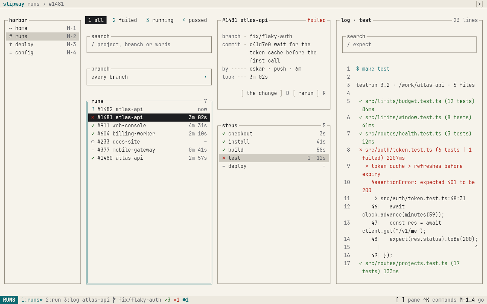
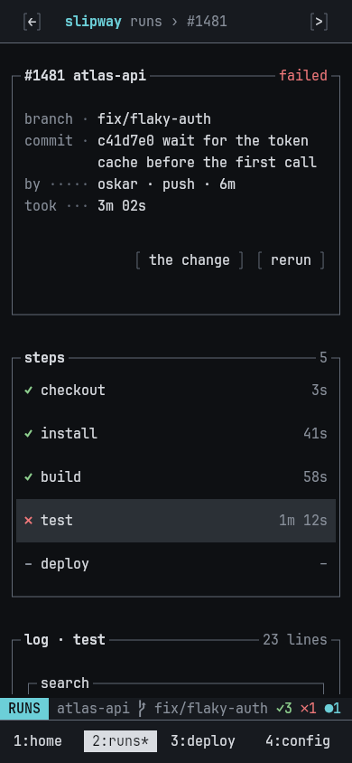

# terminal_ui

Terminal widgets for Flutter: an app drawn on a character grid, with box-drawn panes, bracketed buttons, inverse
selection and keys beside every action.



**[Docs and demo](https://wenkaifan0720.github.io/flutter_design_systems/docs/looks/terminal/)** ·
[Try it in Stint](https://wenkaifan0720.github.io/flutter_design_systems/docs/stint/?look=terminal) ·
[API reference](https://pub.dev/documentation/terminal_ui/latest/) ·
[All the looks](https://wenkaifan0720.github.io/flutter_design_systems/docs/)

## Install

```sh
flutter pub add terminal_ui material_ui
```

`material_ui` is Flutter's Material as a package (from Flutter 3.50 it leaves the SDK): your app's `MaterialApp`.
Terminal draws its glyphs in its own face (`✓`, `›`, `←`), so no icon package is needed. Import
`package:terminal_ui/terminal_ui.dart` and `package:material_ui/material_ui.dart` (it brings Flutter's widgets);
Terminal's library doesn't export `flutter/widgets.dart`. It re-exports ui_core, so `RawNamedPalette`, `RawPalette`
and the `Raw*` parts come with it.

A whole app: Terminal over a `MaterialApp` and one button.

```dart
import 'package:material_ui/material_ui.dart';
import 'package:terminal_ui/terminal_ui.dart';

void main() => runApp(
  MaterialApp(
    builder: (context, child) => TermHost(child: child!),
    home: Center(
      child: TermButton.filled(label: 'deploy', onPressed: () {}),
    ),
  ),
);
```

## Mount Terminal

`TermHost` is the one mount. Put it in your app's `builder:`, above the Navigator, so every screen, dialog and menu
stands inside it. It gives the theme for the brightness in force (by day, by night, or as the device is; `theme` and
`darkTheme`, or a `palette`'s), the screen behind the app, Terminal's page motion for every route a `MaterialApp`
pushes, and the toaster `TermToaster.show` needs. A change of appearance or palette blends across in 200 ms (a cut
under Reduce Motion). Load the bundled faces before the first frame, so nothing is measured in a fallback face:

```dart
import 'package:material_ui/material_ui.dart';
import 'package:terminal_ui/terminal_ui.dart';

Future<void> main() async {
  WidgetsFlutterBinding.ensureInitialized();
  await termLoadFonts(); // the first frame is set on the grid
  runApp(const App(appearance: null));
}

class App extends StatelessWidget {
  const App({super.key, required this.appearance});

  /// Light or dark, pinned by the reader; null follows the device.
  final Brightness? appearance;

  @override
  Widget build(BuildContext context) => MaterialApp(
    builder: (context, child) => TermHost(brightness: appearance, child: child!),
    home: const TermPane(title: 'shelf', child: Text('your reading list')),
  );
}
```

Under a `CupertinoApp` (from `cupertino_ui`) or a bare `WidgetsApp` the host goes in the same place; give a
`WidgetsApp` Terminal's route, `pageRouteBuilder: <T>(settings, builder) => TermPageRoute<T>(settings: settings,
builder: builder)`. A bare `TermTheme` gives a subtree the theme alone: no toasts, no screen, no blend. Screens open
with a brief fade and pop with a cut; places and side panes switch in place. On Android, Back first dismisses an open
menu, list or popover; the iOS transition keeps the swipe from the leading edge.

## Build an app

The example app, [example/lib/main.dart](example/lib/main.dart), is a whole reading list to copy: these are its parts.
Terminal's gallery, every part on a page of its own, is `flutter run -t lib/gallery.dart` in `example/`.

### The shell and its places

`TermScaffold.branches` holds the app's places: a window list along a phone's foot, a rail from 600 wide and the side
pane from 1100, with an optional status line (`TermStatusLine`) along the foot. Each place keeps its own screens; a
screen pushed on one stands beside the rail or the side pane (a phone's window list steps away for it), back pops it,
and choosing the place again goes back to its first screen. Toasts keep clear of the window list. The arrow keys move
between the places and F6 moves the focus between them and the screen. `TermScaffold` (no `.branches`) frames one
`body` of your own instead (an `IndexedStack`, or a router's).

```dart
import 'package:material_ui/material_ui.dart';
import 'package:terminal_ui/terminal_ui.dart';

class ShelfShell extends StatefulWidget {
  const ShelfShell({super.key});

  @override
  State<ShelfShell> createState() => _ShelfShellState();
}

class _ShelfShellState extends State<ShelfShell> {
  int _place = 0;

  @override
  Widget build(BuildContext context) => TermScaffold.branches(
    title: 'shelf',
    destinations: const [
      TermNavigationDestination(label: 'books', glyph: '≡'),
      TermNavigationDestination(label: 'add', glyph: '+'),
      TermNavigationDestination(label: 'settings', glyph: '~'),
    ],
    selectedIndex: _place,
    onDestinationSelected: (place) => setState(() => _place = place),
    statusLine: const TermStatusLine(mode: 'SHELF', segments: [TermStatusSegment('5 books')]),
    branches: [
      (context) => const TermTopBar(title: 'books'),
      (context) => const TermTopBar(title: 'add a book'),
      (context) => const TermTopBar(title: 'settings'),
    ],
  );
}
```

### A list and its screens

A `TermPane.list` of `TermListTile`s, each pushing its own screen. A row is one line from `TermListTile.besideCols`
(56) cells wide, its subtitle a column beside the title, and two lines narrower, whatever the pointer; the words at
the end take at most half the row (where the subtitle and they don't both fit, an author at large text on a phone,
they take a line of their own at the end), and a row's `action` (a delete key, a menu) is a
control of its own beside it. A screen is a `TermScreen`: its title line (a `TermTopBar`, with a back key where its
route can go back), then its body, scrolling, at most `maxCols` cells wide. On a line too short for the title and
its path, the title stays and the path gives way.

```dart
import 'package:material_ui/material_ui.dart';
import 'package:terminal_ui/terminal_ui.dart';

class BooksScreen extends StatelessWidget {
  const BooksScreen({super.key, required this.titles});

  final List<String> titles;

  @override
  Widget build(BuildContext context) => TermPane.list(
    title: 'books',
    trailing: '${titles.length}',
    children: [
      for (final title in titles)
        TermListTile(
          leading: const Text('›'),
          title: Text(title),
          subtitle: const Text('reading'),
          onTap: () => Navigator.of(context).push(
            MaterialPageRoute<void>(
              builder: (context) => TermScreen(
                title: title,
                subtitle: 'books',
                body: TermDescriptionList(items: [('title', title), ('status', 'reading')]),
              ),
            ),
          ),
        ),
    ],
  );
}
```

### Forms

Stand the fields in a `Column` a line apart (`spacing: context.termGrid.lineHeight`); every field (a text field, a
select, a date) takes the column's width, so give a desk's form a column of its own: `TermScreen`'s
`maxCols: TermScreen.formCols`, 72 cells, as the example's screens do. Check
the answers when the reader saves: give each problem to its field's `errorText`, in words (the frame and the words
under it turn the danger ink, with a `✗`), and move the focus to the first one. A `TermDatePicker` with a null
`value` is an optional date; it writes a chosen one `2026-11-14` (`termDate`), and its calendar opens under it,
the page scrolling the field up first where the month wouldn't fit below.

```dart
import 'package:material_ui/material_ui.dart';
import 'package:terminal_ui/terminal_ui.dart';

class AddBookForm extends StatefulWidget {
  const AddBookForm({super.key, required this.onSaved});

  final void Function(String title, String format, DateTime? started) onSaved;

  @override
  State<AddBookForm> createState() => _AddBookFormState();
}

class _AddBookFormState extends State<AddBookForm> {
  final _title = TextEditingController();
  final _titleFocus = FocusNode();
  String _format = 'paperback';
  DateTime? _started;
  String? _titleError;

  @override
  void dispose() {
    _title.dispose();
    _titleFocus.dispose();
    super.dispose();
  }

  // The form's check: the field's error in words, or null.
  String? _checkTitle(String title) => title.trim().isEmpty ? 'enter the book’s title' : null;

  void _save() {
    setState(() => _titleError = _checkTitle(_title.text));
    if (_titleError != null) return _titleFocus.requestFocus();
    widget.onSaved(_title.text.trim(), _format, _started);
  }

  @override
  Widget build(BuildContext context) => Column(
    crossAxisAlignment: CrossAxisAlignment.stretch,
    spacing: context.termGrid.lineHeight,
    children: [
      TermTextField(
        labelText: 'title',
        controller: _title,
        focusNode: _titleFocus,
        errorText: _titleError,
      ),
      TermSelect<String>(
        labelText: 'format',
        value: _format,
        items: const [
          TermSelectItem(value: 'paperback', label: 'paperback'),
          TermSelectItem(value: 'ebook', label: 'ebook'),
        ],
        onChanged: (format) => setState(() => _format = format),
      ),
      TermDatePicker(
        labelText: 'started',
        value: _started,
        firstDate: DateTime(1900),
        lastDate: DateTime(2100),
        onChanged: (day) => setState(() => _started = day),
      ),
      Align(
        alignment: AlignmentDirectional.centerStart,
        child: TermButton.filled(label: 'save book', onPressed: _save),
      ),
    ],
  );
}
```

A choice without words of its own (a toggle group, a slider) stands in a `TermPane` whose `title` names it, and
takes a `semanticLabel` a screen reader hears.

### Questions and toasts

`showTermConfirmDialog` asks a y/N question and completes with the answer: `true` for yes, `false` for no, `null`
when it is dismissed (Escape, the scrim, system back). Under 600 wide it stands as a sheet at the screen's foot, where
a thumb reaches; a destructive one draws its yes in the danger ink, `✗` before its words, as every destructive
action does. `TermToaster.show` says what happened.

```dart
import 'package:material_ui/material_ui.dart';
import 'package:terminal_ui/terminal_ui.dart';

Future<bool> confirmDelete(BuildContext context, String title) async {
  final delete = await showTermConfirmDialog(
    context: context,
    title: 'delete book',
    message: '“$title” comes off your list. this can’t be undone.',
    confirmLabel: 'delete',
    cancelLabel: 'keep',
    isDestructiveAction: true,
  );
  if (delete != true || !context.mounted) return false;
  TermToaster.show(context, message: 'deleted “$title”');
  return true;
}
```

### Let the reader choose a palette

`TermThemeData.palettes` are Terminal's six, each with an id to store, a label to show and the swatches it gives by
day and by night (its accent and its screen). Show each by its name and its ink as it shows now (`swatchesFor` the
theme's brightness, as a radio's `trailing`). Hand the chosen one to the host; `TermThemeData.fromPalette` gives one's
theme, and takes an app's own `RawNamedPalette` too (its first swatch the accent).

```dart
import 'package:material_ui/material_ui.dart';
import 'package:terminal_ui/terminal_ui.dart';

class PalettePicker extends StatelessWidget {
  const PalettePicker({super.key, required this.palette, required this.onChanged});

  final RawNamedPalette palette;
  final ValueChanged<RawNamedPalette> onChanged;

  @override
  Widget build(BuildContext context) {
    final theme = TermTheme.of(context);
    return TermPane(
      title: 'palette',
      child: Column(
        crossAxisAlignment: CrossAxisAlignment.stretch,
        children: [
          for (final p in TermThemeData.palettes)
            TermRadio<String>(
              value: p.id,
              groupValue: palette.id,
              label: p.label,
              // Its ink as it shows now, a cell after its name.
              trailing: Text(
                '██',
                style: theme.textStyle.copyWith(color: p.swatchesFor(theme.brightness).first),
              ),
              onChanged: (id) => onChanged(TermThemeData.palettes.firstWhere((p) => p.id == id)),
            ),
        ],
      ),
    );
  }
}

// Over the app: TermHost(palette: palette, brightness: appearance, child: child!)
```

## Building blocks

| For | Use |
| --- | --- |
| The app and its screens | `TermHost`, `TermScaffold` (`.branches`), `TermScreen`, `TermTopBar`, `TermStatusLine`, `TermNavigationBar`, `TermNavigationRail`, `TermSideBar`, `TermTabBar`, `TermMenuBar`, `TermPageRoute` |
| Panes and rows | `TermPane` (`.list`), `TermListTile`, `TermSectionHeader`, `TermDescriptionList`, `TermDisclosure`, `TermTree`, `TermReorderableList`, `TermPullToRefresh`, `TermDivider`, `TermSplitView`, `TermScrollArea` |
| Actions | `TermButton` (`.filled`), `TermIconButton`, `TermButtonGroup`, `TermSplitButton`, `TermLink`, `TermKey`, `TermCommandPalette` |
| Form fields | `TermTextField` (`lines:` for a text area), `TermPasswordField`, `TermOtpField`, `TermNumberField`, `TermSelect`, `TermCombobox`, `TermTagInput`, `TermFileField`, `TermColorPicker` |
| Choices | `TermCheckbox`, `TermRadio`, `TermSwitch`, `TermToggleGroup`, `TermChip`, `TermSlider`, `TermRangeSlider`, `TermRating` |
| Dates and times | `TermDatePicker`, `TermDateRangePicker`, `TermCalendar`, `TermTimeField`, `termDate` |
| Figures and charts | `TermMeter`, `TermProgressBar`, `TermTable`, `TermDataTable`, `TermLineChart`, `TermAreaChart`, `TermBarChart`, `TermSparkline` |
| Marks | `TermTag`, `TermBadge`, `TermAvatar`, `TermAvatarGroup`, `TermMedia`, `TermSpinner`, `TermSkeleton`, `TermCaret` |
| Messages | `TermToaster`, `TermBanner`, `TermEmptyState`, `TermStatusView`, `TermTooltip` |
| Over the screen | `TermDialog`, `showTermConfirmDialog`, `showTermSheet`, `showTermSideSheet`, `showTermActionSheet`, `TermPopover`, `TermHoverCard`, `TermMenu`, `TermContextMenu` |
| Layout and wayfinding | `TermBreadcrumb`, `TermPagination`, `TermPageDots`, `TermSteps`, `TermTimeline`, `TermCells`, `TermGrid` |
| Foundations | `TermThemeData` (`.dark()`, `.light()`, `.monochrome()`, `.preset(id, brightness)`, `.from(palette)`, `.fromPalette`), `TermTheme`, `AnimatedTermTheme`, `TermPalette`, `TermAnsi`, `TermFace`, `TermStyle`, `termLoadFonts` |

## The look

Flutter widgets drawn the way a well-made terminal program draws itself:
every size whole character cells, panes in box-drawing lines with their
titles cut into the top line, buttons in brackets, the chosen row in
inverse video, the keyboard's focus as the cursor, and the key for every
action written beside it. A sixteen
colour palette in a night and a paper preset, a monochrome theme, and
everything you need to reach it by touch, pointer, keyboard and screen
reader.

```
┌─ runs ─────────────────────────────── 3 ─┐
│ ⠹ #1482 atlas-api                    now │
│ ✗ #1481 atlas-api                 3m 02s │
│ ✓ #911  web-console               4m 31s │
└─ ⏎ open ─────────────────────────────────┘
  [ cancel ] esc   [ deploy ] ⏎
```

## Screens

slipway, the gallery's demo app, is a made-up deploy console built only from these widgets.




<p>
  
</p>

## Make it yours

Six palettes come with it, each by day and by night: `standard` (Terminal's
own night and paper, a cyan accent), `harbor` (a navy screen, a blue
accent), `dusk` (a plum screen, a magenta accent), and three in one ink, as a
monochrome terminal draws: `mono`, `phosphor` (green) and `amber`; a
picker shows them by these lower-case names. `TermThemeData.palettes` lists them (see [Let the reader choose a palette](#let-the-reader-choose-a-palette)); `TermThemeData.preset(id, brightness)` gives one's theme for a part of the tree:

```dart
import 'package:material_ui/material_ui.dart';
import 'package:terminal_ui/terminal_ui.dart';

Widget inAmber(BuildContext context, Widget child) => TermTheme(
  data: TermThemeData.preset('amber', MediaQuery.platformBrightnessOf(context)),
  child: child,
);
```

Every part takes a `style:` (a `TermStyle`) over its slot in
`TermThemeData`: one slot a part, and one a kind of button. A style sets
colours (and a weight, on parts with words of their own); sizes stay
whole cells and lines, so a style can't take the look off its grid. A
part's corners are fixed (ui_core's `cornerFreedom: fixed`): a frame's
corners are box-drawing cells, `┌ ┐ └ ┘`, so there is no radius to set.

```dart
final base = TermThemeData.dark(
  // Your brand's colour; the theme steps it until it reads at 4.5:1.
  accent: const Color(0xFF0A7D4F),
);

final theme = base.copyWith(
  // Every primary button.
  filledButtonStyle: TermStyle(
    fill: WidgetStatePropertyAll(TermAnsi.magenta.of(base.palette)),
    edge: WidgetStatePropertyAll(TermAnsi.magenta.of(base.palette)),
  ),
);

// One button.
TermButton(
  label: 'roll back',
  onPressed: () {},
  style: TermStyle(
    foreground: WidgetStatePropertyAll(theme.warning),
    edge: WidgetStatePropertyAll(theme.warning),
  ),
);
```

A brand colour that reads under 4.5:1 on the background or a surface is
stepped lighter (or darker, on paper) in its own hue until it does.
`TermThemeData` also takes a `face` (a monospace face and
its advance together) and a `stroke` (box drawing's light or heavy line);
`AnimatedTermTheme` animates a change. The painters and faces the parts
are drawn with (`TermFramePainter`, `TermBracketFace`, `TermCellFace`,
`TermMenuRow`, `TermSpring`, …) are public, for a part of your own in the
look.

The pointer over a part changes nothing by default: a terminal has no
hover, and the cursor already says what presses. Only the lit row of an
open menu or select follows it. Every style still sees
`WidgetState.hovered`, so a hover is one line away:

```dart
TermThemeData.dark().copyWith(
  listTileStyle: TermStyle(
    fill: WidgetStateProperty.fromMap({
      WidgetState.hovered: TermAnsi.blue.of(TermPalette.night).withValues(alpha: 0.2),
    }),
  ),
);
```

## The grid

Every width is whole cells and every height whole lines: a 15 px face on a
9 × 24 cell. The text scale grows the grid, so at 200% a cell is twice the
size and the lattice still holds. A control's target is one line under a
pointer and two under a finger.

## Accessibility

Box-drawing, braille and block glyphs are painted, not typed, and a screen
reader hears what they mean (a status's word, a spinner's "loading", a
bar's percentage) instead. Inverse selection is announced as selected. The
spinners and the caret hold still under Reduce Motion. Every tone has a
glyph (`✓ ✗ ! i`), so nothing is said by colour alone; the monochrome theme
proves it. A destructive action (a button, a menu's or a sheet's entry, a
confirm's yes) carries the danger's `✗` before its words, since in a
palette of one ink the danger's ink is the words'; a screen reader hears
the words alone.

The keyboard's focus is the cursor: an accent block over the part, its
words and brackets cut out of it, hollow on a part already chosen or
filled, so chosen, pressed and focused read apart by shape in the
monochrome theme too. A text field shows the caret, its frame's one line
heavy in the accent, as Material's outline goes from 1 to 2 px; a doubled
line is a pane's, for the pane the keys are in. Focus shows for the
keyboard only, never after a click, and differs from the part at rest at
3:1 or more over at least a 2 px outline's area on every theme (a text
field's, a 1 px outline's beside its caret).

Tab visits a tab bar or navigation group once. Use the arrow keys to move
between destinations and F6 to switch between navigation and the page.
Tab visits a set of radios once too, on the chosen one, and so a
segmented control: the arrows move and choose (put sibling `TermRadio`s in
Flutter's `RadioGroup`, with ui_core's `RadioGroupKeyboardFix` round them).
Dialogs and sheets keep focus inside and return it to the opener on close.
On line and area charts, the arrows inspect data points. Ratings accept
arrow and number keys. Screen readers announce shortcuts such as `^K` as
“Ctrl+K”.

The navigation bar wraps its labeled destinations when space is tight.
A selected date range uses extra lines when necessary so both dates stay
visible at larger text sizes.

## Languages

Terminal's own words (a pager's "next page", a tag's "remove", a
confirmation's `proceed? [y/N]` and its keys, a file field's `browse`, a
refresh's `pull to refresh`, the palette's colour names) come from
`TermLocalizations`, in English, Arabic and German. Nothing needs setting
up: in an Arabic or German app they follow the app's locale, beside
ui_core's `RawWidgetsLocalizations`, whose words cover 30 languages. Words an
app passes, such as a dialog's `cancelLabel`, are its own; left at their
English defaults, they follow the locale too. For another language, extend
`DefaultTermLocalizations` and add a delegate for it to
`localizationsDelegates`.

In a right-to-left locale the layout mirrors: panes, keys, menus and
charts read from the right, and Hebrew draws in Liberation Mono on the
same grid.

Figures follow the locale as well, through `RawWidgetsLocalizations`: dates,
times, the number field and the charts (a bar's value, a chart's scale and
readout, a sparkline's reading) write the reader's digits and separators,
Arabic-Indic digits in Arabic and `2,5` in German.

## Requirements

Flutter 3.47.0 or later (ui_core 0.8.1). Terminal runs on Android, iOS, the web, macOS,
Windows and Linux.

## Fonts

JetBrains Mono (SIL Open Font License 1.1) for the words, and Liberation
Mono (SIL Open Font License 1.1) for Hebrew, with the same advance so the
grid holds right to left. Their licences ship in `assets/fonts/LICENSES/`.
