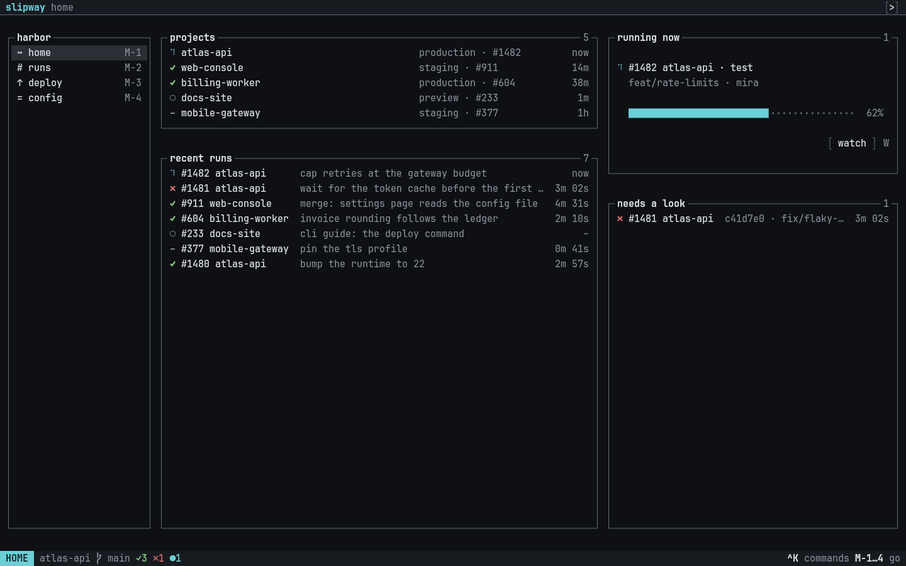
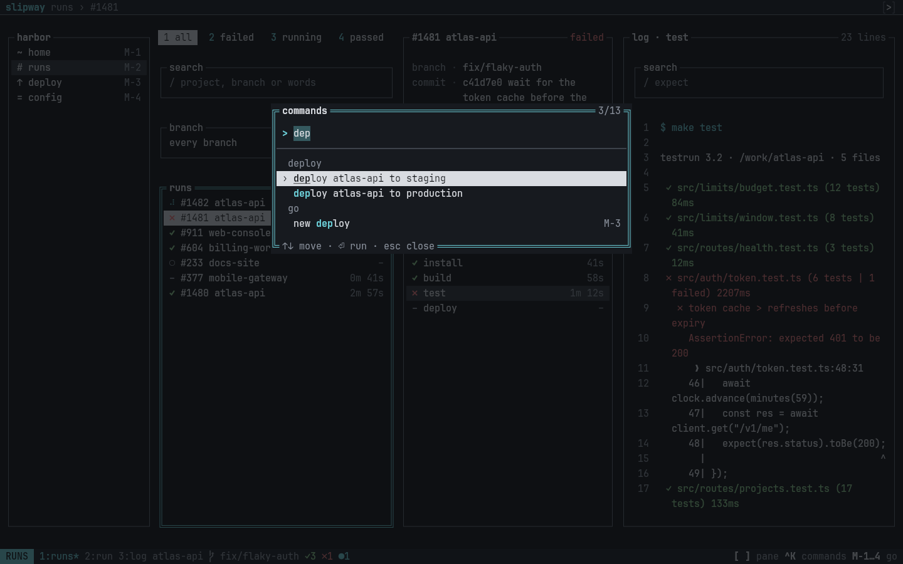
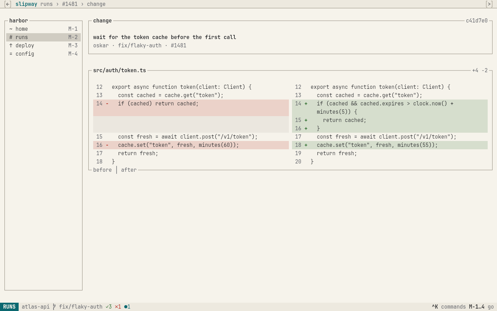
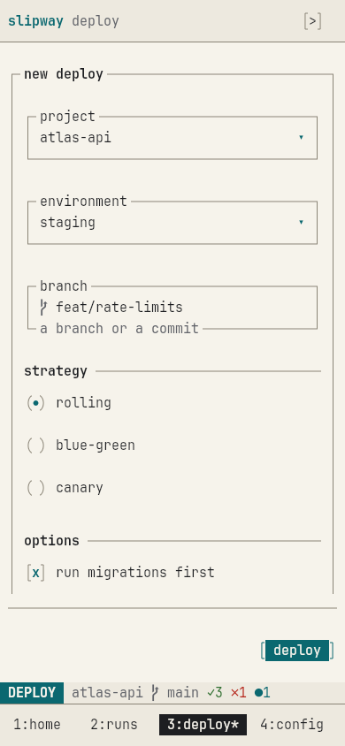

# terminal_ui

Flutter widgets drawn the way a well-made terminal program draws itself:
every size whole character cells, panes in box-drawing lines with their
titles cut into the top line, buttons in brackets, the chosen row in
inverse video, and the key for every action written beside it. A sixteen
colour palette in a night and a paper preset, a monochrome theme, and
everything you need to reach it by touch, pointer, keyboard and screen
reader.

```
┌─ runs ─────────────────────────────── 3 ─┐
│ ⠹ #1482 atlas-api                    now │
│ ✗ #1481 atlas-api                 3m 02s │
│ ✓ #911  web-console               4m 31s │
└─ ⏎ open ─────────────────────────────────┘
  [ cancel ] esc   [ deploy ] ⏎
```

## Screens

The example app, slipway, is a made-up deploy console built only from these
widgets.








<p>
  
  
</p>

## Getting started

```yaml
dependencies:
  terminal_ui: ^0.1.1
```

Put `TermTheme` round your app in its builder, and load the faces before the
first frame so the grid never starts in a fallback font:

```dart
import 'package:flutter/material.dart';
import 'package:terminal_ui/terminal_ui.dart';

Future<void> main() async {
  WidgetsFlutterBinding.ensureInitialized();
  await termLoadFonts();
  runApp(
    MaterialApp(
      // Your routes change screens as a terminal does (see Page motion).
      theme: ThemeData(
        pageTransitionsTheme: const PageTransitionsTheme(
          builders: termPageTransitions,
        ),
      ),
      builder: (context, child) =>
          TermTheme(data: TermThemeData.dark(), child: child!),
      home: const Deploy(),
    ),
  );
}

class Deploy extends StatelessWidget {
  const Deploy({super.key});

  @override
  Widget build(BuildContext context) => TermPane(
    title: 'new deploy',
    child: TermButton.filled(label: 'deploy', onPressed: () {}),
  );
}
```

### Page motion

A screen change is a cut, then the new screen fades up where it stays; going
back is a cut, and a tab or side-pane switch changes in place. `TermTheme`
sets this on the Material this package draws on (`material_ui`). A
`MaterialPageRoute` from Flutter's own `package:flutter/material.dart`
reads your app's theme instead, so give it the same map,
`termPageTransitions`, there, as above, or the platform's slide or zoom
flies each page in:

```dart
theme: ThemeData(
  pageTransitionsTheme: const PageTransitionsTheme(
    builders: termPageTransitions,
  ),
),
```

On iOS the map's entry is `ui_core`'s
`DesignSwipeBackPageTransitionsBuilder` round Terminal's change, so a swipe
from the screen's leading edge takes the page back, as on every iOS screen
(a look's own push drops the platform's swipe). Android's back closes an
open menu, list or popover before it takes the page (`ui_core`'s surfaces
hold it while they are up).

`TermPageRoute` pushes a screen this way whatever the theme says. The
example's `test/page_transitions_test.dart` and `test/page_motion_test.dart`
push and pop a `MaterialPageRoute` on every platform to show it.

## What's inside

Every component an ordinary app expects, each drawn in the grid and each
on `ui_core`'s behaviour where it has one: 84 of the 89 in `ui_core`'s
inventory (`termInventory` lists them; the five it leaves out would move
the structure or leave the grid).

- **Panes** (`TermPane`, `TermPane.list`): the look's card, group and
  window. The line doubles in the accent while focus is inside.
- **Actions**: `TermButton` (and `.filled`), `TermIconButton`,
  `TermButtonGroup`, `TermToggleGroup` (a segmented control too),
  `TermSplitButton`, `TermLink`, `TermKey`.
- **Fields**: `TermTextField` (a text area with `lines:`, add-ons with
  `prefixText`/`suffixText`), `TermPasswordField`, `TermOtpField`,
  `TermNumberField`, `TermSelect`, `TermCombobox`, `TermTagInput`,
  `TermFileField`, `TermDatePicker`, `TermDateRangePicker`,
  `TermTimeField`, `TermCalendar`, `TermColorPicker`.
- **Choices and ranges**: `TermCheckbox`, `TermRadio`, `TermSwitch`,
  `TermChip`, `TermSlider`, `TermRangeSlider`, `TermRating`, `TermMeter`.
- **Rows and collections**: `TermListTile`, `TermSectionHeader`,
  `TermTable`, `TermDataTable`, `TermTree`, `TermDisclosure`,
  `TermReorderableList`, `TermPullToRefresh`, `TermTimeline`,
  `TermDescriptionList`, `TermTag`, `TermBadge`, `TermAvatar`,
  `TermMedia`, `TermDivider`, `TermScrollArea`, `TermSplitView`.
- **Navigation**: `TermScaffold` (a phone's window list, a tablet's rail,
  a desk's side pane), `TermTopBar`, `TermTabBar`, `TermNavigationBar`,
  `TermNavigationRail`, `TermSideBar`, `TermStatusLine`,
  `TermBreadcrumb`, `TermPagination`, `TermPageDots`, `TermSteps`,
  `TermMenuBar` and `TermCommandPalette`.
- **Over the screen**: `TermDialog`, the y/N question
  `showTermConfirmDialog` (with a typed guard for destroying things),
  `showTermSheet`, `showTermSideSheet`, `showTermActionSheet`,
  `TermPopover`, `TermHoverCard`, `TermTooltip`, `TermMenu`, toasts
  through `TermToaster`, `TermBanner`, and screens through
  `TermPageRoute`. A screen change is a cut or a very short fade and a
  menu opens where it stays: nothing travels into place.
- **Working and states**: `TermSpinner` (braille), `TermProgressBar`
  (blocks in eighths of a cell), `TermSkeleton`, `TermStatusView`,
  `TermEmptyState`, `TermCaret`.
- **Charts**: `TermLineChart` and `TermAreaChart` in braille dots,
  `TermBarChart` and `TermSparkline` in blocks.
- **Foundations**: `TermThemeData` (`.dark()`, `.light()`,
  `.monochrome()`, `.from(palette)`), `TermPalette`, `TermAnsi`,
  `TermGrid`, `TermFace`, and `termKeyLabel` for writing shortcuts.

## Make it yours

Every part takes a `style:` (a `TermStyle`) over its slot in
`TermThemeData`: one slot a part, and one a kind of button. A style sets
colours (and a weight, on parts with words of their own); sizes stay
whole cells and lines, so a style can't take the look off its grid.

```dart
final base = TermThemeData.dark(
  // Your brand's colour, pulled until it reads at 4.5:1 on the background.
  accent: termReadable(const Color(0xFF0A7D4F), on: TermPalette.night.background),
);

final theme = base.copyWith(
  // Every primary button.
  filledButtonStyle: TermStyle(
    fill: WidgetStatePropertyAll(TermAnsi.magenta.of(base.palette)),
    edge: WidgetStatePropertyAll(TermAnsi.magenta.of(base.palette)),
  ),
);

// One button.
TermButton(
  label: 'roll back',
  onPressed: rollBack,
  style: TermStyle(
    foreground: WidgetStatePropertyAll(theme.warning),
    edge: WidgetStatePropertyAll(theme.warning),
  ),
);
```

A brand colour that can't read at 4.5:1 asserts in debug and names
`termReadable`. `TermThemeData` also takes a `face` (a monospace face and
its advance together) and a `stroke` (box drawing's light or heavy line);
`AnimatedTermTheme` animates a change. The painters and faces the parts
are drawn with (`TermFramePainter`, `TermBracketFace`, `TermCellFace`,
`TermMenuRow`, `TermSpring`, …) are public, for a part of your own in the
look.

The pointer over a part changes nothing by default: a terminal has no
hover, and the cursor already says what presses. Only the lit row of an
open menu or select follows it. Every style still sees
`WidgetState.hovered`, so a hover is one line away:

```dart
TermThemeData.dark().copyWith(
  listTileStyle: TermStyle(
    fill: WidgetStateProperty.fromMap({
      WidgetState.hovered: TermAnsi.blue.of(TermPalette.night).withValues(alpha: 0.2),
    }),
  ),
);
```

## The grid

Every width is whole cells and every height whole lines: a 15 px face on a
9 × 24 cell. The text scale grows the grid, so at 200% a cell is twice the
size and the lattice still holds. A control's target is one line under a
pointer and two under a finger.

## Accessibility

Box-drawing, braille and block glyphs are painted, not typed, and a screen
reader hears what they mean (a status's word, a spinner's "loading", a
bar's percentage) instead. Inverse selection is announced as selected. The
spinners and the caret hold still under Reduce Motion. Every tone has a
glyph (`✓ ✗ ! i`), so nothing is said by colour alone; the monochrome theme
proves it.

## Fonts

JetBrains Mono (SIL Open Font License 1.1) for the words, and Liberation
Mono (SIL Open Font License 1.1) for Hebrew, with the same advance so the
grid holds right to left. Their licences ship in `assets/fonts/LICENSES/`.
